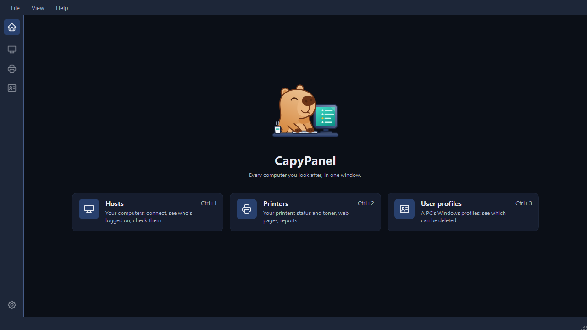

<p align="center">
  
</p>

<p align="center">
  <a href="README.md"></a>
  &nbsp;
  <a href="README.pt-BR.md"></a>
</p>

CapyPanel is a Windows desktop app for IT staff: keep the computers you look after in organized
lists, see which ones are on and who is logged on to them, and open a remote screen on any of
them through Remote Desktop or the VNC viewer you already use. It keeps your printers too, with
the details you need and their web pages a click away, and it finds the Windows user profiles
nobody uses any more on a PC so you can delete them.

> **Status: beta (0.27.0).** [Download the zip](https://github.com/gabrielmariense/CapyPanel/releases/latest),
> unzip it and run CapyPanel.exe. It updates itself when you say so.



## What it does

- Hosts
  - Remote connection: UltraVNC, RealVNC, Remote Desktop
  - Connection profiles
  - Accounts for other PCs, by PC, group or tag
  - Shared lists, groups and tags
  - Status, logged-on users, PC facts and mapped drives
  - Commands on a PC: its folders and consoles, its users, power and printers, with your own quick commands
  - Search, import and export
- Printers
  - Lists with brand, model, serial number and asset tag
  - Status, toner and supplies over SNMP, v2c or v3
  - Page counts from Doc360 MPS
  - Warnings when a printer needs attention
  - Web pages and reports
- User profiles
  - A PC's Windows profiles: who, when last used, how big
  - Which can be deleted, and why the others can't
  - Delete the ones you tick, on several PCs at once

## Documentation

Also online, with search: **[gabrielmariense.github.io/CapyPanel](https://gabrielmariense.github.io/CapyPanel/)**.

- [Download and updates](docs/download.md): the zip, checking it, updating, and running from
  source
- [Getting started](docs/getting-started.md): run CapyPanel, add your first hosts, check and
  connect
- [What's new](docs/whats-new.md): the changes in each release
- [Code signing policy](docs/code-signing.md): how releases are signed, who approves them, and
  what CapyPanel sends over the network
- [Host lists](docs/hosts/host-lists.md): groups and tags, finding a host, and hosts in and out
  of a spreadsheet
- [Connecting](docs/hosts/connecting.md): VNC viewers, Remote Desktop, connection profiles,
  accounts and passwords
- [Checking hosts](docs/hosts/checking.md): status, logged-on users and PC facts
- [Commands on a host](docs/hosts/commands.md): folders and consoles, messages, log off,
  restart, printers, installed programs and mapped drives
- [The Printers tool](docs/printers/printers.md): printers, their lists, details and web pages
- [Checking printers](docs/printers/checking.md): status, toner and supplies over SNMP
- [The User profiles tool](docs/profiles/user-profiles.md): a PC's Windows profiles, and
  deleting the ones nobody uses
- [Settings and files](docs/settings-and-files.md): every setting, and where CapyPanel keeps its
  files
- [Contributing](CONTRIBUTING.md): building, testing and translating

## Quick start

On Windows 10 22H2 or 11, download `CapyPanel-<version>-windows-x64.zip` from the
[latest release](https://github.com/gabrielmariense/CapyPanel/releases/latest), unzip it anywhere
and run **CapyPanel.exe**. No installer, no administrator rights. It isn't signed yet, so
SmartScreen may ask the first time: **More info**, then **Run anyway**. See the
[Code signing policy](docs/code-signing.md).

From source, with [uv](https://docs.astral.sh/uv/), which installs Python and everything else:

```
git clone https://github.com/gabrielmariense/CapyPanel.git
cd CapyPanel
uv run capypanel
```

Remote Desktop uses the client built into Windows. For VNC, install [UltraVNC](https://uvnc.com)
or [RealVNC Viewer](https://www.realvnc.com/en/connect/download/viewer/).

## License

[GPL-3.0](LICENSE).

Icons: [Tabler Icons](https://tabler.io/icons) (MIT), notice in
`src/capypanel/ui/tabler/LICENSE`.
