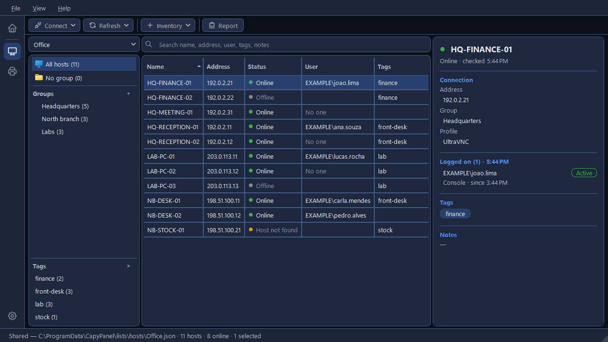

# CapyPanel documentation

Every computer you look after, in one window. CapyPanel is a Windows desktop app for IT staff:
keep the computers you look after in organized lists, see which ones are on and who is logged on
to them, and open a remote screen on any of them through Remote Desktop or the VNC viewer you
already use.

## What it does

- Remote connection
  - UltraVNC
  - RealVNC
  - Remote Desktop (RDP)
- Connection profiles
- Shared host lists
- Host status
- Logged-on users
- Search
- Import and export

## Pages

For people who use CapyPanel, and for people who set it up for a team.

| Page | What it covers |
|---|---|
| [Getting started](getting-started.md) | Running CapyPanel, the main window, adding hosts |
| [Host lists](host-lists.md) | Groups, tags, and the default, personal and shared lists |
| [Importing and exporting hosts](importing.md) | Many hosts at once, in and out as CSV |
| [Connecting](connecting.md) | VNC viewers, Remote Desktop, connection profiles, passwords and the login check |
| [Checking hosts](checking.md) | Status, logged-on users and the account used to read them |
| [Searching hosts](searching.md) | The search box, what it covers and how a search ends |
| [Settings and files](settings-and-files.md) | Every setting, and where CapyPanel keeps its files |
| [Development](development.md) | Building, testing and translating CapyPanel |

These pages describe the current version (0.18.0). CapyPanel is in beta, so they grow with each
feature.
