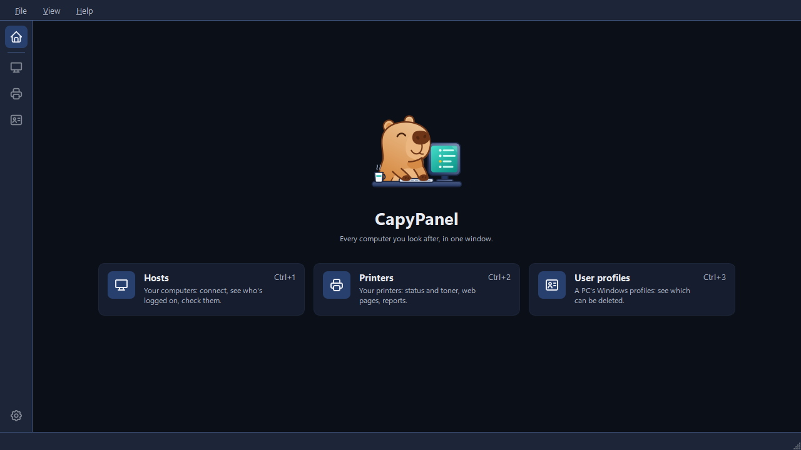

# CapyPanel documentation

Every computer you look after, in one window. CapyPanel is a Windows desktop app for IT staff:
keep the computers you look after in organized lists, see which ones are on and who is logged on
to them, and open a remote screen on any of them through Remote Desktop or the VNC viewer you
already use. It keeps your printers too, with the details you need and their web pages a click
away, and it finds the Windows user profiles nobody uses any more on a PC so you can delete them.

## What it does

- Hosts
  - Remote connection: UltraVNC, RealVNC, Remote Desktop
  - Connection profiles
  - Accounts for other PCs, by PC, group or tag
  - Shared lists, groups and tags
  - Status, logged-on users, PC facts and mapped drives
  - Commands on a PC: its folders and consoles, its users, power and printers, with your own quick commands
  - Search, import and export
- Printers
  - Lists with brand, model, serial number and asset tag
  - Status, toner and supplies over SNMP, v2c or v3
  - Page counts from Doc360 MPS
  - Warnings when a printer needs attention
  - Web pages and reports
- User profiles
  - A PC's Windows profiles: who, when last used, how big
  - Which can be deleted, and why the others can't
  - Delete the ones you tick, on several PCs at once

## Pages

Each page opens with the usual jobs as a few short steps. The details are folded underneath, and
every page ends with the messages you may see and what to do about them.

| Page | What it covers |
|---|---|
| [Getting started](getting-started.md) | Run CapyPanel, add your first hosts, check and connect |
| [Host lists](hosts/host-lists.md) | Groups and tags, finding a host, and hosts in and out of a spreadsheet |
| [Connecting](hosts/connecting.md) | VNC viewers, Remote Desktop, connection profiles, accounts and passwords |
| [Checking hosts](hosts/checking.md) | Status, logged-on users and PC facts |
| [Commands on a host](hosts/commands.md) | A PC's folders and consoles, its users, power, printers, programs and mapped drives |
| [The Printers tool](printers/printers.md) | Printers, their lists, details and web pages |
| [Checking printers](printers/checking.md) | Status, toner and supplies, warnings, SNMP and Doc360 MPS |
| [The User profiles tool](profiles/user-profiles.md) | A PC's Windows profiles, which can be deleted, and deleting them |
| [Settings and files](settings-and-files.md) | Every setting, and where CapyPanel keeps its files |

These pages describe the current version (0.25.0). CapyPanel is in beta, so they grow with each
feature.
