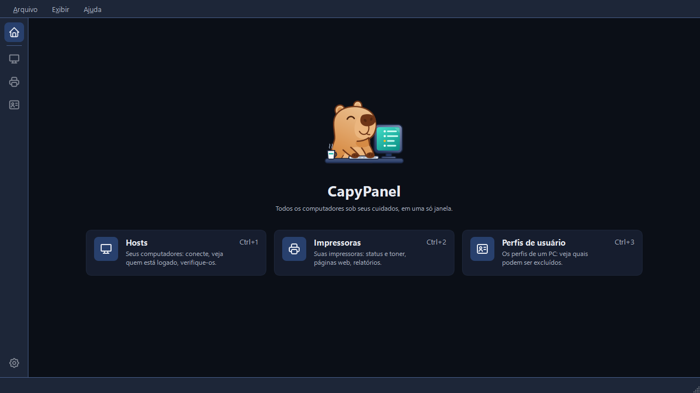

# Documentação do CapyPanel

Todos os computadores sob seus cuidados, em uma só janela. O CapyPanel é um app de desktop para
Windows feito para equipes de TI: organize em listas os computadores que você administra, veja
quais estão ligados e quem está logado neles, e abra a tela remota de qualquer um pela Área de
Trabalho Remota ou pelo visualizador VNC que você já usa. Ele guarda também as suas impressoras,
com os detalhes de que você precisa e a página web delas a um clique, e encontra num PC os perfis
de usuário do Windows que ninguém usa mais, para você excluí-los.

## O que ele faz

- Hosts
  - Conexão remota: UltraVNC, RealVNC, Área de Trabalho Remota
  - Perfis de conexão
  - Contas para outros PCs, por PC, grupo ou tag
  - Listas compartilhadas, grupos e tags
  - Status, usuários logados, dados do PC e unidades mapeadas
  - Comandos num PC: as pastas e os consoles dele, os usuários, a energia e as impressoras, com os seus comandos rápidos
  - Pesquisa, importação e exportação
- Impressoras
  - Listas com marca, modelo, nº de série e patrimônio
  - Status, toner e suprimentos por SNMP, v2c ou v3
  - Contadores de páginas do Doc360 MPS
  - Avisos quando uma impressora requer atenção
  - Páginas web e relatórios
- Perfis de usuário
  - Os perfis do Windows de um PC: de quem, último uso, tamanho
  - Quais podem ser excluídos, e por que os outros não
  - Excluir os que você marcar, em vários PCs ao mesmo tempo

## Páginas

Cada página abre com as tarefas de sempre em poucos passos curtos. Os detalhes ficam dobrados
embaixo, e toda página termina com as mensagens que você pode ver e o que fazer com elas.

| Página | O que ela cobre |
|---|---|
| [Baixar e atualizar](download.pt-BR.md) | O zip, como conferi-lo, as novas versões, e rodar pelo código-fonte |
| [Primeiros passos](getting-started.pt-BR.md) | Rodar o CapyPanel, adicionar seus primeiros hosts, verificar e conectar |
| [Novidades](whats-new.pt-BR.md) | As mudanças de cada versão |
| [Listas de hosts](hosts/host-lists.pt-BR.md) | Grupos e tags, encontrar um host, e hosts entrando e saindo de uma planilha |
| [Conectando](hosts/connecting.pt-BR.md) | Visualizadores VNC, Área de Trabalho Remota, perfis de conexão, contas e senhas |
| [Verificando hosts](hosts/checking.pt-BR.md) | Status, usuários logados e dados do PC |
| [Comandos em um host](hosts/commands.pt-BR.md) | As pastas e os consoles de um PC, os usuários, a energia, as impressoras, os programas e as unidades mapeadas |
| [A ferramenta Impressoras](printers/printers.pt-BR.md) | Impressoras, as listas delas, os detalhes e as páginas web |
| [Verificando impressoras](printers/checking.pt-BR.md) | Status, toner e suprimentos, avisos, SNMP e Doc360 MPS |
| [A ferramenta Perfis de usuário](profiles/user-profiles.pt-BR.md) | Os perfis do Windows de um PC, quais podem ser excluídos, e como excluí-los |
| [Configurações e arquivos](settings-and-files.pt-BR.md) | Cada configuração, e onde o CapyPanel guarda os arquivos |

Estas páginas descrevem a versão atual, a 0.26.0; [Novidades](whats-new.pt-BR.md) lista o que
mudou. O CapyPanel está em beta, então elas crescem a cada funcionalidade.
