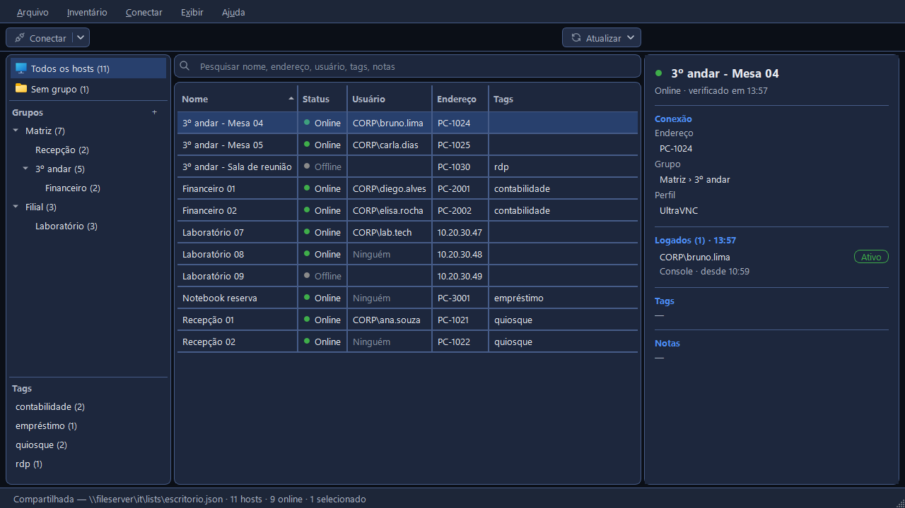

# Documentação do CapyPanel

Todos os computadores sob seus cuidados, em uma só janela. O CapyPanel é um app de desktop para
Windows feito para equipes de TI: organize em listas os computadores que você administra, veja
quais estão ligados e quem está logado neles, e abra a tela remota de qualquer um pela Área de
Trabalho Remota ou pelo visualizador VNC que você já usa. Ele guarda também as suas impressoras,
com os detalhes de que você precisa e a página web delas a um clique.

## O que ele faz

- Conexão remota
  - UltraVNC
  - RealVNC
  - Área de Trabalho Remota (RDP)
- Perfis de conexão
- Listas de hosts compartilhadas
- Status dos hosts
- Usuários logados
- Pesquisa
- Importação e exportação
- Inventário de impressoras
  - Marca, modelo, nº de série, patrimônio
  - Páginas web das impressoras
  - Status, toner e contadores de páginas por SNMP

## Páginas

Para quem usa o CapyPanel e para quem o configura para uma equipe.

| Página | O que ela cobre |
|---|---|
| [Primeiros passos](getting-started.pt-BR.md) | Rodar o CapyPanel, a janela principal, adicionar hosts |
| [Configurações e arquivos](settings-and-files.pt-BR.md) | Cada configuração e onde o CapyPanel guarda os arquivos |
| [Listas de hosts](hosts/host-lists.pt-BR.md) | Grupos, tags e as pastas em que as listas ficam |
| [Importando e exportando hosts](hosts/importing.pt-BR.md) | Muitos hosts de uma vez, entrando e saindo em CSV |
| [Conectando](hosts/connecting.pt-BR.md) | Visualizadores VNC, Área de Trabalho Remota, perfis de conexão, senhas e a verificação de login |
| [Verificando hosts](hosts/checking.pt-BR.md) | Status, usuários logados e a conta usada para lê-los |
| [Pesquisando hosts](hosts/searching.pt-BR.md) | A caixa de pesquisa, o que ela abrange e como encerrar uma pesquisa |
| [A ferramenta Impressoras](printers/printers.pt-BR.md) | A janela Impressoras, os detalhes de uma impressora e as páginas web |
| [Verificando impressoras](printers/checking.pt-BR.md) | Status, toner e suprimentos, e como são lidos |
| [Listas de impressoras](printers/printer-lists.pt-BR.md) | Onde as listas de impressoras ficam e as configurações delas |
| [Desenvolvimento](development.pt-BR.md) | Compilar, testar e traduzir o CapyPanel |

Primeiros passos, Configurações e arquivos e Desenvolvimento falam do app inteiro. As cinco páginas
depois deles são da ferramenta **Hosts**, e as três seguintes das **Impressoras**.

Estas páginas descrevem a versão atual (0.21.0). O CapyPanel está em beta, então elas crescem a
cada funcionalidade.
