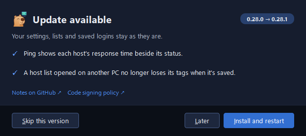

# Download and updates

CapyPanel comes as a zip: unzip it and run **CapyPanel.exe**. There's no installer and you don't
need administrator rights. It runs on Windows 10 22H2 or Windows 11, 64-bit.

## Download CapyPanel <a id="download-get-capypanel"></a>

1. Open the [latest release](https://github.com/gabrielmariense/CapyPanel/releases/latest) on
   GitHub.
2. Under **Assets**, download `CapyPanel-<version>-windows-x64.zip` (about 38 MB).
3. Unzip it into a folder your account can write to, such as one in your Documents.
4. Open the folder and run **CapyPanel.exe**.

Remote Desktop works out of the box. For VNC you also need a viewer:
[UltraVNC](https://uvnc.com) or [RealVNC Viewer](https://www.realvnc.com/en/connect/download/viewer/).
[Getting started](getting-started.md) takes it from there.

CapyPanel is applying to SignPath Foundation for free code signing; how releases will be signed is
in the [Code signing policy](code-signing.md).

??? note "Windows says it protected your PC"

    CapyPanel isn't signed yet, so the first time you run it Windows SmartScreen may say the
    publisher is unknown. Click **More info**, then **Run anyway**. Until it's signed, the SHA-256
    below is how you know the zip is the one GitHub built.

??? note "Check the download"

    Beside the zip, the release has `CapyPanel-<version>-windows-x64.zip.sha256`, a text file with
    the zip's SHA-256. In PowerShell, in the folder you downloaded to:

    ```
    (Get-FileHash .\CapyPanel-0.26.0-windows-x64.zip).Hash
    ```

    The letters it prints must be the ones in the `.sha256` file (upper or lower case doesn't
    matter). If they differ, the file was changed or cut short: download it again.

??? note "Where your settings live"

    Your settings, your lists and your saved logins aren't in the app's folder: they're in
    `C:\ProgramData\CapyPanel` (see [Where CapyPanel keeps its files](settings-and-files.md#where-capypanel-keeps-its-files)).
    So you can move the folder, or replace it with a newer one, and nothing is lost.

    For a USB stick or a shared folder, put an empty file named `capypanel.portable` next to
    **CapyPanel.exe**: everything is then kept in a `userdata` folder beside it instead.

??? note "Starting it twice"

    One copy of CapyPanel runs per Windows user. Starting it again, from the folder, a shortcut or
    the taskbar, brings the open window to the front, out of the tray too. Each person signed in to
    the PC can run their own.

## Update CapyPanel <a id="download-update-capypanel"></a>

When CapyPanel finds a newer release on its own, a window titled **CapyPanel** opens by itself,
once per run, headed **Update available**, and an **Update 0.28.1** button shows at the right end
of the menu bar. The window waits while a guide or another window is open, or while CapyPanel is in
the tray.



1. Read what changed. The window shows your version and the new one ("0.28.0 → 0.28.1"), each
   change on its own line with a ✓, and **Notes on GitHub** under them, in CapyPanel's language.
   The **Update** button on the menu bar opens it again.
2. Click **Install and restart**. Each step and the download's bar show at the bottom left, where
   **Skip this version** was, then "CapyPanel closes now and opens again by itself in a few
   seconds." While the files are swapped, CapyPanel's splash says "Updating to 0.28.1…".
3. CapyPanel opens again with **Update installed**, "0.28.0 → 0.28.1" and "Your settings, lists
   and saved logins are as they were.", the changes, and **Close**.

**Later** only closes the window: the button stays on the menu bar, and both come back at the next
start while that release is the newest. **Skip this version** stops the window and the button for
that version, until a newer release comes out (**Help > Check for updates…** still shows it); the
choice is only yours. While it downloads, **Later** reads **Cancel** and stops the download.

??? note "When CapyPanel looks for updates"

    By default CapyPanel asks GitHub (api.github.com) about a second after every start, then once a
    day while it stays open. **Settings > CapyPanel > General > Updates** has **At every start**,
    **Once a day**, **Once a week** and **Off**. It's one choice for everyone on this PC (see
    [Settings and files](settings-and-files.md#updates)). **Help > Check for updates…** looks
    right away, whatever is set, and says "You already have the newest version." when there's
    nothing newer.

    Only the question goes to GitHub. Nothing is downloaded until you click **Install and
    restart**.

??? note "What Install and restart does"

    1. **Downloading…**, then **Checking the file…**: it downloads the zip and checks it against
       its SHA-256.
    2. **Unpacking…**, then **Checking the new version…**: it unpacks the new version and runs its
       self-test, while CapyPanel is still open. If the test fails, CapyPanel stays as it is and the
       window says "The new version didn't pass its self-test".
    3. If a tool is busy, such as a printer Refresh or a profile being deleted, it waits for it
       ("Waiting for CapyPanel to finish what it's doing…") or asks you first. An SSH connection
       open in a separate window stops it: "1 SSH connection is still open in a separate window.
       Close it, then install the update." Nothing is installed until it's closed, and CapyPanel
       checks again just before it closes.
    4. CapyPanel closes. A small helper swaps the app's files for the new ones, with the splash
       saying "Updating to 0.26.4…", and starts the new version. Starting CapyPanel during the swap
       does no harm: that start just ends.
    5. If another program holds one of CapyPanel's files open, such as a CapyPanel in another
       Windows session or an antivirus in the middle of a scan, the helper stops before anything
       moves. If the new version won't start, the helper puts the old one back. Either way,
       CapyPanel opens as it was, with a window that says "The update to 0.28.1 wasn't
       installed.", why, and **Releases on GitHub**.

    When the update comes from a version older than 0.26.4, which doesn't test first, the helper
    runs the self-test itself before the swap.

    The download, the unpacked new version and the copy of the old one kept to go back to are in
    `%LOCALAPPDATA%\CapyPanel\update`, never in or beside CapyPanel's folder. The old copy is
    deleted as soon as the new version passes its self-test, and the rest when the new version
    starts. Every start also clears anything an update left behind, including the
    `CapyPanel.update` and `CapyPanel.previous` folders that 0.26.0 to 0.26.3 made beside
    CapyPanel's folder.

    Your settings, lists and saved logins are never touched.

## Run CapyPanel from source <a id="download-run-capypanel-from-source"></a>

For developers, or to try a change before it's released, you need
[uv](https://docs.astral.sh/uv/), which installs Python and everything else:

```
git clone https://github.com/gabrielmariense/CapyPanel.git
cd CapyPanel
uv run capypanel
```

The first run downloads Python and the libraries; later runs start right away. A copy run from
source doesn't update itself: use `git pull`. [Contributing](https://github.com/gabrielmariense/CapyPanel/blob/main/CONTRIBUTING.md)
has the rest.

## Messages you may see <a id="download-messages-you-may-see"></a>

| Message | What it means | What to do |
|---|---|---|
| <a id="update-check-failed"></a>"Couldn't check for updates." | GitHub didn't answer, or the PC isn't online | Try **Help > Check for updates…** later |
| <a id="update-certificate-error"></a>"Couldn't check for updates." with "Couldn't reach GitHub: [SSL: CERTIFICATE_VERIFY_FAILED] … unable to get local issuer certificate", in 0.27.1 or older | Those versions trust only the root certificates Windows has already stored on the PC, and this PC hadn't stored the one GitHub's certificate needs. From 0.28.0 on, Windows checks GitHub's certificate itself, as Edge does | Open https://api.github.com in Edge once, then **Help > Check for updates…** again |
| <a id="update-sha256-mismatch"></a>"The download doesn't match its SHA-256: it was changed or cut short." | The zip that arrived isn't the one GitHub built | Click **Install and restart** again |
| <a id="update-folder-not-writable"></a>"CapyPanel can't write to …, so the update can't be installed from here. Open Notes on GitHub, download the zip and unpack it in place of this copy.", in grey under the links, with no **Install and restart** | Your account can't write to CapyPanel's own folder, such as one in Program Files | Unzip the new version over the old one yourself, or move CapyPanel to a folder you can write to |
| <a id="update-from-source"></a>"This copy runs from source: update it with git, or download the zip from the release page." | You started CapyPanel with `uv run` | `git pull`, or switch to the zip |
| <a id="update-self-test-failed"></a>"The new version didn't pass its self-test" | The downloaded version failed its own check, so nothing was changed | Try **Install and restart** again later; **Report a problem** if it keeps failing |
| <a id="update-not-installed"></a>"The update to 0.28.1 wasn't installed." and "You still have CapyPanel 0.28.0.", then the reason | The new version wouldn't start, so the old one was put back | Read the reason; **Report a problem** if it isn't clear |
| <a id="update-swap-failed"></a>"Couldn't put the new version in place: …" as that reason | Another program held one of CapyPanel's files open, so the update stopped with nothing changed | Close what holds it, such as a CapyPanel in another Windows session, and update again |
| <a id="update-ssh-windows-open"></a>"1 SSH connection is still open in a separate window. Close it, then install the update." | That window runs from CapyPanel's folder, so its files can't be replaced while it's open | Close the window, then **Install and restart** again |
| <a id="update-already-running"></a>"CapyPanel is already running for EXAMPLE\user, but its window couldn't be brought forward: …" | Your other copy is open in another Windows session, or isn't answering | Close it there, or end it in Task Manager, then start CapyPanel again |
