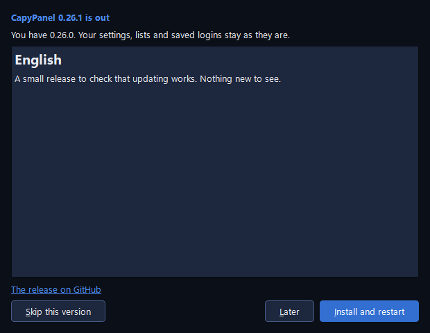

# Download and updates

CapyPanel comes as a zip: unzip it and run **CapyPanel.exe**. There's no installer and you don't
need administrator rights. It runs on Windows 10 22H2 or Windows 11, 64-bit.

## Download CapyPanel

1. Open the [latest release](https://github.com/gabrielmariense/CapyPanel/releases/latest) on
   GitHub.
2. Under **Assets**, download `CapyPanel-<version>-windows-x64.zip` (about 38 MB).
3. Unzip it into a folder your account can write to, such as one in your Documents.
4. Open the folder and run **CapyPanel.exe**.

Remote Desktop works out of the box. For VNC you also need a viewer:
[UltraVNC](https://uvnc.com) or [RealVNC Viewer](https://www.realvnc.com/en/connect/download/viewer/).
[Getting started](getting-started.md) takes it from there.

CapyPanel is applying to SignPath Foundation for free code signing; how releases will be signed is
in the [Code signing policy](code-signing.md).

??? note "Windows says it protected your PC"

    CapyPanel isn't signed yet, so the first time you run it Windows SmartScreen may say the
    publisher is unknown. Click **More info**, then **Run anyway**. Until it's signed, the SHA-256
    below is how you know the zip is the one GitHub built.

??? note "Check the download"

    Beside the zip, the release has `CapyPanel-<version>-windows-x64.zip.sha256`, a text file with
    the zip's SHA-256. In PowerShell, in the folder you downloaded to:

    ```
    (Get-FileHash .\CapyPanel-0.26.0-windows-x64.zip).Hash
    ```

    The letters it prints must be the ones in the `.sha256` file (upper or lower case doesn't
    matter). If they differ, the file was changed or cut short: download it again.

??? note "Where your settings live"

    Your settings, your lists and your saved logins aren't in the app's folder: they're in
    `C:\ProgramData\CapyPanel` (see [Where CapyPanel keeps its files](settings-and-files.md#where-capypanel-keeps-its-files)).
    So you can move the folder, or replace it with a newer one, and nothing is lost.

    For a USB stick or a shared folder, put an empty file named `capypanel.portable` next to
    **CapyPanel.exe**: everything is then kept in a `userdata` folder beside it instead.

??? note "Starting it twice"

    One copy of CapyPanel runs per Windows user. Starting it again, from the folder, a shortcut or
    the taskbar, brings the open window to the front, out of the tray too. Each person signed in to
    the PC can run their own.

## Update CapyPanel

When CapyPanel finds a newer release on its own, the **Update CapyPanel** window opens by itself,
once per run, and an **Update 0.26.2** button shows at the right end of the menu bar. The window
waits while a guide or another window is open, or while CapyPanel is in the tray.



1. Read what changed in the **Update CapyPanel** window, or click the **Update** button to open
   it. The notes show in CapyPanel's language.
2. Click **Install and restart**. The window shows each step, then says "CapyPanel closes now and
   opens again by itself in a few seconds." While the files are swapped, CapyPanel's splash says
   "Updating to 0.26.4…".
3. It opens with a window that says "CapyPanel 0.26.2 is installed" and "Updated from 0.26.1. Your
   settings, lists and saved logins are as they were.", with the notes and a link to the release.

**Later** only closes the window: the button stays on the menu bar, and both come back at the next
start while that release is the newest. **Skip this version** stops the window and the button for
that version, until a newer release comes out (**Help > Check for updates…** still shows it); the
choice is only yours. While it downloads, **Later** reads **Cancel** and stops the download.

??? note "When CapyPanel looks for updates"

    By default CapyPanel asks GitHub (api.github.com) about a second after every start, then once a
    day while it stays open. **Settings > CapyPanel > General > Updates** has **At every start**,
    **Once a day**, **Once a week** and **Off**. It's one choice for everyone on this PC (see
    [Settings and files](settings-and-files.md#updates)). **Help > Check for updates…** looks
    right away, whatever is set, and also says when you're up to date.

    Only the question goes to GitHub. Nothing is downloaded until you click **Install and
    restart**.

??? note "What Install and restart does"

    1. **Downloading…**, then **Checking the file…**: it downloads the zip and checks it against
       its SHA-256.
    2. **Unpacking…**, then **Checking the new version…**: it unpacks the new version and runs its
       self-test, while CapyPanel is still open. If the test fails, CapyPanel stays as it is and the
       window says "The new version didn't pass its self-test".
    3. If a tool is busy, such as a printer Refresh or a profile being deleted, it waits for it
       ("Waiting for CapyPanel to finish what it's doing…") or asks you first.
    4. CapyPanel closes. A small helper swaps the app's files for the new ones, with the splash
       saying "Updating to 0.26.4…", and starts the new version. Starting CapyPanel during the swap
       does no harm: that start just ends.
    5. If the new version won't start, the helper puts the old one back. CapyPanel then opens with
       a window that says "The update to 0.26.4 didn't go in", why, and a link to the releases on
       GitHub.

    When the update comes from a version older than 0.26.4, which doesn't test first, the helper
    runs the self-test itself before the swap.

    Your settings, lists and saved logins are never touched.

## Run CapyPanel from source

For developers, or to try a change before it's released, you need
[uv](https://docs.astral.sh/uv/), which installs Python and everything else:

```
git clone https://github.com/gabrielmariense/CapyPanel.git
cd CapyPanel
uv run capypanel
```

The first run downloads Python and the libraries; later runs start right away. A copy run from
source doesn't update itself: use `git pull`. [Contributing](https://github.com/gabrielmariense/CapyPanel/blob/main/CONTRIBUTING.md)
has the rest.

## Messages you may see

| Message | What it means | What to do |
|---|---|---|
| "Couldn't check for updates." | GitHub didn't answer, or the PC isn't online | Try **Help > Check for updates…** later |
| "The download doesn't match its SHA-256: it was changed or cut short." | The zip that arrived isn't the one GitHub built | Click **Install and restart** again |
| "CapyPanel can't install it from here (CapyPanel can't write to …). Download the zip from the release page and unpack it in place of this one." | Your account can't write to the folder CapyPanel is in, such as Program Files | Unzip the new version over the old one yourself, or move CapyPanel to a folder you can write to |
| "This copy runs from source: update it with git, or download the zip from the release page." | You started CapyPanel with `uv run` | `git pull`, or switch to the zip |
| "The new version didn't pass its self-test" | The downloaded version failed its own check, so nothing was changed | Try **Install and restart** again later; **Report a problem** if it keeps failing |
| "The update to 0.26.2 didn't go in" and "This is still CapyPanel 0.26.1: …" | The new version wouldn't start, so the old one was put back | Read the reason after the colon; **Report a problem** if it isn't clear |
| "CapyPanel is already running for EXAMPLE\user, but its window couldn't be brought forward: …" | Your other copy is open in another Windows session, or isn't answering | Close it there, or end it in Task Manager, then start CapyPanel again |
