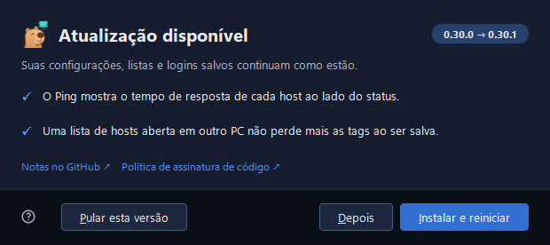

# Baixar e atualizar

O CapyPanel vem num zip: descompacte e rode o **CapyPanel.exe**. Não há instalador e você não
precisa de direitos de administrador. Ele roda no Windows 10 22H2 ou no Windows 11, de 64 bits.

## Baixar o CapyPanel <a id="download-get-capypanel"></a>

1. Abra a [versão mais recente](https://github.com/gabrielmariense/CapyPanel/releases/latest) no
   GitHub.
2. Em **Assets**, baixe o `CapyPanel-<versão>-windows-x64.zip` (uns 38 MB).
3. Descompacte numa pasta em que a sua conta possa gravar, como uma dentro de Documentos.
4. Abra a pasta e rode o **CapyPanel.exe**.

A Área de Trabalho Remota funciona de cara. Para o VNC você também precisa de um visualizador: o
[UltraVNC](https://uvnc.com) ou o
[RealVNC Viewer](https://www.realvnc.com/en/connect/download/viewer/).
Os [Primeiros passos](getting-started.pt-BR.md) seguem daí.

O CapyPanel está se candidatando à SignPath Foundation para assinar as versões de graça; como elas
serão assinadas está na [Política de assinatura de código (Code signing policy)](code-signing.pt-BR.md).

??? note "O Windows diz que protegeu o computador"

    O CapyPanel ainda não é assinado, então na primeira vez que você o roda o SmartScreen do Windows
    pode dizer que o editor é desconhecido. Clique em **Mais informações** e depois em **Executar
    assim mesmo**. Enquanto ele não é assinado, o SHA-256 abaixo é como você sabe que o zip é o que
    o GitHub gerou.

??? note "Conferir o download"

    Ao lado do zip, a versão tem o `CapyPanel-<versão>-windows-x64.zip.sha256`, um arquivo de texto
    com o SHA-256 do zip. No PowerShell, na pasta em que você baixou:

    ```
    (Get-FileHash .\CapyPanel-0.26.0-windows-x64.zip).Hash
    ```

    As letras que ele mostra precisam ser as do arquivo `.sha256` (maiúsculas ou minúsculas não
    importam). Se forem diferentes, o arquivo foi alterado ou veio incompleto: baixe de novo.

??? note "Onde ficam as suas configurações"

    As suas configurações, as suas listas e os seus logins salvos não ficam na pasta do app: ficam
    em `C:\ProgramData\CapyPanel` (veja
    [Onde o CapyPanel guarda os arquivos](settings-and-files.pt-BR.md#onde-o-capypanel-guarda-os-arquivos)).
    Então você pode mover a pasta, ou trocá-la por uma mais nova, e nada se perde.

    Para um pendrive ou uma pasta compartilhada, coloque um arquivo vazio chamado
    `capypanel.portable` ao lado do **CapyPanel.exe**: tudo passa a ficar numa pasta `userdata` ao
    lado dele.

??? note "Abrir duas vezes"

    Roda uma cópia do CapyPanel por usuário do Windows. Abri-lo de novo, pela pasta, por um atalho
    ou pela barra de tarefas, traz a janela aberta para a frente, inclusive da bandeja. Cada pessoa
    conectada ao PC pode rodar a sua.

## Atualizar o CapyPanel <a id="download-update-capypanel"></a>

Quando o CapyPanel encontra sozinho uma versão mais nova, uma janela com o título **CapyPanel**
abre sozinha, uma vez por execução, com **Atualização disponível** no topo, e um botão **Nova
versão 0.28.1** aparece na ponta direita da barra de menus. A janela espera enquanto um guia ou
outra janela está aberta, ou enquanto o CapyPanel está na bandeja.



1. Leia o que mudou. A janela mostra a sua versão e a nova ("0.28.0 → 0.28.1"), cada mudança na
   sua linha com um ✓, e **Notas no GitHub** embaixo delas, no idioma do CapyPanel. O botão **Nova
   versão** na barra de menus abre a janela de novo.
2. Clique em **Instalar e reiniciar**. Cada passo e a barra do download aparecem embaixo, à
   esquerda, onde estava o **Pular esta versão**, e depois "O CapyPanel fecha agora e abre de novo
   sozinho em alguns segundos." Enquanto os arquivos são trocados, a tela de abertura do CapyPanel
   diz "Atualizando para a 0.28.1…".
3. O CapyPanel abre de novo com **Atualização instalada**, "0.28.0 → 0.28.1" e "Suas
   configurações, listas e logins salvos continuam como estavam.", as mudanças, e **Fechar**.

O **Depois** só fecha a janela: o botão continua na barra de menus, e os dois voltam no próximo
início enquanto aquela versão for a mais nova. O **Pular esta versão** para a janela e o botão
daquela versão, até sair uma versão mais nova (o **Ajuda > Procurar nova versão…** ainda a mostra);
a escolha é só sua. Durante o download, o **Depois** vira **Cancelar** e interrompe o download.

??? note "Quando o CapyPanel procura uma nova versão"

    Por padrão o CapyPanel pergunta ao GitHub (api.github.com) mais ou menos um segundo depois de
    cada início, e depois uma vez por dia enquanto fica aberto. **Configurações > CapyPanel > Geral >
    Novas versões** tem **A cada início**, **Uma vez por dia**, **Uma vez por semana** e
    **Desligado**. É uma escolha só para todos neste PC (veja
    [Configurações e arquivos](settings-and-files.pt-BR.md#novas-versoes)). O **Ajuda > Procurar
    nova versão…** procura na hora, seja qual for a opção, e diz "Você já tem a versão mais nova."
    quando não há nenhuma mais nova.

    Só a pergunta vai para o GitHub. Nada é baixado até você clicar em **Instalar e reiniciar**.

??? note "O que o Instalar e reiniciar faz"

    1. **Baixando…** e depois **Conferindo o arquivo…**: baixa o zip e o confere com o SHA-256
       dele.
    2. **Descompactando…** e depois **Conferindo a nova versão…**: descompacta a versão nova e roda
       o autoteste dela, com o CapyPanel ainda aberto. Se o teste falhar, o CapyPanel fica como está
       e a janela diz "A versão nova não passou no autoteste".
    3. Se uma ferramenta está ocupada, como um Atualizar de impressoras ou um perfil sendo excluído,
       ele espera ("Esperando o CapyPanel terminar o que está fazendo…") ou pergunta antes. Uma
       conexão SSH aberta numa janela separada impede a atualização: "1 conexão SSH ainda está
       aberta numa janela separada. Feche-a e depois instale a atualização." Nada é instalado até
       ela ser fechada, e o CapyPanel confere de novo logo antes de fechar.
    4. O CapyPanel fecha. Um pequeno ajudante troca os arquivos do app pelos novos, com a tela de
       abertura dizendo "Atualizando para a 0.26.4…", e abre a versão nova. Abrir o CapyPanel
       durante a troca não causa problema: essa abertura simplesmente termina.
    5. Se outro programa estiver com um arquivo do CapyPanel aberto, como um CapyPanel em outra
       sessão do Windows ou um antivírus no meio de uma verificação, o ajudante para antes de mover
       qualquer coisa. Se a versão nova não abrir, o ajudante põe a antiga de volta. Nos dois
       casos, o CapyPanel abre como estava, com uma janela que diz "A atualização para a 0.28.1 não
       foi instalada.", por quê, e **Versões no GitHub**.

    Quando a atualização vem de uma versão anterior à 0.26.4, que não testa antes, o ajudante roda
    o autoteste ele mesmo antes da troca.

    O download, a versão nova descompactada e a cópia da antiga guardada para voltar ficam em
    `%LOCALAPPDATA%\CapyPanel\update`, nunca dentro nem ao lado da pasta do CapyPanel. A cópia
    antiga é apagada assim que a versão nova passa no autoteste, e o resto quando a versão nova
    abre. Cada início também limpa o que uma atualização deixou para trás, inclusive as pastas
    `CapyPanel.update` e `CapyPanel.previous` que as versões 0.26.0 a 0.26.3 criavam ao lado da
    pasta do CapyPanel.

    As suas configurações, listas e logins salvos nunca são mexidos.

## Rodar o CapyPanel pelo código-fonte <a id="download-run-capypanel-from-source"></a>

Para quem desenvolve, ou para testar uma mudança antes de ela sair numa versão, você precisa do
[uv](https://docs.astral.sh/uv/), que instala o Python e todo o resto:

```
git clone https://github.com/gabrielmariense/CapyPanel.git
cd CapyPanel
uv run capypanel
```

A primeira execução baixa o Python e as bibliotecas; as seguintes abrem na hora. Uma cópia rodando
pelo código-fonte não se atualiza sozinha: use `git pull`. O
[Contribuindo](https://github.com/gabrielmariense/CapyPanel/blob/main/CONTRIBUTING.pt-BR.md) tem o
resto.

## Mensagens que você pode ver <a id="download-messages-you-may-see"></a>

| Mensagem | O que significa | O que fazer |
|---|---|---|
| <a id="update-check-failed"></a>"Não foi possível procurar uma nova versão." | O GitHub não respondeu, ou o PC está sem internet | Tente o **Ajuda > Procurar nova versão…** mais tarde |
| <a id="update-certificate-error"></a>"Não foi possível procurar uma nova versão." com "Não foi possível falar com o GitHub: [SSL: CERTIFICATE_VERIFY_FAILED] … unable to get local issuer certificate", na 0.27.1 ou anterior | Essas versões só confiam nos certificados raiz que o Windows já guardou no PC, e este PC ainda não tinha guardado o de que o certificado do GitHub precisa. Da 0.28.0 em diante, o próprio Windows confere o certificado do GitHub, como o Edge faz | Abra https://api.github.com no Edge uma vez, e depois o **Ajuda > Procurar nova versão…** de novo |
| <a id="update-sha256-mismatch"></a>"O download não confere com o SHA-256: foi alterado ou veio incompleto." | O zip que chegou não é o que o GitHub gerou | Clique em **Instalar e reiniciar** de novo |
| <a id="update-folder-not-writable"></a>"O CapyPanel não consegue gravar em …, então a atualização não pode ser instalada daqui. Abra Notas no GitHub, baixe o zip e descompacte-o no lugar desta cópia.", em cinza embaixo dos links, sem o **Instalar e reiniciar** | A sua conta não pode gravar na própria pasta do CapyPanel, como uma dentro de Arquivos de Programas | Descompacte a versão nova por cima da antiga você mesmo, ou mova o CapyPanel para uma pasta em que você possa gravar |
| <a id="update-from-source"></a>"Esta cópia roda a partir do código-fonte: atualize com o git, ou baixe o zip na página da versão." | Você abriu o CapyPanel com o `uv run` | `git pull`, ou passe a usar o zip |
| <a id="update-self-test-failed"></a>"A versão nova não passou no autoteste" | A versão baixada falhou na própria conferência, então nada foi mudado | Tente o **Instalar e reiniciar** de novo mais tarde; use o **Relatar um problema** se continuar falhando |
| <a id="update-not-installed"></a>"A atualização para a 0.28.1 não foi instalada." e "Você continua com o CapyPanel 0.28.0.", e depois o motivo | A versão nova não abriu, então a antiga voltou | Leia o motivo; use o **Relatar um problema** se não ficar claro |
| <a id="update-swap-failed"></a>"Não foi possível colocar a versão nova no lugar: …" como motivo | Outro programa estava com um arquivo do CapyPanel aberto, então a atualização parou sem mudar nada | Feche o que estiver com o arquivo, como um CapyPanel em outra sessão do Windows, e atualize de novo |
| <a id="update-ssh-windows-open"></a>"1 conexão SSH ainda está aberta numa janela separada. Feche-a e depois instale a atualização." | Essa janela roda da pasta do CapyPanel, então os arquivos não podem ser trocados enquanto ela estiver aberta | Feche a janela e clique em **Instalar e reiniciar** de novo |
| <a id="update-already-running"></a>"O CapyPanel já está em execução para EXAMPLE\user, mas não foi possível trazer a janela dele para a frente: …" | A sua outra cópia está aberta em outra sessão do Windows, ou não está respondendo | Feche-a por lá, ou finalize-a no Gerenciador de Tarefas, e abra o CapyPanel de novo |
