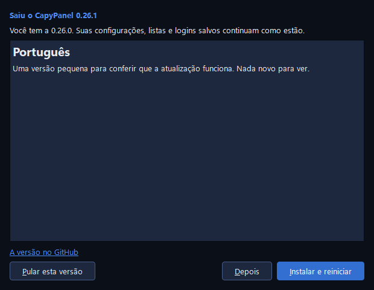

# Baixar e atualizar

O CapyPanel vem num zip: descompacte e rode o **CapyPanel.exe**. Não há instalador e você não
precisa de direitos de administrador. Ele roda no Windows 10 22H2 ou no Windows 11, de 64 bits.

## Baixar o CapyPanel

1. Abra a [versão mais recente](https://github.com/gabrielmariense/CapyPanel/releases/latest) no
   GitHub.
2. Em **Assets**, baixe o `CapyPanel-<versão>-windows-x64.zip` (uns 38 MB).
3. Descompacte numa pasta em que a sua conta possa gravar, como uma dentro de Documentos.
4. Abra a pasta e rode o **CapyPanel.exe**.

A Área de Trabalho Remota funciona de cara. Para o VNC você também precisa de um visualizador: o
[UltraVNC](https://uvnc.com) ou o
[RealVNC Viewer](https://www.realvnc.com/en/connect/download/viewer/).
Os [Primeiros passos](getting-started.pt-BR.md) seguem daí. Como as versões são assinadas está
na [Política de assinatura de código (Code signing policy)](code-signing.pt-BR.md).

??? note "O Windows diz que protegeu o computador"

    O CapyPanel ainda não é assinado, então na primeira vez que você o roda o SmartScreen do Windows
    pode dizer que o editor é desconhecido. Clique em **Mais informações** e depois em **Executar
    assim mesmo**. Enquanto ele não é assinado, o SHA-256 abaixo é como você sabe que o zip é o que
    o GitHub gerou.

??? note "Conferir o download"

    Ao lado do zip, a versão tem o `CapyPanel-<versão>-windows-x64.zip.sha256`, um arquivo de texto
    com o SHA-256 do zip. No PowerShell, na pasta em que você baixou:

    ```
    (Get-FileHash .\CapyPanel-0.26.0-windows-x64.zip).Hash
    ```

    As letras que ele mostra precisam ser as do arquivo `.sha256` (maiúsculas ou minúsculas não
    importam). Se forem diferentes, o arquivo foi alterado ou veio incompleto: baixe de novo.

??? note "Onde ficam as suas configurações"

    As suas configurações, as suas listas e os seus logins salvos não ficam na pasta do app: ficam
    em `C:\ProgramData\CapyPanel` (veja
    [Onde o CapyPanel guarda os arquivos](settings-and-files.pt-BR.md#onde-o-capypanel-guarda-os-arquivos)).
    Então você pode mover a pasta, ou trocá-la por uma mais nova, e nada se perde.

    Para um pendrive ou uma pasta compartilhada, coloque um arquivo vazio chamado
    `capypanel.portable` ao lado do **CapyPanel.exe**: tudo passa a ficar numa pasta `userdata` ao
    lado dele.

??? note "Abrir duas vezes"

    Roda uma cópia do CapyPanel por usuário do Windows. Abri-lo de novo, pela pasta, por um atalho
    ou pela barra de tarefas, traz a janela aberta para a frente, inclusive da bandeja. Cada pessoa
    conectada ao PC pode rodar a sua.

## Atualizar o CapyPanel

Quando sai uma versão mais nova, um botão **Nova versão 0.26.1** aparece na ponta direita da barra
de menus.



1. Clique nele. A janela **Nova versão do CapyPanel** mostra o que mudou.
2. Clique em **Instalar e reiniciar**. O CapyPanel baixa o zip, fecha e abre de novo na versão
   nova.
3. A janela então diz "Instalada a versão 0.26.1 (antes era a 0.26.0)."

O **Depois** só fecha a janela: o botão continua, e volta no próximo início enquanto aquela versão
for a mais nova. O **Pular esta versão** esconde o botão até sair uma versão mais nova (o **Ajuda >
Procurar nova versão…** ainda a mostra); a escolha é só sua. Durante o download, o **Depois** vira
**Cancelar** e interrompe o download.

??? note "Quando o CapyPanel procura uma nova versão"

    Por padrão o CapyPanel pergunta ao GitHub (api.github.com) uns 15 segundos depois de cada
    início, e depois uma vez por dia enquanto fica aberto. **Configurações > CapyPanel > Geral >
    Novas versões** tem **A cada início**, **Uma vez por dia**, **Uma vez por semana** e
    **Desligado**. É uma escolha só para todos neste PC (veja
    [Configurações e arquivos](settings-and-files.pt-BR.md#novas-versoes)). O **Ajuda > Procurar
    nova versão…** procura na hora, seja qual for a opção, e também diz quando você já tem a mais
    nova.

    Só a pergunta vai para o GitHub. Nada é baixado até você clicar em **Instalar e reiniciar**.

??? note "O que o Instalar e reiniciar faz"

    1. Baixa o zip e o confere com o SHA-256 dele.
    2. Se uma ferramenta está ocupada, como um Atualizar de impressoras ou um perfil sendo excluído,
       ele espera ("Esperando o CapyPanel terminar o que está fazendo…") ou pergunta antes.
    3. O CapyPanel fecha. Um pequeno ajudante troca os arquivos do app pelos novos e abre a versão
       nova.
    4. Se a versão nova não abrir, o ajudante põe a antiga de volta, e a janela diz por quê.

    As suas configurações, listas e logins salvos nunca são mexidos.

## Rodar o CapyPanel pelo código-fonte

Para quem desenvolve, ou para testar uma mudança antes de ela sair numa versão, você precisa do
[uv](https://docs.astral.sh/uv/), que instala o Python e todo o resto:

```
git clone https://github.com/gabrielmariense/CapyPanel.git
cd CapyPanel
uv run capypanel
```

A primeira execução baixa o Python e as bibliotecas; as seguintes abrem na hora. Uma cópia rodando
pelo código-fonte não se atualiza sozinha: use `git pull`. O
[Contribuindo](https://github.com/gabrielmariense/CapyPanel/blob/main/CONTRIBUTING.pt-BR.md) tem o
resto.

## Mensagens que você pode ver

| Mensagem | O que significa | O que fazer |
|---|---|---|
| "Não foi possível procurar uma nova versão." | O GitHub não respondeu, ou o PC está sem internet | Tente o **Ajuda > Procurar nova versão…** mais tarde |
| "O download não confere com o SHA-256: foi alterado ou veio incompleto." | O zip que chegou não é o que o GitHub gerou | Clique em **Instalar e reiniciar** de novo |
| "O CapyPanel não consegue instalá-la daqui (O CapyPanel não consegue gravar em …). Baixe o zip na página da versão e descompacte-o no lugar deste." | A sua conta não pode gravar na pasta em que o CapyPanel está, como a Arquivos de Programas | Descompacte a versão nova por cima da antiga você mesmo, ou mova o CapyPanel para uma pasta em que você possa gravar |
| "Esta cópia roda a partir do código-fonte: atualize com o git, ou baixe o zip na página da versão." | Você abriu o CapyPanel com o `uv run` | `git pull`, ou passe a usar o zip |
| "A versão 0.26.1 não foi instalada, então esta continua sendo a 0.26.0: …" | A versão nova não abriu, então a antiga voltou | Leia o motivo depois dos dois-pontos; use o **Relatar um problema** se não ficar claro |
| "O CapyPanel já está em execução para EXAMPLE\user, mas não foi possível trazer a janela dele para a frente: …" | A sua outra cópia está aberta em outra sessão do Windows, ou não está respondendo | Feche-a por lá, ou finalize-a no Gerenciador de Tarefas, e abra o CapyPanel de novo |
