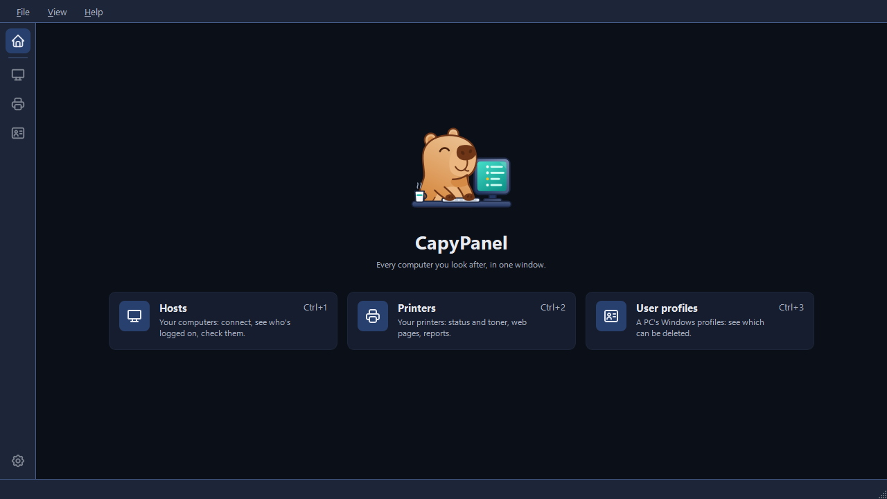
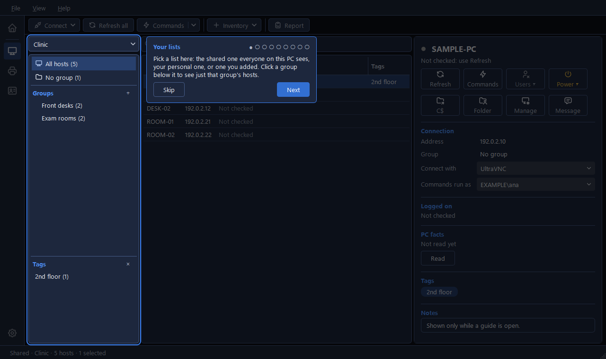
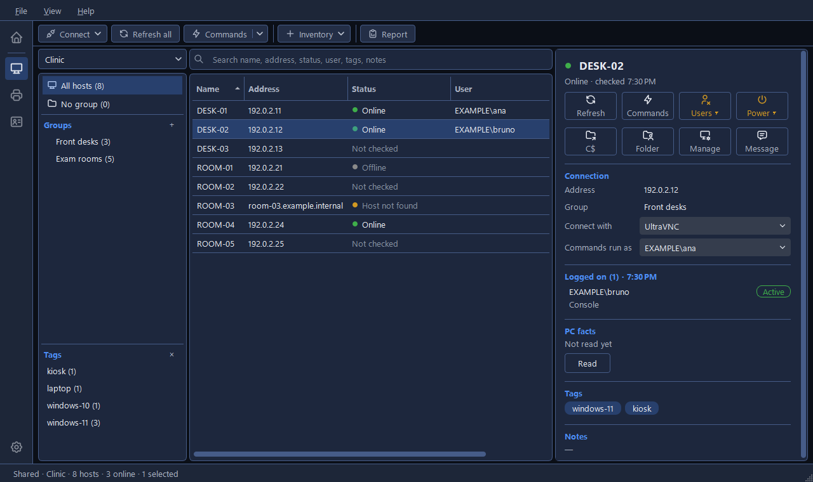
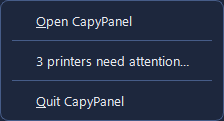

# Getting started

This page takes you from a first start to your first list of PCs, checked and connected. The guide
CapyPanel shows the first time each screen opens points out the window itself.

## Run CapyPanel

1. [Download the zip](download.md#download-capypanel) and unzip it.
2. Run **CapyPanel.exe**. A splash with the capybara and the version shows while it loads.

CapyPanel runs on Windows 10 22H2 or Windows 11. Remote Desktop works out of the box. For VNC you
also need a viewer: [UltraVNC](https://uvnc.com) or
[RealVNC Viewer](https://www.realvnc.com/en/connect/download/viewer/).

CapyPanel opens on its Home page, with a tile for each tool: **Hosts** (Ctrl+1), **Printers**
(Ctrl+2) and **User profiles** (Ctrl+3). Click **Hosts** to start.

The first time each screen opens, a guide of a few cards shows what's on it, on a sample PC or
printer that goes away when it ends. The rest of the window is dimmed until you finish or click
**Skip**. **Help > Guide to this screen** shows it again.

??? note "More about starting"

    - The version shows in the title bar, followed by a build number and the commit, e.g.
      `CapyPanel 0.26.0 build 514 (abc1234)`; a bigger build number is a newer build. Quote it when
      you report a problem.
    - The first start speaks the language Windows is shown in: Portuguese for any Portuguese,
      English for the rest. **Settings > CapyPanel > General > Language** changes it.
    - One copy runs per Windows user. Starting CapyPanel again brings the open window to the front,
      out of the tray too.
    - While a guide runs, only its card's buttons work, and nothing is read from the sample or
      saved. Someone who used CapyPanel before 0.26 doesn't get the guides on their own; **Help >
      Show all the guides again** brings them all back, each the next time its screen opens.
    - Home is the top button on the sidebar, **View > Home**, and **Ctrl+0**. Every tool is always
      there; there's nothing to turn on. To start somewhere else, set **Settings > CapyPanel >
      General > Open on startup** to the last used tool, or to one by name.
    - The tiles say what each tool is for: Hosts "Your computers: connect, see who's logged on,
      check them.", Printers "Your printers: status and toner, web pages, reports.", User profiles
      "A PC's Windows profiles: see which can be deleted."

## Add your first hosts

1. **Inventory > Add host…** (Ctrl+N).
2. Type a **Name** and an **Address**, a computer name or IP address. Leave the address blank if
   the name *is* the computer name (e.g. `PC-1234`).
3. Pick a **Group**, add **Tags** if you like (type one and press Enter), and click **Add**.

Edits are saved to the list file at once; there's no Save button. To add many hosts at once, from a
spreadsheet or another inventory, see
[Add hosts from a spreadsheet](hosts/host-lists.md#add-hosts-from-a-spreadsheet). To make groups,
see [Host lists](hosts/host-lists.md).

??? note "More about adding hosts"

    - A new list starts with one group, **Default group**. **Inventory > Add group…**
      (Ctrl+Shift+N) creates another; with a group selected, the new one goes inside it. The **+**
      beside the **Groups** heading, and a right-click on the heading or on empty space, add one at
      the top level instead.
    - **No group** is a choice too, for a host that doesn't belong anywhere yet.
    - **Connection profile** says how to reach the host; "From group" follows the group's profile
      (see [Connecting](hosts/connecting.md)).
    - In the Tags box, Backspace on an empty box brings the last tag back for editing.
    - An empty list shows **Add host…** and **Import hosts…** buttons right there.

## Check them and connect

1. Click **Refresh all** on the toolbar (F5). The **Status** column says which hosts are online,
   and **User** who is logged on.
2. Select a host: the Details panel shows its buttons, its connection, who's logged on and what the
   PC is.
3. Double-click the host, or press **Enter**, to open its screen.

See [Checking hosts](hosts/checking.md), [Connecting](hosts/connecting.md) and
[Commands on a host](hosts/commands.md) for what comes next.

??? note "The window, part by part"

    | Part | What it shows |
    |---|---|
    | **The sidebar** (left edge) | **Home** (Ctrl+0) at the top, then one icon per tool, **Hosts** (Ctrl+1), **Printers** (Ctrl+2) and **User profiles** (Ctrl+3), and **Settings** (Ctrl+,) at the bottom. Where you are has a tinted square behind its icon |
    | **Toolbar** (top) | The buttons of the tool you're in. For Hosts: **Connect**, **Refresh all**, **Commands**, **Inventory** and **Report** |
    | **Groups panel** (left) | The open list's name on top, as a dropdown that switches lists. Then "All hosts" with how many hosts the list has, and "No group" with how many are in none. Then **Groups**, with a **+** button to add one, and **Tags**; drag the line above Tags to give either more room, and it's remembered |
    | **Hosts panel** (middle) | The search box above the hosts in the selected group or tag, with their **Status** and **User** |
    | **Details panel** (right) | The selected host: its name and status, a grid of buttons for its [commands](hosts/commands.md), then **Connection**, who's **logged on**, the **PC facts**, its **tags** and its **notes**. Click any value to copy it. With nothing selected, how many hosts are shown, and how many are online, offline, not found or not checked |
    | **Status bar** | The open list and its counts, as in "Shared · Clinic · 8 hosts · 3 online · 1 selected". Rest the mouse on it to see the list's file path; a click copies it |

    The menu bar is the same in every tool. **File** opens **Settings…** (Ctrl+,) and **Exit**
    (Ctrl+Q). **View** goes to **Home** and each tool, then shows or hides the panels, the
    **Toolbar** and the **Status bar**; in Hosts it also holds **Customize the details panel…** and
    **Show users' domain**. It stays open while you tick. **Help** has **Documentation**, **Guide to
    this screen**, **Show all the guides again**, **Report a problem**, **Check for updates…** and
    **About CapyPanel**. When a newer release is out, an **Update** button shows at the menu bar's
    right end (see [Update CapyPanel](download.md#update-capypanel)).

??? note "Arranging the window"

    - Drag the edge between two panels to move it, or **double-click** the right edge of the
      **Groups panel** or the **Hosts panel** to fit that panel to what's in it.
    - Right-click the host table's column titles to choose which columns show, or **Fit columns to
      content** to fit them all to their text; double-clicking a column's edge fits that one.
    - Widths are saved for next time, and nothing resizes them behind your back, not a Refresh and
      not switching lists.

??? note "The host's right-click menu"

    Right-click a host to connect, to refresh it with **Refresh host**, to run one of your first
    four quick commands or open **All commands…**, to copy a column through **Copy ▸**, or to edit,
    move or remove it. With several hosts selected, the menu also picks the account their commands
    run as, from **Commands run as ▸**. **Copy** lists every column the table shows, one line per
    selected host, and **Address** keeps Ctrl+Shift+C. Right-clicking empty space offers **Add
    group…** in the groups panel, and **Add host…** and **Add group…** in the host list.

## Hide parts of the Details panel

1. **View > Customize the details panel…**, or right-click the Details panel.
2. On the **Information** tab, untick what you don't use: **Connection**, **Logged-on users**, **PC
   facts**, **Tags** or **Notes**.

"Hiding a part never stops a check." The foot of the panel then says how many are hidden, as in
"2 parts hidden · Customize…". The host's name, its status and a pending restart's warning always
show. The choice is "Only for you, on this PC." The other tab, **Quick commands**, picks your
buttons (see [Choose your quick commands](hosts/commands.md#choose-your-quick-commands)).

## Close CapyPanel, or keep it in the tray

1. Click the window's **✕**. CapyPanel asks "Keep CapyPanel running in the tray?"
2. Click **Keep in tray** to keep it working in the background, or **Quit** to close it.
3. To stop the question, tick **Don't ask again**, or pick an answer in **Settings > CapyPanel >
   General > When closing**.

**File > Exit** (Ctrl+Q) and Windows logging off always quit. In the tray, the Printers tool's
[Refresh on its own](printers/checking.md#have-printers-checked-on-their-own) and warnings keep
working; quitting stops them.

In the tray, CapyPanel's icon carries the same red count as the sidebar. A click opens the window
again.

??? note "More about the tray and quitting"

    - Under the question: "Refresh on its own and warnings keep working while CapyPanel is in the
      tray. Quit stops them." **Keep in tray** is the default, and **Cancel** keeps the window open.
    - **When closing** has **Ask each time** (the default, which asks on every ✕), **Keep running in
      the tray** and **Quit**; the last two never ask.
    - The tray menu holds **Open CapyPanel** in bold, a line per tool with something to report, as
      in "3 printers need attention…", which opens that tool with just those items listed, and
      **Quit CapyPanel**.
    - Quitting while the User profiles tool is deleting profiles asks first: "Quitting now cancels
      the profiles still queued. The profile being deleted on each host finishes first; CapyPanel
      quits after that." **Cancel the rest and quit** does that; **Continue** keeps CapyPanel open
      (see [Delete profiles](profiles/user-profiles.md#delete-profiles)).

## Get help, or report a problem

- **Help > Documentation** opens this site, in Portuguese when the app is in Portuguese.
- **Help > Guide to this screen** shows the current screen's guide again, and **Help > Show all the
  guides again** brings every guide back.
- **Help > Check for updates…** looks for a newer release (see
  [Download and updates](download.md#update-capypanel)).
- **Help > Report a problem** opens a new issue on GitHub with the version, Windows, the theme, the
  language, Qt and Python already in it. It never includes a user name, a computer, a domain or a
  path.
- **Help > About CapyPanel** opens Settings on its **About** page, with the version to copy, the
  licenses, where CapyPanel keeps its files, and **Open log folder** (see
  [Settings and files](settings-and-files.md#about)).

## Keyboard shortcuts

| Shortcut | Action |
|---|---|
| Enter (in the host list) | Open a connection to the selected hosts |
| Ctrl+F / Esc | Search the whole list / end the search |
| F5 | Refresh the hosts shown, checking what the Refresh button's panel has ticked |
| Ctrl+M | The Commands window for an address that isn't in the list |
| Ctrl+E | Open the selected host's C$ share |
| Ctrl+Shift+O | Open a path on the selected host |
| Ctrl+Shift+U | Open the logged-on user's folder |
| Ctrl+Shift+M | Computer Management, pointed at the selected host |
| Ctrl+Shift+C | Copy the selected hosts' addresses |
| Ctrl+N / Ctrl+Shift+N | Add host / Add group |
| F2 / Del | Edit / remove the selection |
| Ctrl+0 / Ctrl+1 / Ctrl+2 / Ctrl+3 | Home / the Hosts tool / the Printers tool / the User profiles tool |
| Ctrl+O | Open a host list file |
| Ctrl+, | Settings |
| Ctrl+Q | Exit |

## Messages you may see

| Message | What it means | What to do |
|---|---|---|
| "Something went wrong. The details were saved to the app log." | Something failed inside CapyPanel itself | **Copy all** and paste it into **Report a problem**. A second error joins the same window, and a repeat is counted ("This error happened 3 times:") |
| "This list has no hosts yet. Add one, or import several at once." | The list is empty | **Add host…** or **Import hosts…** |
| "CapyPanel is already running for EXAMPLE\user, but its window couldn't be brought forward: …" | Your other copy is open in another Windows session, or isn't answering | Close it there, or end it in Task Manager, then start CapyPanel again |
