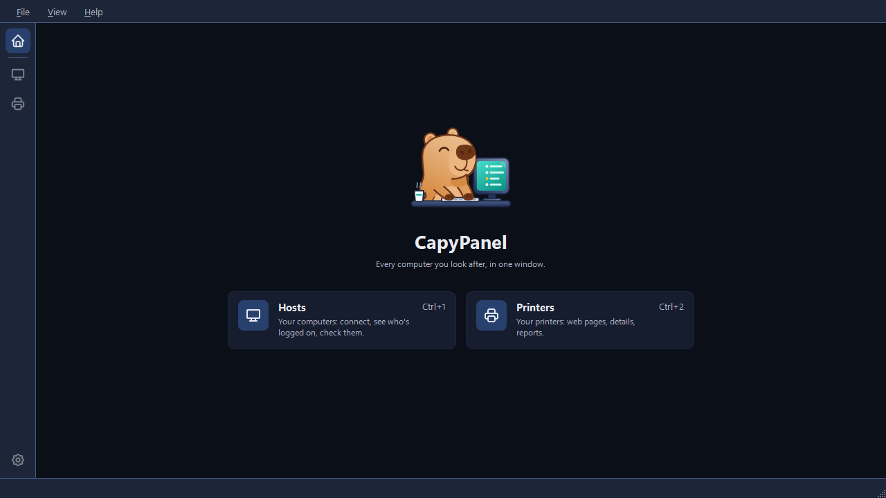

# Getting started

## Run CapyPanel

CapyPanel runs on Windows 10 22H2 or Windows 11. There's no installer yet, so it runs from source
with [uv](https://docs.astral.sh/uv/):

```
git clone https://github.com/gabrielmariense/CapyPanel.git
cd CapyPanel
uv run capypanel
```

The first run downloads Python and the libraries CapyPanel needs; later runs start right away.
The version shows in the title bar, followed by the commit when you run from source, e.g.
`CapyPanel 0.21.0 (abc1234)`. Quote it when you report a problem.

Remote Desktop works out of the box, with the client built into Windows. For VNC you also need a
viewer: [UltraVNC](https://uvnc.com) or
[RealVNC Viewer](https://www.realvnc.com/en/connect/download/viewer/). See
[Connecting](hosts/connecting.md).

## The Home page

CapyPanel opens on its Home page: the capybara, the app's line, and a tile for each of its tools
with one line about it and its shortcut. Click a tile to open that tool.

| Tool | What it's for |
|---|---|
| **Hosts** (Ctrl+1) | "Your computers: connect, see who's logged on, check them." |
| **Printers** (Ctrl+2) | "Your printers: web pages, details, reports." |



Home is the top button on the rail, **View > Home**, and **Ctrl+0**. Both tools are always there;
there's nothing to turn on. To start somewhere else, set **Settings > CapyPanel > Startup > Open on
startup** to the last used tool, or to one by name.

The rest of this page is about the **Hosts** tool. Printers has its own pages, starting at
[The Printers tool](printers/printers.md).

## The Hosts window

| Part | What it shows |
|---|---|
| **The rail** (left edge) | **Home** (Ctrl+0) at the top, then one icon per tool with its name in a tooltip, **Hosts** (Ctrl+1) and **Printers** (Ctrl+2), and **Settings** (Ctrl+,) at the bottom. Where you are has a tinted square behind its icon |
| **Toolbar** (top) | The buttons of the tool you're in. For Hosts: **Connect**, **Refresh**, **Inventory** and **Report** |
| **Groups panel** (left) | The open list's name on top, as a dropdown that switches lists. Then "All hosts" with how many hosts the list has, and "No group" under it with how many are in none. Then **Groups**, with a **+** button to add one, and **Tags** |
| **Hosts panel** (middle) | The search box (see [Searching hosts](hosts/searching.md)) above the hosts in the selected group or tag, with their **Status** and **User** |
| **Details panel** (right) | The selected host: its name and status, then **Connection** (address, group, profile), who's **logged on**, its **tags** and its **notes**. Click any value to copy it. With nothing selected, how many hosts are shown, and how many of them are online, offline, not found or not checked |
| **Status bar** | Which list is open, where it is, how many hosts it has, how many are online once anything has been checked, and how many are selected |

The menu bar is the same whichever tool you're in, and holds nothing a tool owns:

- **File** opens **Settings…** (Ctrl+,) and closes CapyPanel with **Exit** (Ctrl+Q).
- **View** goes to **Home** and to each tool, then shows or hides the panels of the tool you're
  in, the **Toolbar** and the **Status bar**. In Hosts it also holds **Show users' domain** (see
  [Checking hosts](hosts/checking.md#logged-on-users)). It stays open while you tick, so several
  parts can be shown or hidden in one go.
- **Help** has **Documentation**, **Report a problem** and **About CapyPanel**.

The window is yours to arrange. Drag the edge between two panels to move it, or **double-click**
the right edge of the **Groups panel** or the **Hosts panel** to make that panel exactly as wide as
what's in it, the widest group or tag or the table's columns, with the panel beside it taking
the rest. Right-click the host table's column titles to choose which columns show, or **Fit columns
to content** at the bottom of that menu to fit them all to their text; double-clicking a column's
edge fits that one. Widths are saved for next time, and nothing resizes them behind your back,
not a Refresh and not switching lists.

To work on another list, use the dropdown on top of the Groups panel: it lists every list CapyPanel
found, and makes, opens and manages them (see [Host lists](hosts/host-lists.md#the-list-dropdown)).

## Add your first hosts

The **Inventory** button on the toolbar holds everything that puts hosts in a list.

1. A new list starts with one group, **Default group**. **Inventory > Add group…**
   (Ctrl+Shift+N) creates another; with a group selected, the new one goes inside it. The **+**
   beside the **Groups** heading, and a right-click on the heading or on empty space, add one at
   the top level instead.
2. **Inventory > Add host…** (Ctrl+N) adds a host to the selected group:
   - **Name:** how the host shows in the list.
   - **Address:** a computer name or IP address. Leave it blank if the name *is* the computer name
     (e.g. `PC-1234`).
   - **Group:** where it goes. **No group** is a choice too, for a host that doesn't belong
     anywhere yet.
   - **Tags:** type a tag and press Enter; Backspace on an empty box brings the last tag back for
     editing.
   - **Connection profile:** how to reach the host. "From group" follows the group's profile.
3. Double-click the host, select it and press Enter, or click **Connect** in the toolbar, to open
   a connection to it with its profile.

Right-click a host to connect, to refresh its status or its logged-on users, to copy a column
through **Copy ▸**, or to edit, move or remove it. **Copy** lists every column the table shows, one
line per selected host, and **Address** keeps Ctrl+Shift+C. Right-clicking empty space offers **Add
group…** in the groups panel, and **Add host…** and **Add group…** in the host list. To move hosts
to another group, drag them onto it (see
[Host lists](hosts/host-lists.md#arranging-groups-and-hosts)). Removing a group asks what should
happen to the groups and hosts in it (see [Host lists](hosts/host-lists.md#removing-a-group)).

Edits are saved to the list file at once; there's no Save button. To add many hosts in one go,
from a spreadsheet or another inventory, see
[Importing and exporting hosts](hosts/importing.md).

## Help, and reporting a problem

The **Help** menu has three items:

- **Documentation** opens this site, in Portuguese when the app is in Portuguese.
- **Report a problem** opens a new issue on GitHub with the facts that matter already in it: the
  version, how CapyPanel is running, Windows, the theme, the language, Qt and Python. It never
  includes a user name, a computer, a domain or a path.
- **About CapyPanel** opens Settings on its **About** page: the version to click and copy with its
  commit, who made CapyPanel, every license it ships, where it keeps its files, and **Report a
  problem** beside **Open log folder**, so a report can go out with the logs attached (see
  [Settings and files](settings-and-files.md#about)).

## Keyboard shortcuts

| Shortcut | Action |
|---|---|
| Enter (in the host list) | Open a connection to the selected hosts |
| Ctrl+F / Esc | Search the whole list / end the search |
| F5 | Refresh the hosts shown, checking what the Refresh button's panel has ticked |
| Ctrl+M | Manual connection to an address that isn't in the list |
| Ctrl+Shift+C | Copy the selected hosts' addresses |
| Ctrl+N / Ctrl+Shift+N | Add host / Add group |
| F2 / Del | Edit / remove the selection |
| Ctrl+0 / Ctrl+1 / Ctrl+2 | Home / the Hosts tool / the Printers tool |
| Ctrl+O | Open a host list file |
| Ctrl+, | Settings |
| Ctrl+Q | Exit |
