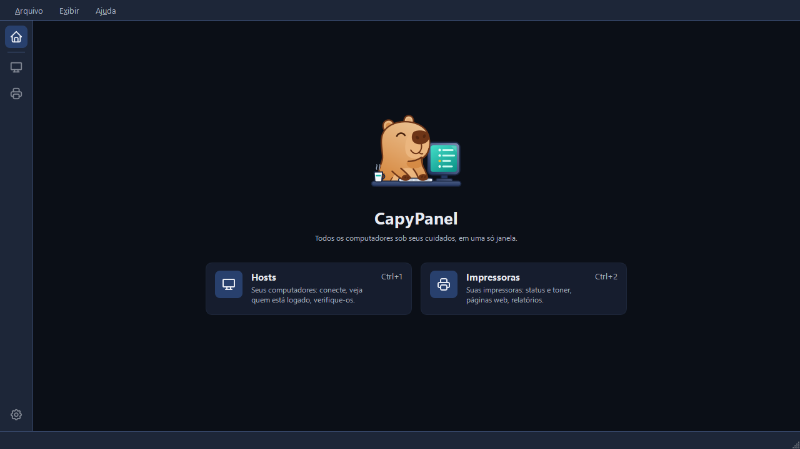

# Primeiros passos

## Rodar o CapyPanel

O CapyPanel roda no Windows 10 22H2 ou no Windows 11. Ainda não há instalador, então ele roda a
partir do código-fonte com o [uv](https://docs.astral.sh/uv/):

```
git clone https://github.com/gabrielmariense/CapyPanel.git
cd CapyPanel
uv run capypanel
```

A primeira execução baixa o Python e as bibliotecas de que o CapyPanel precisa; as seguintes
abrem na hora. A versão aparece na barra de título, seguida do commit quando você roda pelo
código-fonte, por exemplo `CapyPanel 0.21.0 (abc1234)`. Informe-a ao relatar um problema.

A Área de Trabalho Remota funciona de cara, com o cliente que já vem no Windows. Para o VNC você
também precisa de um visualizador: o [UltraVNC](https://uvnc.com) ou o
[RealVNC Viewer](https://www.realvnc.com/en/connect/download/viewer/). Veja
[Conectando](hosts/connecting.pt-BR.md).

## A página inicial

O CapyPanel abre na página inicial dele: a capivara, a frase do app e um bloco para cada
ferramenta, com uma linha sobre ela e o atalho dela. Clique num bloco para abrir aquela
ferramenta.

| Ferramenta | Para que serve |
|---|---|
| **Hosts** (Ctrl+1) | "Seus computadores: conecte, veja quem está logado, verifique-os." |
| **Impressoras** (Ctrl+2) | "Suas impressoras: páginas web, detalhes, relatórios." |



A página inicial é o botão de cima da barra lateral, o **Exibir > Início** e o **Ctrl+0**. As duas
ferramentas estão sempre lá; não há nada para ligar. Para começar em outro lugar, defina
**Configurações > CapyPanel > Inicialização > Abrir ao iniciar** como a última ferramenta usada, ou
como uma delas pelo nome.

O resto desta página é sobre a ferramenta **Hosts**. As Impressoras têm páginas próprias, a partir
de [A ferramenta Impressoras](printers/printers.pt-BR.md).

## A janela do Hosts

| Parte | O que mostra |
|---|---|
| **Barra lateral** (borda esquerda) | Uma faixa estreita com o **Início** (Ctrl+0) no topo, depois um ícone por ferramenta com o nome numa dica, **Hosts** (Ctrl+1) e **Impressoras** (Ctrl+2), e **Configurações** (Ctrl+,) embaixo. Onde você está tem um quadrado colorido atrás do ícone |
| **Barra de ferramentas** (topo) | Os botões da ferramenta aberta. Para o Hosts: **Conectar**, **Atualizar**, **Inventário** e **Relatório** |
| **Painel de grupos** (esquerda) | O nome da lista aberta no topo, como um menu que troca de lista. Depois "Todos os hosts", com quantos hosts a lista tem, e "Sem grupo" embaixo dele, com quantos não estão em nenhum. Depois **Grupos**, com um botão **+** para adicionar um, e **Tags** |
| **Painel de hosts** (meio) | A caixa de pesquisa (veja [Pesquisando hosts](hosts/searching.pt-BR.md)) acima dos hosts do grupo ou da tag selecionada, com **Status** e **Usuário** |
| **Painel de detalhes** (direita) | O host selecionado: o nome e o status dele, depois **Conexão** (endereço, grupo, perfil), quem está **logado**, as **tags** e as **notas**. Clique em qualquer valor para copiá-lo. Sem nada selecionado, quantos hosts estão exibidos e quantos deles estão online, offline, não encontrados ou não verificados |
| **Barra de status** | Qual lista está aberta, onde ela está, quantos hosts tem, quantos estão online depois que algo foi verificado e quantos estão selecionados |

A barra de menus é a mesma em qualquer ferramenta, e não guarda nada que seja de uma delas:

- **Arquivo** abre as **Configurações…** (Ctrl+,) e fecha o CapyPanel com **Sair** (Ctrl+Q).
- **Exibir** leva ao **Início** e a cada ferramenta, e depois mostra ou esconde os painéis da
  ferramenta em que você está, a **Barra de ferramentas** e a **Barra de status**. No Hosts ele
  também guarda **Mostrar domínio dos usuários** (veja
  [Verificando hosts](hosts/checking.pt-BR.md#usuarios-logados)). Ele fica aberto enquanto você
  marca, então várias partes podem aparecer ou sumir de uma vez.
- **Ajuda** tem **Documentação**, **Relatar um problema** e **Sobre o CapyPanel**.

A janela é sua para organizar. Arraste a borda entre dois painéis para movê-la, ou dê um **clique
duplo** na borda direita do **painel de grupos** ou do **painel de hosts** para deixar esse painel
exatamente da largura do que tem dentro, o grupo ou a tag mais longa, ou as colunas da tabela,
com o painel ao lado ficando com o resto. Clique com o botão direito nos títulos das colunas da
tabela de hosts para escolher quais aparecem, ou em **Ajustar colunas ao conteúdo**, no fim desse
menu, para ajustar todas ao texto delas; um clique duplo na borda de uma coluna ajusta só ela. As
larguras são salvas para a próxima vez, e nada as redimensiona por trás, nem uma atualização nem
trocar de lista.

Para trabalhar em outra lista, use o menu no topo do painel de grupos: ele mostra todas as listas
que o CapyPanel encontrou, e também cria, abre e gerencia listas (veja
[Listas de hosts](hosts/host-lists.pt-BR.md#o-menu-de-listas)).

## Adicione seus primeiros hosts

O botão **Inventário** da barra de ferramentas guarda tudo que coloca hosts numa lista.

1. Uma lista nova começa com um grupo, **Grupo padrão**. **Inventário > Adicionar grupo…**
   (Ctrl+Shift+N) cria outro; com um grupo selecionado, o novo fica dentro dele. Já o **+** ao
   lado do título **Grupos**, e o botão direito no título ou num espaço vazio, adicionam um no
   nível superior.
2. **Inventário > Adicionar host…** (Ctrl+N) adiciona um host ao grupo selecionado:
   - **Nome:** como o host aparece na lista.
   - **Endereço:** um nome de computador ou endereço IP. Deixe em branco se o nome *for* o nome
     do computador (por exemplo `PC-1234`).
   - **Grupo:** para onde ele vai. **Sem grupo** também é uma opção, para um host que ainda não
     pertence a lugar nenhum.
   - **Tags:** digite uma tag e pressione Enter; Backspace numa caixa vazia traz a última tag de
     volta para edição.
   - **Perfil de conexão:** como acessar o host. "Do grupo" segue o perfil do grupo.
3. Dê um clique duplo no host, selecione-o e pressione Enter, ou clique em **Conectar** na barra
   de ferramentas, para abrir uma conexão com ele pelo perfil dele.

Clique com o botão direito num host para conectar, para atualizar o status ou os usuários logados
dele, para copiar uma coluna em **Copiar ▸**, ou para editá-lo, movê-lo ou removê-lo. O **Copiar**
lista todas as colunas que a tabela mostra, uma linha por host selecionado, e o **Endereço**
mantém o Ctrl+Shift+C. O botão direito num espaço vazio oferece **Adicionar grupo…** no painel de
grupos, e **Adicionar host…** e **Adicionar grupo…** na lista de hosts. Para mover hosts para outro
grupo, arraste-os até ele (veja
[Listas de hosts](hosts/host-lists.pt-BR.md#organizar-grupos-e-hosts)). Remover um grupo pergunta
o que fazer com os grupos e hosts dentro dele (veja
[Listas de hosts](hosts/host-lists.pt-BR.md#remover-um-grupo)).

As edições são salvas no arquivo da lista na hora; não há botão Salvar. Para adicionar muitos
hosts de uma vez, de uma planilha ou de outro inventário, veja
[Importando e exportando hosts](hosts/importing.pt-BR.md).

## Ajuda e como relatar um problema

O menu **Ajuda** tem três itens:

- **Documentação** abre este site, em português quando o app está em português.
- **Relatar um problema** abre uma issue nova no GitHub já com os dados que importam: a versão,
  como o CapyPanel está rodando, o Windows, o tema, o idioma, o Qt e o Python. Nunca inclui nome
  de usuário, computador, domínio nem caminho de arquivo.
- **Sobre o CapyPanel** abre as Configurações na página **Sobre**: a versão para clicar e copiar
  com o commit, quem fez o CapyPanel, todas as licenças que vêm com ele, onde ele guarda os
  arquivos, e **Relatar um problema** ao lado de **Abrir pasta de logs**, para um relato sair com
  os logs anexados (veja [Configurações e arquivos](settings-and-files.pt-BR.md#sobre)).

## Atalhos de teclado

| Atalho | Ação |
|---|---|
| Enter (na lista de hosts) | Abrir uma conexão com os hosts selecionados |
| Ctrl+F / Esc | Pesquisar na lista inteira / encerrar a pesquisa |
| F5 | Atualizar os hosts exibidos, verificando o que está marcado no painel do botão Atualizar |
| Ctrl+M | Conexão manual a um endereço que não está na lista |
| Ctrl+Shift+C | Copiar os endereços dos hosts selecionados |
| Ctrl+N / Ctrl+Shift+N | Adicionar host / Adicionar grupo |
| F2 / Del | Editar / remover a seleção |
| Ctrl+0 / Ctrl+1 / Ctrl+2 | Início / a ferramenta Hosts / a ferramenta Impressoras |
| Ctrl+O | Abrir um arquivo de lista de hosts |
| Ctrl+, | Configurações |
| Ctrl+Q | Sair |
