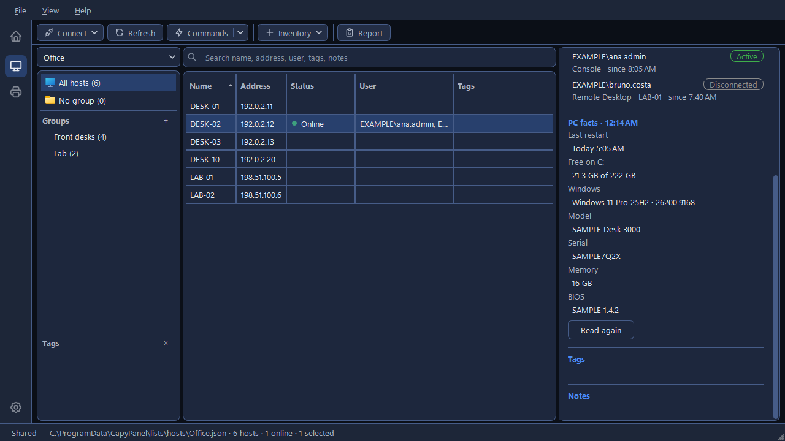

# Checking hosts

CapyPanel can check whether your PCs are on, who is logged on to them, and what each PC is. The
answers show in the **Status** and **User** columns and in the Details panel. They're kept in memory
only, never in the list file, and are gone when CapyPanel closes; editing a host's address clears
them. To keep them, export them with **Report** (see
[Export hosts to a spreadsheet](host-lists.md#export-hosts-to-a-spreadsheet)).

## Check your hosts

1. Click **Refresh all** on the toolbar (**F5**). It checks every host the table shows: the group
   you picked with its subgroups, a tag, All hosts, No group, or a search's results.
2. To check only some, right-click one host for **Refresh host**, several for **Refresh {n}
   hosts**, or a group for **Refresh group**.
3. The status bar shows the progress, 8 hosts at a time, with a **Stop** button.

??? note "More about Refresh"

    - **Refresh all** runs the checks that are ticked: right-click it for the **Refresh every host
      shown** panel, tick status and logged-on users, and click **Run**. CapyPanel remembers the
      ticks, and **F5** runs them without opening the panel (it's ignored while a check is already
      running).
    - **Refresh host** reads one host's status, logged-on users and PC facts. **Refresh {n} hosts**
      and **Refresh group** read status and logged-on users; PC facts are read one PC at a time.
    - Checking who is logged on to more than 50 hosts asks first.
    - A host without an address, whose name isn't a computer name, is skipped with a note in the
      status bar.

## Read a host's status

| Status | What it means |
|---|---|
| **Online** | A ping, or one of the ports CapyPanel connects to, answered |
| **Offline** | Nothing answered within 2 seconds |
| **Host not found** | The name or address doesn't exist |
| **Not checked** (grey) | Nobody has refreshed it yet. These hosts sort last |

Hover over a status to see when it was checked and which address answered. The Details panel says
it under the host's name, as "Online · checked 10:41". Status uses no account and needs no
administrator rights.

??? note "How status is checked"

    The ports are 445 (Windows file sharing), 22 (SSH) and each tool's own port, such as 5900 for
    VNC and 3389 for Remote Desktop. A refused connection counts as an answer. Every address the
    name has is tried, cable and Wi-Fi alike: a PC that answers only on its Wi-Fi address may have
    its cable out.

    When a PC didn't answer, Details says so once under its name, as "Offline · checked 10:41",
    and **Logged on** and **PC facts** show a single dash or one line with the reason.

## Have status checked on its own

**Settings > Hosts > General > Refresh status by itself** checks the status of the hosts shown
every **minute**, **5**, **15** or **30 minutes**, or a **Custom…** interval from 1 to 120. It's
**Off** to begin with. "Only ping and ports, so no account is needed. Refresh in the toolbar always
works."

## See who is logged on

The **User** column shows who is logged on, as `DOMAIN\user`, with "(disconnected)" for a
disconnected session, or **No one**. The Details panel lists each session under **Logged on**: the
user, an **Active** or **Disconnected** badge, whether they're at the computer (**Console**) or on
**Remote Desktop**, which PC they came from, and since when.

This needs an administrator account on each host. Nothing is installed on the hosts, and it works
whatever their language.

??? note "More about logged-on users"

    - Active sessions come first. Before any check the section says **Not checked**; with nobody
      logged on, **No one logged on**; and when a check failed, the reason (see the table at the
      end), with the full explanation in its tooltip.
    - **View > Show users' domain** is on and remembered. Turn it off to see just `user` in the
      column, the Details panel and searches; hovering still shows the whole `DOMAIN\user`, so a
      local "admin" can't pass for the domain's.
    - After someone logs off, they may show as disconnected for a while or disappear, the same as
      in Task Manager's Users tab. That's how Windows reports it.
    - CapyPanel reads this through Windows' own remote session service.

## When a host refuses your account

By default CapyPanel uses your own Windows account. When hosts answer **No admin rights** or
**Account rejected**:

1. Once the Refresh ends, CapyPanel asks for another account in **Account for other PCs**, naming
   the hosts it's for (the first five, then how many more).
2. Type it in. It's tried on one host at a time until one accepts it; if a host rejects it before
   that, CapyPanel stops and asks again, so a mistyped password can't lock the account out.
3. Those hosts are checked again, and the account becomes a row of **Settings > Hosts >
   Credentials > Accounts**.

Once one host has accepted the account, a host that still refuses it shows its error and the
Refresh carries on. Hosts that refused last time are tried last, so they can't stop the next
Refresh before it starts.

The Details panel's **Commands run as** names the account each host ends up with. See
[Accounts for other PCs](connecting.md#use-another-account-on-some-pcs) to give a PC, a group, a tag or
every PC its own account.

## Read a PC's facts

Select a host and stay on it for a moment: the Details panel ends with **PC facts**, what the PC
says about itself. That's **Last restart**, **Free on C:**, **Windows** (as in "Windows 11 Pro 25H2
· 26200.9168"), **Model**, **Serial**, **Memory** and **BIOS**. **Read again** reads them afresh.

They're never read by **Refresh all**, so a list of hundreds of hosts is left alone.

??? note "More about PC facts"

    - Until they're read, the section says "Not read yet", with a **Read** button. The free space
      and the last restart come in first, while the heading says "PC facts · reading…"; the rest
      follows a few seconds later.
    - Each fact is read on its own, so one that fails doesn't take the others with it: a fact that
      couldn't be read says why in amber in its place. Click that line to copy it. The app log
      names the part that failed.
    - **Refresh host**, and **Commands ▾ > Check > PC facts** on the toolbar or in the Commands
      window, read them too (see [Commands on a host](commands.md)).

??? note "How CapyPanel reads other PCs"

    Status uses ping and ports, and logged-on users use Windows' remote session service. The PC
    facts, the installed programs, the mapped drives and the
    [User profiles](../profiles/user-profiles.md) tool read the PC over **WMI**, Windows' own
    management service, which every Windows PC answers. Nothing is installed or started on the other
    PC.

    On your own PC, CapyPanel talks WMI itself, through Windows' scripting objects. It starts
    PowerShell for this only when it can't do that on your PC at all, and never because one PC's
    read failed. The app log says at each start which way it reads.

    **Settings > Hosts > Connecting > Read PC data with** sets the way for everyone on your PC:

    | Choice | What it does |
    |---|---|
    | **Automatic (recommended)** | WMI directly, and through PowerShell only when that can't be used on this PC. "in use:" beside it names the way it's using |
    | **WMI directly** | Always talks WMI itself and never starts PowerShell, even when it can't, in which case the reads fail and say why |
    | **WMI through PowerShell** | Starts PowerShell on your PC to talk WMI, as CapyPanel did before 0.24. A way back, in case reading directly misbehaves on your network |

    Both ways ask the other PC the same questions and get the same answers; only what starts on
    your own PC changes.

## Messages you may see

| Message | What it means | What to do |
|---|---|---|
| **Unreachable** | Port 445 (Windows file sharing) didn't answer: the PC is off, off the network, blocks file sharing, or isn't Windows | Check the PC is on and on the network |
| **No admin rights** | The account isn't an administrator on that host | Use another account (see above) |
| **Account rejected** | The host refused the account | Check the account, or use another one |
| **Couldn't read** | The host answered, but the sessions couldn't be read | Hover for the reason; try again later |
| "No access: needs an admin account on this PC" | A PC fact needs an administrator account | Use an administrator account for that host |
| "Couldn't read: Windows didn't let PowerShell start on your PC (an antivirus may block it)" | Your own PC refused to start PowerShell, not the one you were reading | Check your PC's antivirus, or set **Read PC data with** to **WMI directly** |
