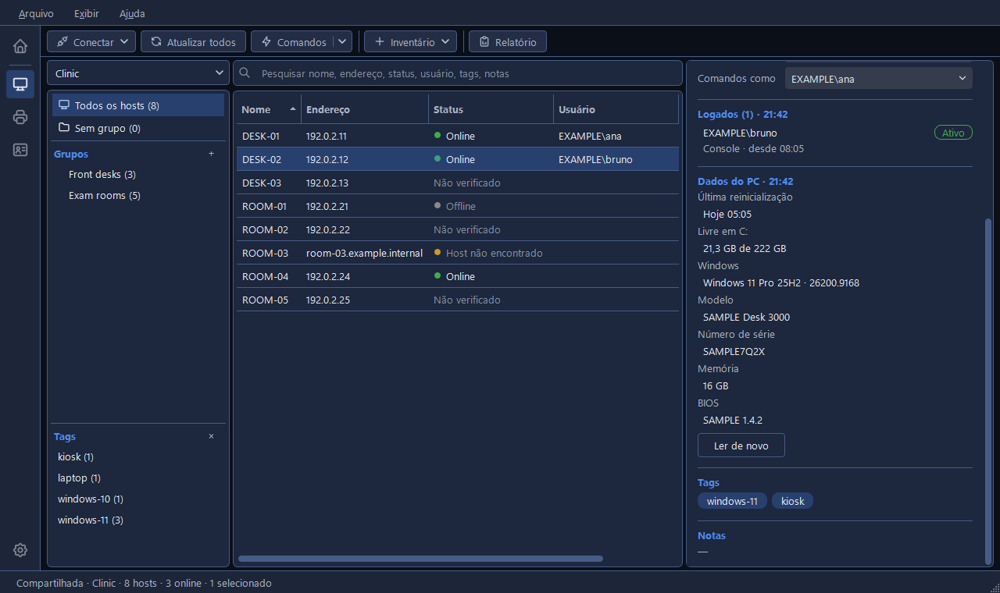

# Verificando hosts

O CapyPanel pode verificar se os hosts estão ligados, quem está logado neles e o que o próprio
PC é. Os resultados aparecem nas colunas **Status** e **Usuário** da tabela de hosts e no
painel de detalhes. Eles
ficam só na memória: nunca no arquivo da lista, e somem quando o CapyPanel fecha. Editar o
endereço de um host apaga os resultados dele. Para guardá-los, o **Relatório** da barra de
ferramentas grava a última verificação num CSV e oferece verificar os hosts antes (veja
[Importando e exportando hosts](importing.pt-BR.md)).

## Atualizar

**Atualizar**, na barra de ferramentas, verifica todos os hosts que a tabela mostra: o grupo
escolhido no painel de grupos com seus subgrupos, uma tag, Todos os hosts, Sem grupo ou os
resultados de uma pesquisa. Não é preciso selecionar nada.

- Clique nele para rodar as verificações marcadas em todos os hosts exibidos. A dica dele diz
  isso: "Atualiza todos os hosts exibidos, com as verificações marcadas no botão direito
  (também F5)".
- Clique com o botão direito para abrir o painel **Atualizar todos os hosts exibidos**: marque os
  dois e clique em **Executar**. O CapyPanel lembra o que você marcou.
- **F5** faz o mesmo que esse **Executar**, nos hosts exibidos, sem abrir o painel. Ele é ignorado
  enquanto uma verificação já está rodando.

Para verificar só alguns hosts, selecione-os e use o botão direito > **Atualizar status** ou
**Atualizar usuários logados**. O menu de botão direito de um grupo tem os mesmos dois itens, para
os hosts dele e os dos grupos de dentro.

O CapyPanel verifica 8 hosts por vez; a barra de status mostra o andamento e um botão **Parar**.
Verificar quem está logado em mais de 50 hosts pergunta antes. Um host sem endereço, cujo nome não
é um nome de computador, é pulado com um aviso na barra de status.

## Status

| Status | Significado |
|---|---|
| **Online** | Um ping, ou uma das portas em que o CapyPanel conecta, respondeu |
| **Offline** | Nada respondeu em 2 segundos |
| **Host não encontrado** | O nome ou endereço não existe |

As portas são a 445 (compartilhamento de arquivos do Windows), a 22 (SSH) e a porta de cada
ferramenta, como a 5900 do VNC e a 3389 da Área de Trabalho Remota. Uma conexão recusada conta
como resposta. Todos os endereços do nome são tentados, cabo e Wi-Fi. Passe o mouse sobre um
status para ver quando ele foi verificado e qual endereço respondeu: um PC que só responde no
endereço do Wi-Fi pode estar com o cabo solto. O painel de detalhes diz isso embaixo do nome do
host, como "Online · verificado em 10:41", ou "Não verificado: use Atualizar".

O status não usa conta nenhuma e não precisa de direitos de administrador.

### Status automático

**Configurações > Hosts > Geral > Atualizar o status sozinho** pode verificar o status
dos hosts exibidos a cada alguns minutos: **A cada minuto**, **A cada 5 minutos**, **A cada 15
minutos**, **A cada 30 minutos** ou **Personalizado…**, de 1 a 120. Começa **Desligado**, então
nada é verificado sozinho a menos que você ligue, e desligar de novo guarda o seu intervalo para
a próxima vez.

Como a própria configuração diz: "Só ping e portas, nunca usuários logados, então nenhuma conta é
usada. O Atualizar da barra de ferramentas sempre funciona."

## Usuários logados

A coluna **Usuário** mostra quem está logado, como `DOMÍNIO\usuário`, com "(desconectado)" para
uma sessão desconectada, ou **Ninguém**.

O painel de detalhes lista cada sessão em **Logados**, com a hora da verificação, como em
"Logados (3) · 10:40". Cada linha traz o usuário, uma etiqueta dizendo **Ativo** ou
**Desconectado** e, embaixo, se a pessoa está no computador (**Console**) ou na **Área de Trabalho
Remota**, de qual PC ela veio e desde quando. As sessões ativas vêm primeiro. Antes de qualquer
verificação, a seção diz **Não verificado**; sem ninguém logado, **Ninguém logado**; e quando a
verificação falha, o motivo aparece abaixo, com a explicação completa na dica do mouse.

**Exibir > Mostrar domínio dos usuários** vem ligado e é lembrado. Desligue para ver só
`usuário` na coluna, no painel de detalhes e nas pesquisas; ao passar o mouse, o
`DOMÍNIO\usuário` completo continua aparecendo, então um "admin" local não passa pelo do domínio.

O CapyPanel lê isso pelo próprio serviço de sessões remotas do Windows: nada é instalado nos
hosts, e funciona qualquer que seja o idioma deles. É preciso uma conta de administrador em cada
host.

| Aparece | Significado |
|---|---|
| **Inacessível** | A porta 445 (compartilhamento de arquivos do Windows) não respondeu: o PC está desligado, fora da rede, bloqueia o compartilhamento de arquivos ou não é Windows |
| **Sem direitos de administrador** | A conta não é administradora nesse host |
| **Conta recusada** | O host recusou a conta |
| **Não foi possível ler** | O host respondeu, mas as sessões não puderam ser lidas |

Depois que alguém faz logoff, a pessoa pode aparecer como desconectada por um tempo ou sumir, como
na aba Usuários do Gerenciador de Tarefas. É assim que o Windows informa.

### Qual conta é usada

Por padrão, a sua própria conta do Windows. As **Configurações > Hosts > Credenciais > Contas**
podem dar outra conta a um PC, um grupo, uma tag ou a todos os PCs, e o **Comandos como** do
painel de detalhes diz qual conta cada host acaba usando (veja
[Contas para outros PCs](connecting.pt-BR.md#contas-para-outros-pcs)).

Se hosts responderem **Sem direitos de administrador** ou **Conta recusada**, o CapyPanel pede
outra conta quando o Atualizar termina, numa janela chamada **Conta para outros PCs**, e verifica
de novo só esses hosts. A conta que você digita ali vira uma linha da tabela Contas. Ela é tentada
num host por vez: se um host a recusar, o CapyPanel para e pergunta de novo em vez de tentá-la nos
outros, para a conta não ser bloqueada.

## Dados do PC

O painel de detalhes termina com o que o PC diz sobre si mesmo: **Última reinicialização**,
**Livre em C:**, **Windows** (a edição, a versão e o build dele, como em "Windows 11 Pro 25H2 ·
26200.9168"), **Modelo**, **Número de série**, **Memória** e **BIOS**, com um botão **Ler de
novo** embaixo deles.

Eles são lidos uma vez, quando um host fica selecionado por um instante, e nunca pelo Atualizar,
então uma lista de centenas de hosts fica em paz. Até lá a seção diz "Ainda não lido", com um
botão **Ler**. O espaço livre e a última reinicialização chegam primeiro, enquanto o título diz
"Dados do PC · lendo…" e as outras linhas dizem "Lendo…"; o resto vem alguns segundos depois.

Cada dado é lido à parte, então um que falha não leva os outros junto: o que foi lido aparece, e
um dado que não pôde ser lido diz o motivo em âmbar no lugar do valor, como em "Sem acesso: precisa
de uma conta de administrador neste PC". Clique nessa linha para copiá-la, como qualquer valor. O
log do aplicativo diz qual parte falhou.

O **Verificar > Dados do PC** lê tudo de novo quando você quiser, pelo menu de botão direito do
host, pelo **…** do painel de detalhes ou pela janela Comandos (veja
[Comandos em um host](commands.pt-BR.md)).

## Como o CapyPanel lê outros PCs

O status usa ping e portas, e os usuários logados usam o serviço de sessões remotas do Windows. Os
dados do PC, os programas instalados, as unidades mapeadas e a ferramenta
[Perfis de usuário](../profiles/user-profiles.pt-BR.md) leem o PC pelo **WMI**, o serviço de
gerenciamento do próprio Windows, que todo PC com Windows responde. Nada é instalado nem aberto no
outro PC.

No seu próprio PC, o CapyPanel fala com o WMI sozinho, pelos objetos de script do Windows. Ele só
abre o PowerShell para isso quando não consegue fazer isso no seu PC de jeito nenhum, e nunca
porque a leitura de um PC falhou. O log do aplicativo diz, a cada início, de que jeito ele lê.

Alguns antivírus bloqueiam programas que outro programa abre, o PowerShell mais que todos. Se o
seu faz isso, uma leitura pelo PowerShell falha com "Não foi possível ler: o Windows não deixou o
PowerShell abrir no seu PC (um antivírus pode bloqueá-lo)". Quem recusou foi o seu PC, não o que
você estava lendo, então é o seu PC que precisa ser olhado.

As **Configurações > Hosts > Conexão > Ler dados dos PCs com** definem o jeito para todos no seu PC:

| Opção | O que faz |
|---|---|
| **Automático (recomendado)** | WMI direto, e pelo PowerShell só quando isso não dá neste PC. O "em uso:" ao lado diz o jeito que ele está usando |
| **WMI direto** | Sempre fala com o WMI sozinho e nunca abre o PowerShell, mesmo quando não consegue; nesse caso as leituras falham e dizem por quê |
| **WMI pelo PowerShell** | Abre o PowerShell no seu PC para falar com o WMI, como o CapyPanel fazia antes da 0.24. Um caminho de volta, caso a leitura direta dê problema na sua rede |

Os dois jeitos fazem as mesmas perguntas ao outro PC e recebem as mesmas respostas; só muda o que
abre no seu próprio PC.
