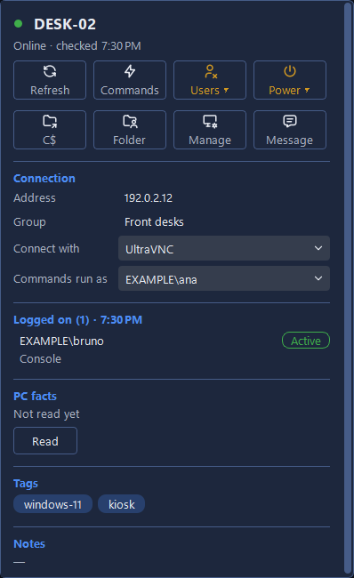
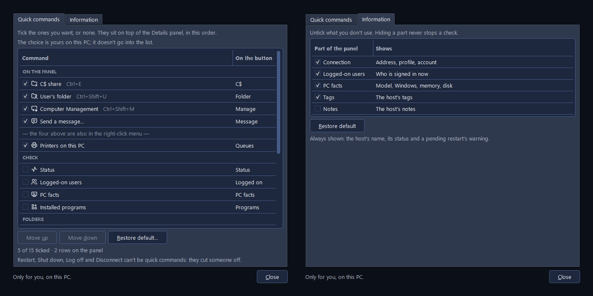
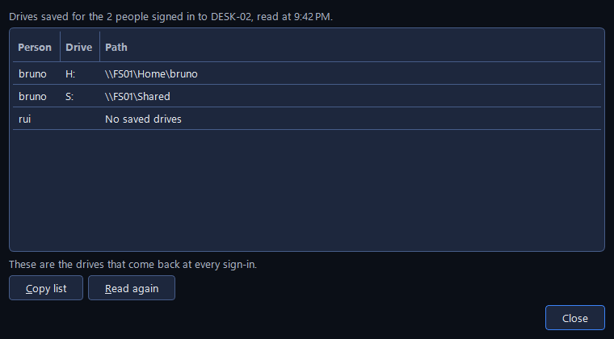
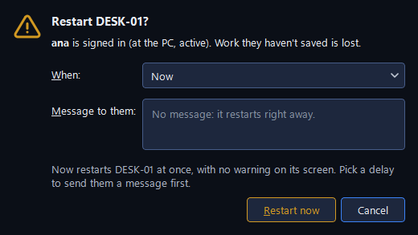
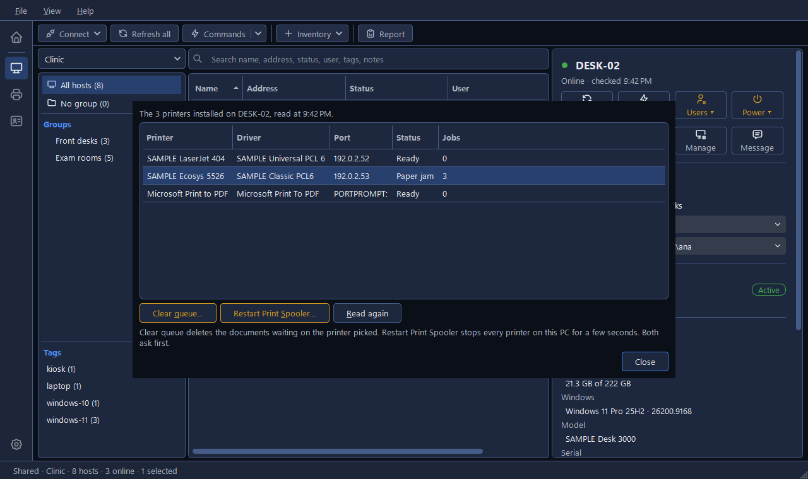
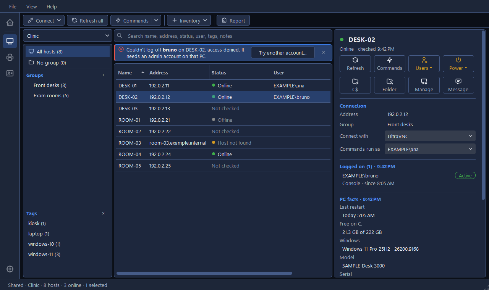
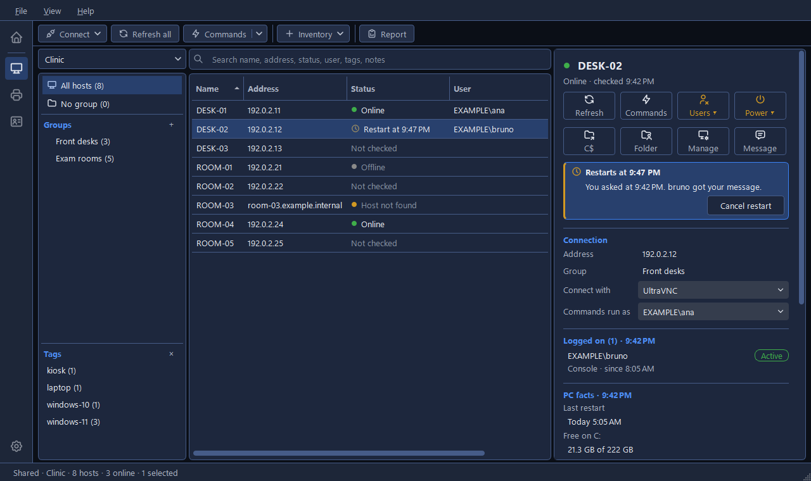
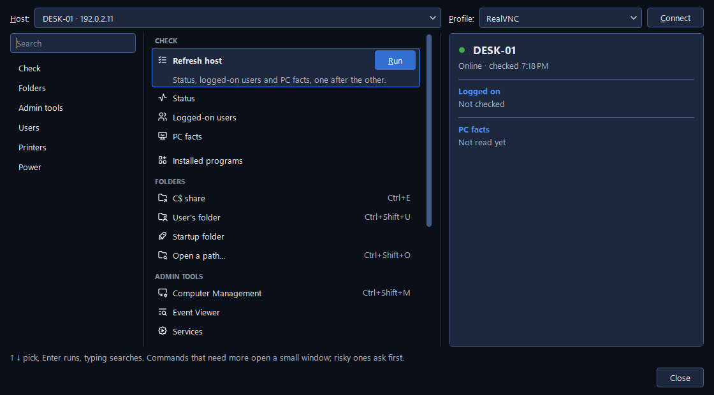

# Commands on a host

A host's commands are the everyday jobs you would otherwise do from a console or a command line:
open a PC's C: drive, see what is installed on it, message or log off whoever is using it,
restart it, or unstick its printing. They work on one host at a time, the one you selected or an
address you type.

Nothing is installed on the other PC and nothing of yours runs there. Every command uses
Windows' own remote functions: file sharing, the session service, remote shutdown, the print
spooler, the service manager, and WMI for the PC's facts, its installed programs and its mapped
drives (see [How CapyPanel reads other PCs](checking.md#how-capypanel-reads-other-pcs)). The
account is the one the Details panel's **Commands run as** names for the host: your own Windows
login, unless an account is set for it (see
[Accounts for other PCs](connecting.md#accounts-for-other-pcs)).

## Where they are

- **The Details panel:** a grid of buttons under the host's name, each an icon over a word. The
  first row is always the same: **Refresh** (the host's status, logged-on users and PC facts),
  **Commands** (the [Commands window](#the-commands-window)), **Users ▾** (log off or disconnect
  someone) and **Power ▾** (restart or shut down). Under it, four to a row, are your
  [quick commands](#quick-commands). A tooltip gives each button's full name.
- **Right-click a host:** **Connect** in bold, **Refresh host**, your first four quick commands,
  then **All commands…**, which opens the Commands window. **Copy ▸**, **Edit…**, **Move to ▸**,
  **Tags ▸** and **Remove** come after. With several hosts selected the menu holds what works on all of
  them: **Connect**, **Refresh {n} hosts**, **Commands run as ▸**, **Copy ▸**, **Move to ▸**, **Tags ▸**
  and **Remove**.
- **The toolbar:** **Commands**, beside Refresh, opens the Commands window for the selected host.
  Its arrow lists every command by group (**Check**, **Folders**, **Admin tools**, **Users**,
  **Printers** and **Power**) and ends with **All commands…**.
- **A person under Logged on:** right-click them in Details for **Send a message to {user}…**,
  **Disconnect {user}…** and **Log off {user}…**, then **Copy ▸**.

Commands work on one host with an address. The amber buttons and menu items are the ones that
disturb whoever is using the PC, and they always ask first.

A command meant for the person at the PC, such as Send a message or the user's folder, reads
"… (nobody signed in)" and is greyed when the host's last refresh, less than 10 minutes old, found
nobody. Before any refresh, or once it's older, it stays usable.

## Quick commands

Quick commands are the commands you use most, one click away. Each admin picks their own: the
choice is kept in your settings on this PC, never in the list, so the people sharing a list each
have theirs. CapyPanel starts with **C$ share**, **User's folder**, **Computer Management** and
**Send a message…**.

To choose them, open **View > Customize the details panel…**, right-click the Details panel, or
use **Settings > Hosts > General > Details panel > Quick commands > Choose…**. The **Quick
commands** tab lists the ticked commands first, under **On the panel**, in the order of their
buttons, then the rest by group, each with its shortcut in grey and the word its button shows.
"Tick the ones you want, or none." A newly ticked command goes to the end; **Move up** and **Move
down** change the order, and **Restore default…** goes back to the four CapyPanel starts with.
Every change shows on the panel at once. A line under the table counts them, as in "6 of 15
ticked · 2 rows on the panel".

Any of these can be a quick command: Status, Logged-on users, PC facts, Installed programs, C$
share, User's folder, Startup folder, Open a path…, Computer Management, Event Viewer, Services,
Send a message…, Mapped drives, Printers on this PC and Restart Print Spooler…. "Restart, Shut
down, Log off and Disconnect can't be quick commands: they cut someone off."

The first four are also in the host's right-click menu.

## What each command does

**Check** reads something and shows it where that check normally shows:

| Command | What it does |
|---|---|
| **Refresh host** | Status, logged-on users and PC facts, one after the other |
| **Status** | Whether the PC answers on the network (see [Checking hosts](checking.md#status)) |
| **Logged-on users** | Who is signed in, and since when |
| **PC facts** | Windows version, model, serial number, memory, free space and last restart (see [PC facts](checking.md#pc-facts)) |
| **Installed programs** | The programs installed for every user of the PC |

**Folders** and **Admin tools** open something on *your* PC pointed at the other one:

| Command | What it opens |
|---|---|
| **C$ share** (Ctrl+E) | The PC's C: drive in File Explorer |
| **{user}'s folder** (Ctrl+Shift+U) | The signed-in user's profile folder |
| **Startup folder** | The programs that start for every user who signs in |
| **Open a path…** (Ctrl+Shift+O) | Any folder on the PC, such as `D:\Logs` |
| **Computer Management** (Ctrl+Shift+M) | Windows' Computer Management, pointed at the PC |
| **Event Viewer** | The PC's event logs |
| **Services** | The PC's Windows services |

The first four are **Folders**, the last three **Admin tools**. A folder waits for the PC to answer
before File Explorer opens, because Explorer itself can hang for half a minute on a PC that's off.
A path that isn't a folder is refused with "there's no folder there.", so that a file is never
opened, and so run, on your own PC. The three Windows consoles open straight away and show their
own error when the PC can't be reached.

**Users** holds **Send a message…** and **Mapped drives**. Log off and Disconnect act on one
person, so they're offered on that person instead: in Details, or under **Users ▾**,
which lists everyone signed in as a heading, as in "ana.admin  (at the PC, active, since 8:05
AM)", with **Log off…** and **Disconnect…** under each. It's greyed when nobody is signed in, or
nobody was checked yet.

**Printers** holds **Printers on this PC** and **Restart Print Spooler…**.

**Power** holds **Restart…**, **Shut down…** and **Cancel the pending restart**, the last one
greyed unless a restart CapyPanel asked for is still waiting.

## The questions and the small windows

### Open a path…

"Open a folder on {host}" takes a path the way you already have it: as File Explorer copies it,
quotes and all (`"D:\Logs\App"`), on another drive (`D:\Logs` or `D$\Logs`), on C: alone
(`Users\Public`), or as a whole `\\PC\share\…` path. A line under the box shows what will open,
as in "Opens \\DESK-02\D$\Logs\App". The box keeps the last 10 folders you opened.

### Send a message…

The message goes to everyone at their screen on the PC, shown as chips beside **To:** whose
tooltip says where each of them is signed in; disconnected sessions, and your own, aren't
included. It pops up on their screen until they click OK, titled "Message from {your Windows user
name}", and Windows shows about 255 characters of it.

### Mapped drives

The network drives saved for each person signed in to the PC: **Person**, **Drive** and **Path**,
as in "Drives saved for the 2 people signed in to DESK-02, read at 11:56 AM.". "These are the
drives that come back at every sign-in." A person with none reads "No saved drives". They're read
from each person's part of the PC's registry over WMI; nothing is run on the PC. **Copy list** puts
the rows on the clipboard, and **Read again** reads them afresh.

### Log off… and Disconnect…

Both ask first, naming the person and where they're signed in. Log off warns that "Work they
haven't saved is lost."; Disconnect says their programs keep running and they get back to them
next time. Cancel is the button that's ready to press.

### Restart… and Shut down…

This window is the question. It names whoever is signed in and what they stand to lose. **When**
starts on **Now**: the message box greys out, saying "No message: it restarts right away.", a line
under it warns "Now restarts DESK-02 at once, with no warning on its screen. Pick a delay to send
them a message first.", and the button reads **Restart now**.

**In 1 minute**, **In 5 minutes** and **In 15 minutes** each come with a message Windows shows
them with a countdown, prefilled as "This PC restarts in 5 minutes. Please save your work." and
yours to change; the button then reads **Restart**.

The keyboard starts on **When**: the arrow keys pick, **Tab** goes to the message (when there is
one), then to the amber button, where **Enter** runs it. Enter anywhere else is **Cancel**, the
default button.

### Printers on this PC

A window with **Printer**, **Driver**, **Port**, **Status** and **Jobs**, and three buttons:
**Clear queue…** deletes the documents waiting on the printer you picked, **Restart Print
Spooler…** stops every printer on that PC for a few seconds (documents waiting stay, and print
once it's back), and **Read again** reads the list afresh. Both of the first two ask first.

These are the PC's own printers, not the ones a user added for themselves from a print server.
The printers in the [Printers tool](../printers/printers.md) are a different thing: those are the
printers themselves, on the network.

### Installed programs

**Name**, **Publisher**, **Version** and **Installed on**, with a **Search programs** box, how
many there are and when they were read, then **Copy list**, **Export CSV…** and **Read again**.
The CSV opens in the spreadsheet your PC uses for CSV files, with the same guard against a cell
a spreadsheet would run as a formula as the host report has.

The list is the programs installed for every user of the PC. Windows' own parts and its updates
are left out, and CapyPanel never asks Windows through `Win32_Product`, which repairs every
program it lists as it goes.

## What happened: the strip above the table

A command that worked says so in green above the host table, as in "Message sent to bruno on
DESK-02.", and the strip closes by itself after a few seconds.

A command that failed says so in red, with Windows' own reason: "Couldn't log off bruno on
DESK-02: access denied. It needs an admin account on that PC." That strip stays until you close
it. When the account was the problem, **Try another account…** asks for another one, and for which
PCs to use it (see [Accounts for other PCs](connecting.md#accounts-for-other-pcs)), then runs the
command again.

Opening a folder is the exception: it says "Opened \\DESK-02\C$" in the status bar, where the
rest of what you open shows too.

## A restart that waits

A restart or shutdown with a delay shows in the **Status** column, as "Restart at 2:37 PM" with a
clock, and in Details as an amber strip: "Restarts at 2:37 PM", "You asked at 2:32 PM. bruno
got your message." and **Cancel restart**. **Power > Cancel the pending restart** does the same
from the menus.

After the PC restarts, CapyPanel looks it up every 15 seconds. Once it has gone away and answers
again, a Windows notification says "{host} is back online", with "It restarted at 2:37 PM and
answered again at 2:39 PM. Click to show it."; the click selects that host. CapyPanel stops
watching 20 minutes after the restart time.

## The Commands window

The Commands window holds every command for one PC in one place, with its answer beside it. It
opens from the **Commands** buttons, from **All commands…**, and from **Connect > Manual
connection…** (Ctrl+M), which is the same window for an address that isn't in your list. It's a
window of its own, beside the main one rather than over it: you can go back to the host list and
leave it open. Asking for the Commands of another host while it's open turns the window to that
host, and each host's answers are kept while the window stays open, so going back shows them
again. It opens at 1120 × 620 the first time and can be resized: wider, the commands and the
answers share the extra room; narrower, the answers keep their width and the command list
scrolls sideways. It opens again at the size you left it at.

- **On top:** the **Host** box, then **Profile** and **Connect**. The box lists the hosts the
  Hosts panel shows, as "DESK-02 · 192.0.2.12", and under **Recent** the addresses you typed
  before; you can also type a name or an address (`host:port` works). Picking another host
  changes the whole window to it, its profile included. The title says "Commands · DESK-02" for a
  host of yours, "Manual connection · 198.51.100.40" for an address you typed.
- **Add to host list…** shows beside the box only for a typed address the open list doesn't have:
  it puts the PC into the list, with the address already filled in.
- **On the left:** a **Search** box and the six groups; a click jumps to a group.
- **In the middle:** every command, one line each, with its shortcut in grey when it has one.
  The one you pick grows to show what it does
  and a **Run** button. The arrow keys move, Enter runs, and typing anywhere searches; a
  double-click only picks, so a risky command never runs by accident.
- **On the right:** what the command found, laid out as the Details panel lays it out: the
  status, who is logged on, the PC facts, or the last answer with **Try another account…**.
  Printers on this PC, Installed programs and Mapped drives show there as tables: right-click a
  printer to clear its queue or copy the row, and a program to copy the row, copy or export the
  whole list, or open the list in its own window with a search. Commands that need you to type
  something open their small window over this one.
- **At the bottom:** a line of help, "↑ ↓ pick, Enter runs, typing searches. Commands that need
  more open a small window; risky ones ask first.", and **Close**.
