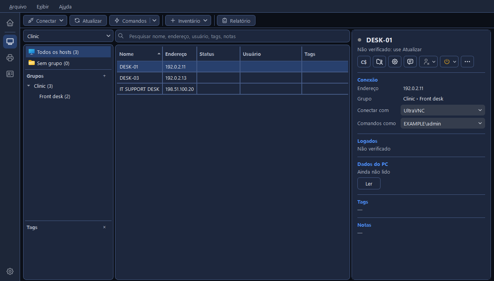
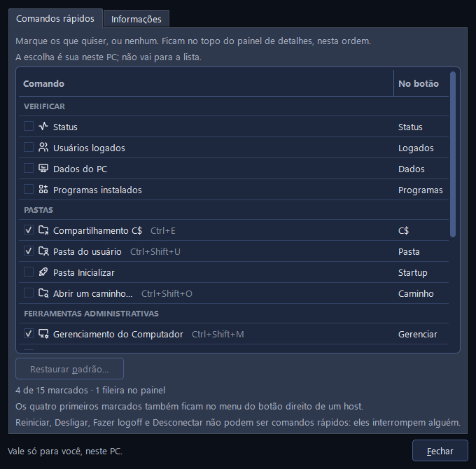
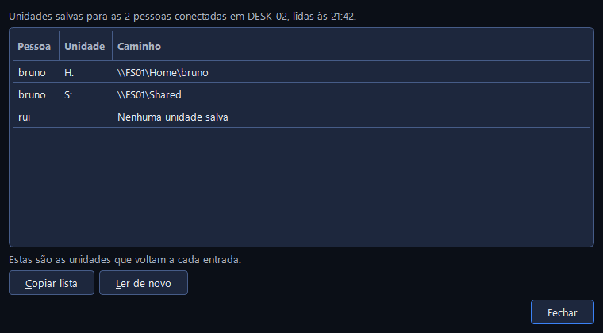
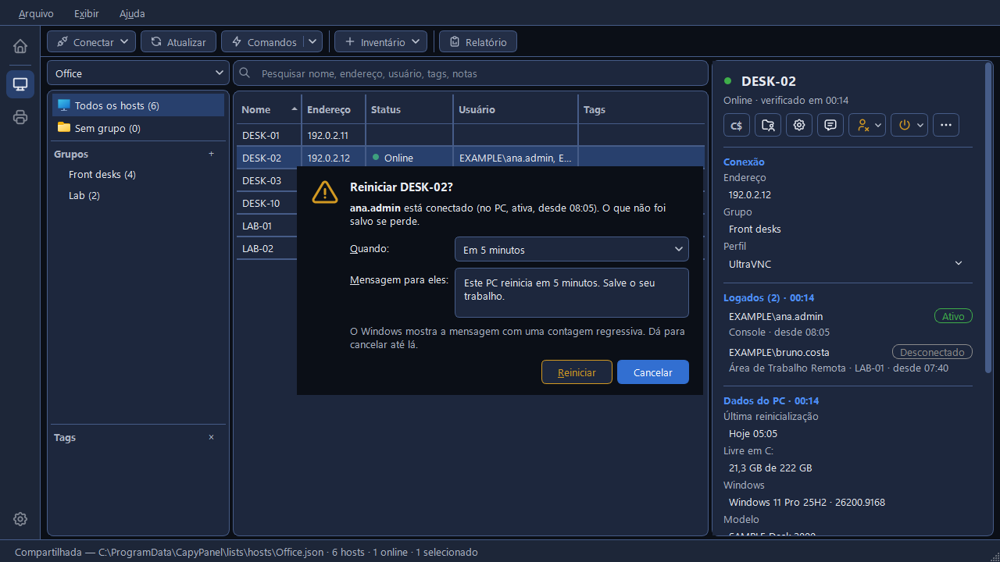
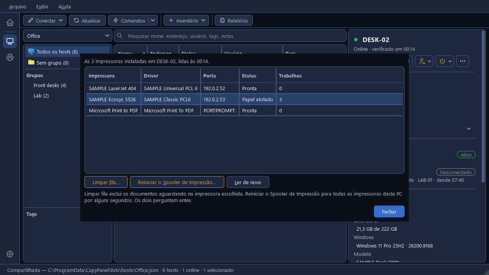
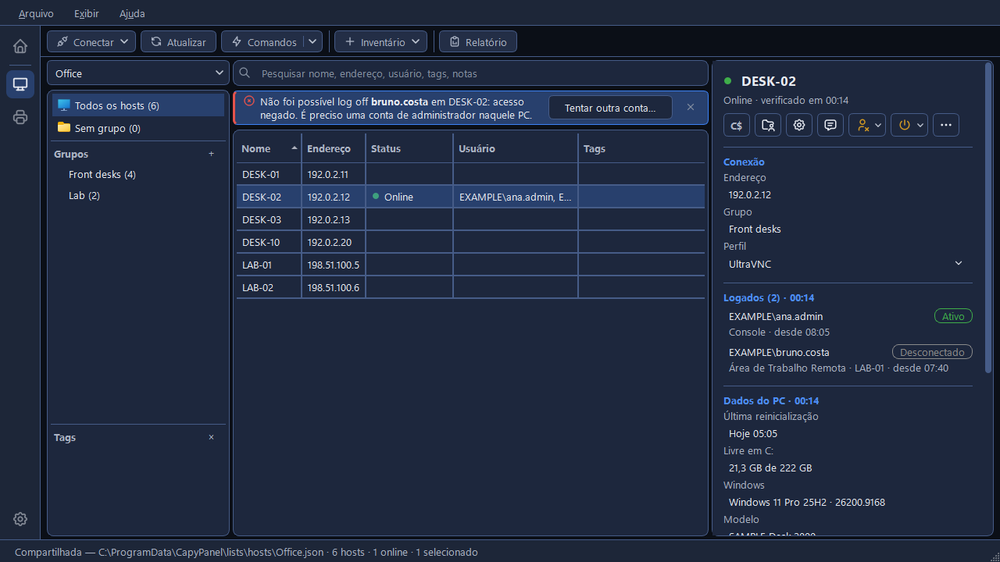
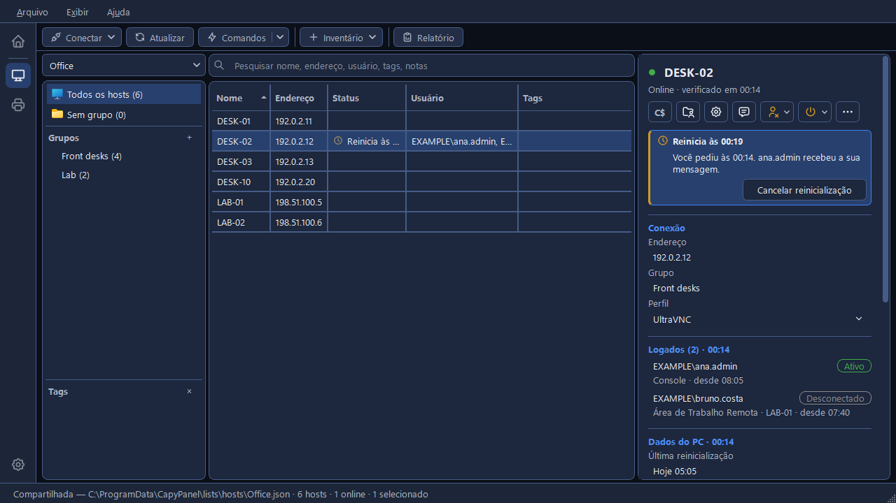
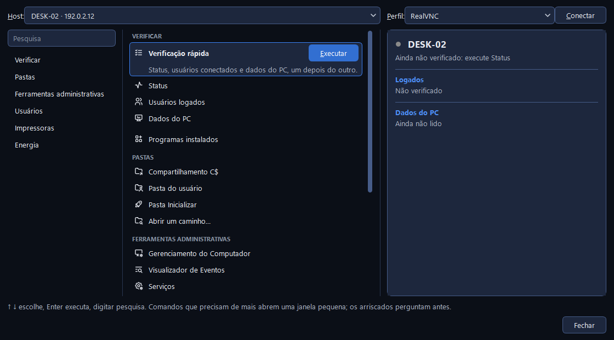

# Comandos em um host

Os comandos de um host são as tarefas de todo dia que você faria por um console ou por uma linha
de comando: abrir o disco C: de um PC, ver o que está instalado nele, mandar uma mensagem para
quem o está usando ou fazer logoff dessa pessoa, reiniciá-lo ou destravar a impressão dele. Eles
funcionam em um host por vez: o que você selecionou ou um endereço que você digita.

Nada é instalado no outro PC e nada seu é executado lá. Todo comando usa as próprias funções
remotas do Windows: o compartilhamento de arquivos, o serviço de sessões, o desligamento remoto,
o spooler de impressão, o gerenciador de serviços e o WMI para os dados do PC, os programas
instalados e as unidades mapeadas (veja
[Como o CapyPanel lê outros PCs](checking.pt-BR.md#como-o-capypanel-le-outros-pcs)). A conta é a
que o **Comandos como** do painel de detalhes diz para o host: o seu próprio login do Windows, a
não ser que uma conta tenha sido definida para ele (veja
[Contas para outros PCs](connecting.pt-BR.md#contas-para-outros-pcs)).

## Onde eles estão

- **O painel de detalhes:** uma grade de botões abaixo do nome do host, cada um com um ícone
  sobre uma palavra. A primeira fileira é sempre a mesma: **Atualizar** (o status, os usuários
  logados e os dados do PC do host), **Comandos** (a [janela Comandos](#a-janela-comandos)),
  **Usuários ▾** (fazer logoff ou desconectar alguém) e **Energia ▾** (reiniciar ou desligar).
  Embaixo dela, quatro por fileira, ficam os seus [comandos rápidos](#comandos-rapidos). Uma dica
  dá o nome completo de cada botão.
- **Clique com o botão direito num host:** **Conectar** em negrito, **Atualizar host**, os seus
  quatro primeiros comandos rápidos e depois **Todos os comandos…**, que abre a janela Comandos.
  Depois vêm **Copiar ▸**, **Editar…**, **Mover para ▸**, **Tags ▸** e **Remover**. Com vários hosts
  selecionados, o menu traz o que funciona em todos eles: **Conectar**, **Atualizar {n} hosts**,
  **Comandos como ▸**, **Copiar ▸**, **Mover para ▸**, **Tags ▸** e **Remover**.
- **A barra de ferramentas:** **Comandos**, ao lado do Atualizar, abre a janela Comandos para o
  host selecionado. A seta dele lista todos os comandos por grupo (**Verificar**, **Pastas**,
  **Ferramentas administrativas**, **Usuários**, **Impressoras** e **Energia**) e termina com
  **Todos os comandos…**.
- **Uma pessoa em Logados:** clique nela com o botão direito nos Detalhes para **Enviar uma
  mensagem para {user}…**, **Desconectar {user}…** e **Fazer logoff de {user}…**, e depois
  **Copiar ▸**.

Os comandos funcionam em um host com endereço. Os botões e itens de menu em âmbar são os que
atrapalham quem está usando o PC, e eles sempre perguntam antes.

Um comando feito para a pessoa no PC, como Enviar uma mensagem ou a pasta do usuário, diz
"… (ninguém conectado)" e fica esmaecido quando a última atualização do host, de menos de 10
minutos atrás, não encontrou ninguém. Antes de qualquer atualização, ou depois que ela fica mais
velha, ele continua utilizável.

## Comandos rápidos

Os comandos rápidos são os que você mais usa, a um clique. Cada administrador escolhe os seus: a
escolha fica nas suas configurações neste PC, nunca na lista, então quem compartilha uma lista tem
cada um os seus. O CapyPanel começa com **Compartilhamento C$**, **Pasta do usuário**,
**Gerenciamento do Computador** e **Enviar uma mensagem…**.

Para escolhê-los, abra **Exibir > Personalizar o painel de detalhes…**, clique com o botão direito
no painel de detalhes, ou use **Configurações > Hosts > Geral > Painel de detalhes > Comandos
rápidos > Escolher…**. A aba **Comandos rápidos** lista primeiro os comandos marcados, em **No
painel**, na ordem dos botões, e depois os outros por grupo, cada um com o atalho em cinza e a
palavra que o botão mostra. "Marque os que quiser, ou nenhum." Um comando recém-marcado vai para o
fim; **Mover para cima** e **Mover para baixo** mudam a ordem, e **Restaurar padrão…** volta aos
quatro com que o CapyPanel começa. Cada mudança aparece no painel na hora. Uma linha abaixo da
tabela os conta, como em "6 de 15 marcados · 2 fileiras no painel".

Qualquer um destes pode ser um comando rápido: Status, Usuários logados, Dados do PC, Programas
instalados, Compartilhamento C$, Pasta do usuário, Pasta Inicializar, Abrir um caminho…,
Gerenciamento do Computador, Visualizador de Eventos, Serviços, Enviar uma mensagem…, Unidades
mapeadas, Impressoras deste PC e Reiniciar o Spooler de Impressão…. "Reiniciar, Desligar, Fazer
logoff e Desconectar não podem ser comandos rápidos: eles interrompem alguém."

Os quatro primeiros também ficam no menu do botão direito do host.

## O que cada comando faz

O **Verificar** lê algo e mostra onde aquela verificação normalmente aparece:

| Comando | O que faz |
|---|---|
| **Atualizar host** | Status, usuários logados e dados do PC, um depois do outro |
| **Status** | Se o PC responde na rede (veja [Verificando hosts](checking.pt-BR.md#status)) |
| **Usuários logados** | Quem está conectado, e desde quando |
| **Dados do PC** | Versão do Windows, modelo, número de série, memória, espaço livre e última reinicialização (veja [Dados do PC](checking.pt-BR.md#dados-do-pc)) |
| **Programas instalados** | Os programas instalados para todos os usuários do PC |

As **Pastas** e as **Ferramentas administrativas** abrem algo no *seu* PC apontado para o outro:

| Comando | O que abre |
|---|---|
| **Compartilhamento C$** (Ctrl+E) | O disco C: do PC no Explorador de Arquivos |
| **Pasta de {usuário}** (Ctrl+Shift+U) | A pasta de perfil do usuário conectado |
| **Pasta Inicializar** | Os programas que iniciam para todo usuário que entra |
| **Abrir um caminho…** (Ctrl+Shift+O) | Qualquer pasta do PC, como `D:\Logs` |
| **Gerenciamento do Computador** (Ctrl+Shift+M) | O Gerenciamento do Computador do Windows, apontado para o PC |
| **Visualizador de Eventos** | Os logs de eventos do PC |
| **Serviços** | Os serviços do Windows no PC |

Os quatro primeiros são as **Pastas**, os três últimos as **Ferramentas administrativas**. Uma
pasta espera o PC responder antes de o Explorador de Arquivos abrir, porque o próprio Explorador
pode travar por meio minuto num PC desligado. Um caminho que não é uma pasta é recusado com "não
há uma pasta aí.", para que um arquivo nunca seja aberto, e assim executado, no seu próprio PC. Os
três consoles do Windows abrem na hora e mostram o erro deles quando o PC não pode ser alcançado.

O **Usuários** tem o **Enviar uma mensagem…** e as **Unidades mapeadas**. Fazer logoff e
Desconectar agem sobre uma pessoa, então são oferecidos nela: nos Detalhes, ou no **Usuários ▾**,
que lista cada pessoa conectada como um título, como em "ana.admin  (no PC, ativa, desde
08:05)", com **Fazer logoff…** e **Desconectar…** embaixo de cada uma. Ele fica esmaecido quando
ninguém está conectado, ou quando ninguém foi verificado ainda.

O **Impressoras** tem o **Impressoras deste PC** e o **Reiniciar o Spooler de Impressão…**.

O **Energia** tem o **Reiniciar…**, o **Desligar…** e o **Cancelar a reinicialização pendente**,
este esmaecido a menos que uma reinicialização pedida pelo CapyPanel ainda esteja aguardando.

## As perguntas e as janelas pequenas

### Abrir um caminho…

A "Abrir uma pasta em {host}" aceita o caminho do jeito que você já o tem: como o Explorador de
Arquivos copia, com aspas e tudo (`"D:\Logs\App"`), em outro disco (`D:\Logs` ou `D$\Logs`), só
no C: (`Users\Public`), ou um caminho `\\PC\compartilhamento\…` inteiro. Uma linha embaixo da
caixa mostra o que vai abrir, como em "Abre \\DESK-02\D$\Logs\App". A caixa guarda as últimas 10
pastas que você abriu.

### Enviar uma mensagem…

A mensagem vai para todos que estão na frente da tela do PC, mostrados como etiquetas ao lado do
**Para:**, cuja dica diz onde cada um está conectado; sessões desconectadas, e a sua, ficam de
fora. Ela aparece na tela deles até clicarem em OK, com o título "Mensagem de {seu usuário do
Windows}", e o Windows mostra cerca de 255 caracteres dela.

### Unidades mapeadas

As unidades de rede salvas para cada pessoa conectada ao PC: **Pessoa**, **Unidade** e
**Caminho**, como em "Unidades salvas para as 2 pessoas conectadas em DESK-02, lidas às 11:56.".
"Estas são as unidades que voltam a cada entrada." Uma pessoa sem nenhuma aparece como "Nenhuma
unidade salva". Elas são lidas da parte de cada pessoa no registro do PC, pelo WMI; nada é
executado no PC. O **Copiar lista** põe as linhas na área de transferência, e o **Ler de novo** as
lê outra vez.

### Fazer logoff… e Desconectar…

Os dois perguntam antes, nomeando a pessoa e onde ela está conectada. O Fazer logoff avisa que "O
que não foi salvo se perde."; o Desconectar diz que os programas dela continuam abertos e que ela
volta a eles quando entrar de novo. O Cancelar é o botão pronto para apertar.

### Reiniciar… e Desligar…

Esta janela é a pergunta. Ela nomeia quem está conectado e o que essa pessoa tem a perder. O
**Quando** começa em **Agora**: a caixa de mensagem fica esmaecida, dizendo "Sem mensagem: ele
reinicia na hora.", uma linha embaixo avisa "Agora reinicia DESK-02 na hora, sem aviso na tela.
Escolha um tempo de espera para mandar uma mensagem antes.", e o botão diz **Reiniciar agora**.

**Em 1 minuto**, **Em 5 minutos** e **Em 15 minutos** vêm cada um com uma mensagem que o Windows
mostra a eles com uma contagem regressiva, já preenchida como "Este PC reinicia em 5 minutos.
Salve o seu trabalho." e sua para mudar; o botão então diz **Reiniciar**.

O teclado começa no **Quando**: as setas escolhem, o **Tab** vai para a mensagem (quando há uma)
e depois para o botão âmbar, onde o **Enter** o executa. O Enter em qualquer outro lugar é o
**Cancelar**, o botão padrão.

### Impressoras deste PC

Uma janela com **Impressora**, **Driver**, **Porta**, **Status** e **Trabalhos**, e três botões:
o **Limpar fila…** exclui os documentos aguardando na impressora que você escolheu, o **Reiniciar
o Spooler de Impressão…** para todas as impressoras daquele PC por alguns segundos (os documentos
aguardando ficam, e saem quando ele volta), e o **Ler de novo** lê a lista de novo. Os dois
primeiros perguntam antes.

Estas são as impressoras do próprio PC, não as que um usuário adicionou para si de um servidor de
impressão. As impressoras da [ferramenta Impressoras](../printers/printers.pt-BR.md) são outra
coisa: aquelas são as impressoras em si, na rede.

### Programas instalados

**Nome**, **Fabricante**, **Versão** e **Instalado em**, com uma caixa **Pesquisar programas**,
quantos são e quando foram lidos, e depois **Copiar lista**, **Exportar CSV…** e **Ler de novo**.
O CSV abre na planilha que o seu PC usa para arquivos CSV, com a mesma proteção contra uma célula
que uma planilha executaria como fórmula que o relatório de hosts tem.

A lista traz os programas instalados para todos os usuários do PC. As partes do próprio Windows e
as atualizações dele ficam de fora, e o CapyPanel nunca pergunta ao Windows pelo `Win32_Product`,
que repara cada programa que lista enquanto passa por eles.

## O que aconteceu: a faixa acima da tabela

Um comando que deu certo diz isso em verde acima da tabela de hosts, como em "Mensagem enviada
para ana.admin em DESK-02.", e a faixa se fecha sozinha depois de alguns segundos.

Um comando que falhou diz isso em vermelho, com o motivo do próprio Windows: "Não foi possível
fazer logoff de bruno.costa em DESK-02: acesso negado. É preciso uma conta de administrador
naquele PC." Essa faixa fica até você fechá-la. Quando o problema foi a conta, o **Tentar outra
conta…** pede outra, e para quais PCs usá-la (veja
[Contas para outros PCs](connecting.pt-BR.md#contas-para-outros-pcs)), e executa o comando de
novo.

Abrir uma pasta é a exceção: ela diz "Aberto: \\DESK-02\C$" na barra de status, onde o resto do
que você abre também aparece.

## Uma reinicialização que aguarda

Uma reinicialização ou um desligamento com atraso aparece na coluna **Status**, como "Reinicia às
14:37" com um relógio, e nos Detalhes como uma faixa âmbar: "Reinicia às 14:37", "Você pediu às
14:32. ana.admin recebeu a sua mensagem." e **Cancelar reinicialização**. O **Energia > Cancelar
a reinicialização pendente** faz o mesmo pelos menus.

Depois que o PC reinicia, o CapyPanel procura por ele a cada 15 segundos. Assim que ele sumiu e
responde de novo, uma notificação do Windows diz "{host} está online de novo", com "Ele reiniciou
às 14:37 e respondeu de novo às 14:39. Clique para mostrá-lo."; o clique seleciona aquele host. O
CapyPanel para de procurar 20 minutos depois do horário da reinicialização.

## A janela Comandos

A janela Comandos reúne todos os comandos de um PC num lugar só, com a resposta ao lado. Ela abre
pelos botões **Comandos**, pelo **Todos os comandos…** e pelo **Conectar > Conexão manual…**
(Ctrl+M), que é a mesma janela para um endereço que não está na sua lista. É uma janela própria,
ao lado da principal e não por cima dela: você pode voltar à lista de hosts e deixá-la aberta.
Pedir os Comandos de outro host com ela aberta vira a janela para esse host, e as respostas de
cada host ficam guardadas enquanto ela continua aberta, então voltar a um host as mostra de novo.
Ela abre em 1120 × 620 na primeira vez e pode ser redimensionada: mais larga, os comandos e as
respostas dividem o espaço a mais; mais estreita, as respostas mantêm a largura e a lista de
comandos rola para o lado. Ela abre de novo no tamanho em que você a deixou.

- **No topo:** a caixa **Host**, e depois **Perfil** e **Conectar**. A caixa lista os hosts que o
  painel de hosts mostra, como "DESK-02 · 192.0.2.12", e em **Recentes** os endereços que você
  digitou antes; você também pode digitar um nome ou um endereço (`host:porta` funciona). Escolher
  outro host muda a janela inteira para ele, inclusive o perfil. O título diz "Comandos · DESK-02"
  para um host seu e "Conexão manual · 198.51.100.40" para um endereço digitado.
- O **Adicionar à lista de hosts…** aparece ao lado da caixa só para um endereço digitado que a
  lista aberta não tem: ele põe o PC na lista, com o endereço já preenchido.
- **À esquerda:** uma caixa **Pesquisa** e os seis grupos; um clique pula para um grupo.
- **No meio:** todos os comandos, um por linha, com o atalho em cinza quando ele tem um. O que
  você escolhe cresce para mostrar o que ele
  faz e um botão **Executar**. As setas movem, o Enter executa, e digitar em qualquer lugar
  pesquisa; um clique duplo só escolhe, para um comando arriscado nunca rodar por acidente.
- **À direita:** o que o comando encontrou, apresentado como o painel de detalhes apresenta: o
  status, quem está logado, os dados do PC, ou a última resposta com **Tentar outra conta…**. As
  Impressoras deste PC, os Programas instalados e as Unidades mapeadas aparecem ali como tabelas:
  clique numa impressora com o botão direito para limpar a fila dela ou copiar a linha, e num
  programa para copiar a linha, copiar ou exportar a lista inteira, ou abrir a lista na própria
  janela com uma pesquisa. Os comandos que precisam que você digite algo abrem a janela pequena
  deles por cima desta.
- **Embaixo:** uma linha de ajuda, "↑ ↓ escolhe, Enter executa, digitar pesquisa. Comandos que
  precisam de mais abrem uma janela pequena; os arriscados perguntam antes.", e o **Fechar**.
