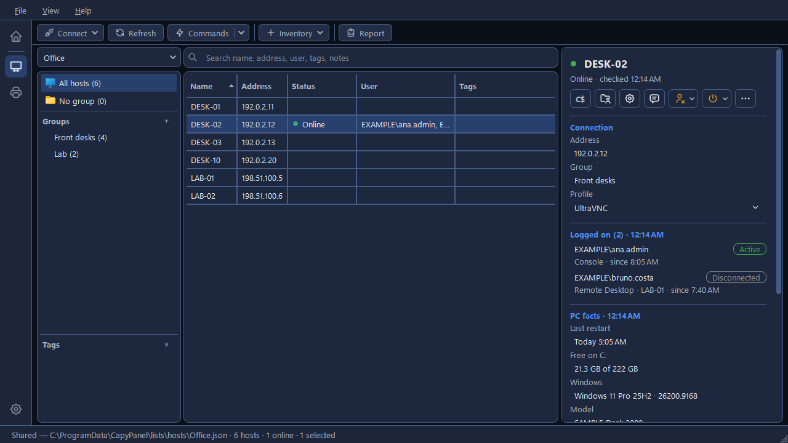

# Connecting

CapyPanel opens a host's screen in a VNC viewer you install yourself (UltraVNC or RealVNC), or in
Windows' own Remote Desktop client. It never ships, bundles or downloads them.

## Connect to a host

1. Double-click the host, press **Enter**, or click **Connect** on the toolbar.
2. The first time, CapyPanel finds the viewer by itself. If it isn't installed, it asks you to
   install it or to locate its `.exe`.
3. Type the password when asked. It's kept until CapyPanel closes, or in Windows Credential Manager
   if you tick **Remember it on this computer**.

Select several hosts and press **Enter** to open each in its own window; each profile's password is
asked at most once, and more than five at once asks first.

??? note "The tools, and how they get the password"

    | Tool | How CapyPanel gives it the password |
    |---|---|
    | **UltraVNC Viewer** | On its command line (the only way UltraVNC accepts one). Administrators of your PC can see command lines; the log never shows the password |
    | **RealVNC Viewer** | Through a private pipe that only your Windows account can open, read once. Nothing is written to disk or put on the command line |
    | **Remote Desktop Connection** | It doesn't: the Remote Desktop client asks for the password itself |

    Remote Desktop Connection is built into Windows, so CapyPanel finds it in `System32`. A VNC
    viewer is found where Windows recorded the install, the usual Program Files folders, then your
    PATH; a portable copy unzipped somewhere else isn't. The path is saved once for everyone on the
    PC, as in **Settings > Hosts > Connecting > Remote tools**.

??? note "Passwords"

    - For VNC, CapyPanel asks for a profile's password the first time you connect with it, and
      remembers it, per profile, until it closes. Hosts with another profile never receive it.
    - Every window that asks for a password has **Remember it on this computer**, unticked:
      "Windows keeps it in Credential Manager for your Windows account. Otherwise CapyPanel forgets
      it when it closes and asks once the next time." Neither way puts a password in a file of
      CapyPanel's own. One window starts ticked: when a PC rejects an account whose password you
      had remembered and CapyPanel asks for it again, so typing it again keeps it saved.
    - Classic VNC passwords are at most 8 characters long, so the password box of an UltraVNC
      "password only" profile stops at 8.

??? note "The login check, before UltraVNC sends a password"

    Classic VNC password login uses only the first 8 characters of a password, and its exchange can
    be cracked offline. So before an UltraVNC **user-and-password** profile connects, CapyPanel
    asks each server which kinds of login it offers: it reads the server's greeting and hangs up
    without logging in. A server that doesn't take a user and password is skipped, with a message,
    and is never sent your password.

    - The check takes a few milliseconds per host on a local network.
    - A server that can't be asked (unreachable, or refusing connections) still opens in the
      viewer, which shows the real error.
    - A server using the SecureVNC plugin announces only the plugin, so the check can't tell the
      two kinds of login apart there.

## Choose how a host connects

A **connection profile** says how a host connects: the **tool**, the **login** (user and password,
or password only) and the tool's **options**, such as UltraVNC's **SecureVNC plugin**.

- **For a group:** right-click it > **Connection profile**. Every host inside follows it, unless it
  sets its own.
- **For a host:** pick it under **Connect with** in the Details panel, or in **Edit selected…**
  (F2), which can cover several hosts at once.
- **Just once:** the toolbar's **Connect** dropdown lists one item per profile, such as **Connect
  with Remote Desktop**; the selected hosts open with it this time, without changing them.

"From group" means the host follows the nearest group that sets a profile. Hosts with no profile
anywhere use the default.

??? note "More about Connect with and Commands run as"

    - **Connect with** opens the same list as a group's **Connection profile** menu: the group's
      choice, as in "From group “Front desk”: UltraVNC", or a profile by name. A small key beside
      the name means a login is kept for that profile; its tooltip names the user.
    - **Commands run as** is the account that reads who is logged on and runs the host's commands.
      It offers **Follow Accounts** (what the Accounts table gives this PC), **Your Windows
      account**, each account of the table, and **Another account…**. Picking one sets it for this
      PC alone, with a small pin beside the name; **Follow Accounts** takes the pin off. It's also
      on the right-click menu of several selected hosts and of a group.
    - A list stores only a profile's ID. A host or group that names a profile your PC doesn't have
      follows its group's profile, or the default, and the missing one is marked "not available on
      this PC".

## Set up connection profiles

Open **Settings > Hosts > Connecting > Connection profiles** (or **Connect > Connection
profiles…**) to add, edit, duplicate, delete, or restore the ones CapyPanel ships with. Each
profile has a name, a tool, a login, the tool's options and a port (blank for the tool's own).

CapyPanel starts with **UltraVNC** and **RealVNC**, both with "user and password", and **Remote
Desktop**. **Hosts with no profile use**, the last row, is the profile for hosts with none of their
own.

??? note "Where profiles are kept, and who can change them"

    - All profiles live in `C:\ProgramData\CapyPanel\profiles\`, so everyone on the PC sees the
      same ones. **Windows permissions decide who can change them**: CapyPanel creates the folder
      read-only for other users, and a profile file made by another user (not an administrator) is
      ignored. **Hosts with no profile use** is saved there too.
    - A starter profile is added once, also on a PC that already had profiles; one you delete
      stays deleted.
    - Deleting a profile asks first, with how many hosts and groups in the open list use it. Those
      then follow their group's profile, or the default.
    - A profile can name a viewer that isn't installed on this PC (it's marked so). CapyPanel asks
      for the viewer only when you connect.

??? note "UltraVNC: a viewer settings file"

    For anything else UltraVNC offers (quality, scaling, view-only, full screen and so on), an
    UltraVNC profile can carry a settings file:

    1. In UltraVNC Viewer, set the options and save the connection as a `.vnc` file.
    2. In the profile editor, **Viewer settings > Choose file…** and pick it. **Use defaults** goes
       back to the viewer's own settings.

    On **Add** or **Save**, CapyPanel copies the file beside the profile (`profiles\<id>.vnc`).
    It's used **exactly as saved**, encryption plugin included; only the `host` is emptied. While a
    profile has a file, its options are off: the file decides. When you connect, the viewer gets a
    temporary copy, deleted a minute later.

??? note "Remote Desktop profiles"

    A Remote Desktop profile opens the host in `mstsc`, on port 3389 unless the host or profile
    sets another. Its options are **Administrative session (servers only)**, **Full screen** and
    **Use all my monitors**; there's no settings file. CapyPanel never handles a Remote Desktop
    password: the client asks for it. If you tick **Remember me** there, Windows keeps that login
    itself, as `TERMSRV/<address>`; remove it in **Control Panel > Credential Manager**.

## Use another account on some PCs

Reading who is logged on and running [commands](commands.md) need an account that's an
administrator on that PC. By default that's your own Windows account. To use another one:

1. Open **Settings > Hosts > Credentials > Accounts** and click **Add…**.
2. Type the **User** (empty for your Windows account) and, if you like, the **Password**; it's
   asked the first time it's needed otherwise.
3. Under **Use it for**, pick **Every PC**, **One PC**, **A group** or **A tag**, then **Add**.

When several rows match a PC, the narrowest wins: "A PC's own account wins over its group's, a
group's over a tag's, and those over Every PC." The table is yours only, "kept in your own
settings, never in the shared host lists".

??? note "More about accounts"

    | Column | What it shows |
    |---|---|
    | **Account** | The user, as `DOMAIN\user` |
    | **Used for** | **Every PC**, a group, as in "Group Clinic › Front desk", a tag, or one PC, as in "DESK-02 (198.51.100.20)" |
    | **Kept in** | Where its password is: **Credential Manager**, **Temporary**, or **Asked when needed** |

    - **Remove** takes the row away, and its saved password with it. Groups and tags are those of
      the open list.
    - When PCs answer **No admin rights** or **Account rejected**, CapyPanel asks for another
      account (after a Refresh, or with **Try another account…** after a failed command) in
      **Account for other PCs**, with **Use it for** offering this PC, each group and tag they
      share, or every PC, the narrowest first. **Use account** makes it a row of the table. "If a
      computer rejects it, CapyPanel stops and asks again instead of trying it on the others, so
      the account isn't locked."
    - On PCs that aren't in a domain, the built-in Administrator is the only local account Windows
      accepts remotely.

## Forget a saved password

1. **Connect ▾ > Saved credentials…** (or **Manage…** on **Settings > Hosts > Credentials**).
2. Pick the login and click **Forget**, or **Forget all**.

CapyPanel can't tell when a viewer rejects a password, so this is how to fix a typo. A login
forgotten here is deleted from Credential Manager too.

??? note "More about saved credentials"

    "Every login CapyPanel keeps for you. Passwords never show here." The window lists **Used for**
    (the profile, or the PCs an account is for), **Tool**, **User** ("(password only)" for a profile
    that takes only a password) and **Kept** (**Credential Manager**, or **Temporary** until
    CapyPanel closes). Windows encrypts them for your account, "so anyone using your Windows
    session can connect with them."

    **Forget all** asks first, listing every login; Cancel is the default button. The printers'
    SNMP and Doc360 accounts aren't listed: they're managed in **Settings > Printers > Connecting**
    (see [Set the SNMP account](../printers/checking.md#set-the-snmp-account)). Remote Desktop
    logins aren't either.

## Connect to an address that isn't in the list

**Connect > Manual connection…** (Ctrl+M) opens the Commands window with its **Host** box empty:
type the address, pick a **Profile** and click **Connect**. An address with a port, as in
`192.0.2.77:5901`, uses that port. **Add to host list…** puts the PC into the open list (see
[The Commands window](commands.md#the-commands-window)).

## Messages you may see

| Message | What it means | What to do |
|---|---|---|
| A host's name can't be used as an address | It has no address, and a name like "Ward 2A - Desk" isn't a computer name | Edit the host and add its address; CapyPanel offers to |
| A server skipped by the login check | It doesn't take a user and password, so it was never sent yours | Use a "password only" profile for it |
| "not available on this PC" | A host or group names a profile this PC doesn't have | Pick another profile, or add that one |
| The viewer asks to be installed or located | The VNC viewer wasn't found | Install it, or point CapyPanel to its `.exe` |
