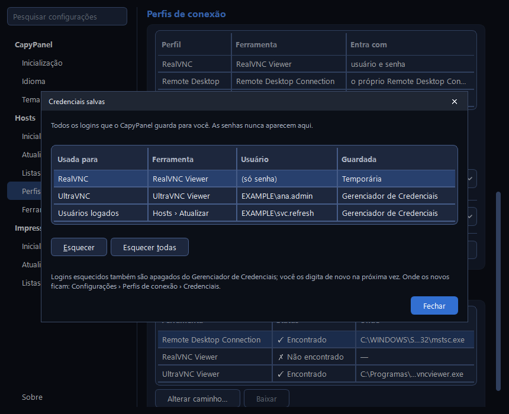

# Conectando

O CapyPanel abre telas remotas por visualizadores VNC que você mesmo instala, e pelo cliente de
Área de Trabalho Remota do próprio Windows. Ele nunca os distribui, empacota ou baixa.

## Ferramentas suportadas

| Ferramenta | Como o CapyPanel entrega a senha |
|---|---|
| **UltraVNC Viewer** | Na linha de comando (o único jeito que o UltraVNC aceita). Administradores do seu PC podem ver linhas de comando; o log nunca mostra a senha |
| **RealVNC Viewer** | Por um pipe privado que só a sua conta do Windows pode abrir, lido uma vez. Nada é gravado em disco nem vai para a linha de comando |
| **Remote Desktop Connection** | Não entrega: o próprio cliente de Área de Trabalho Remota pede a senha |

O Remote Desktop Connection vem com o Windows, então o CapyPanel o encontra na `System32`. Um
visualizador VNC instalado ele também encontra sozinho: onde o Windows registrou a instalação
(qualquer pasta), as pastas de Arquivos de Programas de costume, depois o seu PATH. Uma cópia
portátil descompactada em outro lugar não é encontrada automaticamente; quando falta um
visualizador, o CapyPanel pede para instalá-lo ou localizar o `.exe`. O caminho é salvo uma vez
para todos no PC, como em **Configurações > Hosts > Ferramentas remotas** (veja
[Configurações e arquivos](../settings-and-files.pt-BR.md#ferramentas-remotas)).

## Perfis de conexão

Uma rede costuma misturar várias configurações: servidores VNC que pedem uma conta do Windows (o
MS-Logon do UltraVNC), servidores que pedem só uma senha VNC, plugins de criptografia, RealVNC em
Raspberry Pis, Área de Trabalho Remota. Um **perfil de conexão** diz qual delas um host usa:

- a **ferramenta**: um visualizador VNC ou o Remote Desktop Connection;
- o **login**: usuário e senha, ou só senha. Na Área de Trabalho Remota a tabela lê "o próprio
  Remote Desktop Connection pede";
- **opções** que a ferramenta oferece, como o **plugin SecureVNC** do UltraVNC.

### Gerenciar perfis

- Os perfis são gerenciados em **Configurações > Hosts > Perfis de conexão** (também em
  **Conectar > Perfis de conexão…**): adicionar, editar, duplicar, excluir e restaurar os que vêm
  com o CapyPanel. Cada um tem um nome, uma
  ferramenta, um login (só os que essa ferramenta suporta), as opções da ferramenta (como o
  SecureVNC) e uma porta, em branco para a da própria ferramenta.
- Cada ferramenta vem com um perfil inicial: **UltraVNC** e **RealVNC**, ambos com "usuário e
  senha", e **Remote Desktop**. Um perfil inicial é adicionado uma vez, também num PC que já tinha
  perfis; são perfis comuns, e um que você exclui continua excluído.
- Todos os perfis ficam juntos em `C:\ProgramData\CapyPanel\profiles\`, junto da lista padrão,
  para que todos no PC vejam os mesmos e seja fácil conferi-los. **As permissões do Windows
  decidem quem pode alterá-los**: o CapyPanel cria a pasta no primeiro início, somente leitura
  para os outros usuários. Um arquivo de perfil criado por outro usuário (que não seja
  administrador) é ignorado.
- **Hosts sem perfil usam**, a última linha dessa seção, é o perfil com que um host conecta
  quando não tem um próprio. Ele é salvo na mesma pasta, então é o mesmo para todos.
- Excluir um perfil pergunta antes e diz quantos hosts e grupos da lista aberta o usam. Eles
  passam a seguir o perfil do grupo, ou o padrão.
- Um perfil pode indicar um visualizador que não está instalado neste PC (ele aparece marcado),
  por exemplo para preparar os perfis antes de instalar os visualizadores. O CapyPanel pede o
  visualizador só na hora de conectar.

### Arquivos de configurações do visualizador

Por padrão, um perfil usa as configurações do próprio visualizador, mais as opções do perfil.
Para todo o resto que o visualizador oferece (qualidade, escala, só visualização, tela cheia e
assim por diante), um perfil do **UltraVNC** pode levar um arquivo de configurações:

1. No UltraVNC Viewer, ajuste as opções que quiser e salve a conexão como um arquivo `.vnc`.
2. No editor de perfil, **Configurações do visualizador > Escolher arquivo…** e selecione-o.
   **Usar padrões** volta às configurações do próprio visualizador.

Quando você clica em OK, o CapyPanel copia o arquivo para junto do perfil
(`profiles\<id>.vnc`). Ele é usado **exatamente como foi salvo**, inclusive o plugin de
criptografia; só o `host` é esvaziado, já que o endereço vem do host que você abre. Enquanto um
perfil tem arquivo, as opções dele (como o SecureVNC) ficam desligadas: quem decide é o arquivo.
Ao conectar, o visualizador recebe uma cópia temporária, apagada um minuto depois, e o arquivo
compartilhado nunca é alterado.

### Escolher um perfil

- **Num grupo:** clique com o botão direito no grupo > **Perfil de conexão**. Todos os hosts
  dentro dele o seguem, inclusive os de grupos aninhados, a menos que definam o próprio.
- **Em hosts:** no campo **Perfil de conexão** do próprio host, em **Editar selecionado…** (F2).
  Uma edição pode cobrir vários hosts de uma vez.
- **"Do grupo"** significa que o host segue o grupo mais próximo que define um perfil. Hosts sem
  perfil em lugar nenhum usam o padrão.
- **Só uma vez:** o menu **Conectar** da barra de ferramentas lista **Conectar com RealVNC**,
  **Conectar com Remote Desktop** e assim por diante, um por perfil: os hosts selecionados abrem
  com aquele perfil desta vez, sem serem alterados.

O painel de **detalhes** diz qual perfil cada host acaba usando, em **Conexão**, com uma seta ao
lado dele, "Trocar o perfil de conexão". Ela abre a mesma lista do submenu **Perfil de conexão**
do botão direito, o **Do grupo** ou um perfil pelo nome, então o perfil de um host pode ser
trocado dali sem abrir o **Editar selecionado…**.

Uma lista guarda só o ID do perfil. Quando um host ou grupo cita um perfil que o seu PC não tem,
ele segue o perfil do grupo (ou o padrão), e o que falta é marcado como "não disponível neste PC"
onde quer que apareça: no campo **Perfil de conexão** do host e no menu **Perfil de conexão** de
um grupo.

## Área de Trabalho Remota

Um perfil de Área de Trabalho Remota abre o host no cliente de Área de Trabalho Remota do Windows
(`mstsc`), na porta 3389, a menos que o host ou o perfil defina outra. As opções dele são caixas
de seleção no perfil: **Sessão administrativa (só servidores)**, que só faz diferença em
servidores de Serviços de Área de Trabalho Remota, **Tela cheia** e **Usar todos os meus
monitores**. Não há arquivo de configurações para a Área de Trabalho Remota.

O CapyPanel nunca lida com a senha da Área de Trabalho Remota: o cliente a pede, e a verificação
de login abaixo não se aplica. Um login da Área de Trabalho Remota também nunca está nas
**Credenciais salvas**. Se você marcar **Lembrar de mim** no cliente de Área de Trabalho Remota, o
Windows guarda esse login por conta própria, como `TERMSRV/<endereço>`; remova-o por lá, ou no
**Painel de Controle > Gerenciador de Credenciais**.

## Senhas

- No VNC, o CapyPanel pede a senha de um perfil na primeira vez que você conecta com ele e **a
  lembra, por perfil**, até fechar. Hosts com outro perfil nunca a recebem.
- Onde ele guarda essa senha é você que escolhe, em **Configurações > Hosts > Perfis de conexão >
  Credenciais**: **Credenciais temporárias**, o padrão, "esquecidas quando o CapyPanel fecha", ou
  **Gerenciador de Credenciais**, "salvas para a sua conta do Windows". Em nenhum dos dois casos o
  CapyPanel grava uma senha num arquivo próprio.
- Senhas VNC clássicas têm no máximo 8 caracteres, então a caixa de senha de um perfil UltraVNC
  "só senha" para em 8.

### Credenciais salvas

O **Gerenciador de Credenciais** guarda a senha digitada no **Gerenciador de Credenciais do
Windows**, na sua própria conta do Windows, para o CapyPanel não pedi-la de novo na próxima vez que
abrir. A dica dele diz o que isso significa: "O Windows as criptografa para a sua conta, inclusive
contas de domínio: quem usar a sua sessão do Windows pode se conectar com elas." Voltar para
**Credenciais temporárias** apaga as que já estavam salvas. A escolha vale também para a conta
digitada para ler os usuários logados (veja
[Verificando hosts](checking.pt-BR.md#qual-conta-e-usada)).

O **Conectar ▾ > Credenciais salvas…**, e o **Gerenciar…** da linha **Credenciais salvas** dessa
mesma seção das configurações, abrem uma janela com todos os logins que o CapyPanel guarda: "Todos
os logins que o CapyPanel guarda para você. As senhas nunca aparecem aqui." A linha das
configurações diz quantos são e onde estão, como "2 guardados: 1 no Gerenciador de Credenciais, 1
temporário.", ou "Nenhum guardado."

| Coluna | O que ela mostra |
|---|---|
| **Usada para** | O perfil de conexão, ou **Usuários logados** |
| **Ferramenta** | O que entra com ela, como "RealVNC Viewer" ou "Hosts › Atualizar" |
| **Usuário** | O nome de usuário, ou "(só senha)" num perfil que só recebe senha |
| **Guardada** | **Gerenciador de Credenciais**, ou **Temporária** até o CapyPanel fechar |

O **Esquecer** descarta o login escolhido, por exemplo depois de um erro de digitação: o CapyPanel
não consegue saber quando um visualizador recusa uma senha. O **Esquecer todas** pergunta antes,
listando cada login em "Salvos no Gerenciador de Credenciais:" e "Temporários:", e então "O
CapyPanel pede de novo quando precisar deles."; o Cancelar é o botão padrão. Um login esquecido
aqui também é apagado do Gerenciador de Credenciais.

Só os logins de conexão são listados. A comunidade SNMP e a conta v3 das impressoras não: elas são
gerenciadas em **Configurações > Impressoras > Atualizar**, onde esvaziar o campo as esquece (veja
[Verificando impressoras](../printers/checking.pt-BR.md#a-conta-snmp)).

## A verificação de login

O login VNC clássico por senha usa só os 8 primeiros caracteres da senha, e sua troca pode ser
quebrada offline. Por isso, antes de um perfil UltraVNC de **usuário e senha** conectar, o
CapyPanel pergunta a cada servidor quais tipos de login ele oferece. Ele lê a saudação do servidor
e desliga sem fazer login. Um servidor que não aceita usuário e senha é pulado, com uma mensagem,
e nunca recebe sua senha.

- A verificação leva poucos milissegundos por host numa rede local.
- Um servidor que não pode ser consultado (inacessível, ou recusando conexões) ainda abre no
  visualizador, que mostra o erro real.
- Um servidor com o plugin SecureVNC anuncia só o plugin, não o login por trás dele, então a
  verificação não consegue distinguir os dois tipos nesse caso.

## Abrir vários hosts

Selecione vários hosts e pressione Enter: cada um abre na sua própria janela do visualizador,
agrupados por perfil, então a senha de cada perfil é pedida no máximo uma vez. Abrir mais de cinco
de uma vez pergunta antes.

Um host sem endereço conecta pelo nome só quando o nome é um nome de computador válido. Um nome
como "Ala 2A - Posto" não pode ser usado como endereço, então o CapyPanel avisa e oferece editar o
host.

## Conexão manual

**Conectar > Conexão manual…** (Ctrl+M) abre um endereço que não está na lista, com o perfil e a
porta que você escolher. Deixe a porta em "Padrão" para usar a do perfil.
