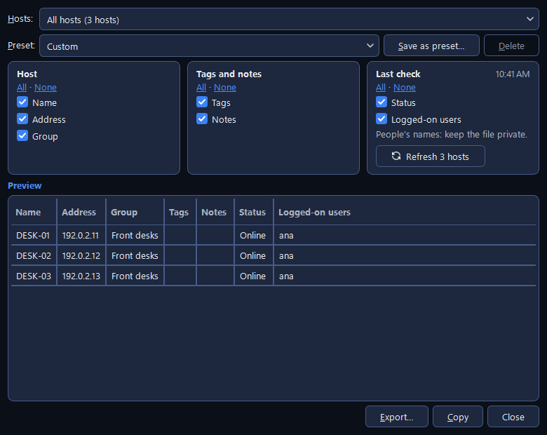

# Host lists

A host list is one file holding your computers, the groups they sit in and their tags. CapyPanel
shows one list at a time and saves every change right away. This page covers arranging a list,
finding a host in it, and moving many hosts in or out at once. The guide that shows the first time
Hosts opens points out the list, its groups and tags on a sample PC; **Help > Guide to this
screen** shows it again.

## Arrange hosts in groups

1. Click **+** beside the **Groups** heading, or use **Inventory > Add group…**, to make a group.
   Groups nest as deep as you like ("Headquarters › Finance › Floor 3").
2. Drag selected hosts from the table onto a group to move them there, or right-click them and use
   **Move to ▸**.
3. Drag a group up or down to reorder it, onto another group to put it inside, or onto the
   **Groups** heading to bring it back to the top level.

A host you haven't put anywhere sits under **No group**, which shows under "All hosts" with how
many it holds. A new list starts with one group, **Default group**.

??? note "More about arranging"

    - Right-click a group > **Move to** lists **Groups** (the top level), then every group this one
      can go into, drawn as a tree; where it is now is ticked. For hosts, **Move to** lists **No
      group** first, then the same tree.
    - A group you collapsed stays collapsed, and moving a group into a collapsed one opens the way
      to it, so what you moved stays in sight.
    - **Inventory > Manage groups…** shows the whole tree in a window, with **Move to**, **Move
      up**, **Move down** and **Sort A–Z** (a one-time sort you can rearrange after). Dragging
      works there too. "Nothing changes until you click Save." Lists made before version 0.13.0
      show their groups in the order they were created; Sort A–Z puts them in order once.
    - On a read-only list, dragging is off.
    - **Notes** hold anything else worth knowing about a host. They show in the Details panel, and
      searching always covers them.

??? note "Removing a group"

    Right-click a group > **Remove selected**, or press Del with a group picked. An empty group
    only asks to confirm. A group with anything in it asks what should happen to what's inside:

    - **Move them to ▸** picks where they go: **No group**, or any group that isn't being removed.
      The group above this one is ticked, so the usual answer is one click. Nothing is deleted;
      the groups inside move along with their hosts.
    - **Remove everything:** the group, every group inside it and all their hosts.

    Cancel is the default button, so Enter or Esc leaves the list as it is.

## Tag hosts and filter by tag

1. Select the hosts, right-click them and open **Tags ▸**.
2. Pick a tag to give it to all of them (or take it from all of them, when they all have it), or
   **New tag…** to make one.
3. Click a tag in the Groups panel: the table keeps only the hosts carrying it. Pick several and
   it keeps only the hosts carrying **all** of them.

Tags cut across groups ("kiosk", "floor-3"). A tag narrows the group you have picked; to see it
across the whole list, pick **All hosts** first.

??? note "More about tags"

    - In **Tags ▸**, a tag is ticked where every selected host carries it, and shows "(1 of 2)"
      where only some do. Tags you've used before are suggested as you type, spelling kept.
    - While tags are picked, a tinted strip above the table says which, as in "Only hosts with all
      of: kiosk, floor-3 · 4 of 37 shown", with a **Clear** button; the **Tags** heading shows how
      many are picked and offers a **×**; the status bar adds "Tags: kiosk, floor-3".
    - Picked tags stay as you move between groups and while you search.
    - Printers has the same **Tags ▸** menu.

## Find a host

Type in the box above the table (**Ctrl+F** jumps there). It searches the whole open list,
whatever group or tag is picked, and case doesn't matter. Press **Down** or **Enter** to move to
the first result, and **Esc** to end the search and go back to the group you had picked.

??? note "What the search covers"

    The box lists what it covers, "Search name, address, status, user, tags, notes" when every
    column is shown:

    - the computer **name** and the **notes**, always;
    - the **address**, the **status**, the logged-on **users** and the **tags**, each while its
      column is shown. The status is searched as the column says it, so "online" or "not checked"
      lists the hosts with that status. Status and users come from the last refresh, so a host
      that hasn't been checked isn't found by who is on it.

    While you search:

    - What you typed is marked wherever it matched, in the table and in the notes in Details.
    - Nothing is picked in the Groups panel; the Details panel says which group the selected host
      is in, and CapyPanel never jumps there by itself.
    - The status bar adds **N found**. **Refresh all** checks only the results, and automatic
      status only the hosts shown. **Report** offers the results as what to export.
    - **Down** and **Enter** in the box never connect, so a typo can't reach the wrong PC. In the
      table, a double-click and Enter connect as usual.
    - The **×** in the box also ends the search, and so does picking a group or tag, or switching
      host lists.

## Add hosts from a spreadsheet

1. **Inventory > Import hosts…**.
2. Paste a list into the box at the top, or click **Open a CSV file…** for a `.csv` or `.txt`
   file. The rows fill the preview below.
3. Check the preview, and pick where hosts with no group go under **Hosts with no group go to:**.
4. Click **Add {n} hosts**. Nothing changes in your list before that.

Three shapes are understood, and **Formats…** shows each one with an example:

| Format | What it looks like |
|---|---|
| **Hostnames** | One computer name per line |
| **Name and address** | A name, then the computer's name or IP address, separated by a comma, or two columns copied from Excel |
| **CSV with headers** | A first line naming the columns: `name, address, group, tags, notes` |

A host already in your list is skipped, never overwritten.

??? note "More about the columns"

    - With headers the columns can come in any order, and their names work in English or in
      Portuguese (`nome, endereço, grupo, tags, notas`), however their words are joined and
      whatever their case: `GroupName`, `Group name` and `group_name` are all the group column.
    - In a group cell, `/` separates the levels ("Headquarters/Front desk"); in a tags cell, `;`
      separates the tags. Columns CapyPanel has no use for are ignored, and the summary names them.
    - A table copied with its columns lined up with spaces instead of tabs is read too, as long as
      the first line is the header row and names at least two columns, one of them the name.
    - A list with more than a name and an address but no header row can't be read: CapyPanel won't
      guess which column is which.

??? note "Fixing rows in the preview"

    The preview shows **Name**, **Address**, **Group**, **Tags**, **Notes** and a **Warning** for
    every row. Right-click a row:

    - **Edit cell** (F2) changes the value under the pointer; a double-click does the same.
    - **Put in group ▸** puts the selected rows in a group, picked from the tree.
    - **Set tags…** gives the selected rows the same tags, separated by `;`.
    - **Leave out of the import** (Del) drops the rows from this import. The file isn't touched.
    - **Add a row below** types a host in by hand.

    Editing in the table rewrites the pasted text above as CSV with a header row, so the two always
    agree; CapyPanel asks before doing that the first time. A group named in the file that doesn't
    exist yet is created by the import, and the preview and summary say so. Tags and notes come in
    with their hosts. The summary counts what will be added, skipped and can't be added, and each
    row says why.

## Export hosts to a spreadsheet

1. Click **Report** on the toolbar.
2. Pick the **Hosts**: a group, a tag, the selected hosts, the search results, or all of them.
3. Tick the **Columns**, or pick a **Preset**.
4. Click **Copy** to paste into Excel, or **Export…** to save a CSV file.

**For Import** ticks the hosts' own fields, which Import hosts reads back: a way to copy hosts to
another list, or keep a copy before a big change. Report only reads the list, so it works on a
read-only one too.

??? note "More about the Report"

    - **Columns** come in three boxes: **Host** (Name, Address, Group), **Tags and notes** and
      **Last check** (Status, Logged-on users). Each has **All · None**. Ticks are kept as soon as
      you change them. Keep your own set with **Save as preset…**; ticks matching no preset read
      **Custom**.
    - **Last check** comes from the last refresh, with its time beside the box's name. A host
      nobody has checked shows **Not checked** in the preview, and an empty cell in the file. A
      button under the ticks checks these hosts again now, named after how many there are
      (**Refresh 3 hosts**, or **Refresh host** for one), with **Stop** while it runs. With
      **Logged-on users** ticked, a note says "People's names: keep the file private."
    - **Preview** shows the rows in the list's own order; a click on a column title sorts them
      there while the window is open. What goes out follows Preview.
    - **Copy** puts the rows on the clipboard with tabs, and the window stays open. **Export…**
      saves a CSV named after the list and the part you picked, then offers **Open file** or
      **Open folder**. **Close** is the only way out: every choice is kept as soon as it's made.
    - The file uses the column separator your PC's Excel expects, a comma or a semicolon, and
      opens accented names correctly.
    - A cell that starts with `=`, `+`, `-` or `@` would run as a formula in Excel, so Report
      writes it with an apostrophe in front, which keeps it as text. Import hosts takes the
      apostrophe off again.

## Switch, make and share lists

The open list's name sits on top of the Groups panel. Click it to switch to another list, make one
with **New list…**, open any list file with **Open list…** (Ctrl+O), or go to **Manage host
lists…** in Settings.

A new list asks for a **Name** and who it's **For:** **Everyone on this PC (shared)**, **Only me
(personal)**, or **Somewhere else, e.g. a network share…**.

??? note "Where lists are kept"

    | Folder | Where | Who it's for |
    |---|---|---|
    | **Shared host lists** | `C:\ProgramData\CapyPanel\lists\hosts` | Everyone on the PC. The **default list** is `default.json` there |
    | **Your host lists** | `C:\ProgramData\CapyPanel\users\<you@DOMAIN>\lists\hosts` | Only you, and administrators. Your **personal list** is `personal.json` there |

    - **Every list saved in either folder shows up by itself.** Drop a file in the shared folder
      and everyone on the PC has it; drop one in yours and it's yours alone. In portable mode both
      folders are inside the app's own `userdata` folder (see
      [Settings and files](../settings-and-files.md#portable-mode)).
    - The Printers tool keeps its lists in `lists\printers` in the same two places, and the two
      never mix: each file records which kind it is.
    - Lists are named "Default", "Personal", and every other one by its file name without `.json`.
      Two with the same name show their folder after it; the full path is in the tooltip.
    - Windows permissions decide whether a list opens read-only. A read-only list can still be
      browsed and connected to; only editing is off. Sharing a list for everyone needs write
      access to the shared folder; for anyone else that choice is greyed out, with a note saying
      why.
    - A list somewhere else, on a network share for instance, is added once and then stays in the
      dropdown.
    - Lists from an earlier version are copied into these folders once, by themselves (the
      `hosts.json` files of before 0.19, and the lists 0.19 kept directly in `lists`). The older
      files stay where they are.

??? note "Settings › Hosts › General › Host lists"

    The same lists as a table of **List**, **Type** (**Shared**, **Yours** or **Added**) and
    **Access** (**Read/write**, **Read-only**, **Created when opened**, **File not found**, or
    **Not used: made by another user**). **New…**, **Add existing…** and **Remove** are under it,
    then the picked list's path; a click copies it. A row's right-click adds **Open**, **Save a
    copy…** and **Open folder**.

    **Remove** asks which you meant: **Remove from my lists** leaves the file alone (a list in a
    lists folder is then hidden for you only), **Delete the file** moves it to the Recycle Bin for
    everyone, and **Cancel** is the default. The default and personal lists can't be removed, and
    removing the open list opens the default one.

    Also on that page: **List on startup** (the last used list by default; if it can't open,
    CapyPanel tries the default list, then your personal one, and says so) and **Show first**,
    which each list keeps for itself: **All hosts**, **Where I left off**, or **A chosen group ▸**.
    A group's right-click **Show this group first** sets the same thing.

??? note "Shared lists, safety and the file format"

    - When two people edit the same shared list, CapyPanel never overwrites the other person's
      changes. If the file changed since you opened it, your edit isn't saved, and you choose: save
      your version as a copy, or reload the list with their changes.
    - Any user can add files to ProgramData, so **a shared list made by another user who isn't an
      administrator isn't opened**: it could send your password to the wrong computer. It's left
      out of the dropdown, named in the log, and shown in Settings as "Not used: made by another
      user", where an administrator can replace or delete it.
    - Lists are readable JSON with a schema version. Older versions of CapyPanel keep fields they
      don't know about when they save, and a list written by a newer version is refused instead of
      being damaged.

## Messages you may see

| Message | What it means | What to do |
|---|---|---|
| "“{path}” isn't a host list." | The file you opened is a printer list | Open it in Printers |
| "This list needs a header row." | The pasted list has more than a name and an address, but no first line naming the columns | Add a header row; **Formats…** shows how |
| "Already in the list, in “Front desk”" or "Same name as row 7" | The host is already in your list, or twice in the file | Nothing: it's skipped, never overwritten |
| "No name", "Not a computer name or IP address", "No address: the name must then be the computer's name on the network" | That row can't be added | Fix the row in the preview, or leave it out |
| "No host matches “…”." | The search found nothing | Check the spelling, or show the column you're searching |
| **Not used: made by another user** | A shared list made by someone who isn't an administrator | Ask an administrator to replace or delete it |
