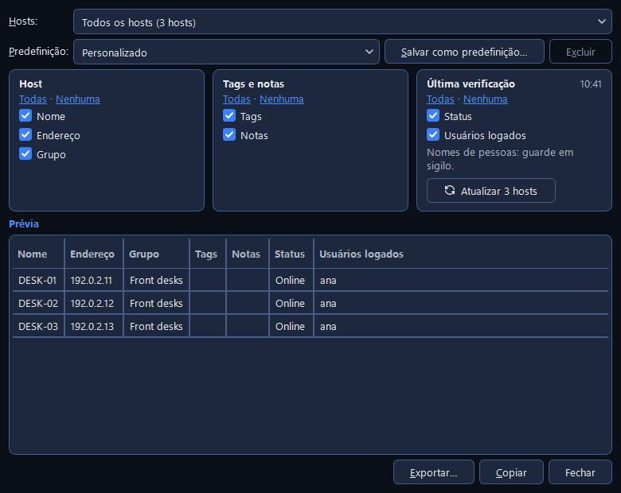

# Listas de hosts

Uma lista de hosts é um arquivo com os seus computadores, os grupos em que eles ficam e as tags
deles. O CapyPanel mostra uma lista por vez e salva cada mudança na hora. Esta página cobre como
organizar uma lista, encontrar um host nela e colocar ou tirar muitos hosts de uma vez.

## Organizar os hosts em grupos

1. Clique no **+** ao lado do título **Grupos**, ou use **Inventário > Adicionar grupo…**, para
   criar um grupo. Os grupos se aninham o quanto você quiser ("Matriz › Financeiro › 3º andar").
2. Arraste os hosts selecionados da tabela para um grupo para movê-los para lá, ou clique com o
   botão direito neles e use **Mover para ▸**.
3. Arraste um grupo para cima ou para baixo para reordená-lo, sobre outro grupo para colocá-lo
   dentro dele, ou sobre o título **Grupos** para levá-lo de volta ao nível superior.

Um host que você não colocou em lugar nenhum fica em **Sem grupo**, que aparece embaixo de "Todos
os hosts" com quantos ele tem. Uma lista nova começa com um grupo, **Grupo padrão**.

??? note "Mais sobre organizar"

    - Botão direito num grupo > **Mover para** lista **Grupos** (o nível superior), e depois todos
      os grupos em que esse pode entrar, desenhados como uma árvore; o lugar atual fica marcado.
      Para hosts, o **Mover para** lista **Sem grupo** primeiro, e depois a mesma árvore.
    - Um grupo que você recolheu continua recolhido, e mover um grupo para dentro de um recolhido
      abre o caminho até ele, para o que você moveu continuar visível.
    - **Inventário > Gerenciar grupos…** mostra a árvore inteira numa janela, com **Mover para**,
      **Mover para cima**, **Mover para baixo** e **Classificar de A a Z** (uma ordenação única que
      você pode reorganizar depois). Arrastar também funciona lá. "Nada muda até você clicar em
      Salvar." Listas criadas antes da versão 0.13.0 mostram os grupos na ordem em que foram
      criados; Classificar de A a Z os coloca em ordem uma vez.
    - Numa lista somente leitura, arrastar fica desligado.
    - **Notas** guardam o que mais valer a pena saber sobre um host. Elas aparecem no painel de
      detalhes, e a pesquisa sempre as cobre.

??? note "Remover um grupo"

    Botão direito num grupo > **Remover selecionado**, ou Del com um grupo escolhido. Um grupo vazio
    só pede confirmação. Um grupo com algo dentro pergunta o que fazer com o que está nele:

    - **Mover para ▸** escolhe para onde eles vão: **Sem grupo** ou qualquer grupo que não esteja
      sendo removido. O grupo acima deste fica marcado, então a resposta de sempre é um clique. Nada
      é excluído; os grupos de dentro vão junto com os hosts deles.
    - **Remover tudo:** o grupo, todos os grupos dentro dele e todos os hosts deles.

    Cancelar é o botão padrão, então Enter ou Esc deixa a lista como está.

## Pôr tags nos hosts e filtrar por tag

1. Selecione os hosts, clique com o botão direito neles e abra **Tags ▸**.
2. Escolha uma tag para dá-la a todos eles (ou tirá-la de todos, quando todos a têm), ou **Nova
   tag…** para criar uma.
3. Clique numa tag no painel de grupos: a tabela mantém só os hosts que a têm. Escolha várias e
   ela mantém só os hosts que têm **todas** elas.

As tags atravessam os grupos ("quiosque", "3-andar"). Uma tag filtra dentro do grupo que você
escolheu; para vê-la na lista inteira, escolha **Todos os hosts** primeiro.

??? note "Mais sobre tags"

    - No **Tags ▸**, uma tag fica marcada quando todos os hosts selecionados a têm, e com "(1 de
      2)" quando só alguns. Tags que você já usou são sugeridas enquanto digita, com a grafia
      mantida.
    - Com tags escolhidas, uma faixa colorida acima da tabela diz quais, como em "Só hosts com todas
      estas tags: quiosque, 3-andar · 4 de 37 exibidos", com um botão **Limpar**; o título **Tags**
      mostra quantas estão escolhidas e oferece um **×**; a barra de status acrescenta "Tags:
      quiosque, 3-andar".
    - As tags escolhidas continuam quando você troca de grupo e enquanto você pesquisa.
    - As Impressoras têm o mesmo menu **Tags ▸**.

## Encontrar um host

Digite na caixa acima da tabela (o **Ctrl+F** leva até ela). Ela pesquisa a lista aberta inteira,
seja qual for o grupo ou a tag escolhida, e maiúsculas e minúsculas não importam. Aperte **Seta
para baixo** ou **Enter** para ir ao primeiro resultado, e **Esc** para encerrar a pesquisa e voltar
ao grupo que estava escolhido.

??? note "O que a pesquisa cobre"

    A caixa lista o que ela cobre, "Pesquisar nome, endereço, status, usuário, tags, notas" quando
    todas as colunas estão visíveis:

    - o **nome** do computador e as **notas**, sempre;
    - o **endereço**, o **status**, os **usuários** logados e as **tags**, cada um enquanto a
      coluna dele estiver visível. O status é pesquisado como a coluna o diz, então "online" ou "não
      verificado" lista os hosts com esse status. O status e os usuários vêm da última atualização,
      então um host que não foi verificado não é encontrado por quem está nele.

    Enquanto você pesquisa:

    - O que você digitou fica marcado onde houver correspondência, na tabela e nas notas dos
      detalhes.
    - Nada fica escolhido no painel de grupos; o painel de detalhes diz em que grupo está o host
      selecionado, e o CapyPanel nunca salta para lá por conta própria.
    - A barra de status acrescenta **N resultados**. O **Atualizar todos** verifica só os
      resultados, e o status automático só os hosts exibidos. O **Relatório** oferece os resultados
      como o que exportar.
    - A **Seta para baixo** e o **Enter** na caixa nunca conectam, então um erro de digitação não
      chega ao PC errado. Na tabela, o clique duplo e o Enter conectam como sempre.
    - O **×** na caixa também encerra a pesquisa, e escolher um grupo ou uma tag, ou trocar de lista
      de hosts, também.

## Adicionar hosts de uma planilha

1. **Inventário > Importar hosts…**.
2. Cole uma lista na caixa de cima, ou clique em **Abrir um arquivo CSV…** para um arquivo `.csv`
   ou `.txt`. As linhas preenchem a prévia abaixo.
3. Confira a prévia, e escolha para onde vão os hosts sem grupo em **Hosts sem grupo vão para:**.
4. Clique em **Adicionar {n} hosts**. Nada muda na sua lista antes disso.

Três formatos são entendidos, e o **Formatos…** mostra cada um com um exemplo:

| Formato | Como é |
|---|---|
| **Nomes de host** | Um nome de computador por linha |
| **Nome e endereço** | Um nome e, depois, o nome do computador na rede ou o endereço IP, separados por vírgula, ou duas colunas copiadas do Excel |
| **CSV com cabeçalho** | Uma primeira linha dando nome às colunas: `nome, endereço, grupo, tags, notas` |

Um host que já está na sua lista é ignorado, nunca sobrescrito.

??? note "Mais sobre as colunas"

    - Com cabeçalho as colunas podem vir em qualquer ordem, e os nomes delas funcionam em português
      ou em inglês (`name, address, group, tags, notes`), com as palavras juntas de qualquer jeito e
      em qualquer caixa: `GroupName`, `Group name` e `group_name` são todos a coluna de grupo, e
      `Nome do grupo` também.
    - Numa célula de grupo, `/` separa os níveis ("Matriz/Recepção"); numa célula de tags, `;`
      separa as tags. As colunas que o CapyPanel não usa são ignoradas, e o resumo diz quais.
    - Uma tabela copiada com as colunas alinhadas por espaços, em vez de tabulações, também é lida,
      desde que a primeira linha seja o cabeçalho e nomeie pelo menos duas colunas, uma delas o
      nome.
    - Uma lista com mais do que um nome e um endereço, e sem linha de cabeçalho, não pode ser lida:
      o CapyPanel não adivinha qual coluna é qual.

??? note "Corrigir linhas na prévia"

    A prévia mostra **Nome**, **Endereço**, **Grupo**, **Tags**, **Notas** e um **Aviso** para cada
    linha. Clique com o botão direito numa linha:

    - **Editar célula** (F2) altera o valor sob o ponteiro; dois cliques fazem o mesmo.
    - **Colocar no grupo ▸** coloca as linhas selecionadas num grupo, escolhido na árvore.
    - **Definir tags…** dá as mesmas tags às linhas selecionadas, separadas por `;`.
    - **Deixar fora da importação** (Del) tira as linhas desta importação. O arquivo não é alterado.
    - **Adicionar uma linha abaixo** digita um host à mão.

    Editar na tabela reescreve o texto colado acima como CSV com uma linha de cabeçalho, para que os
    dois sempre coincidam; o CapyPanel pergunta antes de fazer isso na primeira vez. Um grupo
    nomeado no arquivo que ainda não existe é criado pela importação, e a prévia e o resumo avisam.
    As tags e as notas entram junto com os hosts. O resumo conta o que será adicionado, ignorado e
    o que não pode ser adicionado, e cada linha diz por quê.

## Exportar hosts para uma planilha

1. Clique em **Relatório** na barra de ferramentas.
2. Escolha os **Hosts**: um grupo, uma tag, os hosts selecionados, os resultados da pesquisa ou
   todos.
3. Marque as **Colunas**, ou escolha uma **Predefinição**.
4. Clique em **Copiar** para colar no Excel, ou em **Exportar…** para salvar um arquivo CSV.

O **Para importar** marca os campos dos próprios hosts, que o Importar hosts lê de volta: um jeito
de copiar hosts para outra lista, ou de guardar uma cópia antes de uma mudança grande. O Relatório
só lê a lista, então funciona também numa somente leitura.

??? note "Mais sobre o Relatório"

    - As **Colunas** vêm em três quadros: **Host** (Nome, Endereço, Grupo), **Tags e notas** e
      **Última verificação** (Status, Usuários logados). Cada um tem **Todas · Nenhuma**. As
      marcações são guardadas assim que você as muda. Guarde o seu próprio conjunto com **Salvar
      como predefinição…**; marcações que não correspondem a nenhuma predefinição aparecem como
      **Personalizado**.
    - A **Última verificação** vem da última atualização, com a hora dela ao lado do nome do
      quadro. Um host que ninguém verificou mostra **Não verificado** na prévia, e uma célula vazia
      no arquivo. Um botão embaixo das marcas verifica esses hosts de novo agora, com o nome de
      quantos são (**Atualizar 3 hosts**, ou **Atualizar host** para um só), com **Parar** enquanto
      corre. Com **Usuários logados** marcado, um aviso diz "Nomes de pessoas: guarde em sigilo."
    - A **Prévia** mostra as linhas na ordem da própria lista; um clique no título de uma coluna as
      ordena ali enquanto a janela está aberta. O que sai segue a Prévia.
    - O **Copiar** põe as linhas na área de transferência com tabulações, e a janela fica aberta. O
      **Exportar…** salva um CSV com o nome da lista e da parte que você escolheu, e depois oferece
      **Abrir arquivo** ou **Abrir pasta**. O **Fechar** é a única saída: cada escolha é guardada
      assim que é feita.
    - O arquivo usa o separador de colunas que o Excel deste PC espera, vírgula ou ponto e vírgula,
      e abre os nomes acentuados corretamente.
    - Uma célula que começa com `=`, `+`, `-` ou `@` rodaria como fórmula no Excel, então o
      Relatório a grava com um apóstrofo na frente, o que a mantém como texto. O Importar hosts tira
      o apóstrofo de novo.

## Trocar, criar e compartilhar listas

O nome da lista aberta fica no topo do painel de grupos. Clique nele para trocar de lista, criar
uma com **Nova lista…**, abrir qualquer arquivo de lista com **Abrir lista…** (Ctrl+O), ou ir a
**Gerenciar listas de hosts…** nas Configurações.

Uma lista nova pede um **Nome** e para quem ela é, em **Para:** **Todos neste PC
(compartilhada)**, **Só eu (pessoal)** ou **Outro lugar, como uma pasta de rede…**.

??? note "Onde as listas ficam"

    | Pasta | Onde | Para quem |
    |---|---|---|
    | **Listas de hosts compartilhadas** | `C:\ProgramData\CapyPanel\lists\hosts` | Todos no PC. A **lista padrão** é o `default.json` ali |
    | **Suas listas de hosts** | `C:\ProgramData\CapyPanel\users\<você@DOMÍNIO>\lists\hosts` | Só você e os administradores. Sua **lista pessoal** é o `personal.json` ali |

    - **Toda lista salva numa dessas pastas aparece sozinha.** Coloque um arquivo na pasta
      compartilhada e todos no PC o têm; coloque um na sua e ele é só seu. No modo portátil as duas
      pastas ficam dentro da pasta `userdata` do próprio app (veja
      [Configurações e arquivos](../settings-and-files.pt-BR.md#modo-portatil)).
    - A ferramenta Impressoras guarda as listas dela em `lists\printers` nos mesmos dois lugares, e
      as duas nunca se misturam: cada arquivo registra de que tipo é.
    - As listas se chamam "Padrão", "Pessoal", e cada uma das outras pelo nome do arquivo sem o
      `.json`. Duas com o mesmo nome mostram a pasta delas depois; o caminho inteiro está na dica.
    - As permissões do Windows decidem se uma lista abre somente leitura. Uma lista somente leitura
      ainda pode ser navegada e usada para conectar; só a edição fica desligada. Compartilhar uma
      lista com todos exige poder gravar na pasta compartilhada; para os outros essa escolha fica
      apagada, com um aviso dizendo por quê.
    - Uma lista em outro lugar, numa pasta de rede por exemplo, é adicionada uma vez e fica no menu
      de listas desde então.
    - Listas de uma versão anterior são copiadas para essas pastas uma vez, sozinhas (os arquivos
      `hosts.json` de antes da 0.19 e as listas que a 0.19 guardava direto em `lists`). Os arquivos
      antigos ficam onde estão.

??? note "Configurações › Hosts › Geral › Listas de hosts"

    As mesmas listas como uma tabela de **Lista**, **Tipo** (**Compartilhada**, **Sua** ou
    **Adicionada**) e **Acesso** (**Leitura/gravação**, **Somente leitura**, **Criada ao abrir**,
    **Arquivo não encontrado** ou **Não usada: criada por outro usuário**). **Nova…**, **Adicionar
    existente…** e **Remover** ficam embaixo dela, e depois o caminho da lista escolhida; um clique o
    copia. O botão direito numa linha acrescenta **Abrir**, **Salvar uma cópia…** e **Abrir pasta**.

    O **Remover** pergunta o que você quis dizer: **Remover das minhas listas** não mexe no arquivo
    (uma lista numa pasta de listas fica escondida só para você), **Excluir o arquivo** o move para
    a Lixeira para todos, e **Cancelar** é o padrão. A lista padrão e a pessoal não podem ser
    removidas, e remover a lista aberta abre a padrão.

    Também nessa página: **Lista ao iniciar** (a última lista usada, por padrão; se ela não abrir,
    o CapyPanel tenta a lista padrão e depois a sua pessoal, e avisa) e **Mostrar primeiro**, que
    cada lista guarda para si: **Todos os hosts**, **Onde parei** ou **Um grupo escolhido ▸**. O
    **Mostrar este grupo primeiro** no botão direito de um grupo define a mesma coisa.

??? note "Listas compartilhadas, segurança e o formato do arquivo"

    - Quando duas pessoas editam a mesma lista compartilhada, o CapyPanel nunca sobrescreve as
      alterações da outra. Se o arquivo mudou desde que você o abriu, sua edição não é salva e você
      escolhe: salvar sua versão como cópia ou recarregar a lista com as alterações da outra pessoa.
    - Qualquer usuário pode criar arquivos no ProgramData, então **uma lista compartilhada criada
      por outro usuário que não seja administrador não é aberta**: ela poderia mandar a sua senha
      para o computador errado. Ela fica fora do menu de listas, é registrada no log e aparece nas
      Configurações como "Não usada: criada por outro usuário", onde um administrador pode
      substituí-la ou excluí-la.
    - As listas são JSON legível com uma versão de esquema. Versões mais antigas do CapyPanel mantêm
      os campos que não conhecem ao salvar, e uma lista gravada por uma versão mais nova é recusada
      em vez de ser danificada.

## Mensagens que você pode ver

| Mensagem | O que significa | O que fazer |
|---|---|---|
| "“{path}” não é uma lista de hosts." | O arquivo que você abriu é uma lista de impressoras | Abra-o no Impressoras |
| "Esta lista precisa de uma linha de cabeçalho." | A lista colada tem mais do que um nome e um endereço, mas nenhuma primeira linha dando nome às colunas | Acrescente um cabeçalho; o **Formatos…** mostra como |
| "Já está na lista, em “Recepção”" ou "Mesmo nome da linha 7" | O host já está na sua lista, ou aparece duas vezes no arquivo | Nada: ele é ignorado, nunca sobrescrito |
| "Sem nome", "Não é um nome de computador nem um endereço IP", "Sem endereço: o nome precisa ser o nome do computador na rede" | Essa linha não pode ser adicionada | Corrija a linha na prévia, ou deixe-a de fora |
| "Nenhum host corresponde a “…”." | A pesquisa não achou nada | Confira a grafia, ou mostre a coluna que você está pesquisando |
| **Não usada: criada por outro usuário** | Uma lista compartilhada criada por alguém que não é administrador | Peça a um administrador para substituí-la ou excluí-la |
