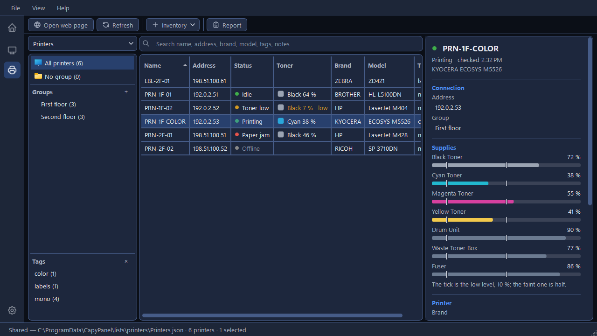
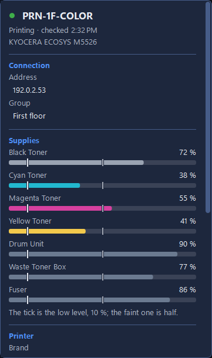

# Checking printers

**Refresh** asks every printer shown what state it's in and how much toner it has left, and fills
the **Status** and **Toner** columns, the **Supplies** section of the Details panel, and the page
counter. CapyPanel only ever reads: it never changes a setting on a printer.

The results are kept in memory, never in the list file, and they're gone when CapyPanel closes.
That also means a read-only list can be refreshed like any other.

## Refresh

**Refresh** on the toolbar reads every printer the table shows, which is the group, tag or search
you have picked. **F5** does the same, and a single printer's right-click menu has **Refresh** for
that one. Nothing is read until you ask: CapyPanel never refreshes by itself, and it never warns
you about a printer.

Eight printers are read at a time. The status bar counts them, "Checking 3 of 12…", with a
**Stop** button, and says "Checked 12 printers." at the end, or "Stopped: 4 printers weren't
checked." A printer with no address is asked by its name.

## Status

A coloured dot and a few words, with the time of the check beside them in the Details panel.
Before the first Refresh both columns are empty and the Status cell's tooltip says "Not checked:
use Refresh".

| Dot | What it means | Examples |
|---|---|---|
| Green | Working | "Idle", "Printing", "Warming up", "Ready" |
| Amber | Needs attention, still printing | "Toner low", "Paper low", "Tray empty", "Needs attention" |
| Red | Stopped | "Paper jam", "Out of paper", "Door open", "Out of toner", "Stopped" |
| Grey | "Offline": nothing answered |  |
| Amber | "Unreadable": it answered, but not in a way CapyPanel could read |  |

Printers often add a message of their own, sometimes a code and several sentences. That never goes
in the Status column, where it would push everything else out of sight. Hover the cell to read it,
or select the printer and read it in full under its name in the Details panel.

## Toner and the other supplies

The **Toner** column shows the lowest toner or ink the printer reports, as text by default, with
a dab of that toner's own colour beside it: "Black 24 %", or "Cyan 8 % · low" in amber once it's
at or below the low level. A printer that
reports a toner without a percentage shows "Black: some left" or "Toner: level unknown", and a
black-only printer that names no colour simply shows "Toner".

**Settings > Printers > Refresh > Toner column** can show a bar instead, filled to that level with
the percentage beside it. The bar stretches with the column, and in a very narrow column only the
percentage shows. Copying a cell and the report always use the text form.

The Details panel's **Supplies** section lists everything the printer reports: toners and inks,
the drum, the waste box, the fuser, the rollers. Each is named as the printer names it, which is
usually English whatever language CapyPanel is in. Each has its level and a bar, a low one is
marked "24 % · Low", and a waste box close to full is marked "88 % · Nearly full". The fuser and
the rollers show a level but are never called low, because they wear out rather than run out.
When a printer reports none of this, the section says "The printer doesn't report its
supplies."

Every bar carries two marks, explained under them: "The tick is the low level, 10 %; the faint one
is half."

**Settings > Printers > Refresh > Low supply level** sets that level, anywhere from 1 to 50 %, and
10 % to begin with. One level covers every kind of supply.

## What the printer says about itself

A Refresh also reads the brand, model, serial number and total page count the printer reports.

The page count shows in the Details panel under **Page counters**, beside the **Source** you chose
for the printer.

The brand, model and serial number are compared with what your list says. Where they differ, or
where your list has nothing, the Details panel adds the printer's own answer under the value, as
"The printer says **RICOH IM C3000** · Use this". **Use this** copies it into the list, and only
you can do that: CapyPanel never writes to a list on its own, and the link isn't offered on a
read-only list.

## How CapyPanel reads a printer

It uses **SNMP version 2c on port 161**, and it only reads. CapyPanel never sends an SNMP write,
so a Refresh cannot change anything on a printer, whatever is wrong with it. Version 3 isn't
supported yet.

Most of what it asks for is the standard printer information every brand answers, the Host
Resources, Printer and Entity MIBs. Where those leave a gap, it reads the maker's own read-only
data to fill it:

- **Ricoh:** the toner level when the standard one has no percentage, and the serial number when
  the standard fields are empty.
- **Brother:** the toner and drum levels when the standard one has no percentage.

No other brand needs this today. A printer that already answers with a percentage is never asked
anything extra, and more brands are added one at a time, when a real printer shows the gap.

The brand comes from the maker number the printer reports, and the model from its own description.

## The SNMP community string

Printers answer SNMP only to a password of sorts, the **community string**. Almost every printer
leaves it at "public", which is what CapyPanel uses until you say otherwise.

**Settings > Printers > Refresh > SNMP community string** says which it's using: "Not set:
printers are asked with “public”." or "Set. Kept in Windows Credential Manager, never in a file."
**Change…** opens a small window to set it, with a **Show** box if you want to read what you
typed. Saving an empty one goes back to "public".

It's kept in **Windows Credential Manager**, under your own Windows account. It never goes into a
settings file, a list file or a log. One string covers every printer.
