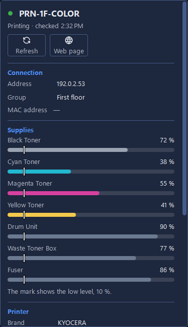
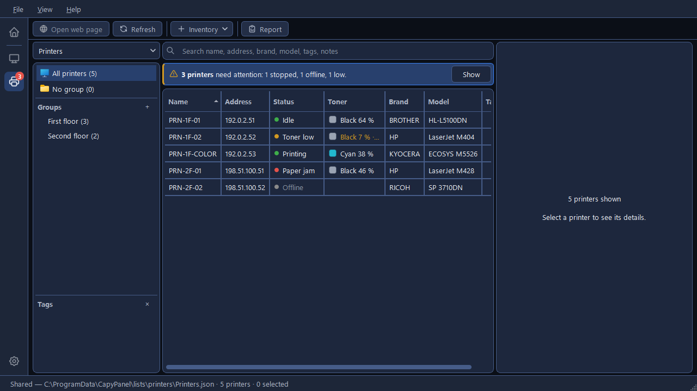
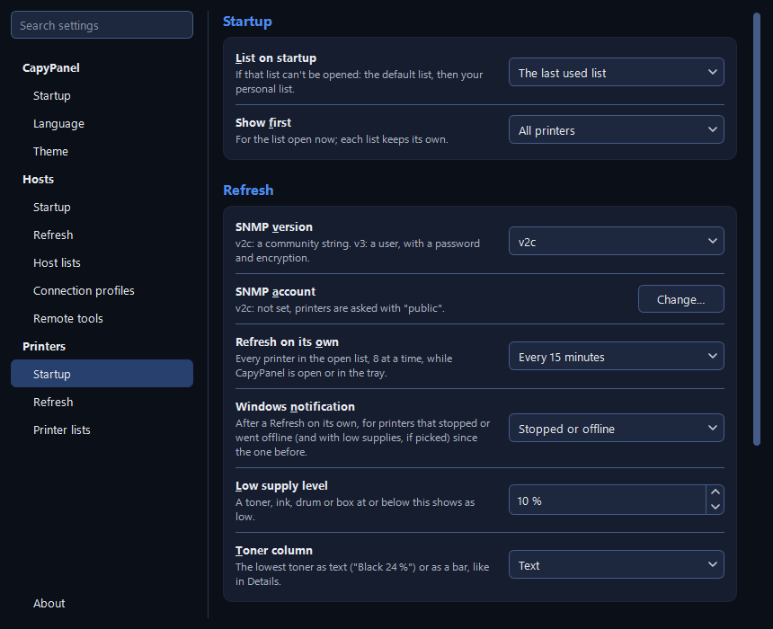

# Checking printers

**Refresh** asks every printer shown what state it's in and how much toner it has left, and fills
the **Status** and **Toner** columns, the **Supplies** section of the Details panel, the page
counter, and the printer's MAC address and firmware version. CapyPanel only ever reads: it never
changes a setting on a printer.

The results are kept in memory, never in the list file, and they're gone when CapyPanel closes.
That also means a read-only list can be refreshed like any other.

## Refresh

**Refresh** on the toolbar reads every printer the table shows, which is the group, tag or search
you have picked. **F5** does the same, and a single printer's right-click menu has **Refresh** for
that one. Nothing is read until you ask, unless you turn on
[Refresh on its own](#refresh-on-its-own), which is off to begin with.

Eight printers are read at a time. The status bar counts them, "Checking 3 of 12…", with a
**Stop** button, and says "Checked 12 printers." at the end, or "Stopped: 4 printers weren't
checked." A printer with no address is asked by its name.

## Refresh on its own

**Settings > Printers > Refresh > Refresh on its own** reads the printers on a timer: **Off**, the
default, or every **5**, **15**, **30** or **60 minutes**. Its line says what one turn covers:
"Every printer in the open list, 8 at a time, while CapyPanel is open or in the tray."

It reads the whole open list, not only the printers the table shows, because the warnings below
count them all, and the status bar counts them as it would for a Refresh you pressed. A turn is
skipped while a Refresh is already running, and also while **v3** is picked with no account set
yet.

While it's on, CapyPanel keeps an icon in the Windows tray, and the window can close to it instead
of quitting, so the printers go on being read (see
[Getting started](../getting-started.md#closing-capypanel-and-the-tray)).

## Status

A coloured dot and a few words, with the time of the check beside them in the Details panel.
Before the first Refresh both columns are empty and the Status cell's tooltip says "Not checked:
use Refresh".

| Dot | What it means | Examples |
|---|---|---|
| Green | Working | "Idle", "Printing", "Warming up", "Ready" |
| Amber | Needs attention, still printing | "Toner low", "Paper low", "Tray empty", "Needs attention" |
| Red | Stopped | "Paper jam", "Out of paper", "Door open", "Out of toner", "Stopped" |
| Grey | "Offline": nothing answered |  |
| Amber | "Unreadable": it answered, but not in a way CapyPanel could read |  |

Printers often add a message of their own, sometimes a code and several sentences. That never goes
in the Status column, where it would push everything else out of sight. Hover the cell to read it,
or select the printer and read it in full under its name in the Details panel.

## Toner and the other supplies

The **Toner** column shows the lowest toner or ink the printer reports, as text by default, with
a dab of that toner's own colour beside it: "Black 24 %", or "Cyan 8 % · low" in amber once it's
at or below the low level. A printer that reports a toner without a percentage shows
"Black: some left" or "Black: not reported", and a black-only printer that names no colour
simply shows "Toner".

**Settings > Printers > Refresh > Toner column** can show a bar instead, filled to that level with
the percentage beside it. The bar stretches with the column, and in a very narrow column only the
percentage shows. Copying a cell and the report always use the text form.

The Details panel's **Supplies** section lists everything the printer reports: toners and inks,
the drum, the waste box, the fuser, the rollers. Each is named as the printer names it, which is
usually English whatever language CapyPanel is in. Each has its level and a bar, a low one is
marked "24 % · Low", and a waste box close to full is marked "88 % · Nearly full". The fuser and
the rollers show a level but are never called low, because they wear out rather than run out.
A supply the printer gives no level for has no bar, and says so instead: "This printer
doesn't report a level for this supply." When a printer reports none of this, the section says
"The printer doesn't report its supplies."

Every bar carries two marks, explained under them: "The tick is the low level, 10 %; the faint one
is half."

**Settings > Printers > Refresh > Low supply level** sets that level, anywhere from 1 to 50 %, and
10 % to begin with. One level covers every kind of supply.

## What the printer says about itself

A Refresh also reads the brand, model, serial number and total page count the printer reports,
its **MAC address** and its **firmware version**. The MAC address shows in the Details panel
under **Connection**, after the group, and the firmware under **Printer**, after the asset tag.
Both read "—" until a Refresh has read them, and the report can carry either (see
[The Printers tool](printers.md#report)).

The page count shows in the Details panel under **Page counters**, beside the **Source** you chose
for the printer, and the report can carry it as **Total pages**.

A printer whose Source is **Doc360 MPS** is the exception. CapyPanel can't read that portal yet,
so its Total pages reads "Error: CapyPanel can't read page counters from Doc360 MPS yet.", in
Details and before any refresh, and plain "Error" in the report. CapyPanel doesn't fall back to
the printer's own SNMP counter there, because that isn't the source you picked for it. Its status
and toner still come from a refresh like any other printer's.

The brand, model and serial number are compared with what your list says. Where they differ, or
where your list has nothing, the Details panel adds the printer's own answer under the value, as
"The printer says **RICOH IM C3000** · Use this". **Use this** copies it into the list, and only
you can do that: CapyPanel never writes to a list on its own, and the link isn't offered on a
read-only list.

## Printers that need attention

After a Refresh, a printer **needs attention** when it has stopped (a red status), didn't answer
(**Offline**), or has a toner, ink, drum or box at or below the low level. A printer's own "Needs
attention" message doesn't count, and neither do **Refused** and **Unreadable**: those say
CapyPanel couldn't read the printer, not that something is wrong with it.

Three things then say so:

- a **red count** on the Printers icon in the rail, whose tooltip gains a line, "3 printers need
  attention";
- a **strip above the table**: "3 printers need attention: 1 stopped, 1 offline, 1 low.", with a
  **Show** button that lists just those printers, out of the whole list: any group, tag or search
  is cleared first, so none of them stays hidden. The strip then reads "Showing the 3 printers that
  need attention." with **Show all** to go back, and picking a group or a tag, or searching, brings
  every printer back too;
- a **Windows notification**, if you ask for one.

The count and the strip go away by themselves once nothing needs attention any more.

**Settings > Printers > Refresh > Windows notification** chooses what to notify about: **Off**,
**Stopped or offline** (the default) or **Also low supplies**. "After a Refresh on its own, for
printers that stopped or went offline (and with low supplies, if picked) since the one before."

One notification goes out per Refresh on its own, and only for what changed, so a printer that was
already offline isn't named again. Its title counts them, "2 printers need attention", and a line
per printer says which and why, as in "PRN-2F-02: Offline" or "PRN-1F-02: Black 7 %", at most five
of them and then "and 3 more". Clicking it opens Printers with just those printers listed, and its
**✕** dismisses it. A Refresh you press yourself never notifies, so nothing is sent until Refresh
on its own is on.

## How CapyPanel reads a printer

It uses **SNMP on port 161**, version **2c** or **3** as you choose below, and it only reads.
CapyPanel never sends an SNMP write, so a Refresh cannot change anything on a printer, whatever
is wrong with it.

Most of what it asks for is the standard printer information every brand answers, the Host
Resources, Printer and Entity MIBs. Where those leave a gap, it reads the maker's own read-only
data to fill it:

- **Ricoh:** the toner level when the standard one has no percentage, and the serial number when
  the standard fields are empty.
- **Brother:** the toner and drum levels when the standard one has no percentage.

No other brand needs this today. A printer that already answers with a percentage is never asked
anything extra, and more brands are added one at a time, when a real printer shows the gap.

The brand comes from the maker number the printer reports, and the model from its own description.

## The SNMP account

Printers answer SNMP only to whoever they already know, and which that is depends on the version.
**Settings > Printers > Refresh > SNMP version** picks it, for every printer at once: **v2c**, the
default, or **v3**. "v2c: a community string. v3: a user, with a password and encryption."

Under it, one **SNMP account** row says what is set for the version you picked, and **Change…**
opens the window that belongs to that version. Either way it's kept in **Windows Credential
Manager**, under your own Windows account. It never goes into a settings file, a list file or a
log, and one account covers every printer.

### v2c: a community string

The **community string** is a password of sorts, and almost every printer leaves it at "public",
which is what CapyPanel uses until you say otherwise. The row reads 'v2c: not set, printers are
asked with "public".' or "v2c: community string set. Kept in Windows Credential Manager."
**Change…** opens a small window to set it, with a **Show** box if you want to read what you
typed. Saving an empty one goes back to "public".

### v3: a user with passwords

SNMP v3 signs every request, and can encrypt it, so it takes an account instead of one string. The
row reads "v3: not set. Use Change… to add the user.", or names what is set, as in "v3: user
it-reader, SHA-256, AES-128. Kept in Windows Credential Manager."

**Change…** opens the **SNMP v3 account** window, for "the read-only SNMP v3 user your printers
know":

| Field | What it takes |
|---|---|
| **User name** | The v3 user the printers know. Emptying it forgets the account |
| **Authentication** | **None**, or the hash that signs each request: MD5, SHA, SHA-224, SHA-256, SHA-384, SHA-512 |
| **Authentication password** | 8 characters or more |
| **Encryption** | **None** or **AES-128**, which needs authentication set |
| **Encryption password** | 8 characters or more |

A new account starts at **SHA** and **AES-128**, which is what most printers are set up for, and
**Show passwords** reads back what you typed. A password already saved isn't shown again: its box
says "Kept: type to change it", and left empty it stays as it was. Under the fields the window says
what is still missing, and **Save** waits until the account is complete. DES encryption isn't
offered: AES-128 is the one printers implement.

To forget the account, empty the **User name** and save. The window says so first, "Save forgets
the saved account.", the same way an empty community string goes back to "public".

A printer that refuses the account shows **Refused** in amber in the Status column, and its tooltip
says why, as in "Refused at 14:32: wrong authentication password or type.", followed by "Check the
SNMP account in Settings › Printers › Refresh." The reasons it tells apart are a user name the
printer doesn't know, a wrong authentication password or type, a wrong encryption password,
authentication or encryption it wants set differently, and a clock too far from CapyPanel's.

With **v3** picked and no account yet, a Refresh doesn't start: the status bar says "Set the SNMP
v3 account in Settings › Printers › Refresh first." A Refresh on its own just waits, without
saying anything.
