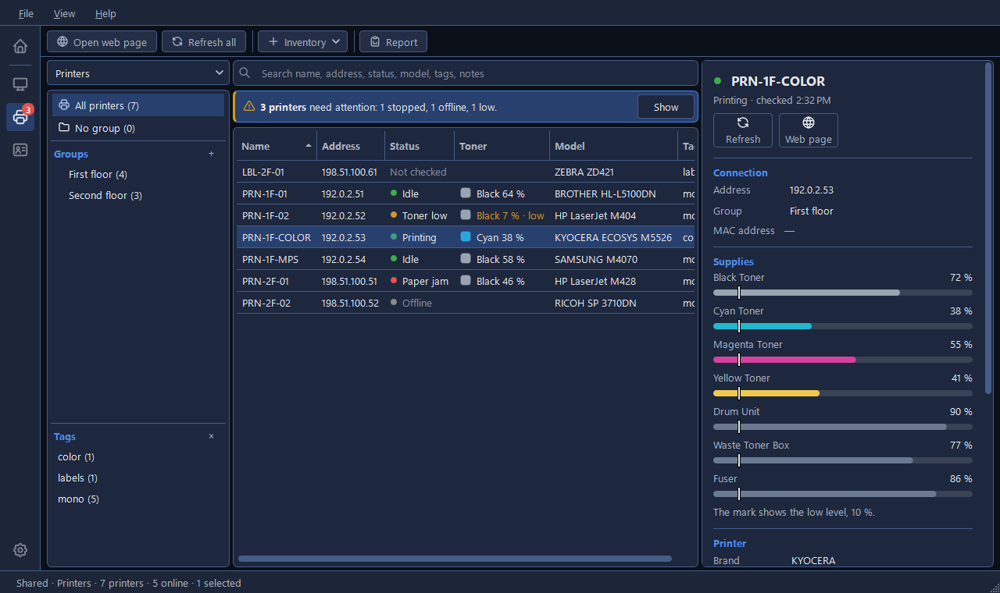
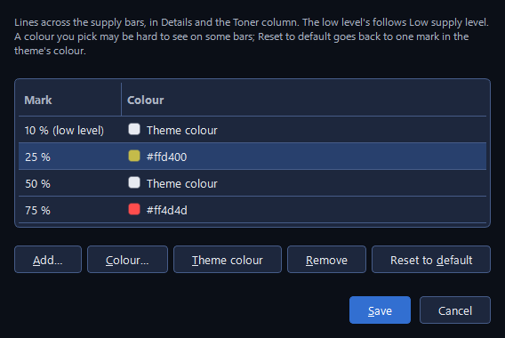
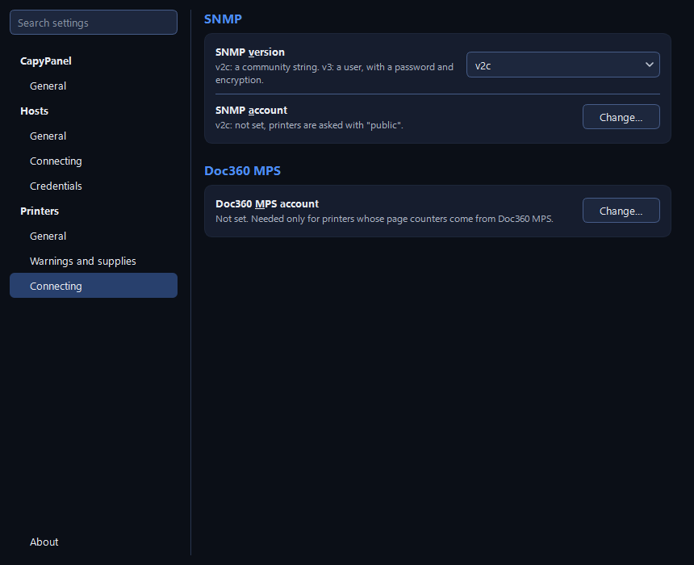
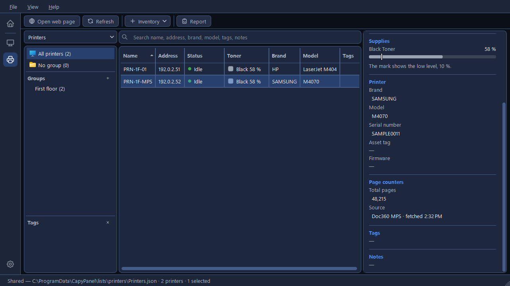
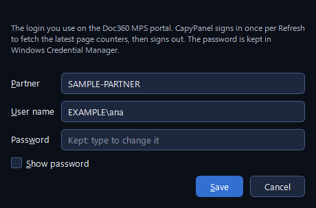

# Checking printers

A Refresh asks each printer what state it's in, how much toner it has left and how many pages it
has printed. CapyPanel only reads printers: it never changes a setting on one. The results stay in
memory, never in the list file, and are gone when CapyPanel closes, so a read-only list can be
refreshed like any other.

## Check your printers

1. Click **Refresh all** on the toolbar (**F5**). It reads every printer the table shows, which is
   the group, tag or search you have picked.
2. To read only some, right-click a printer for **Refresh printer**, several for **Refresh {n}
   printers**, or a group for **Refresh group** (with the groups inside it). The Details panel's
   **Refresh** reads the printer it shows.
3. The status bar counts them as they're read, eight at a time, with a **Stop** button.

Nothing is read until you ask, unless you turn on
[Refresh on its own](#have-printers-checked-on-their-own).

??? note "What else a Refresh reads"

    - The brand, model, serial number and total page count the printer reports, its **MAC
      address** and its **firmware version**. The MAC address shows in Details under
      **Connection**, the firmware under **Printer**; both read "—" until a Refresh has read them,
      and the report can carry either. The firmware comes from the printer's own description or
      its list of installed software, which Samsung, Ricoh and Brother printers fill in; some
      printers name no version anywhere.
    - The page count shows under **Page counters**, beside the **Source** you chose. A printer
      whose Source is **Doc360 MPS** gets its count from the portal instead (see
      [below](#get-page-counts-from-doc360-mps)); CapyPanel never falls back to its own SNMP
      counter, because that isn't the source you picked.
    - Where the brand, model or serial number differ from your list, or your list has nothing,
      Details adds the printer's own answer under the value, as "The printer says **RICOH IM
      C3000** · Use this". **Use this** copies it into the list. Only you can do that: CapyPanel
      never writes to a list on its own, and the link isn't offered on a read-only list.
    - A printer with no address is asked by its name.
    - After a Refresh the status bar adds how many printers answered, as in "9 online". A printer
      that refused or answered something unreadable counts, since it's on.

## Read a printer's status

Each printer gets a coloured dot and a few words:

| Dot | What it means | Examples |
|---|---|---|
| Green | Working | "Idle", "Printing", "Warming up", "Ready" |
| Amber | Needs attention, still printing | "Toner low", "Paper low", "Tray empty", "Needs attention" |
| Red | Stopped | "Paper jam", "Out of paper", "Door open", "Out of toner", "Stopped" |
| Grey | Nothing answered | "Offline" |
| Amber | It answered, but not in a way CapyPanel could read | "Unreadable" |

Before the first Refresh it says **Not checked** in grey. The printer's own message, which can be a
code and several sentences, is in the cell's tooltip and in full under its name in Details.

## See how much toner is left

- The **Toner** column shows the lowest toner or ink, with a dab of its colour: "Black 24 %", or
  "Cyan 8 % · low" in amber once it's at or below the low level.
- The Details panel's **Supplies** section lists every supply with its level and a bar.
- **Settings > Printers > Warnings and supplies > Low supply level** sets the low level, from 1 to
  50 % (10 % to begin with). One level covers every kind of supply.
- In the same page, **Toner column** shows the level as text (the default) or as a bar.

??? note "More about supplies"

    - Supplies are named as the printer names them, usually in English whatever language CapyPanel
      is in: toners and inks, the drum, the waste box, the fuser, the rollers.
    - A low one is marked "24 % · Low", and a waste box close to full "88 % · Nearly full". The
      fuser and the rollers show a level but are never called low, because they wear out rather
      than run out.
    - A toner reported without a percentage shows "Black: some left" or "Black: not reported" in
      the column, and a black-only printer that names no colour simply shows "Toner".
    - The bar stretches with the column; in a very narrow column only the percentage shows.
      Copying a cell and the report always use the text form.

??? note "Marks on the bars"

    Every bar carries a mark at the low level, and the line under the bars says where the marks
    are: "The mark shows the low level, 10 %." Each mark has a thin dark outline and sticks out a
    little past the bar, so it can be seen on any fill and in any theme.

    **Settings > Printers > Warnings and supplies > Bar marks > Change…** opens a window: **Add…**
    puts a mark anywhere from 1 to 99 %, up to eight of your own, **Colour…** gives one a colour of
    its own and **Theme colour** takes it back, **Remove** drops one, and **Reset to default** goes
    back to the low level's mark alone. That one always follows **Low supply level** and can't be
    removed. With several marks the line names them all, as in "The marks show 10 % (low), 50 %."

    

## See which printers need attention

- A printer **needs attention** when it has stopped (a red status), didn't answer (**Offline**),
  or has a toner, ink, drum or box at or below the low level.
- A red count on the Printers icon in the rail and a strip above the table say how many, as in
  "3 printers need attention: 1 stopped, 1 offline, 1 low." **Show** lists just those printers;
  **Show all** goes back.
- Both go away by themselves once nothing needs attention any more.

??? note "What doesn't count, and how Show works"

    A printer's own "Needs attention" message doesn't count, and neither do **Refused** and
    **Unreadable**: those say CapyPanel couldn't read the printer, not that something is wrong
    with it.

    **Show** picks the printers out of the whole list: any group, tag or search is cleared first,
    so none of them stays hidden. The strip then reads "Showing the 3 printers that need
    attention." Picking a group or a tag, or searching, brings every printer back too.

??? note "Windows notifications"

    **Settings > Printers > Warnings and supplies > Windows notification** chooses what to notify
    about: **Off**, **Stopped or offline** (the default) or **Also low supplies**. "After a Refresh
    on its own, for what changed since the one before."

    One notification goes out per Refresh on its own, and only for what changed, so a printer that
    was already offline isn't named again. Its title counts them, "2 printers need attention", and
    a line per printer says which and why, as in "PRN-2F-02: Offline" or "PRN-1F-02: Black 7 %", at
    most five of them and then "and 3 more". Clicking it opens Printers with just those printers
    listed, and its **✕** dismisses it. A Refresh you press yourself never notifies.

## Have printers checked on their own

**Settings > Printers > Warnings and supplies > Refresh on its own**: **Off** (the default), or
every **5**, **15**, **30** or **60 minutes**. It reads the whole open list, not only what the table
shows, because the warnings count them all. While it's on, CapyPanel keeps an icon in the Windows
tray and the window can close to it, so the printers go on being read (see
[Getting started](../getting-started.md#close-capypanel-or-keep-it-in-the-tray)).

??? note "When a turn is skipped"

    A turn is skipped while a Refresh is already running, and while **v3** is picked with no
    account set yet. Its line in Settings says what one turn covers: "Every printer in the open
    list, 8 at a time, while CapyPanel is open or in the tray."

## Set the SNMP account

1. Open **Settings > Printers > Connecting**.
2. Pick the **SNMP version**, for every printer at once: **v2c** (the default) or **v3**.
3. Click **Change…** on the **SNMP account** row and fill it in.

Most printers answer v2c with the community "public", which CapyPanel uses until you set another.
The account is kept in **Windows Credential Manager**, under your own Windows account. It never goes
into a settings file, a list file or a log, and one account covers every printer.

??? note "v2c: the community string"

    The community string is a password of sorts, and almost every printer leaves it at "public".
    The row reads 'v2c: not set, printers are asked with "public".' or "v2c: community string set.
    Kept in Windows Credential Manager." **Change…** opens a small window to set it, with a
    **Show** box if you want to read what you typed. Saving an empty one goes back to "public".

??? note "v3: the account window"

    SNMP v3 signs every request, and can encrypt it, so it takes an account instead of one string.
    **Change…** opens the **SNMP v3 account** window, for "the read-only SNMP v3 user your printers
    know":

    | Field | What it takes |
    |---|---|
    | **User name** | The v3 user the printers know. Emptying it forgets the account |
    | **Authentication** | **None**, or the hash that signs each request: MD5, SHA, SHA-224, SHA-256, SHA-384, SHA-512 |
    | **Authentication password** | 8 characters or more |
    | **Encryption** | **None** or **AES-128**, which needs authentication set |
    | **Encryption password** | 8 characters or more |

    A new account starts at **SHA** and **AES-128**, which is what most printers are set up for,
    and **Show passwords** reads back what you typed. A password already saved isn't shown again:
    its box says "Kept: type to change it", and left empty it stays as it was. Under the fields the
    window says what is still missing, and **Save** waits until the account is complete. DES
    encryption isn't offered: AES-128 is the one printers implement. To forget the account, empty
    the **User name** and save; the window warns "Save forgets the saved account." first.

    The row then names what is set, as in "v3: user it-reader, SHA-256, AES-128. Kept in Windows
    Credential Manager."

??? note "How CapyPanel reads a printer"

    It uses **SNMP on port 161**, version 2c or 3, and it only reads: CapyPanel never sends an SNMP
    write, so a Refresh can't change anything on a printer.

    Most of what it asks for is the standard printer information every brand answers, the Host
    Resources, Printer and Entity MIBs. Where those leave a gap, it reads the maker's own
    read-only data:

    - **Ricoh:** the toner level when the standard one has no percentage, and the serial number
      when the standard fields are empty.
    - **Brother:** the toner and drum levels when the standard one has no percentage.

    A printer that already answers with a percentage is never asked anything extra, and more brands
    are added one at a time, when a real printer shows the gap. The brand comes from the maker
    number the printer reports, and the model from its own description.

## Get page counts from Doc360 MPS

If your printers are on the Doc360 MPS portal, set a printer's **Page counters** to **Doc360 MPS**
and add the portal account in **Settings > Printers > Connecting > Doc360 MPS account**. A Refresh
then takes that printer's page count from the portal.

??? note "How Doc360 counts arrive"

    A Refresh signs in to Doc360 once, downloads the latest counters, signs out, and matches each
    printer by its serial number: the one in your list, or the one the printer reports. It only
    does that when the open list has a Doc360 printer in it, and Refresh on its own does it too.
    Such a printer doesn't have to be on your network: it shows **Offline** when it isn't, and its
    count still arrives.

    

    The number shows in Details under **Page counters**, with **Source** reading "Doc360 MPS ·
    fetched 14:32"; its tooltip adds that Doc360 reads printers on its own schedule, so the number
    can be behind the printer. It's this month's count. In the first days of a month Doc360 may
    have none yet, so CapyPanel takes last month's and says so in amber, and the report writes
    "20500 (from October 2026)". When there's no count at all, Details says why in its place and
    the report has plain "Error" (see the table below).

    A refused login is tried once and left alone until the next Refresh, so a wrong password isn't
    sent over and over.

??? note "The Doc360 MPS account"

    **Change…** opens a window for "the login you use on the Doc360 MPS portal": **Partner**,
    **User name** and **Password**, with a **Show password** box. The partner is the partner code
    on Doc360's own login page.

    

    The password is kept in **Windows Credential Manager**, under your own Windows account, and the
    settings row shows only the rest of it: "Partner SAMPLE-PARTNER, user EXAMPLE\ana. Kept in
    Windows Credential Manager.", or "Not set. Needed only for printers whose page counters come
    from Doc360 MPS." Emptying the user name and saving forgets the account. When a login is
    missing or refused, a button under the error in Details opens this window straight away: **Set
    the account…**, or **Change the account…** once there is one.

## Messages you may see

| Message | What it means | What to do |
|---|---|---|
| **Not checked** | No Refresh has read the printer yet | Refresh it |
| **Offline** | Nothing answered | Check the printer is on and its address is right |
| **Refused** (amber), with a tooltip such as "Refused at 14:32: wrong authentication password or type." | The printer rejected the SNMP account. The tooltip names the reason: a user name it doesn't know, a wrong authentication password or type, a wrong encryption password, authentication or encryption it wants set differently, or a clock too far from CapyPanel's | Fix that part in **Settings > Printers > Connecting**, or the printer's clock |
| **Unreadable** (amber) | It answered, but not in a way CapyPanel could read | Open its web page |
| "Set the SNMP v3 account in Settings › Printers › Connecting first." | **v3** is picked with no account, so a Refresh doesn't start | Set the account |
| "Stopped: 4 printers weren't checked." | You pressed **Stop** | Refresh again |
| "This printer doesn't report a level for this supply." | The printer gives no level for that supply | Check its web page |
| "The printer doesn't report its supplies." | No supply data at all | Check its web page |
| "No Doc360 MPS account is set." | Nothing to sign in with yet | **Set the account…** |
| "Doc360 MPS refused the login." | The partner, user name or password is wrong | **Change the account…** |
| "Doc360 MPS didn't answer." | No network, or the portal is down | Try again later |
| "Doc360 MPS's pages changed, so CapyPanel couldn't read the counters." | The portal was rebuilt | CapyPanel needs an update for the new pages |
| "Doc360 MPS doesn't list serial SAMPLE0011." | The portal has no printer with that serial | Check the serial number |
| "Add the printer's serial number: Doc360 MPS lists printers by serial." | Your list has no serial for this printer | Add it with **Edit selected…** |
| "⚠ From October 2026: Doc360 MPS has no counts for this month yet. Check the portal before using this number." | Early in a month, the count is last month's | Check the portal before using the number |
