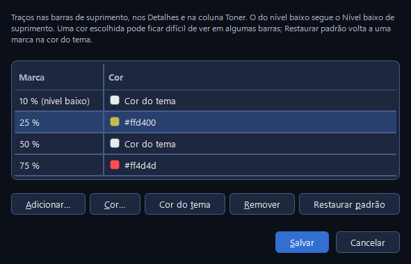
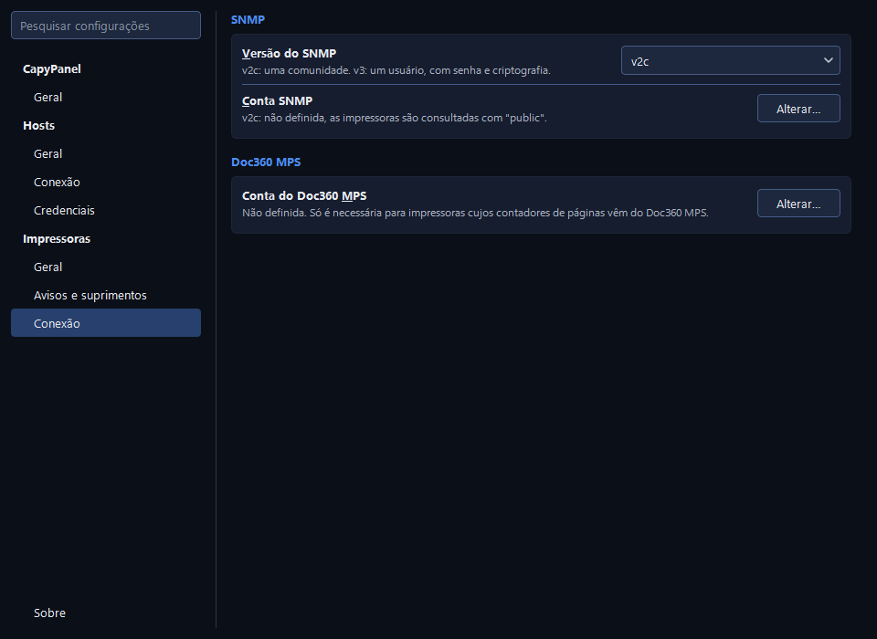
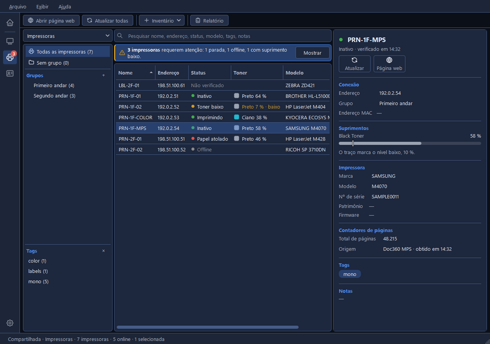
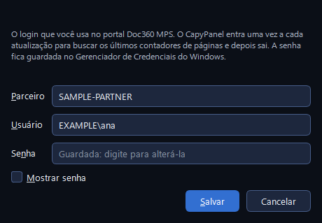

# Verificando impressoras

Um Atualizar pergunta a cada impressora em que estado ela está, quanto toner ainda resta e quantas
páginas ela já imprimiu. O CapyPanel só lê impressoras: ele nunca altera uma configuração numa
delas. Os resultados ficam na memória, nunca no arquivo da lista, e somem quando o CapyPanel fecha,
então uma lista somente leitura pode ser atualizada como qualquer outra.

## Verificar as suas impressoras

1. Clique em **Atualizar todas** na barra de ferramentas (**F5**). Ele lê todas as impressoras que
   a tabela mostra, ou seja, o grupo, a tag ou a pesquisa que você escolheu.
2. Para ler só algumas, use o botão direito numa impressora para **Atualizar impressora**, em
   várias para **Atualizar {n} impressoras**, ou num grupo para **Atualizar grupo** (com os grupos
   de dentro). O **Atualizar** do painel de detalhes lê a impressora que ele mostra.
3. A barra de status as conta enquanto são lidas, oito por vez, com um botão **Parar**.

Nada é lido sem você pedir, a não ser que você ligue o
[Atualizar sozinho](#atualizar-as-impressoras-sozinho).

??? note "O que mais um Atualizar lê"

    - A marca, o modelo, o nº de série e o total de páginas que a impressora informa, o **endereço
      MAC** dela e a **versão do firmware**. O endereço MAC aparece nos detalhes em **Conexão**, e o
      firmware em **Impressora**; os dois ficam em "—" até um Atualizar lê-los, e o relatório pode
      levar qualquer um deles. O firmware vem da descrição da própria impressora ou da lista de
      software instalado nela, que impressoras Samsung, Ricoh e Brother preenchem; algumas
      impressoras não informam versão nenhuma.
    - O total de páginas aparece em **Contadores de páginas**, ao lado da **Origem** que você
      escolheu. Uma impressora cuja Origem é o **Doc360 MPS** recebe a contagem do portal (veja
      [mais abaixo](#contar-paginas-pelo-doc360-mps)); o CapyPanel nunca recorre ao contador SNMP
      dela, porque não é a origem que você escolheu.
    - Onde a marca, o modelo ou o nº de série diferem da sua lista, ou onde ela não tem nada, os
      detalhes acrescentam a resposta da impressora embaixo do valor, como "A impressora diz
      **RICOH IM C3000** · Usar este". O **Usar este** copia o valor para a lista. Só você pode
      fazer isso: o CapyPanel nunca grava numa lista sozinho, e o link não aparece numa lista
      somente leitura.
    - Uma impressora sem endereço é consultada pelo nome dela.
    - Depois de um Atualizar, a barra de status acrescenta quantas impressoras responderam, como em
      "9 online". Uma impressora que recusou ou respondeu algo ilegível conta, porque está ligada.

## Ler o status de uma impressora

Cada impressora ganha um ponto colorido e algumas palavras:

| Ponto | O que significa | Exemplos |
|---|---|---|
| Verde | Funcionando | "Inativo", "Imprimindo", "Aquecendo", "Pronta" |
| Âmbar | Requer atenção, ainda imprime | "Toner baixo", "Pouco papel", "Bandeja vazia", "Requer atenção" |
| Vermelho | Parada | "Papel atolado", "Sem papel", "Porta aberta", "Sem toner", "Parada" |
| Cinza | Nada respondeu | "Offline" |
| Âmbar | Ela respondeu, mas de um jeito que o CapyPanel não conseguiu ler | "Ilegível" |

Antes do primeiro Atualizar ela diz **Não verificado** em cinza. A mensagem da própria impressora,
que pode ser um código e várias frases, fica na dica da célula e inteira embaixo do nome dela, nos
detalhes.

## Ver quanto toner resta

- A coluna **Toner** mostra o toner ou a tinta mais baixa, com um quadradinho da cor dele: "Preto
  24 %", ou "Ciano 8 % · baixo" em âmbar quando está no nível baixo ou abaixo dele.
- A seção **Suprimentos** do painel de detalhes lista cada suprimento com o nível e uma barra.
- **Configurações > Impressoras > Avisos e suprimentos > Nível baixo de suprimento** define o
  nível baixo, de 1 a 50 % (começa em 10 %). Um nível só vale para todo tipo de suprimento.
- Na mesma página, a **Coluna Toner** mostra o nível como texto (o padrão) ou como uma barra.

??? note "Mais sobre os suprimentos"

    - Os suprimentos aparecem com o nome que a própria impressora dá, que costuma estar em inglês
      ("Black Toner", "Drum Unit") seja qual for o idioma do CapyPanel: toners e tintas, o
      cilindro, a caixa de resíduos, o fusor, os roletes.
    - Um nível baixo é marcado "24 % · Baixo", e uma caixa de resíduos quase cheia "88 % · Quase
      cheia". O fusor e os roletes mostram o nível mas nunca são chamados de baixos, porque eles se
      desgastam em vez de acabar.
    - Um toner informado sem porcentagem aparece na coluna como "Preto: ainda há" ou "Preto: não
      informado", e uma impressora só preto que não nomeia cor nenhuma mostra apenas "Toner".
    - A barra estica junto com a coluna; numa coluna bem estreita aparece só a porcentagem. Copiar
      uma célula e o relatório sempre usam o texto.

??? note "Os traços nas barras"

    Toda barra tem um traço no nível baixo, e a linha embaixo das barras diz onde os traços estão:
    "O traço marca o nível baixo, 10 %." Cada traço tem um contorno escuro fino e passa um pouco da
    barra, para dar para ver em qualquer preenchimento e em qualquer tema.

    **Configurações > Impressoras > Avisos e suprimentos > Marcas das barras > Alterar…** abre uma
    janela: o **Adicionar…** põe um traço de 1 a 99 %, até oito seus, o **Cor…** dá a um deles uma
    cor própria e a **Cor do tema** a devolve, o **Remover** tira um, e o **Restaurar padrão** volta
    ao traço do nível baixo sozinho. Esse sempre segue o **Nível baixo de suprimento** e não pode
    ser removido. Com vários traços, a linha nomeia todos, como em "Os traços marcam 10 % (baixo),
    50 %."

    

## Ver quais impressoras requerem atenção

- Uma impressora **requer atenção** quando um dos motivos marcados em **No CapyPanel** vale para
  ela (veja [Escolher quais problemas avisam](#escolher-quais-problemas-avisam)). Para começar, são
  **Offline**, **Papel atolado**, **Sem toner** ou **Suprimento baixo**: um toner, tinta, cilindro
  ou caixa no nível baixo ou abaixo dele.
- Uma contagem vermelha no ícone de Impressoras na barra lateral e uma faixa acima da tabela dizem
  quantas, como em "3 impressoras requerem atenção: 1 parada, 1 offline, 1 com suprimento baixo." O
  **Mostrar** lista só essas impressoras; o **Mostrar todas** volta.
- As duas somem por conta própria quando nada mais requer atenção.

??? note "O que não conta, e como o Mostrar funciona"

    A mensagem "Requer atenção" da própria impressora não conta, e nem a **Recusada** e a
    **Ilegível**: essas dizem que o CapyPanel não conseguiu ler a impressora, não que ela está com
    problema. Na faixa, papel atolado, sem papel e sem toner contam como "parada".

    O **Mostrar** tira as impressoras da lista inteira: qualquer grupo, tag ou pesquisa é limpo
    antes, para nenhuma delas ficar escondida. A faixa passa a dizer "Mostrando as 3 impressoras que
    requerem atenção." Escolher um grupo ou uma tag, ou pesquisar, também traz todas de volta.

## Escolher quais problemas avisam

1. Abra **Configurações > Impressoras > Avisos e suprimentos**. A seção **Avisos** tem uma linha
   para cada motivo: **Offline**, **Papel atolado**, **Parada**, **Sem papel**, **Sem toner** e
   **Suprimento baixo**.
2. Marque um motivo em **No CapyPanel** para ele entrar na contagem vermelha e na faixa, e em
   **Notificação do Windows** para ser avisado dele depois de um Atualizar sozinho.
3. Clique em **Salvar**.

Para começar, **Offline**, **Papel atolado**, **Sem toner** e **Suprimento baixo** vêm marcados nas
duas colunas. O **Restaurar padrão** volta para eles; fica apagado enquanto são eles os marcados. As
marcas só escolhem o que avisa: a coluna **Status** da tabela e os Detalhes sempre mostram todos os
problemas.

??? note "Mais sobre os motivos"

    - **Parada** é uma impressora parada sem dizer o motivo, como num erro de serviço. **Offline**
      é uma que não respondeu ao Atualizar. **Suprimento baixo** é um suprimento no **Nível baixo de
      suprimento**, em **Suprimentos** na mesma página, ou abaixo dele.
    - Uma impressora conta quando qualquer um dos motivos marcados vale para ela, e a faixa e a
      notificação dizem qual.
    - Porta aberta, bandeja faltando, bandeja de saída cheia, impressora pausada ou suprimento
      faltando aparecem no Status e nos Detalhes, mas nunca avisam: só acontecem enquanto alguém
      está na impressora. Uma impressora parada por um deles também não conta como **Parada**.
    - Antes da 0.27, as Configurações tinham uma única escolha de **Notificação do Windows**. Ela
      passa uma vez para a tabela: **Desligado** não marca nenhuma notificação, **Também suprimento
      baixo** marca todos os motivos, e **Parada ou offline** fica com as marcas acima.

??? note "Notificações do Windows"

    Sai uma notificação por Atualizar sozinho, e só do que mudou: uma impressora que já estava
    offline não é citada de novo. O título as conta, "2 impressoras requerem atenção", e uma linha
    por impressora diz qual e por quê, como "PRN-2F-02: Offline" ou "PRN-1F-02: Preto 7 %", no
    máximo cinco delas e então "e mais 3". Um clique nela abre as Impressoras com só essas
    listadas, e o **✕** descarta a notificação. Um Atualizar que você aperta nunca notifica.

## Atualizar as impressoras sozinho

**Configurações > Impressoras > Avisos e suprimentos > Atualizar sozinho**: **Desligado** (o
padrão), ou a cada **5**, **15**, **30** ou **60 minutos**. Ele lê a lista aberta inteira, não só o
que a tabela mostra, porque os avisos contam todas. Enquanto ele está ligado, o CapyPanel mantém um
ícone na bandeja do Windows e a janela pode fechar para lá, para as impressoras continuarem sendo
lidas (veja [Primeiros passos](../getting-started.pt-BR.md#fechar-o-capypanel-ou-deixa-lo-na-bandeja)).

??? note "Quando uma rodada é pulada"

    Uma rodada é pulada enquanto outro Atualizar está rodando, e enquanto o **v3** está escolhido
    sem conta definida. A linha dele nas configurações diz o que uma rodada abrange: "Todas as
    impressoras da lista aberta, 8 por vez, enquanto o CapyPanel estiver aberto ou na bandeja."

## Definir a conta SNMP

1. Abra **Configurações > Impressoras > Conexão**.
2. Escolha a **Versão do SNMP**, para todas as impressoras de uma vez: **v2c** (o padrão) ou
   **v3**.
3. Clique em **Alterar…** na linha **Conta SNMP** e preencha.

A maioria das impressoras responde ao v2c com a comunidade "public", que o CapyPanel usa até você
definir outra. A conta fica no **Gerenciador de Credenciais do Windows**, na sua própria conta do
Windows. Nunca vai para um arquivo de configurações, um arquivo de lista ou um log, e uma conta só
vale para todas as impressoras.

??? note "v2c: a comunidade"

    A comunidade é uma espécie de senha, e quase toda impressora a deixa em "public". A linha diz
    'v2c: não definida, as impressoras são consultadas com "public".' ou "v2c: comunidade definida.
    Guardada no Gerenciador de Credenciais do Windows." O **Alterar…** abre uma janelinha para
    defini-la, com uma caixa **Mostrar** se você quiser ler o que digitou. Salvar uma comunidade
    vazia volta para "public".

??? note "v3: a janela da conta"

    O SNMP v3 assina cada pedido, e pode criptografá-lo, então ele pede uma conta em vez de uma
    palavra só. O **Alterar…** abre a janela **Conta SNMP v3**, para "o usuário SNMP v3 somente
    leitura que suas impressoras conhecem":

    | Campo | O que ele recebe |
    |---|---|
    | **Usuário** | O usuário v3 que as impressoras conhecem. Esvaziá-lo esquece a conta |
    | **Autenticação** | **Nenhuma**, ou o hash que assina cada pedido: MD5, SHA, SHA-224, SHA-256, SHA-384, SHA-512 |
    | **Senha da autenticação** | 8 caracteres ou mais |
    | **Criptografia** | **Nenhuma** ou **AES-128**, que precisa da autenticação definida |
    | **Senha da criptografia** | 8 caracteres ou mais |

    Uma conta nova começa em **SHA** e **AES-128**, que é como a maioria das impressoras vem
    configurada, e o **Mostrar senhas** deixa ler o que você digitou. Uma senha já guardada não
    aparece de novo: a caixa dela diz "Guardada: digite para alterá-la", e vazia ela fica como
    estava. Embaixo dos campos a janela diz o que ainda falta, e o **Salvar** espera até a conta
    estar completa. A criptografia DES não é oferecida: a AES-128 é a que as impressoras
    implementam. Para esquecer a conta, esvazie o **Usuário** e salve; a janela avisa antes,
    "Salvar esquece a conta guardada."

    A linha então nomeia o que está definido, como "v3: usuário it-reader, SHA-256, AES-128.
    Guardada no Gerenciador de Credenciais do Windows."

??? note "Como o CapyPanel lê uma impressora"

    Ele usa **SNMP na porta 161**, na versão 2c ou 3, e só lê: o CapyPanel nunca envia uma gravação
    SNMP, então um Atualizar não consegue alterar nada numa impressora.

    Quase tudo que ele pede são as informações de impressora padrão que toda marca responde, as
    MIBs Host Resources, Printer e Entity. Onde elas deixam uma lacuna, ele lê os dados próprios do
    fabricante, também só leitura:

    - **Ricoh:** o nível do toner quando o padrão não tem porcentagem, e o nº de série quando os
      campos padrão estão vazios.
    - **Brother:** os níveis do toner e do cilindro quando o padrão não tem porcentagem.

    Uma impressora que já responde com porcentagem nunca é consultada a mais, e novas marcas entram
    uma a uma, quando uma impressora real mostra a lacuna. A marca vem do número de fabricante que a
    impressora informa, e o modelo, da descrição dela.

## Contar páginas pelo Doc360 MPS

Se as suas impressoras estão no portal Doc360 MPS, ponha os **Contadores de páginas** de uma
impressora em **Doc360 MPS** e adicione a conta do portal em **Configurações > Impressoras >
Conexão > Conta do Doc360 MPS**. Um Atualizar então pega a contagem de páginas dela no portal.

??? note "Como chegam as contagens do Doc360"

    Um Atualizar entra no Doc360 uma vez, baixa os contadores mais recentes, sai, e identifica cada
    impressora pelo número de série: o da sua lista ou o que a impressora informa. Ele só faz isso
    quando a lista aberta tem uma impressora do Doc360, e o Atualizar sozinho também faz. Uma
    impressora dessas não precisa estar na sua rede: ela aparece como **Offline** quando não está,
    e a contagem chega assim mesmo.

    

    O número aparece nos detalhes em **Contadores de páginas**, com a **Origem** dizendo "Doc360 MPS
    · obtido em 14:32"; a dica acrescenta que o Doc360 lê as impressoras no horário dele, então o
    número pode estar atrasado em relação à impressora. Ele é a contagem deste mês. Nos primeiros
    dias de um mês o Doc360 pode ainda não ter nenhuma, então o CapyPanel pega a do mês passado e
    avisa em âmbar, e o relatório escreve "20500 (de outubro de 2026)". Quando não há contagem
    nenhuma, os detalhes dizem o porquê no lugar dela e o relatório fica com "Erro" (veja a tabela
    abaixo).

    Um login recusado é tentado uma vez e deixado em paz até o próximo Atualizar, para uma senha
    errada não ser enviada de novo e de novo.

??? note "A conta do Doc360 MPS"

    O **Alterar…** abre uma janela para "o login que você usa no portal Doc360 MPS": **Parceiro**,
    **Usuário** e **Senha**, com uma caixa **Mostrar senha**. O parceiro é o código de parceiro da
    própria página de login do Doc360.

    

    A senha fica no **Gerenciador de Credenciais do Windows**, na sua própria conta do Windows, e a
    linha das configurações mostra só o resto: "Parceiro SAMPLE-PARTNER, usuário EXAMPLE\ana.
    Guardada no Gerenciador de Credenciais do Windows.", ou "Não definida. Só é necessária para
    impressoras cujos contadores de páginas vêm do Doc360 MPS." Apagar o usuário e salvar esquece a
    conta. Quando um login falta ou é recusado, um botão embaixo do erro nos detalhes abre esta
    janela na hora: **Definir a conta…**, ou **Alterar a conta…** quando já existe uma.

## Mensagens que você pode ver

| Mensagem | O que significa | O que fazer |
|---|---|---|
| **Não verificado** | Nenhum Atualizar leu a impressora ainda | Atualize-a |
| **Offline** | Nada respondeu | Confira se a impressora está ligada e o endereço está certo |
| **Recusada** (âmbar), com uma dica como "Recusada às 14:32: senha ou tipo de autenticação errado." | A impressora recusou a conta SNMP. A dica diz o motivo: um usuário que ela não conhece, a senha ou o tipo de autenticação errado, a senha da criptografia errada, a autenticação ou a criptografia que ela espera de outro jeito, ou um relógio longe demais do do CapyPanel | Corrija essa parte em **Configurações > Impressoras > Conexão**, ou o relógio da impressora |
| **Ilegível** (âmbar) | Ela respondeu, mas de um jeito que o CapyPanel não conseguiu ler | Abra a página web dela |
| "Defina antes a conta SNMP v3 em Configurações › Impressoras › Conexão." | O **v3** está escolhido sem conta, então um Atualizar não começa | Defina a conta |
| "Parado: 4 impressoras não foram verificadas." | Você apertou **Parar** | Atualize de novo |
| "Esta impressora não informa o nível deste suprimento." | A impressora não dá nível para esse suprimento | Confira a página web dela |
| "A impressora não informa seus suprimentos." | Nenhum dado de suprimento | Confira a página web dela |
| "Nenhuma conta do Doc360 MPS definida." | Ainda não há com o que entrar | **Definir a conta…** |
| "O Doc360 MPS recusou o login." | O parceiro, o usuário ou a senha está errado | **Alterar a conta…** |
| "O Doc360 MPS não respondeu." | Sem rede, ou o portal está fora do ar | Tente de novo mais tarde |
| "As páginas do Doc360 MPS mudaram, então o CapyPanel não conseguiu ler os contadores." | O portal foi refeito | O CapyPanel precisa de uma atualização para as páginas novas |
| "O Doc360 MPS não tem o número de série SAMPLE0011." | O portal não tem nenhuma impressora com esse número | Confira o nº de série |
| "Adicione o número de série da impressora: o Doc360 MPS identifica as impressoras pelo número de série." | A sua lista não tem o número de série desta impressora | Adicione-o com **Editar selecionado…** |
| "⚠ De outubro de 2026: o Doc360 MPS ainda não tem contadores deste mês. Confira o portal antes de usar este número." | No começo de um mês, a contagem é a do mês passado | Confira o portal antes de usar o número |
