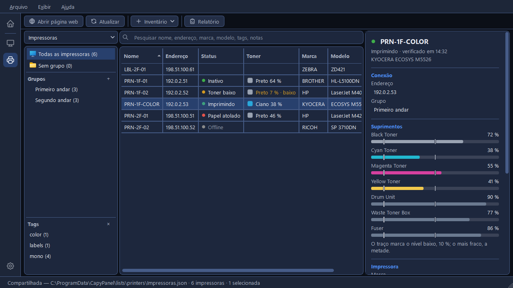
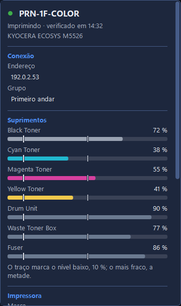

# Verificando impressoras

O **Atualizar** pergunta a cada impressora exibida em que estado ela está e quanto toner ainda
resta, e preenche as colunas **Status** e **Toner**, a seção **Suprimentos** do painel de detalhes
e o contador de páginas. O CapyPanel só lê: ele nunca altera uma configuração numa impressora.

Os resultados ficam na memória, nunca no arquivo da lista, e somem quando o CapyPanel fecha. Isso
também significa que uma lista somente leitura pode ser atualizada como qualquer outra.

## Atualizar

O **Atualizar** da barra de ferramentas lê todas as impressoras que a tabela mostra, ou seja, o
grupo, a tag ou a pesquisa que você escolheu. O **F5** faz o mesmo, e o menu de botão direito de
uma impressora tem **Atualizar** só para ela. Nada é lido sem você pedir: o CapyPanel nunca
atualiza sozinho, e nunca avisa sobre uma impressora.

São oito impressoras por vez. A barra de status as conta, "Verificando 3 de 12…", com um botão
**Parar**, e diz "12 impressoras verificadas." no fim, ou "Parado: 4 impressoras não foram
verificadas." Uma impressora sem endereço é consultada pelo nome dela.

## Status

Um ponto colorido e algumas palavras, com a hora da verificação ao lado no painel de detalhes.
Antes do primeiro Atualizar as duas colunas ficam vazias e a dica da célula de Status diz "Não
verificado: use Atualizar".

| Ponto | O que significa | Exemplos |
|---|---|---|
| Verde | Funcionando | "Inativo", "Imprimindo", "Aquecendo", "Pronta" |
| Âmbar | Requer atenção, ainda imprime | "Toner baixo", "Pouco papel", "Bandeja vazia", "Requer atenção" |
| Vermelho | Parada | "Papel atolado", "Sem papel", "Porta aberta", "Sem toner", "Parada" |
| Cinza | "Offline": nada respondeu |  |
| Âmbar | "Ilegível": ela respondeu, mas de um jeito que o CapyPanel não conseguiu ler |  |

As impressoras costumam acrescentar uma mensagem própria, às vezes um código e várias frases. Ela
nunca entra na coluna Status, onde empurraria todo o resto para fora da vista. Passe o mouse na
célula para lê-la, ou selecione a impressora e leia-a inteira embaixo do nome dela, no painel de
detalhes.

## Toner e os outros suprimentos

A coluna **Toner** mostra o toner ou a tinta mais baixa que a impressora informa, como texto por
padrão, com um quadradinho da cor daquele toner ao lado: "Preto 24 %", ou "Ciano 8 % · baixo" em
âmbar quando está no nível baixo ou abaixo dele.
Uma impressora que informa um toner sem porcentagem mostra "Preto: ainda há" ou "Toner: nível
desconhecido", e uma impressora só preto que não nomeia cor nenhuma mostra apenas "Toner".

Em **Configurações > Impressoras > Atualizar > Coluna Toner** dá para mostrar uma barra no lugar,
preenchida até aquele nível e com a porcentagem ao lado. A barra estica junto com a coluna, e numa
coluna bem estreita aparece só a porcentagem. Copiar uma célula e o relatório sempre usam o texto.

A seção **Suprimentos** do painel de detalhes lista tudo que a impressora informa: toners e
tintas, o cilindro, a caixa de resíduos, o fusor, os roletes. Cada um aparece com o nome que a
própria impressora dá a ele, que costuma estar em inglês ("Black Toner", "Drum Unit") seja qual
for o idioma do CapyPanel. Cada um tem o nível e uma barra, um
nível baixo é marcado "24 % · Baixo", e uma caixa de resíduos quase cheia é marcada "88 % · Quase
cheia". O fusor e os roletes mostram o nível mas nunca são chamados de baixos, porque eles se
desgastam em vez de acabar. Quando a impressora não informa nada disso, a seção diz "A impressora
não informa seus suprimentos."

Toda barra tem dois traços, explicados embaixo delas: "O traço marca o nível baixo, 10 %; o mais
fraco, a metade."

Em **Configurações > Impressoras > Atualizar > Nível baixo de suprimento** você define esse nível,
de 1 a 50 %, e começa em 10 %. Um nível só vale para todo tipo de suprimento.

## O que a impressora diz sobre si mesma

O Atualizar também lê a marca, o modelo, o nº de série e o total de páginas que a impressora
informa.

O total de páginas aparece no painel de detalhes, em **Contadores de páginas**, ao lado da
**Origem** que você escolheu para a impressora.

A marca, o modelo e o nº de série são comparados com o que a sua lista diz. Onde eles diferem, ou
onde a sua lista não tem nada, o painel de detalhes acrescenta a resposta da impressora embaixo do
valor, como "A impressora diz **RICOH IM C3000** · Usar este". O **Usar este** copia o valor para
a lista, e só você pode fazer isso: o CapyPanel nunca grava numa lista sozinho, e o link não
aparece numa lista somente leitura.

## Como o CapyPanel lê uma impressora

Ele usa **SNMP versão 2c na porta 161**, e só lê. O CapyPanel nunca envia uma gravação SNMP, então
um Atualizar não consegue alterar nada numa impressora, seja qual for o problema dela. A versão 3
ainda não é suportada.

Quase tudo que ele pede são as informações de impressora padrão que toda marca responde, as MIBs
Host Resources, Printer e Entity. Onde elas deixam uma lacuna, ele lê os dados próprios do
fabricante, também só leitura, para preenchê-la:

- **Ricoh:** o nível do toner quando o padrão não tem porcentagem, e o nº de série quando os
  campos padrão estão vazios.
- **Brother:** os níveis do toner e do cilindro quando o padrão não tem porcentagem.

Nenhuma outra marca precisa disso hoje. Uma impressora que já responde com porcentagem nunca é
consultada a mais, e novas marcas entram uma a uma, quando uma impressora real mostra a lacuna.

A marca vem do número de fabricante que a impressora informa, e o modelo, da descrição dela.

## A comunidade SNMP

As impressoras só respondem ao SNMP com uma espécie de senha, a **comunidade**. Quase toda
impressora a deixa em "public", que é o que o CapyPanel usa até você dizer o contrário.

Em **Configurações > Impressoras > Atualizar > Comunidade SNMP** está escrito qual ele está
usando: "Não definida: as impressoras são consultadas com “public”." ou "Definida. Guardada no
Gerenciador de Credenciais do Windows, nunca em um arquivo." O **Alterar…** abre uma janelinha
para defini-la, com uma caixa **Mostrar** se você quiser ler o que digitou. Salvar uma comunidade
vazia volta para "public".

Ela fica guardada no **Gerenciador de Credenciais do Windows**, na sua própria conta do Windows.
Nunca vai para um arquivo de configurações, um arquivo de lista ou um log. Uma comunidade só vale
para todas as impressoras.
