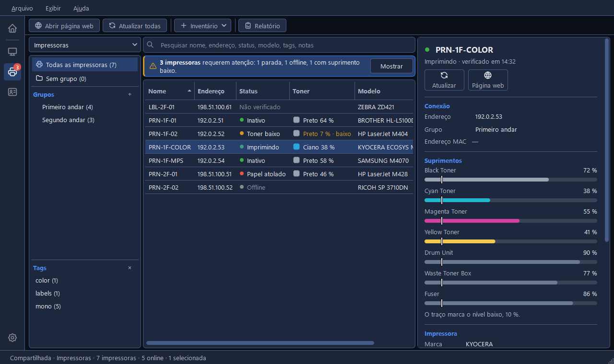
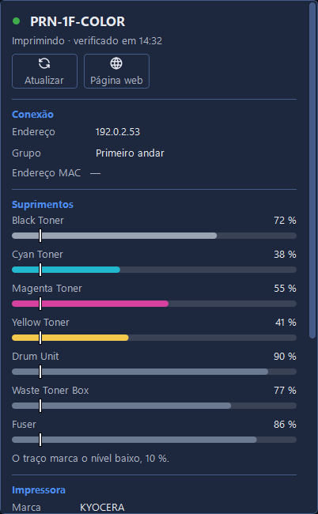
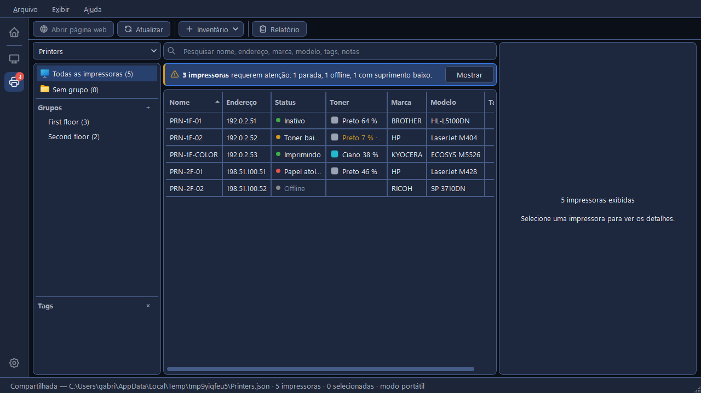
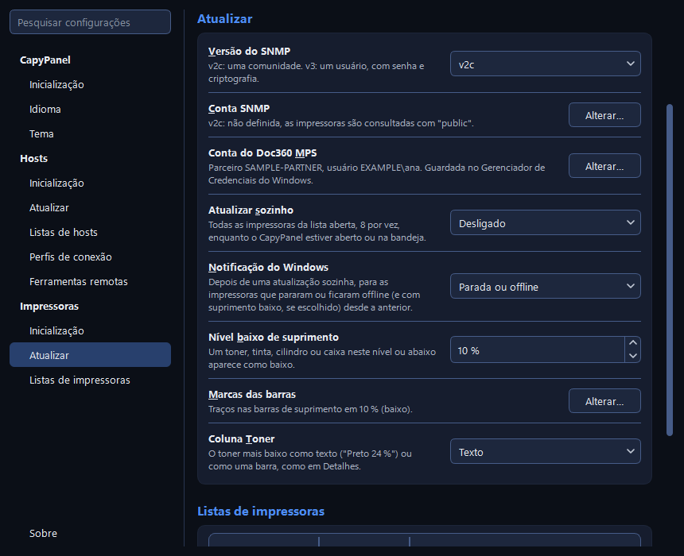

# Verificando impressoras

O **Atualizar** pergunta a cada impressora exibida em que estado ela está e quanto toner ainda
resta, e preenche as colunas **Status** e **Toner**, a seção **Suprimentos** do painel de detalhes,
o contador de páginas e o endereço MAC e a versão do firmware da impressora. O CapyPanel só lê:
ele nunca altera uma configuração numa impressora.

Os resultados ficam na memória, nunca no arquivo da lista, e somem quando o CapyPanel fecha. Isso
também significa que uma lista somente leitura pode ser atualizada como qualquer outra.

## Atualizar

O **Atualizar** da barra de ferramentas lê todas as impressoras que a tabela mostra, ou seja, o
grupo, a tag ou a pesquisa que você escolheu. O **F5** faz o mesmo, e o menu de botão direito de
uma impressora tem **Atualizar** só para ela. Nada é lido sem você pedir, a não ser que você
ligue o [Atualizar sozinho](#atualizar-sozinho), que começa desligado.

São oito impressoras por vez. A barra de status as conta, "Verificando 3 de 12…", com um botão
**Parar**, e diz "12 impressoras verificadas." no fim, ou "Parado: 4 impressoras não foram
verificadas." Uma impressora sem endereço é consultada pelo nome dela.

## Atualizar sozinho

Em **Configurações > Impressoras > Atualizar > Atualizar sozinho** a leitura acontece por tempo:
**Desligado**, o padrão, ou a cada **5**, **15**, **30** ou **60 minutos**. A linha dele diz o que
uma rodada abrange: "Todas as impressoras da lista aberta, 8 por vez, enquanto o CapyPanel estiver
aberto ou na bandeja."

Ele lê a lista aberta inteira, não só as impressoras que a tabela mostra, porque os avisos mais
abaixo contam todas, e a barra de status as conta como num Atualizar que você apertou. Uma rodada é
pulada enquanto outro Atualizar está rodando, e também enquanto o **v3** está escolhido sem conta
definida.

Enquanto ele está ligado, o CapyPanel mantém um ícone na bandeja do Windows, e a janela pode fechar
para lá em vez de sair, para as impressoras continuarem sendo lidas (veja
[Primeiros passos](../getting-started.pt-BR.md#fechando-o-capypanel-e-a-bandeja)).

## Status

Um ponto colorido e algumas palavras, com a hora da verificação ao lado no painel de detalhes.
Antes do primeiro Atualizar as duas colunas ficam vazias e a dica da célula de Status diz "Não
verificado: use Atualizar".

| Ponto | O que significa | Exemplos |
|---|---|---|
| Verde | Funcionando | "Inativo", "Imprimindo", "Aquecendo", "Pronta" |
| Âmbar | Requer atenção, ainda imprime | "Toner baixo", "Pouco papel", "Bandeja vazia", "Requer atenção" |
| Vermelho | Parada | "Papel atolado", "Sem papel", "Porta aberta", "Sem toner", "Parada" |
| Cinza | "Offline": nada respondeu |  |
| Âmbar | "Ilegível": ela respondeu, mas de um jeito que o CapyPanel não conseguiu ler |  |

As impressoras costumam acrescentar uma mensagem própria, às vezes um código e várias frases. Ela
nunca entra na coluna Status, onde empurraria todo o resto para fora da vista. Passe o mouse na
célula para lê-la, ou selecione a impressora e leia-a inteira embaixo do nome dela, no painel de
detalhes.

## Toner e os outros suprimentos

A coluna **Toner** mostra o toner ou a tinta mais baixa que a impressora informa, como texto por
padrão, com um quadradinho da cor daquele toner ao lado: "Preto 24 %", ou "Ciano 8 % · baixo" em
âmbar quando está no nível baixo ou abaixo dele. Uma impressora que informa um toner sem
porcentagem mostra "Preto: ainda há" ou "Preto: não informado", e uma impressora só preto que
não nomeia cor nenhuma mostra apenas "Toner".

Em **Configurações > Impressoras > Atualizar > Coluna Toner** dá para mostrar uma barra no lugar,
preenchida até aquele nível e com a porcentagem ao lado. A barra estica junto com a coluna, e numa
coluna bem estreita aparece só a porcentagem. Copiar uma célula e o relatório sempre usam o texto.

A seção **Suprimentos** do painel de detalhes lista tudo que a impressora informa: toners e
tintas, o cilindro, a caixa de resíduos, o fusor, os roletes. Cada um aparece com o nome que a
própria impressora dá a ele, que costuma estar em inglês ("Black Toner", "Drum Unit") seja qual
for o idioma do CapyPanel. Cada um tem o nível e uma barra, um
nível baixo é marcado "24 % · Baixo", e uma caixa de resíduos quase cheia é marcada "88 % · Quase
cheia". O fusor e os roletes mostram o nível mas nunca são chamados de baixos, porque eles se
desgastam em vez de acabar. Um suprimento cujo nível a impressora não informa não tem barra, e
diz isso no lugar: "Esta impressora não informa o nível deste suprimento." Quando a impressora
não informa nada disso, a seção diz "A impressora não informa seus suprimentos."

Toda barra tem dois traços, explicados embaixo delas: "O traço marca o nível baixo, 10 %; o mais
fraco, a metade."

Em **Configurações > Impressoras > Atualizar > Nível baixo de suprimento** você define esse nível,
de 1 a 50 %, e começa em 10 %. Um nível só vale para todo tipo de suprimento.

## O que a impressora diz sobre si mesma

O Atualizar também lê a marca, o modelo, o nº de série e o total de páginas que a impressora
informa, o **endereço MAC** dela e a **versão do firmware**. O endereço MAC aparece no painel de
detalhes em **Conexão**, depois do grupo, e o firmware em **Impressora**, depois do patrimônio.
Os dois ficam em "—" até um Atualizar lê-los, e o relatório pode levar qualquer um dos dois (veja
[A ferramenta Impressoras](printers.pt-BR.md#relatorio)).

O total de páginas aparece no painel de detalhes, em **Contadores de páginas**, ao lado da
**Origem** que você escolheu para a impressora, e o relatório pode levá-lo como **Total de
páginas**.

Uma impressora cuja Origem é o **Doc360 MPS** é a exceção. O CapyPanel ainda não lê esse portal,
então o Total de páginas dela fica "Erro: O CapyPanel ainda não lê contadores de páginas do Doc360
MPS.", nos detalhes e antes de qualquer atualização, e só "Erro" no relatório. O CapyPanel não
recorre ao contador SNMP da própria impressora nesse caso, porque não é a origem que você escolheu
para ela. O status e o toner dela continuam vindo de uma atualização como os de qualquer outra.

A marca, o modelo e o nº de série são comparados com o que a sua lista diz. Onde eles diferem, ou
onde a sua lista não tem nada, o painel de detalhes acrescenta a resposta da impressora embaixo do
valor, como "A impressora diz **RICOH IM C3000** · Usar este". O **Usar este** copia o valor para
a lista, e só você pode fazer isso: o CapyPanel nunca grava numa lista sozinho, e o link não
aparece numa lista somente leitura.

## Impressoras que requerem atenção

Depois de um Atualizar, uma impressora **requer atenção** quando ela parou (status vermelho), não
respondeu (**Offline**) ou tem um toner, tinta, cilindro ou caixa no nível baixo ou abaixo dele. A
mensagem "Requer atenção" da própria impressora não conta, e nem a **Recusada** e a **Ilegível**:
essas dizem que o CapyPanel não conseguiu ler a impressora, não que ela está com problema.

Três coisas então avisam:

- uma **contagem vermelha** no ícone de Impressoras na barra lateral, cuja dica ganha uma linha, "3
  impressoras requerem atenção";
- uma **faixa acima da tabela**: "3 impressoras requerem atenção: 1 parada, 1 offline, 1 com
  suprimento baixo.", com um botão **Mostrar** que lista só essas impressoras, da lista inteira:
  qualquer grupo, tag ou pesquisa é limpo antes, para nenhuma delas ficar escondida. A faixa passa
  a dizer "Mostrando as 3 impressoras que requerem atenção." com um **Mostrar todas** para
  voltar, e escolher um grupo ou uma tag, ou pesquisar, também traz todas de volta;
- uma **notificação do Windows**, se você pedir uma.

A contagem e a faixa somem por conta própria quando nada mais requer atenção.

Em **Configurações > Impressoras > Atualizar > Notificação do Windows** você escolhe o que
notificar: **Desligado**, **Parada ou offline** (o padrão) ou **Também suprimento baixo**. "Depois
de uma atualização sozinha, para as impressoras que pararam ou ficaram offline (e com suprimento
baixo, se escolhido) desde a anterior."

Sai uma notificação por Atualizar sozinho, e só do que mudou: uma impressora que já estava offline
não é citada de novo. O título as conta, "2 impressoras requerem atenção", e uma linha por
impressora diz qual e por quê, como "PRN-2F-02: Offline" ou "PRN-1F-02: Preto 7 %", no máximo cinco
delas e então "e mais 3". Um clique nela abre as Impressoras com só essas listadas, e o **✕**
descarta a notificação. Um Atualizar que você aperta nunca notifica, então nada é enviado antes de
o Atualizar sozinho estar ligado.

## Como o CapyPanel lê uma impressora

Ele usa **SNMP na porta 161**, na versão **2c** ou **3** que você escolher mais abaixo, e só lê.
O CapyPanel nunca envia uma gravação SNMP, então um Atualizar não consegue alterar nada numa
impressora, seja qual for o problema dela.

Quase tudo que ele pede são as informações de impressora padrão que toda marca responde, as MIBs
Host Resources, Printer e Entity. Onde elas deixam uma lacuna, ele lê os dados próprios do
fabricante, também só leitura, para preenchê-la:

- **Ricoh:** o nível do toner quando o padrão não tem porcentagem, e o nº de série quando os
  campos padrão estão vazios.
- **Brother:** os níveis do toner e do cilindro quando o padrão não tem porcentagem.

Nenhuma outra marca precisa disso hoje. Uma impressora que já responde com porcentagem nunca é
consultada a mais, e novas marcas entram uma a uma, quando uma impressora real mostra a lacuna.

A marca vem do número de fabricante que a impressora informa, e o modelo, da descrição dela.

## A conta SNMP

As impressoras só respondem ao SNMP a quem elas já conhecem, e quem é isso depende da versão. Em
**Configurações > Impressoras > Atualizar > Versão do SNMP** você escolhe, para todas as
impressoras de uma vez: **v2c**, o padrão, ou **v3**. "v2c: uma comunidade. v3: um usuário, com
senha e criptografia."

Embaixo dela, uma linha de **Conta SNMP** diz o que está definido para a versão escolhida, e o
**Alterar…** abre a janela daquela versão. Em qualquer uma das duas, o que você define fica
guardado no **Gerenciador de Credenciais do Windows**, na sua própria conta do Windows. Nunca vai
para um arquivo de configurações, um arquivo de lista ou um log, e uma conta só vale para todas as
impressoras.

### v2c: uma comunidade

A **comunidade** é uma espécie de senha, e quase toda impressora a deixa em "public", que é o que o
CapyPanel usa até você dizer o contrário. A linha diz 'v2c: não definida, as impressoras são
consultadas com "public".' ou "v2c: comunidade definida. Guardada no Gerenciador de Credenciais do
Windows." O **Alterar…** abre uma janelinha para defini-la, com uma caixa **Mostrar** se você
quiser ler o que digitou. Salvar uma comunidade vazia volta para "public".

### v3: um usuário com senhas

O SNMP v3 assina cada pedido, e pode criptografá-lo, então ele pede uma conta em vez de uma
palavra só. A linha diz "v3: não definida. Use Alterar… para adicionar o usuário." ou nomeia o que
está definido, como "v3: usuário it-reader, SHA-256, AES-128. Guardada no Gerenciador de
Credenciais do Windows."

O **Alterar…** abre a janela **Conta SNMP v3**, para "o usuário SNMP v3 somente leitura que suas
impressoras conhecem":

| Campo | O que ele recebe |
|---|---|
| **Usuário** | O usuário v3 que as impressoras conhecem. Esvaziá-lo esquece a conta |
| **Autenticação** | **Nenhuma**, ou o hash que assina cada pedido: MD5, SHA, SHA-224, SHA-256, SHA-384, SHA-512 |
| **Senha da autenticação** | 8 caracteres ou mais |
| **Criptografia** | **Nenhuma** ou **AES-128**, que precisa da autenticação definida |
| **Senha da criptografia** | 8 caracteres ou mais |

Uma conta nova começa em **SHA** e **AES-128**, que é como a maioria das impressoras vem
configurada, e o **Mostrar senhas** deixa ler o que você digitou. Uma senha já guardada não aparece
de novo: a caixa dela diz "Guardada: digite para alterá-la", e vazia ela fica como estava. Embaixo
dos campos a janela diz o que ainda falta, e o **Salvar** espera até a conta estar completa. A
criptografia DES não é oferecida: a AES-128 é a que as impressoras implementam.

Para esquecer a conta, esvazie o **Usuário** e salve. A janela avisa antes, "Salvar esquece a conta
guardada.", do mesmo jeito que uma comunidade vazia volta para "public".

Uma impressora que recusa a conta aparece como **Recusada** em âmbar na coluna Status, e a dica
dela diz por quê, como "Recusada às 14:32: senha ou tipo de autenticação errado.", seguida de
"Confira a conta SNMP em Configurações › Impressoras › Atualizar." Os motivos que ela distingue são
um usuário que a impressora não conhece, a senha ou o tipo de autenticação errado, a senha da
criptografia errada, a autenticação ou a criptografia que ela espera de outro jeito, e um relógio
longe demais do do CapyPanel.

Com o **v3** escolhido e nenhuma conta ainda, um Atualizar não começa: a barra de status diz
"Defina antes a conta SNMP v3 em Configurações › Impressoras › Atualizar." O Atualizar sozinho
apenas espera, sem dizer nada.
