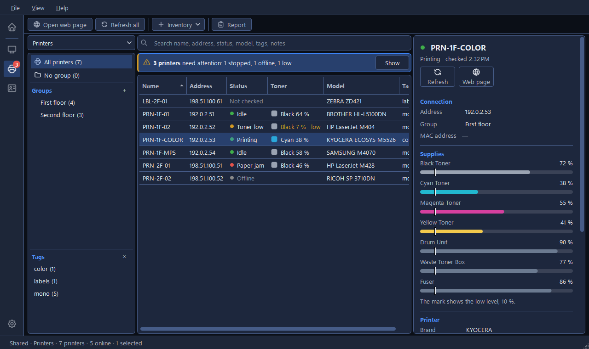

# The Printers tool

Printers keeps the printers you look after, tells you what state each one is in, and opens any
printer's own web page. Open it from the **Printers** tile on Home, the printer icon on the rail,
or **Ctrl+2**.

How a Refresh reads status and toner has a page of its own: [Checking printers](checking.md).

## Add a printer

1. **Inventory > Add printer…** (Ctrl+N).
2. Type a **Name** and the **Address**, an IP address or a network name. That's enough: a Refresh
   reads the brand, model, serial number and toner from the printer.
3. Click **Add**.

The other fields are optional:

| Field | What it's for |
|---|---|
| **Group** and **Tags** | Where it sits in the list, as in Hosts |
| **Brand** and **Model** | Filled in by hand, or copied from what the printer reports |
| **Serial number** and **Asset tag** | The two numbers you need when you call support or do an audit |
| **Page counters** | Where the page count comes from: **SNMP** or **Doc360 MPS** |
| **Notes** | Anything else |

??? note "More about the fields"

    - **Brand** is a dropdown of common makes (Brother, Canon, Epson, HP, Kyocera, Lexmark, Ricoh,
      Samsung, Xerox, Zebra), and you can type any other one in. Brand and serial number are saved
      in capitals.
    - **Page counters** is **SNMP**, asked from the printer itself, or **Doc360 MPS**, the
      managed-print portal (see
      [Get page counts from Doc360 MPS](checking.md#get-page-counts-from-doc360-mps)). A Refresh
      reads the count from the source you pick here.
    - A printer with no address is reached by its name.
    - **Edit selected…** (F2) opens the same window for a printer already in the list, with
      **Save** instead of **Add**.

## Open a printer's web page

Almost every printer has a web page of its own for settings, counters and supplies. Click **Open
web page** on the toolbar, double-click the printer, or press **Enter**. It opens in your default
browser.

If the printer's page needs https, start its address with `https://`. Anything else opens with
http.

??? note "More about web pages"

    - An address that starts with `https://` opens exactly as you typed it, port and all, so
      `https://prn-01.example.com:8443` reaches a printer whose web page is on another port. The
      **Address** field says so in its tooltip.
    - CapyPanel opens at most ten pages at once.
    - Only the address is handed to the browser. CapyPanel fetches nothing from the printer and
      signs in to nothing.

## Find a printer

Type in the search box above the table (**Ctrl+F**). To narrow the group you're in, pick a tag on
the left; pick several to keep only the printers that carry all of them. To see a tag across the
whole list, pick **All printers** first.

??? note "What the search covers"

    - Every column on show except Toner, plus the notes; the box names them, as in "Search name,
      address, status, model, tags, notes". Showing or hiding a column changes what it covers.
    - The status is searched as the column shows it.
    - With tags picked, a tinted strip above the table says which, as in "Only printers with all
      of: floor-2, colour · 4 of 37 shown", with a **Clear** button. The **Tags** heading shows how
      many are picked and offers a **×** to clear them. Picked tags stay as you move between groups
      and while you search.

## Keep printers in lists, groups and tags

Printers has its own lists, kept apart from the Hosts tool's. The open list's name sits on top of
the Groups panel; its menu switches lists and holds **New printer list**, **Open a printer list**
(Ctrl+O) and **Manage printer lists…**.

Groups, tags, dragging, **Move to ▸**, **Tags ▸** and **Manage groups…** work exactly as in Hosts:
see [Host lists](../hosts/host-lists.md).

??? note "Where printer lists are kept"

    A printer list is one JSON file holding groups, printers and their tags. CapyPanel keeps a
    folder for printer lists in both of its lists folders:

    | Folder | Where |
    |---|---|
    | **Shared printer lists** | `C:\ProgramData\CapyPanel\lists\printers` |
    | **Your printer lists** | `C:\ProgramData\CapyPanel\users\<you@DOMAIN>\lists\printers` |

    Hosts uses `lists\hosts` in the same two places. A list saved in either folder shows up by
    itself, the shared folder is for everyone on the PC and yours is private to you, and in
    portable mode both sit inside the app's own `userdata` folder. Each file records which kind of
    list it is. [Host lists](../hosts/host-lists.md) has the naming rules and what Windows
    permissions decide.

??? note "Settings › Printers › General"

    **Printer lists** is the table of every list with its type and what you can do to it, with
    **New…**, **Add existing…** and **Remove**. It's the same table as Host lists, down to what
    **Remove** asks (see [Host lists](../hosts/host-lists.md)). Under it, **List on startup** says
    which printer list opens with the tool, and **Show first** what that list shows when it opens.
    Each list keeps its own answer.

    The other two Printers pages, **Warnings and supplies** and **Connecting**, are explained in
    [Checking printers](checking.md).

## Export printers to a spreadsheet

1. Click **Report** on the toolbar.
2. Pick the printers and the columns.
3. Save the CSV file, or copy it.

The window works as it does for hosts (see
[Export hosts to a spreadsheet](../hosts/host-lists.md#export-hosts-to-a-spreadsheet)). Its
columns come in three groups: **Printer** (name, address, group, brand, model, serial number),
**Details** (asset tag, page counters, tags, notes) and **Last check** (status, toner as text, the
toner model, total pages, the MAC address and the firmware version). The built-in preset is **All
details**.

??? note "What the report's columns hold"

    - **Toner model** is what the printer calls its own toners and inks, which usually names the
      cartridge, as in "Black Cartridge HP CF258A"; several are joined with "; ".
    - **Total pages** is in plain digits, so a spreadsheet reads it as a number.
    - Ticking any column under Last check lets the window refresh those printers itself, with a
      button named after how many there are, as in **Refresh 12 printers**; it also says how many
      have never been checked.
    - A printer whose counters come from Doc360 MPS has the portal's number, "20500 (from October
      2026)" early in a month, or "Error" when the portal had none for it (see
      [Get page counts from Doc360 MPS](checking.md#get-page-counts-from-doc360-mps)).
    - The printers to export are the same kinds of choice as in Hosts: the search results or the
      picked tags while either is on, the selected printers when you have more than one, every
      printer, those in no group, each group with its subgroups, and each tag, every one of them
      counted.

## The window in detail

??? note "The window, part by part"

    | Part | What it shows |
    |---|---|
    | **Toolbar** | **Open web page**, **Refresh all**, **Inventory** and **Report** |
    | **Groups panel** (left) | The open list's name on top, as a dropdown, then "All printers" and the groups and tags of the list |
    | **Printers panel** (middle) | The search box above the printers in the group or tag you picked |
    | **Details panel** (right) | Everything known about the printer you selected, under its name and status with a **Refresh** and a **Web page** button. Click any value to copy it |
    | **Status bar** | The open list and its counts, as in Hosts: its kind, a shared list's name, how many printers it holds, how many are online once any has been refreshed, and how many are selected. Rest the mouse on it for the list's file path; a click copies it |

    **Inventory** holds **Add printer…** (Ctrl+N), **Add group…** and **Manage groups…**, the same
    three as in Hosts.

??? note "The table's columns"

    - The columns are **Name**, **Address**, **Status**, **Toner**, **Brand**, **Model**, **Serial
      number**, **Asset tag** and **Tags**, in that order. Brand, Serial number and Asset tag start
      hidden: right-click the column titles to show them.
    - **Model** puts the brand in front, as in "ZEBRA ZD421", unless the model already starts with
      it.
    - Before a refresh, **Status** reads **Not checked** in grey, and those printers sort last.
    - Long status words are shortened in the column only, as **Output full**, **Output nearly
      full**, **No output tray**, **Needs service**, **Waste nearly full** and **Supply low**; the
      tooltip, the Details panel and the notifications give the full words.
    - Click a column title to sort by it, and again to reverse it. Numbers inside names sort as
      numbers, so "P2" comes before "P10"; case doesn't matter, and ties are ordered by name.
      Columns can't be dragged into another order, in either tool.

??? note "Right-click menus"

    A printer's menu holds **Open web page** in bold (it's what a double-click does), **Refresh
    printer** (or **Refresh {n} printers** with several selected), **Copy ▸**, **Edit selected…**
    for one printer, **Move to ▸**, **Tags ▸** and **Remove**. **Copy ▸** lists the columns in the
    table's order. A group's menu ends with **Refresh group**, which reads its printers and those of
    the groups inside it.

??? note "The Details panel"

    Under the printer's name are its status, with the time of the last check, and two buttons:
    **Refresh**, for this printer, and **Web page**, greyed only when neither its address nor its
    name makes a web address.

    The sections are **Connection** (address, group, MAC address), **Supplies**, **Printer**
    (brand, model, serial number, asset tag, firmware), **Page counters** (source and the printer's
    own total), **Tags** and **Notes**. Click any value to copy it. The status, the messages and the
    supplies arrive with a refresh, and so does the chance to copy what the printer reports into
    your list (see [Checking printers](checking.md#check-your-printers)).

    **View > Customize the details panel…**, or a right-click on the panel, can hide any section,
    each named with what it shows: Connection "Address, group, MAC", Supplies "Toner, ink and the
    rest, with their levels", Printer "Brand, model, serial number, firmware", Page counters "Total
    pages and their source", and Tags and Notes. "Always shown: the printer's name and its status."

## Messages you may see

| Message | What it means | What to do |
|---|---|---|
| "“{path}” isn't a printer list." | The file you opened is a host list | Open it in Hosts |
| "Opened 10 web pages. Only the first 10 open at once." | More than ten printers were selected | Open the rest in a second go |
| "Tick a column under Last check to read them" | The Report's refresh button has nothing to read | Tick a column under Last check |
