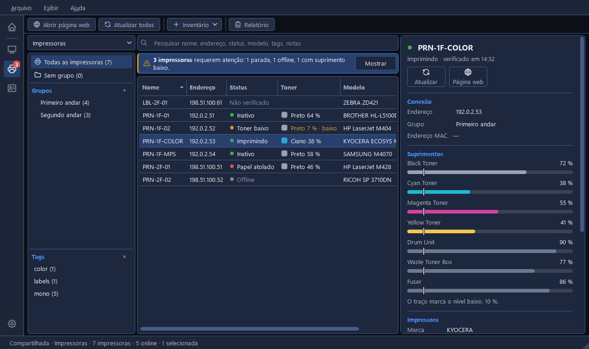

# A ferramenta Impressoras

Impressoras é a segunda ferramenta do CapyPanel: um inventário das impressoras que você
administra, com o que é preciso para diferenciar uma da outra e um jeito de abrir a página web de
qualquer uma. Abra-a pelo bloco **Impressoras** da página inicial, pelo ícone de impressora na
barra lateral ou com **Ctrl+2**.

Ela tem as próprias listas, separadas das da ferramenta Hosts (veja
[Listas de impressoras](printer-lists.pt-BR.md)).

## A janela

| Parte | O que mostra |
|---|---|
| **Barra de ferramentas** | **Abrir página web**, **Atualizar todas**, **Inventário** e **Relatório** |
| **Painel de grupos** (esquerda) | O nome da lista aberta no topo, como um menu, depois "Todas as impressoras" e os grupos e tags da lista |
| **Painel de impressoras** (meio) | A caixa de pesquisa acima das impressoras do grupo ou da tag que você escolheu |
| **Painel de detalhes** (direita) | Tudo que se sabe sobre a impressora selecionada, abaixo do nome e do status dela, com um botão **Atualizar** e um **Página web**. Clique em qualquer valor para copiá-lo |
| **Barra de status** | A lista aberta e as contagens dela, como no Hosts: o tipo, o nome de uma lista compartilhada, quantas impressoras ela tem, quantas estão online depois que alguma foi atualizada e quantas estão selecionadas. Deixe o mouse sobre ela para ver o caminho do arquivo da lista; um clique o copia |

O **Atualizar todas** lê o status e os suprimentos de todas as impressoras exibidas, por SNMP, e
preenche as colunas **Status** e **Toner**. Ele também pode ler por tempo, e uma faixa acima da
tabela avisa quando impressoras requerem atenção. Ele tem uma página própria:
[Verificando impressoras](checking.pt-BR.md).

O **Inventário** guarda **Adicionar impressora…** (Ctrl+N), **Adicionar grupo…** e **Gerenciar
grupos…**, os mesmos três do Hosts.

### A tabela

As colunas são **Nome**, **Endereço**, **Status**, **Toner**, **Marca**, **Modelo**, **Nº de
série**, **Patrimônio** e **Tags**, nessa ordem. Marca, Nº de série e Patrimônio começam
escondidas: clique com o botão direito nos títulos das colunas para mostrá-las. O **Modelo** põe a
marca na frente, como em "ZEBRA ZD421", a não ser que o modelo já comece com ela.

Antes de uma atualização, o **Status** diz **Não verificado** em cinza, e essas impressoras ficam
por último na ordenação; Toner fica vazia. As palavras longas de status são encurtadas só na
coluna, como **Saída cheia**, **Saída quase cheia**, **Saída ausente**, **Pede assistência**,
**Coletor quase cheio** e **Suprimento baixo**: a dica, o painel de detalhes e as notificações
trazem as palavras completas. Esse mesmo menu, e o **Copiar ▸** de uma impressora, listam as
colunas nessa ordem. As colunas não podem ser arrastadas para outra posição, em nenhuma das duas
ferramentas.

Clique no título de uma coluna para ordenar por ela, e de novo para inverter. Números dentro dos
nomes são ordenados como números, então "P2" vem antes de "P10"; maiúsculas e minúsculas não
importam, e impressoras empatadas ficam em ordem de nome.

## Adicionar uma impressora

**Inventário > Adicionar impressora…** (Ctrl+N) pede:

- **Nome** e **Endereço**, sendo o endereço um IP ou um nome de rede. Uma impressora sem endereço é
  acessada pelo nome dela.
- **Grupo** e **Tags**, que funcionam como no Hosts.
- **Marca** e **Modelo**. Marca é um menu com as marcas mais comuns (Brother, Canon, Epson, HP,
  Kyocera, Lexmark, Ricoh, Samsung, Xerox, Zebra), e você pode digitar qualquer outra.
- **Nº de série** e **Patrimônio**, os dois números de que você precisa ao abrir um chamado ou
  fazer um inventário. Marca e nº de série são salvos em maiúsculas.
- **Contadores de páginas**, que diz de onde vem a contagem: **SNMP**, perguntado à própria
  impressora, ou **Doc360 MPS**, o portal de impressão gerenciada (veja
  [Verificando impressoras](checking.pt-BR.md#contadores-de-paginas-do-doc360-mps)). Um Atualizar
  lê a contagem da origem que você escolher aqui.
- **Notas**, para o que mais houver.

O **Adicionar** põe a impressora na lista. O **Editar selecionado…** (F2) abre a mesma janela
para uma impressora que já está na lista, com **Salvar** no lugar.

Uma lista nova diz "Esta lista ainda não tem impressoras. Adicione uma para começar." com um botão
**Adicionar impressora…**, e um grupo vazio diz "Este grupo ainda não tem impressoras."

### Menus do botão direito

O menu do botão direito de uma impressora tem **Abrir página web** em negrito, **Atualizar
impressora** (ou **Atualizar {n} impressoras** com várias selecionadas), **Copiar ▸**, **Editar
selecionado…** para uma impressora, **Mover para ▸**, **Tags ▸** e **Remover**. O de um grupo termina com
**Atualizar grupo**, que lê as impressoras dele e as dos grupos de dentro.

### O painel de detalhes

Embaixo do nome da impressora ficam o status, com a hora da última verificação, e dois botões:
**Atualizar**, para esta impressora, e **Página web**, que abre a página web dela e só fica
esmaecido quando nem o endereço nem o nome dela formam um endereço web.

O painel mostra tudo isso, em **Conexão** (endereço, grupo, endereço MAC),
**Suprimentos**, **Impressora** (marca, modelo, nº de série, patrimônio, firmware), **Contadores
de páginas** (origem e o total da própria impressora), **Tags** e **Notas**. O status, as
mensagens da impressora e os suprimentos chegam com uma atualização, e com ela também a chance de
copiar para a sua lista a marca, o modelo ou o nº de série que a impressora informa. Cada seção
põe os rótulos à esquerda e os valores alinhados ao lado, como no Hosts.

**Exibir > Personalizar o painel de detalhes…**, ou o botão direito no painel, pode esconder
qualquer seção, cada uma descrita pelo que mostra: Conexão "Endereço, grupo, MAC", Suprimentos
"Toner, tinta e o resto, com os níveis", Impressora "Marca, modelo, nº de série, firmware",
Contadores de páginas "Total de páginas e a origem", e Tags e Notas. "Sempre aparecem: o nome da
impressora e o status." Veja
[Primeiros passos](../getting-started.pt-BR.md#personalizando-o-painel-de-detalhes).

## Abrir a página web de uma impressora

Quase toda impressora tem uma página web própria, com configurações, contadores e suprimentos. O
**Abrir página web** abre essa página no seu navegador padrão, e um clique duplo na impressora ou a
tecla **Enter** fazem o mesmo. Clique com o botão direito numa impressora e esse item aparece em
negrito, porque é o que o clique duplo faz.

Um endereço que começa com `https://` abre com https, exatamente como você digitou, com porta e
tudo, então `https://prn-01.example.com:8443` chega a uma impressora cuja página web está em outra
porta. Qualquer outro abre com http. O campo **Endereço** diz isso na dica dele: "Comece com
https:// se a página web da impressora precisar; senão ela abre com http."

O CapyPanel abre no máximo dez páginas de uma vez. Selecione mais e a barra de status diz "10
páginas web abertas. Só as 10 primeiras abrem de uma vez."

Só o endereço é passado ao navegador. O CapyPanel não busca nada na impressora e não faz login em
lugar nenhum.

## Encontrar uma impressora

A caixa de pesquisa acima da tabela cobre todas as colunas à mostra menos Toner, mais as notas, e o
texto dela diz quais são, como em "Pesquisar nome, endereço, status, modelo, tags, notas". O
status é pesquisado como a coluna o mostra. Uma pesquisa sem resultado diz "Nenhuma impressora
corresponde a “…”." O **Ctrl+F** leva
até ela. Mostrar ou esconder uma coluna muda o que a pesquisa cobre.

As tags filtram o que a tabela mostra, e você pode escolher várias de uma vez: a tabela então
mantém só as impressoras que têm todas elas. Uma faixa colorida acima da tabela diz quais, como em
"Só impressoras com todas estas tags: 2-andar, colorida · 4 de 37 exibidas", com um botão
**Limpar**; o título **Tags** mostra quantas estão escolhidas e oferece um **×** para limpá-las. As
tags escolhidas continuam quando você troca de grupo e enquanto você pesquisa. Quando nada
corresponde, a tabela diz "Nenhuma impressora deste grupo tem todas as tags escolhidas." e oferece
**Limpar tags**.

Uma tag filtra dentro do grupo que você escolheu. Para ver uma tag na lista inteira, escolha
**Todas as impressoras** primeiro.

## Relatório

O **Relatório** grava as impressoras que você escolher, com as colunas que você escolher, num
arquivo CSV. Ele funciona exatamente como o dos hosts, então
[Importando e exportando hosts](../hosts/importing.pt-BR.md#exportando-hosts) descreve a janela
inteira.

O que muda é o que entra nele. As colunas são agrupadas em **Impressora** (nome, endereço, grupo,
marca, modelo, nº de série), **Detalhes** (patrimônio, contadores de páginas, tags, notas) e
**Última verificação** (status, toner em texto, o modelo do toner, o total de páginas em dígitos
simples para uma planilha ler como número, o endereço MAC e a versão do firmware). A
predefinição que vem pronta é **Todos os detalhes**.

O **modelo do toner** é o nome que a impressora dá aos toners e às tintas dela, que costuma
incluir o cartucho, como "Black Cartridge HP CF258A"; quando ela informa vários, eles vêm
juntos, separados por "; ".

Marcar qualquer coluna em Última verificação deixa a janela atualizar essas impressoras ali
mesmo, com um botão embaixo das marcas que diz quantas são, como **Atualizar 12 impressoras**, e
ela diz quantas nunca foram verificadas. Sem nenhuma marcada o botão se explica:
"Marque uma coluna em Última verificação para lê-las". Uma impressora cujos contadores vêm do
Doc360 MPS fica com o número do portal, ou com "Erro" quando o portal não tinha nenhum para
ela; o [Verificando impressoras](checking.pt-BR.md#contadores-de-paginas-do-doc360-mps) diz o que
pode dar errado lá.

As impressoras a exportar são os mesmos tipos de escolha do Hosts: os resultados da pesquisa ou as
tags escolhidas enquanto uma das duas está ativa, as impressoras selecionadas quando você tem mais
de uma, todas as impressoras, as que não estão em grupo nenhum, cada grupo com os subgrupos dele e
cada tag, todas elas contadas.
