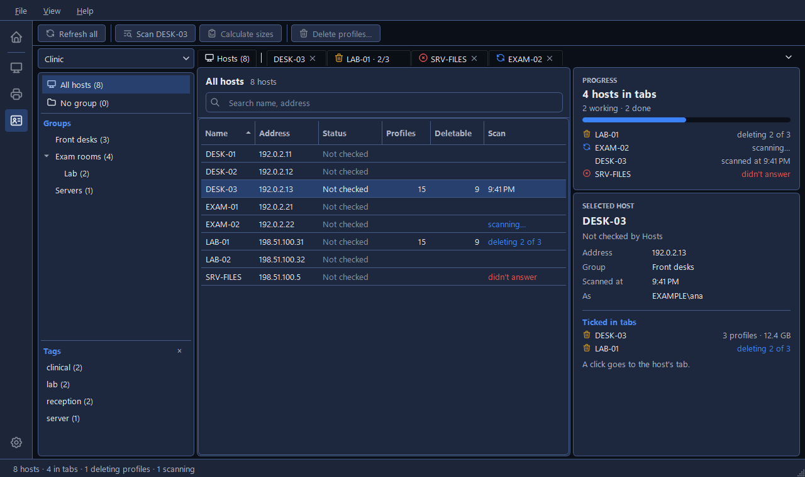
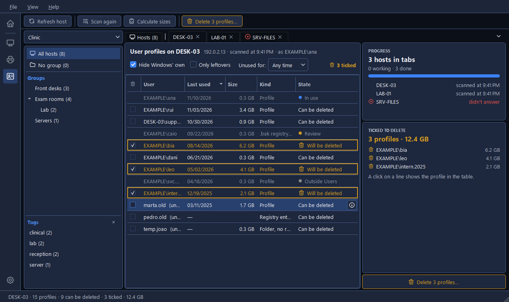
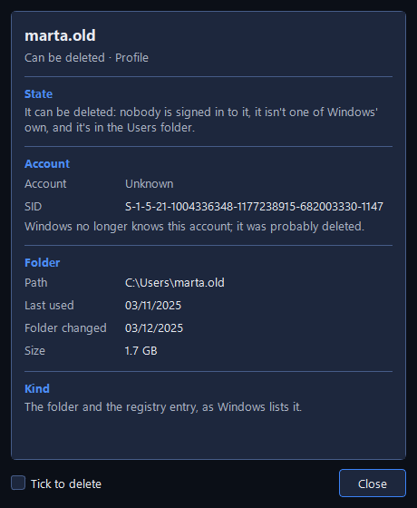
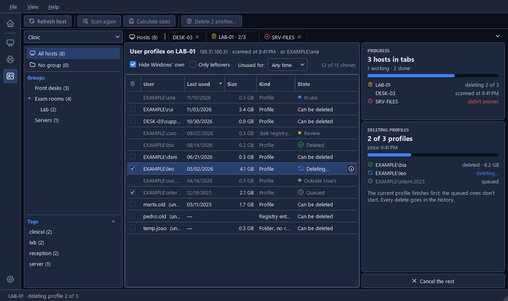

# The User profiles tool

Every person who signs in to a Windows PC leaves a profile behind: a folder under `C:\Users` and
an entry in the registry. On shared PCs they pile up for years and fill the disk. The **User
profiles** tool, the third icon on the rail (**Ctrl+3**), shows a PC's profiles, says which of
them can be deleted and why the others can't, counts their size, and deletes the ones you tick,
on several PCs at once.

It works on the hosts of the list open in Hosts: there's no list of its own. Each PC is read with
the account Hosts gives it, the one its **Commands run as** names (see
[Accounts for other PCs](../hosts/connecting.md#accounts-for-other-pcs)), and that account needs
to be an administrator there.

Nothing is installed or run on the PCs. Profiles are read over WMI, and deleted by Windows' own
profile removal on that PC, asked through WMI too (see
[How CapyPanel reads other PCs](../hosts/checking.md#how-capypanel-reads-other-pcs)). Scanning
only reads.

## The window

On the left is Hosts' **Groups panel**, with the open list's dropdown on top. It's read only here:
groups are made in Hosts. In the middle, tabs: the pinned **Hosts** tab first, then one tab per
host you open, so several hosts can be read, counted and cleaned at the same time. On the right,
the tab's cards, and on a host's tab the delete button at the foot.

A **▾** at the right end of the tab bar lists every tab. Tabs never reorder themselves: a new one
opens at the right end. Right-click a tab for **Close**, **Close the others** and **Close the
finished ones**; a middle-click closes a tab too. A tab can be closed while its host is still being
scanned, but not while it's deleting.

## The Hosts tab

The hosts of the group picked on the left, with **Name**, **Address**, **Status**, **Profiles**,
**Can be deleted** (**Deletable** when the table is narrow) and **Scan**, which says when a host
was scanned or where its scan is: "scanning…", "deleting 2 of 3", "didn't answer". The
**Search name, address** box looks through every host of the list, whatever the group. The tab
never scans by itself:

- **Double-click** a host, or press **Enter**, to open it in a tab of its own and go there.
- **Middle-click** it, or press **Ctrl+Enter**, to open it in a tab behind, and stay on the list.
- Pick several and click **Scan** on the toolbar ("Scan 3 hosts"): each opens in a tab behind.
- Type a host that isn't in the list into the search box: the table says "No host of the list
  with “…”." and offers **Scan** with its name.

Right-click a host for **Open**, **Scan**, **Refresh host**, **Copy name** and **Copy address**.
**Refresh all**, on the toolbar, checks whether each host shown answers, as Hosts' Refresh does;
the Status column then shows the same here and in Hosts.

On the right, **Progress** follows every host in a tab: "4 hosts in tabs", "2 working · 2 done",
and a line per host. Under it, **Hosts shown** sums up the picked group: its status, how many hosts
were scanned and how many profiles can be deleted, and **Ticked in tabs**, the hosts with profiles
ticked; a click on one goes to its tab. With a host picked, the card shows that host instead:
**Address**, **Group**, **Scanned at** and **As**, the account. Click a value to copy it.

## A host's tab

The tab's header names the host: "User profiles on DESK-03", then its address, when it was
scanned and the account it was read as. Under it, the filters:

- **Hide Windows' own**, on to begin with: "Public, Default, the built-in Administrator and the
  like: never deleted here".
- **Only leftovers**: "Only registry entries without a folder and folders without a registry
  entry".
- **Unused for:** **Any time**, or at least 1, 3 or 6 months, or 1 year, by when the profile was
  last used. A profile with no date at all is left out once this is set.

At the right end, how many rows show ("12 of 15 shown"), or how many are ticked.

### The profiles table

| Column | What it shows |
|---|---|
| **User** | The account, as `DOMAIN\user`. One Windows no longer knows shows its folder's name and "(unknown)" |
| **Last used** | When the person last signed in or out, or the folder's own date when Windows wrote none |
| **Size** | The folder's size, once counted |
| **Kind** | **Profile**, the folder and the registry entry as Windows lists it; **Registry entry, no folder**; **Folder, no registry entry**; or **.bak registry entry** |
| **State** | Whether it can be deleted, and if not, why |

| State | Meaning |
|---|---|
| **Can be deleted** | "Nobody is signed in to it, it isn't one of Windows' own, and it's in the Users folder." |
| **In use** | "This person is signed in now. It can only be deleted after they sign out." |
| **Protected** | "It's one of Windows' own. It's never deleted here." The built-in Administrator is one of them |
| **Outside Users** | The folder isn't in the Users folder, and CapyPanel only deletes profiles there |
| **Review** | "A .bak entry: a profile that failed to load. CapyPanel never deletes these; the fix is by hand, in the registry." |

Rows that can't be deleted are greyed and have no tick box.

**Calculate sizes**, on the toolbar, counts the size of each profile shown; it only reads, and
**Stop the count** stops it at once, keeping the sizes already counted. **Scan again** reads the
host afresh, and **Refresh host** checks whether it answers.

### A profile's details

The **ⓘ** at the end of a row, **Enter**, or the row's right-click **Details…** opens a window
for that profile: its **State** and why, the **Account** and its **SID**, the **Folder** with its
**Path**, **Last used**, **Folder changed** and **Size**, and its **Kind**. "Windows no longer
knows this account; it was probably deleted." says so for an account that's gone. **Tick to
delete**, at its foot, ticks the row from there.

### When a host can't be read

The tab says why, in red, with **Try again**: "{host} didn't answer", "{host} refused the account
{account}", which also offers **Try another account…**, or "PowerShell couldn't start on your PC"
(see [How CapyPanel reads other PCs](../hosts/checking.md#how-capypanel-reads-other-pcs)). Up to
four hosts are read or counted at a time, across every tab; the others wait their turn, saying
"{host} waits for its turn".

## Deleting

1. **Tick** the profiles to delete: the box, **Space**, or a double-click on the row. A ticked row
   is outlined in amber and its State reads **Will be deleted**. The **Ticked to delete** card on
   the right lists them with their sizes and the total, as in "3 profiles · 12.4 GB"; a click on a
   line shows that profile in the table.
2. Click **Delete 3 profiles…**, at the foot of the right panel or on the toolbar.
3. The window asks "Delete 3 profiles from DESK-03?", lists them, and says: "This is **final**.
   With local profiles, each person's desktop and documents go too: there's no recycle bin and no
   copy." To go on, type **DELETE** in the box. The amber button lights up then, and Enter
   presses it; until then **Cancel** is the default.

Each host deletes one profile at a time, and checks the host again before each one: "anyone who
signed in since the scan is skipped". The rows go from **Queued** to **Deleting…** to **Deleted**,
**Skipped** or **Failed**, and the **Deleting profiles** card counts them. **Cancel the rest** lets
the profile under way finish and starts no other. When it's over, the card reads **Deletion
finished**, with what was freed, and **Open the history**.

What can't be deleted is left alone: Windows' own profiles and the built-in Administrator are
never deleted, a profile someone signed in to since the scan is skipped, and a `.bak` entry is
left for you to fix by hand.

Every delete, done or not, goes into a history of its own, one file per Windows user:
`logs\<you@DOMAIN>.user-profiles.log` in CapyPanel's folder (see
[Settings and files](../settings-and-files.md#where-capypanel-keeps-its-files)). It says when, on
which PC, whose profile and how it ended.

Quitting CapyPanel while a host is deleting asks first; see
[Getting started](../getting-started.md#closing-capypanel-and-the-tray).
