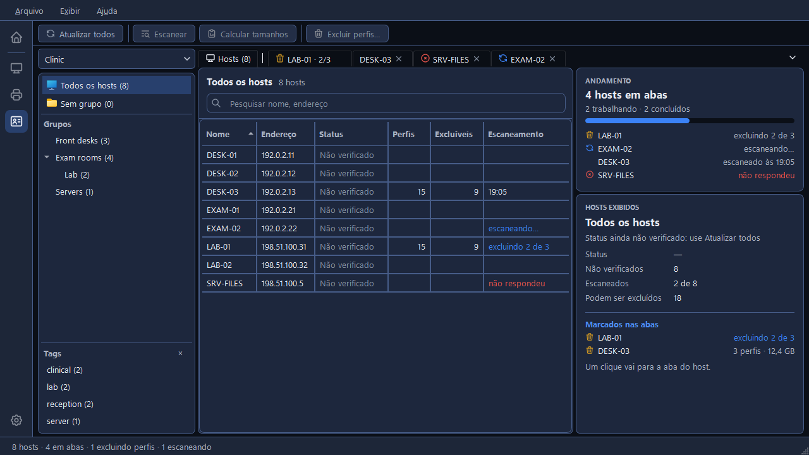
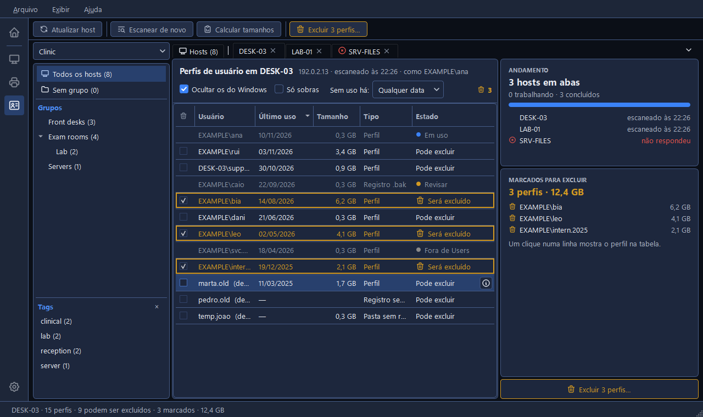
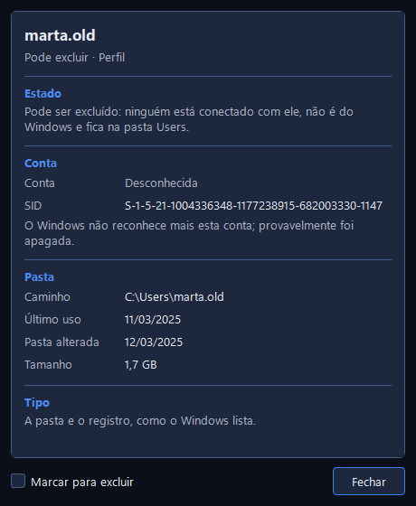
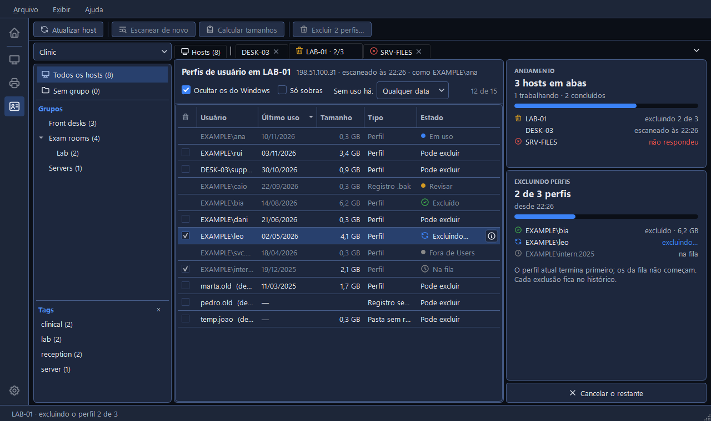

# A ferramenta Perfis de usuário

Cada pessoa que entra num PC com Windows deixa um perfil para trás: uma pasta em `C:\Users` e uma
entrada no registro do Windows. Em PCs compartilhados eles se acumulam por anos e enchem o disco.
A ferramenta **Perfis de usuário**, o terceiro ícone da barra lateral (**Ctrl+3**), mostra os
perfis de um PC, diz quais podem ser excluídos e por que os outros não, calcula o tamanho deles e
exclui os que você marcar, em vários PCs ao mesmo tempo.

Ela trabalha com os hosts da lista aberta no Hosts: não tem uma lista própria. Cada PC é lido com a
conta que o Hosts dá a ele, a que o **Comandos como** dele diz (veja
[Contas para outros PCs](../hosts/connecting.pt-BR.md#contas-para-outros-pcs)), e essa conta
precisa ser administradora lá.

Nada é instalado nem executado nos PCs. Os perfis são lidos pelo WMI, e excluídos pela própria
remoção de perfis do Windows naquele PC, pedida também pelo WMI (veja
[Como o CapyPanel lê outros PCs](../hosts/checking.pt-BR.md#como-o-capypanel-le-outros-pcs)).
Escanear só lê.

## A janela

À esquerda fica o **painel de grupos** do Hosts, com o menu da lista aberta no topo. Aqui ele é só
leitura: os grupos são criados no Hosts. No meio, abas: a aba **Hosts** fixa primeiro, depois uma
aba para cada host que você abre, para vários hosts serem lidos, calculados e limpos ao mesmo
tempo. À direita, os cartões da aba, e numa aba de host o botão de excluir no pé.

Um **▾** na ponta direita da barra de abas lista todas as abas. As abas nunca se reordenam
sozinhas: uma nova abre na ponta direita. O botão direito numa aba oferece **Fechar**, **Fechar as
outras** e **Fechar as concluídas**; um clique do meio também fecha uma aba. Uma aba pode ser
fechada enquanto o host dela ainda está sendo escaneado, mas não enquanto ele está excluindo.

## A aba Hosts

Os hosts do grupo escolhido à esquerda, com **Nome**, **Endereço**, **Status**, **Perfis**,
**Podem ser excluídos** (**Excluíveis** quando a tabela está estreita) e **Escaneamento**, que diz
quando um host foi escaneado ou em que pé está o escaneamento dele: "escaneando…", "excluindo 2 de
3", "não respondeu". A caixa **Pesquisar nome, endereço** procura em todos os hosts da lista,
seja qual for o grupo. A aba nunca escaneia sozinha:

- **Clique duplo** num host, ou **Enter**, para abri-lo numa aba própria e ir até ela.
- **Clique do meio** nele, ou **Ctrl+Enter**, para abri-lo numa aba por trás, e ficar na lista.
- Escolha vários e clique em **Escanear** na barra de ferramentas ("Escanear 3 hosts"): cada um
  abre numa aba por trás.
- Digite na caixa de pesquisa um host que não está na lista: a tabela diz "Nenhum host da lista
  com “…”." e oferece o **Escanear** com o nome dele.

O botão direito num host oferece **Abrir**, **Escanear**, **Atualizar host**, **Copiar nome** e
**Copiar endereço**. O **Atualizar todos**, na barra de ferramentas, verifica se cada host exibido
responde, como o Atualizar do Hosts; a coluna Status passa então a mostrar o mesmo aqui e no Hosts.

À direita, o **Andamento** acompanha cada host numa aba: "4 hosts em abas", "2 trabalhando · 2
concluídos", e uma linha por host. Embaixo dele, **Hosts exibidos** resume o grupo escolhido: o
status, quantos hosts foram escaneados e quantos perfis podem ser excluídos, e **Marcados nas
abas**, os hosts com perfis marcados; um clique num deles vai para a aba dele. Com um host
escolhido, o cartão mostra esse host: **Endereço**, **Grupo**, **Escaneado às** e **Como**, a
conta. Clique num valor para copiá-lo.

## A aba de um host

O cabeçalho da aba nomeia o host: "Perfis de usuário em DESK-03", depois o endereço, quando ele
foi escaneado e a conta com que foi lido. Embaixo, os filtros:

- **Ocultar os do Windows**, ligado de início: "Public, Default, o Administrador interno e
  parecidos: nunca são excluídos aqui".
- **Só sobras**: "Só registros sem pasta e pastas sem registro".
- **Sem uso há:** **Qualquer data**, ou pelo menos 1, 3 ou 6 meses, ou 1 ano, pela última vez em
  que o perfil foi usado. Um perfil sem data nenhuma fica de fora quando isso está definido.

Na ponta direita, quantas linhas aparecem ("12 de 15 exibidos"), ou quantas estão marcadas.

### A tabela de perfis

| Coluna | O que ela mostra |
|---|---|
| **Usuário** | A conta, como `DOMÍNIO\usuário`. Uma que o Windows não reconhece mais mostra o nome da pasta e "(desconhecida)" |
| **Último uso** | Quando a pessoa entrou ou saiu pela última vez, ou a data da própria pasta quando o Windows não anotou nenhuma |
| **Tamanho** | O tamanho da pasta, depois de calculado |
| **Tipo** | **Perfil**, a pasta e o registro como o Windows os lista; **Registro sem pasta**; **Pasta sem registro**; ou **Registro .bak** |
| **Estado** | Se ele pode ser excluído, e se não, por quê |

| Estado | O que quer dizer |
|---|---|
| **Pode excluir** | "Ninguém está conectado com ele, não é do Windows e fica na pasta Users." |
| **Em uso** | "Esta pessoa está conectada agora. Só pode ser excluído depois que ela sair." |
| **Protegido** | "É do próprio Windows. Nunca é excluído aqui." O Administrador interno é um deles |
| **Fora de Users** | A pasta não fica na pasta Users, e o CapyPanel só exclui perfis lá |
| **Revisar** | "Um registro .bak: um perfil que falhou ao carregar. O CapyPanel nunca exclui estes; o conserto é manual, no registro." |

As linhas que não podem ser excluídas ficam esmaecidas e não têm caixa de marcar.

O **Calcular tamanhos**, na barra de ferramentas, calcula o tamanho de cada perfil exibido; ele só
lê, e o **Parar o cálculo** para na hora, mantendo os tamanhos já calculados. O **Escanear de
novo** lê o host outra vez, e o **Atualizar host** verifica se ele responde.

### Os detalhes de um perfil

O **ⓘ** no fim de uma linha, o **Enter**, ou o **Detalhes…** do botão direito na linha abre uma
janela para aquele perfil: o **Estado** e o motivo, a **Conta** e o **SID** dela, a **Pasta** com
**Caminho**, **Último uso**, **Pasta alterada** e **Tamanho**, e o **Tipo**. "O Windows não
reconhece mais esta conta; provavelmente foi apagada." avisa quando a conta não existe mais. O
**Marcar para excluir**, no pé dela, marca a linha dali mesmo.

### Quando um host não pode ser lido

A aba diz o motivo, em vermelho, com o **Tentar de novo**: "{host} não respondeu", "{host} recusou
a conta {account}", que também oferece o **Tentar outra conta…**, ou "O PowerShell não abriu no
seu PC" (veja
[Como o CapyPanel lê outros PCs](../hosts/checking.pt-BR.md#como-o-capypanel-le-outros-pcs)). Até
quatro hosts são lidos ou calculados ao mesmo tempo, somando todas as abas; os outros aguardam a
vez, dizendo "{host} aguarda a vez".

## Excluindo

1. **Marque** os perfis a excluir: a caixa, o **Espaço**, ou um clique duplo na linha. Uma linha
   marcada fica contornada em âmbar e o Estado dela diz **Será excluído**. O cartão **Marcados
   para excluir** à direita os lista com os tamanhos e o total, como "3 perfis · 12,4 GB"; um
   clique numa linha mostra aquele perfil na tabela.
2. Clique em **Excluir 3 perfis…**, no pé do painel da direita ou na barra de ferramentas.
3. A janela pergunta "Excluir 3 perfis de DESK-03?", lista os perfis e diz: "Isto é
   **definitivo**. Com perfis locais, a área de trabalho e os documentos de cada pessoa vão junto:
   não há lixeira nem cópia." Para seguir, digite **EXCLUIR** na caixa. O botão âmbar acende
   então, e o Enter o aperta; até lá, o **Cancelar** é o padrão.

Cada host exclui um perfil por vez, e verifica o host de novo antes de cada um: "quem tiver
entrado desde o escaneamento é ignorado". As linhas vão de **Na fila** para **Excluindo…** e
depois **Excluído**, **Ignorado** ou **Falhou**, e o cartão **Excluindo perfis** as conta. O
**Cancelar o restante** deixa o perfil em andamento terminar e não começa nenhum outro. Quando
acaba, o cartão diz **Exclusão concluída**, com o que foi liberado, e **Abrir o histórico**.

O que não pode ser excluído fica como está: os perfis do próprio Windows e o Administrador interno
nunca são excluídos, um perfil em que alguém entrou desde o escaneamento é ignorado, e um registro
`.bak` fica para você consertar à mão.

Cada exclusão, feita ou não, vai para um histórico próprio, um arquivo por usuário do Windows:
`logs\<você@DOMÍNIO>.user-profiles.log` na pasta do CapyPanel (veja
[Configurações e arquivos](../settings-and-files.pt-BR.md#onde-o-capypanel-guarda-os-arquivos)).
Ele diz quando, em qual PC, de quem era o perfil e como terminou.

Sair do CapyPanel enquanto um host exclui pergunta antes; veja
[Primeiros passos](../getting-started.pt-BR.md#fechando-o-capypanel-e-a-bandeja).
