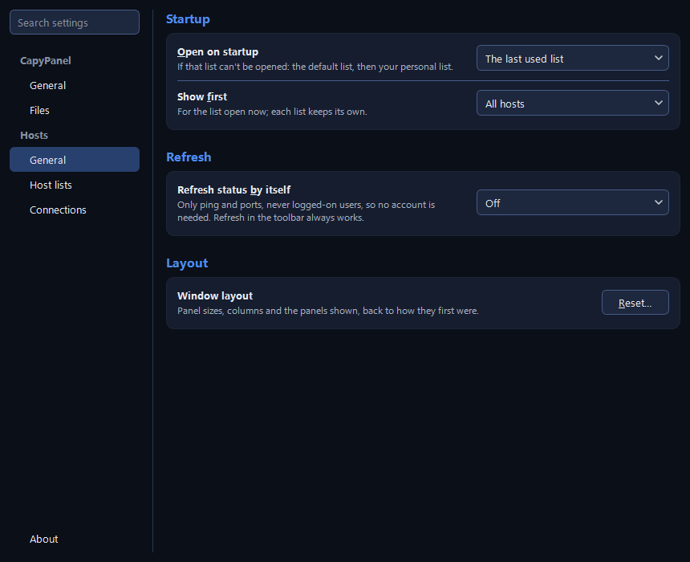

# Settings and files

Settings is the gear at the bottom of the rail, and **File > Settings…** (Ctrl+,). **Every choice
applies as soon as you make it.** There is no Save button and no Close button: the window's **×**
or **Esc** closes it, and nothing ever asks you about unsaved changes.

## How the window works

Down the left are a **Search settings** box and the pages, in two groups:

| Group | Pages |
|---|---|
| **CapyPanel** | **General** (language and theme) and **Files** (where everything is kept) |
| **Hosts** | **General**, **Host lists** and **Connections**, all for the Hosts tool |

**About** sits on its own at the very bottom of that list, below the groups, wherever the tools
above it grow.

A page is made of sections: a title, and its settings on a soft card under it. A simple setting is
a row — its name, a one-line description under it, and its control at the right end. Anything that
holds several things, from host lists to licenses, is the same table everywhere: grid lines, a
header, six rows before it scrolls, the main actions as buttons under it, **every action for a row
on its right-click**, and a double-click for the obvious one. The window opens at a fixed size, and
a page taller than it scrolls.

### Searching the settings

Type three letters or more and the right side shows every section that mentions them, from every
page, each under the name of the page it came from ("CapyPanel › General"), with the matching words
marked in yellow. Words are matched from their start. The settings work there, so you can change
what you were looking for without opening its page. A dropdown whose match is one of its choices,
not the one showing, gets the mark on its arrow. Clicking a page, or clearing the box, puts
everything back.

## CapyPanel > General

**Language and theme**, both applied the moment you pick them:

- **Language:** English or Português (Brasil). "The app's language. Changes at once." — the
  Settings window included, with no restart.
- **Theme:** "Windows themes follow Windows' look and accent; CapyPanel themes look the same
  everywhere."

| Theme | Look |
|---|---|
| Windows — follow system theme / dark / light | Native Windows styling, with your accent color |
| CapyPanel — dark / light | CapyPanel's own look, the same on every computer |
| Graphite, Paper | Two more of CapyPanel's own looks |

Themes change colors only — the font, its size and the rounded corners are the same in every one —
and never change what the app does.

The Windows themes follow your Windows accent color (**Settings > Personalization > Colors**), and
everything built from it stays readable whichever one you pick: section headings, the default
button, highlights, and the Groups heading when you drag a group onto it. CapyPanel's own looks
keep their own accents instead, the same on every computer.

## CapyPanel > Files

**Folders** is a table of **Folder** and **Where**, with **Open folder** under it (also a
double-click, or the row's right-click):

| Folder | What it holds |
|---|---|
| **Shared files** | "Connection profiles and remote tools, for everyone on this PC." |
| **Shared lists** | "The default list, and every list saved there, for everyone on this PC." |
| **Your files** | "Your settings, private to you and administrators." |
| **Your lists** | "Your personal list, and every list saved there, only for you." |
| **Logs** | "One per user, named after the account." |

Hover a folder to see what it holds, as the table says under itself. In portable mode it adds
"Portable mode: everything stays in the app's own folder." The paths are there to read, not to
select. Where each one is, and what may and may not go in it, is under
[Where CapyPanel keeps its files](#where-capypanel-keeps-its-files).

## Hosts > General

### Startup

- **Open on startup:** which host list opens when CapyPanel starts — the last used list, the
  default list, your personal list, or any other list you have. "If that list can't be opened: the
  default list, then your personal list."
- **Show first:** what the open list shows when it opens (see
  [Host lists](hosts/host-lists.md#what-a-list-shows-first)). "For the list open now; each list
  keeps its own."

### Refresh

**Refresh status by itself** is one dropdown: **Off**, **Every minute**, **Every 5 minutes**,
**Every 15 minutes**, **Every 30 minutes**, or **Custom…**, which asks for anything from 1 to 120
minutes and then shows that interval among the choices. Turning it **Off** keeps the interval for
next time.

"Only ping and ports, never logged-on users, so no account is needed. Refresh in the toolbar always
works." It's off until you turn it on; see [Checking hosts](hosts/checking.md#automatic-status).

### Layout

**Window layout** — "Panel sizes, columns and the panels shown, back to how they first were." —
with a **Reset…** button that asks before it does it.

## Hosts > Host lists

The table of every list CapyPanel found or you added, with what you can do to each, and the buttons
that make, add and remove them. The list dropdown over the Groups panel opens this page through
**Manage host lists…**. [Host lists](hosts/host-lists.md#settings-hosts-host-lists) describes the
table, the buttons and what **Remove** asks.

## Hosts > Connections

### Connection profiles

The table **Profile | Tool | Signs in with**, with **Add…**, **Edit…** and **Delete…** under it;
a row's right-click adds **Duplicate…**, and a double-click edits. Remote Desktop's sign-in reads
"asked by Remote Desktop Connection itself", because CapyPanel asks for nothing: the Remote Desktop
client asks for the user and the password when it connects. What a profile is made of is under
[Connecting](hosts/connecting.md#managing-profiles).

"Shared by everyone on this PC." Changes are written for everyone the moment you make them, and
**Delete…** asks first. Where Windows doesn't let you write the folder, the note adds that it's
read-only, and only people it does let write can change them.

**Hosts with no profile use** — "The profile a host connects with when it has none of its own." —
is the last row of the section.

CapyPanel fills the profiles folder at its first start with the profiles it ships (RealVNC, Remote
Desktop and UltraVNC) and a settings file, `_profiles.json`, which records that row's choice and
which shipped profiles have been added already, so one you delete doesn't come back. Where the
folder couldn't be created, the page shows the built-in profiles and says so: "These are the
built-in profiles: the folder is created when you change one.", or "…the folder isn't there yet."
where you can't create it at all.

### Remote tools

The table **Tool | Status | Where**: **✓ Found** when CapyPanel found it by itself, **✓ Your
choice** when a path was set here, or **✗ Not found**, whose tooltip says "Install it, or locate
its .exe."

- **Change path…** picks a tool's `.exe` — a portable copy, say. A row's right-click then also
  offers **Use the automatic path**, which forgets that choice.
- **Download** opens the tool's website, and is there only for a tool that wasn't found. Remote
  Desktop Connection is built into Windows, so it has none.

"Where each tool is installed, set once for everyone on this PC." Like profiles, it's written at
once, and only where Windows lets you write the folder.

Under both tables, a line names the files CapyPanel isn't using and why, such as "2 files skipped:
broken.json (can't be read), clinics.json (made by another user)". Hover it for the full paths and
the errors; it's hidden when every file is in use.

## About

**Help > About CapyPanel** opens this page, pinned at the bottom of the page list. Three cards:

| Card | What it holds |
|---|---|
| **CapyPanel** | The mascot, the name and the version — click it to copy it with its commit — "Every computer you look after, in one window.", the copyright and "Free software under the GPL-3.0, with no warranty: see Licenses.", which scrolls down to them, links to the documentation and the source code, a **Build** line with the commit and portable mode where they apply, and **Report a problem** beside **Open log folder** |
| **Credits** | Who made CapyPanel, its mascot, and the icons it uses |
| **Licenses** | The table **Software \| Version \| License \| Notice**: CapyPanel (GPL-3.0), Qt and Qt for Python (LGPL-3.0), Python (PSF License), Tabler Icons (MIT). **Read license** opens the shipped text in a window, also on a double-click or the row's right-click, and **Open folder** opens the folder they all ship in |

## Where CapyPanel keeps its files

CapyPanel keeps everything for all users of a PC in one folder, `C:\ProgramData\CapyPanel`,
with one private folder per user:

| What | Where |
|---|---|
| The default host list, and every list shared with everyone on the PC | `lists\` |
| Connection profiles, their settings files, and which one hosts fall back to | `profiles\` |
| Viewer definitions added by your company, and where each viewer is installed | `tools\` |
| Your settings | `users\<you@DOMAIN>\` |
| Your personal list, and your own lists | `users\<you@DOMAIN>\lists\` |
| Logs, one file per user | `logs\` |
| Built-in viewer definitions, and the starter profiles | Inside the app |

- **Your folder is private:** only you, administrators and Windows itself can open it.
  CapyPanel refuses to use a folder someone else created first in your name.
- **Shared files must come from someone trusted.** Any user can add files to ProgramData, so
  CapyPanel ignores a shared file (a list, a profile, a company viewer definition) made by
  another user who isn't an administrator, and logs it.
- **Logs never contain passwords.** They record which viewer started for which address, and the
  result of each login check.

CapyPanel makes both lists folders at its first start. A list from before version 0.19, when the
default and personal lists were `hosts.json` files, is copied into them once, by itself; the old
file is left where it is, so an older version still runs.

### Portable mode

An empty file named `capypanel.portable` next to the app keeps everything (settings, lists,
logs) in a `userdata` folder beside it instead, for running from a USB stick or a shared folder.
When you run from source, "next to the app" means the repository folder.
