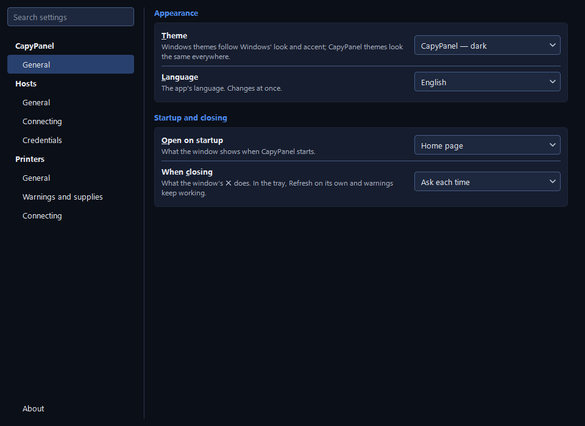
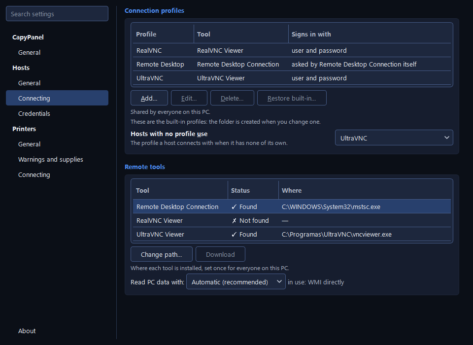
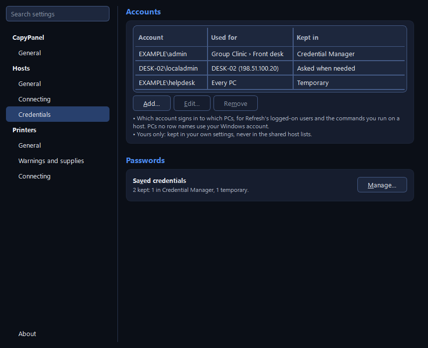

# Settings and files

Settings is the gear at the bottom of the rail, and **File > Settings…** (Ctrl+,). **Every choice
applies as soon as you make it**: there's no Save button, and the window's **×** or **Esc** closes
it. This page lists every setting, page by page, and where CapyPanel keeps its files.

## Find a setting

Type three letters or more in **Search settings**, at the top left. The right side shows every
section that mentions them, from every page, with the matching words marked in yellow, and the
settings work right there.

??? note "More about the window"

    - The pages are grouped: **CapyPanel** (General), **Hosts** (General, Connecting, Credentials)
      and **Printers** (General, Warnings and supplies, Connecting). **About** sits apart at the
      very bottom. Settings opens on **CapyPanel > General**.
    - Each page is made of sections: a title with its settings on a soft card. A table looks the
      same everywhere: a thin line under each row, dividers to drag a column wider, the main
      actions as buttons under it, **every action for a row on its right-click**, and a
      double-click for the obvious one. Right-click the column titles for **Fit columns to
      content**.
    - Search matches words from their start, and the page list keeps only the pages with a match.
      A dropdown whose match is one of its choices gets the mark on its arrow. Clearing the box
      puts everything back.
    - The window opens at 960 × 700 the first time, or smaller on a small screen, such as a laptop
      at 125 % scale. You can make it any size: a page larger than the window scrolls, down and
      sideways. It opens again at the size and place you left it at.

??? note "Settings for everyone on this PC"

    Most settings are yours alone. A few are the same for everyone who uses CapyPanel on this PC,
    and their sections say **Everyone on this PC**, with a small computer, beside the title:

    - **CapyPanel > General > Updates**
    - **Hosts > Connecting**: **Connection profiles** (with **Hosts with no profile use**) and
      **Remote tools** (with **Read PC data with**)

    Under the title, one line says "A change here reaches everyone on this PC." If Windows doesn't
    let your account change them, the line reads "Read-only for you. An administrator of this PC
    can change it." and the controls are greyed. They're kept in the shared folder (see [Where
    CapyPanel keeps its files](#where-capypanel-keeps-its-files)), which only administrators and
    whoever created it can change.

    The shared host and printer lists are for everyone too: the lists tables say which list is
    **Shared** and which is **Personal**.

## CapyPanel > General

| Setting | What it does | To begin with |
|---|---|---|
| **Theme** | The look: Windows (follow system, dark, light), CapyPanel (dark, light), Graphite or Paper | Windows, follow system |
| **Language** | English or Português (Brasil). "The app's language. Changes at once.", Settings included | The language Windows is shown in: Português (Brasil) for any Portuguese, English for the rest |
| **Open on startup** | What the window shows at start: the **Home page**, **The last used tool**, or a tool by name | Home page |
| **When closing** | What the window's **✕** does: **Ask each time**, **Keep running in the tray** or **Quit** (see [Getting started](getting-started.md#close-capypanel-or-keep-it-in-the-tray)) | Ask each time |

??? note "More about themes"

    "Windows themes follow Windows' look and accent; CapyPanel themes look the same everywhere."
    Themes change colors and how round the corners are: Graphite and Paper round them more than the
    others do. The font and its size are the same in every one, and a theme never changes what the
    app does. The Windows themes follow your accent color (**Settings > Personalization > Colors**),
    and everything built from it stays readable.

### Updates

**Everyone on this PC**: "A change here reaches everyone on this PC: an update replaces CapyPanel
for all of them."

| Setting | What it does | To begin with |
|---|---|---|
| **Check for updates** | **At every start**, **Once a day**, **Once a week** or **Off**. "Asks GitHub (api.github.com) for CapyPanel's newest release. Nothing is downloaded until you choose Install. Help › Check for updates works whatever is set." | At every start |

## Hosts > General

| Setting | What it does | To begin with |
|---|---|---|
| **Host lists** | The table of every list, with **New…**, **Add existing…** and **Remove** (see [Switch, make and share lists](hosts/host-lists.md#switch-make-and-share-lists)) | The default and personal lists |
| **List on startup** | Which host list opens with the tool. "If that list can't be opened: the default list, then your personal list." | The last used list |
| **Show first** | What the open list shows when it opens: **All hosts**, **Where I left off**, or **A chosen group ▸**. "For the list open now; each list keeps its own." | All hosts |
| **Refresh status by itself** | Checks the status of the hosts shown every **minute**, **5**, **15** or **30 minutes**, or a **Custom…** interval from 1 to 120 (see [Checking hosts](hosts/checking.md#have-status-checked-on-its-own)) | Off |
| **Quick commands > Choose…** | "The buttons on top of a host's Details panel; the first four are also in its right-click menu. Yours, on this PC." (see [Choose your quick commands](hosts/commands.md#choose-your-quick-commands)) | C$ share, User's folder, Computer Management, Send a message… |

## Hosts > Connecting

**Everyone on this PC**: both sections, **Connection profiles** and **Remote tools**, carry the
mark, with "A change here reaches everyone on this PC." under the title.

| Setting | What it does | To begin with |
|---|---|---|
| **Connection profiles** | The table **Profile \| Tool \| Signs in with**, with **Add…**, **Edit…**, **Delete…** and **Restore built-in…** (see [Set up connection profiles](hosts/connecting.md#set-up-connection-profiles)) | UltraVNC, RealVNC, Remote Desktop |
| **Hosts with no profile use** | "The profile a host connects with when it has none of its own." | UltraVNC |
| **Remote tools** | The table **Tool \| Status \| Where**, with **Change path…** and **Download**: where each tool is installed | Found by itself |
| **Read PC data with** | How CapyPanel reads the PC facts, programs, mapped drives and user profiles of other PCs: **Automatic (recommended)**, **WMI directly** or **WMI through PowerShell** (see [How CapyPanel reads other PCs](hosts/checking.md#read-a-pcs-facts)) | Automatic |

??? note "More about profiles and tools"

    - A row's right-click adds **Duplicate…**, and a double-click edits. Remote Desktop's sign-in
      reads "asked by Remote Desktop Connection itself".
    - **Restore built-in…** brings back the profiles CapyPanel ships with, and is greyed while none
      is missing. It asks first, naming them, and adds "Profiles you changed or made yourself stay
      as they are." Cancel is the default button.
    - Changes are written for everyone the moment you make them. Where Windows doesn't let you
      change them, the line under the title says "Read-only for you. An administrator of this PC
      can change it."
    - CapyPanel fills the profiles folder at its first start, with a settings file,
      `_profiles.json`, that records **Hosts with no profile use** and which shipped profiles were
      added. Where the folder couldn't be created, the page shows the built-in profiles and says
      so.
    - A remote tool reads **✓ Found** when CapyPanel found it by itself, **✓ Your choice** when a
      path was set here, or **✗ Not found** ("Install it, or locate its .exe."). After **Change
      path…**, a row's right-click offers **Use the automatic path**. **Download** opens the
      tool's website, only for a tool that wasn't found.
    - Under both tables, a line names the files CapyPanel isn't using and why, such as "2 files
      skipped: broken.json (can't be read), clinics.json (made by another user)"; hover it for the
      full paths.
    - With **Automatic**, "in use:" beside it names the way it uses on this PC.

## Hosts > Credentials

| Setting | What it does | To begin with |
|---|---|---|
| **Accounts** | The table **Account \| Used for \| Kept in**: which account signs in to which PCs, for logged-on users and commands. "kept in your own settings, never in the shared host lists" (see [Use another account on some PCs](hosts/connecting.md#use-another-account-on-some-pcs)) | Empty: your Windows account everywhere |
| **Saved credentials** | How many logins CapyPanel keeps and where, as in "2 kept: 1 in Credential Manager, 1 temporary.", with **Manage…** (see [Forget a saved password](hosts/connecting.md#forget-a-saved-password)) | None kept |

## Printers

| Page | Setting | What it does | To begin with |
|---|---|---|---|
| General | **Printer lists**, **List on startup**, **Show first** | As for Hosts (see [Keep printers in lists, groups and tags](printers/printers.md#keep-printers-in-lists-groups-and-tags)) | As for Hosts |
| Warnings and supplies | **Refresh on its own** | Reads every printer of the open list every **5**, **15**, **30** or **60 minutes** (see [Checking printers](printers/checking.md#have-printers-checked-on-their-own)) | Off |
| Warnings and supplies | **Windows notification** | **Off**, **Stopped or offline** or **Also low supplies** | Stopped or offline |
| Warnings and supplies | **Low supply level** | When a supply counts as low, 1 to 50 % | 10 % |
| Warnings and supplies | **Bar marks** | Marks on the supply bars, with **Change…** | The low level's mark |
| Warnings and supplies | **Toner column** | Text or a bar | Text |
| Connecting | **SNMP version** and **SNMP account** | v2c or v3, and the account for it (see [Set the SNMP account](printers/checking.md#set-the-snmp-account)) | v2c, "public" |
| Connecting | **Doc360 MPS account** | The portal login for printers whose page counters come from it (see [Get page counts from Doc360 MPS](printers/checking.md#get-page-counts-from-doc360-mps)) | Not set |

The User profiles tool has no settings of its own: it uses Hosts' lists and accounts.

## About

**Help > About CapyPanel** opens this page, at the bottom of the list. It has four cards:

| Card | What it holds |
|---|---|
| **CapyPanel** | The version (click it to copy it with its commit), the copyright and license, links to the documentation and the source code, a **Build** line, and **Report a problem** beside **Open log folder** |
| **Credits** | Who made CapyPanel, its mascot, and the icons it uses |
| **Licenses** | Every library CapyPanel ships, with its license; **Read license** opens the shipped text |
| **Folders** | Where CapyPanel keeps everything, with an **Open folder** button |

??? note "The Licenses and Folders cards in full"

    **Licenses** is the table **Software | Version | License | Notice**: CapyPanel (GPL-3.0), Qt
    and Qt for Python (LGPL-3.0), Python (PSF License), cryptography (BSD-3-Clause, and the OpenSSL
    license, Apache-2.0, in the same notice, because its Windows build carries OpenSSL), cffi
    (MIT-0) and pycparser (BSD-3-Clause), which cryptography needs, pywin32 (BSD-3-Clause), which
    CapyPanel reads other PCs through, and Tabler Icons (MIT). **Read license** also works on a
    double-click or the row's right-click, and **Open folder** opens the folder they all ship in.
    The CapyPanel card's "Free software under the GPL-3.0, with no warranty: see Licenses." scrolls
    down to them.

    **Folders** is the short version of the section below:

    | Folder | What it holds |
    |---|---|
    | **Shared** | "For everyone on this PC: connection profiles, remote tools, and the shared lists in “lists”, a folder for each kind of list." |
    | **Personal** | "Only for you and administrators: your settings, and your lists in “lists”, a folder for each kind of list." |
    | **Logs** | "One per user, named after the account." |

    In portable mode it adds "Portable mode: everything stays in the app's own folder."

## Where CapyPanel keeps its files

Everything for all users of a PC is in one folder, `C:\ProgramData\CapyPanel`, with one private
folder per user:

| What | Where |
|---|---|
| Lists shared with everyone on the PC, a folder per kind | `lists\hosts\`, `lists\printers\` |
| Connection profiles, their settings files, and which one hosts fall back to | `profiles\` |
| Viewer definitions added by your company, where each viewer is installed, how other PCs are read, and how often to check for updates | `tools\` |
| Your settings, your accounts for other PCs among them | `users\<you@DOMAIN>\` |
| Your own lists, a folder per kind | `users\<you@DOMAIN>\lists\hosts\`, `…\lists\printers\` |
| Logs, one file per user | `logs\<you@DOMAIN>.log` |
| Every user profile you deleted, or tried to | `logs\<you@DOMAIN>.user-profiles.log` |
| Built-in viewer definitions, and the starter profiles | Inside the app |

??? note "Who can read what"

    - **Your folder is private:** only you, administrators and Windows itself can open it.
      CapyPanel refuses to use a folder someone else created first in your name.
    - **Shared files must come from someone trusted.** Any user can add files to ProgramData, so
      CapyPanel ignores a shared file (a list, a profile, a company viewer definition) made by
      another user who isn't an administrator, and logs it.
    - **Logs never contain passwords.** They record which viewer started for which address, the
      result of each login check, and, at each start, which way CapyPanel reads other PCs. The user
      profiles log keeps, for each delete, when, on which PC, whose profile and how it ended.
    - CapyPanel makes these folders at its first start. Lists from an earlier version are copied
      into them once, by themselves: the `hosts.json` files of before 0.19, and the lists that 0.19
      kept directly in `lists\`. The older files are left where they are, so an older version still
      runs.

### Portable mode

An empty file named `capypanel.portable` next to the app keeps everything (settings, lists, logs)
in a `userdata` folder beside it instead, for running from a USB stick or a shared folder. When you
run from source, "next to the app" means the repository folder.

## Messages you may see

| Message | What it means | What to do |
|---|---|---|
| "Read-only for you. An administrator of this PC can change it." | The settings in that section are the same for everyone on this PC, and Windows doesn't let your account change them | Ask an administrator of the PC to change them |
| "2 files skipped: broken.json (can't be read), clinics.json (made by another user)" | Under the profiles or the tools table: files in the shared folder that CapyPanel isn't using. Hover it for the full paths | Fix or remove a file that can't be read. A file made by another user who isn't an administrator is ignored on purpose: have an administrator put it there |
