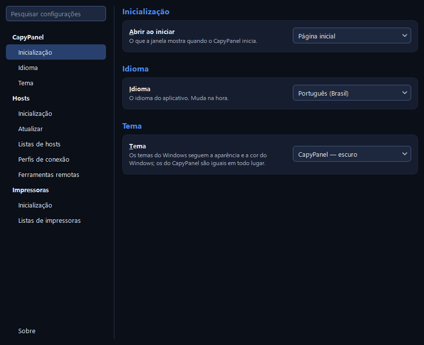

# Configurações e arquivos

As Configurações são a engrenagem embaixo na barra lateral, e **Arquivo > Configurações…**
(Ctrl+,). **Cada escolha vale assim que você a faz.** Não há botão Salvar nem botão Fechar: o **×**
da janela ou o **Esc** a fecham, e nada nunca pergunta sobre alterações não salvas.

## Como a janela funciona

À esquerda ficam uma caixa **Pesquisar configurações** e as páginas, em dois grupos:

| Grupo | Páginas |
|---|---|
| **CapyPanel** | **Geral** (idioma e tema) e **Arquivos** (onde tudo é guardado) |
| **Hosts** | **Geral**, **Listas de hosts** e **Conexões**, todas da ferramenta Hosts |

**Sobre** fica sozinha no fim dessa lista, embaixo dos grupos, por mais que as ferramentas acima
dela cresçam.

Uma página é feita de seções: um título e, embaixo dele, as configurações num cartão arredondado.
Uma configuração simples é uma linha: o nome dela, uma descrição de uma linha embaixo e o controle
na ponta direita. Tudo que guarda várias coisas, de listas de hosts a licenças, é a mesma tabela em
todo lugar: linhas de grade, um cabeçalho, seis linhas antes de rolar, as ações principais como
botões embaixo, **todas as ações de uma linha no botão direito dela** e um clique duplo para a mais
óbvia. A janela abre num tamanho fixo, e uma página mais alta que ela rola.

### Pesquisar nas configurações

Digite três letras ou mais e o lado direito mostra todas as seções que as mencionam, de todas as
páginas, cada uma sob o nome da página de onde veio ("CapyPanel › Geral"), com as palavras
encontradas marcadas em amarelo. As palavras são procuradas pelo começo. As configurações
funcionam ali, então você pode mudar o que procurava sem abrir a página dela. Um menu cuja
correspondência é uma das opções, e não a que está à mostra, recebe a marca na setinha. Clicar numa
página, ou limpar a caixa, põe tudo de volta no lugar.

## CapyPanel > Geral

**Idioma e tema**, os dois valendo no instante em que você escolhe:

- **Idioma:** English ou Português (Brasil). "O idioma do aplicativo. Muda na hora.", e isso vale
  para a própria janela de Configurações, sem reiniciar.
- **Tema:** "Os temas do Windows seguem a aparência e a cor do Windows; os do CapyPanel são iguais
  em todo lugar."

| Tema | Visual |
|---|---|
| Windows — seguir o tema do sistema / escuro / claro | Visual nativo do Windows, com sua cor de destaque |
| CapyPanel — escuro / claro | O visual próprio do CapyPanel, igual em todo computador |
| Graphite, Paper | Mais dois visuais próprios do CapyPanel |

Os temas mudam só as cores. A fonte, o tamanho dela e os cantos arredondados são os mesmos em
todos, e um tema nunca muda o que o app faz.

Os temas do Windows seguem a cor de destaque do seu Windows (**Configurações > Personalização >
Cores**), e tudo o que vem dela continua legível com qualquer uma que você escolher: os títulos
das seções, o botão padrão, os destaques e o título Grupos quando você arrasta um grupo até ele. Os
visuais próprios do CapyPanel mantêm os destaques deles, iguais em todo computador.

## CapyPanel > Arquivos

**Pastas** é uma tabela de **Pasta** e **Onde**, com **Abrir pasta** embaixo (também um clique
duplo, ou o botão direito na linha):

| Pasta | O que ela guarda |
|---|---|
| **Arquivos compartilhados** | "Perfis de conexão e ferramentas remotas, para todos neste PC." |
| **Listas compartilhadas** | "A lista padrão e toda lista salva ali, para todos neste PC." |
| **Seus arquivos** | "Suas configurações, privadas para você e os administradores." |
| **Suas listas** | "Sua lista pessoal e toda lista salva ali, só para você." |
| **Logs** | "Um por usuário, com o nome da conta." |

Passe o mouse sobre uma pasta para ver o que ela guarda, como a própria tabela diz embaixo de si.
No modo portátil ela acrescenta "Modo portátil: tudo fica na própria pasta do aplicativo." Os
caminhos estão ali para ler, não para selecionar. Onde cada um fica, e o que pode e não pode entrar
nele, está em [Onde o CapyPanel guarda os arquivos](#onde-o-capypanel-guarda-os-arquivos).

## Hosts > Geral

### Inicialização

- **Abrir ao iniciar:** qual lista de hosts abre quando o CapyPanel inicia: a última lista usada,
  a lista padrão, sua lista pessoal ou qualquer outra lista que você tenha. "Se essa lista não
  abrir: a lista padrão, depois a sua lista pessoal."
- **Mostrar primeiro:** o que a lista aberta mostra quando ela abre (veja
  [Listas de hosts](hosts/host-lists.pt-BR.md#o-que-uma-lista-mostra-primeiro)). "Para a lista
  aberta agora; cada lista guarda a sua."

### Atualizar

**Atualizar o status sozinho** é um só menu: **Desligado**, **A cada minuto**, **A cada 5
minutos**, **A cada 15 minutos**, **A cada 30 minutos** ou **Personalizado…**, que pede de 1 a 120
minutos e depois mostra esse intervalo entre as opções. Desligar guarda o intervalo para a próxima
vez.

"Só ping e portas, nunca usuários logados, então nenhuma conta é usada. O Atualizar da barra de
ferramentas sempre funciona." Vem desligado até você ligar; veja
[Verificando hosts](hosts/checking.pt-BR.md#status-automatico).

### Layout

**Layout da janela** tem um botão **Redefinir…**, que pergunta antes de fazer qualquer coisa. A
configuração diz "Tamanhos dos painéis, colunas e painéis mostrados, de volta a como eram no
início."

## Hosts > Listas de hosts

A tabela de todas as listas que o CapyPanel encontrou ou que você adicionou, com o que você pode
fazer com cada uma, e os botões que criam, adicionam e removem listas. O menu de listas no topo do
painel de grupos abre esta página em **Gerenciar listas de hosts…**.
[Listas de hosts](hosts/host-lists.pt-BR.md#configuracoes-hosts-listas-de-hosts) descreve a
tabela, os botões e o que o **Remover** pergunta.

## Hosts > Conexões

### Perfis de conexão

A tabela **Perfil | Ferramenta | Entra com**, com **Adicionar…**, **Editar…** e **Excluir…**
embaixo; o botão direito numa linha acrescenta **Duplicar…**, e um clique duplo edita. A entrada da
Área de Trabalho Remota lê "o próprio Remote Desktop Connection pede", porque o CapyPanel não pede
nada: o cliente da Área de Trabalho Remota pede o usuário e a senha quando conecta. Do que um
perfil é feito está em [Conectando](hosts/connecting.pt-BR.md#gerenciar-perfis).

"Compartilhados por todos neste PC." As alterações são gravadas para todos no instante em que você
as faz, e o **Excluir…** pergunta antes. Onde o Windows não deixa você gravar na pasta, o aviso
acrescenta que é somente leitura, e que só quem ele deixa gravar pode alterá-los.

**Hosts sem perfil usam** é a última linha da seção: "O perfil com que um host conecta quando não
tem um próprio."

O CapyPanel enche a pasta de perfis no primeiro início com os perfis que vêm com ele (RealVNC,
Remote Desktop e UltraVNC) e um arquivo de configurações, `_profiles.json`, que registra a escolha
dessa linha e quais perfis de fábrica já foram adicionados, para que um que você exclua não volte.
Onde a pasta não pôde ser criada, a página mostra os perfis de fábrica e diz: "Estes são os perfis
que vêm com o app: a pasta é criada quando você altera um.", ou "…a pasta ainda não existe." onde
você não pode criá-la de jeito nenhum.

### Ferramentas remotas

A tabela **Ferramenta | Status | Onde**: **✓ Encontrado** quando o CapyPanel a achou sozinho, **✓
Sua escolha** quando um caminho foi definido aqui, ou **✗ Não encontrado**, cuja dica diz
"Instale-o ou localize o .exe dele."

- **Alterar caminho…** escolhe o `.exe` de uma ferramenta, de uma cópia portátil por exemplo. O
  botão direito na linha passa a oferecer também **Usar o caminho automático**, que esquece essa
  escolha.
- **Baixar** abre o site da ferramenta, e só aparece para uma que não foi encontrada. O Remote
  Desktop Connection vem com o Windows, então não tem esse botão.

"Onde cada ferramenta está instalada, definido uma vez para todos neste PC." Como nos perfis, é
gravado na hora, e só onde o Windows deixa você gravar na pasta.

Embaixo das duas tabelas, uma linha diz quais arquivos o CapyPanel não está usando e por quê, como
"2 arquivos ignorados: broken.json (não pode ser lido), clinicas.json (feito por outro usuário)".
Passe o mouse nela para ver os caminhos inteiros e os erros; ela fica escondida quando todos os
arquivos estão em uso.

## Sobre

**Ajuda > Sobre o CapyPanel** abre esta página, fixa no fim da lista de páginas. Três cartões:

| Cartão | O que tem |
|---|---|
| **CapyPanel** | O mascote, o nome e a versão (clique nela para copiá-la com o commit), "Todos os computadores sob seus cuidados, em uma só janela.", os direitos autorais e "Software livre sob a GPL-3.0, sem garantia: veja Licenças.", que rola até elas, links para a documentação e para o código-fonte, uma linha **Build** com o commit e o modo portátil quando se aplicam, e **Relatar um problema** ao lado de **Abrir pasta de logs** |
| **Créditos** | Quem fez o CapyPanel, o mascote dele e os ícones que ele usa |
| **Licenças** | A tabela **Software \| Versão \| Licença \| Aviso**: CapyPanel (GPL-3.0), Qt e Qt for Python (LGPL-3.0), Python (PSF License), Tabler Icons (MIT). **Ler licença** abre o texto que vem com o app numa janela, também num clique duplo ou no botão direito da linha, e **Abrir pasta** abre a pasta em que todas vêm |

## Onde o CapyPanel guarda os arquivos

O CapyPanel guarda tudo de todos os usuários de um PC numa só pasta, `C:\ProgramData\CapyPanel`,
com uma pasta privada por usuário:

| O quê | Onde |
|---|---|
| A lista de hosts padrão, e toda lista compartilhada com todos no PC | `lists\` |
| Perfis de conexão, seus arquivos de configurações, e qual deles os hosts usam sem um próprio | `profiles\` |
| Definições de visualizadores adicionadas pela sua empresa, e onde cada visualizador está instalado | `tools\` |
| Suas configurações | `users\<você@DOMÍNIO>\` |
| Sua lista pessoal e as suas próprias listas | `users\<você@DOMÍNIO>\lists\` |
| Logs, um arquivo por usuário | `logs\` |
| Definições de visualizadores embutidas e os perfis iniciais | Dentro do app |

- **Sua pasta é privada:** só você, os administradores e o próprio Windows podem abri-la. O
  CapyPanel se recusa a usar uma pasta que outra pessoa criou antes em seu nome.
- **Arquivos compartilhados precisam vir de alguém confiável.** Qualquer usuário pode criar
  arquivos no ProgramData, então o CapyPanel ignora um arquivo compartilhado (uma lista, um
  perfil, uma definição de visualizador da empresa) criado por outro usuário que não seja
  administrador, e registra isso no log.
- **Os logs nunca contêm senhas.** Eles registram qual visualizador abriu para qual endereço e o
  resultado de cada verificação de login.

O CapyPanel cria as duas pastas de listas no primeiro início. Uma lista de antes da versão 0.19,
quando a lista padrão e a pessoal eram arquivos `hosts.json`, é copiada para dentro delas uma vez,
sozinha; o arquivo antigo fica onde está, para uma versão mais antiga ainda rodar.

### Modo portátil

Um arquivo vazio chamado `capypanel.portable` ao lado do app guarda tudo (configurações, listas,
logs) numa pasta `userdata` ao lado dele, para rodar de um pendrive ou de uma pasta
compartilhada. Quando você roda pelo código-fonte, "ao lado do app" significa a pasta do
repositório.
