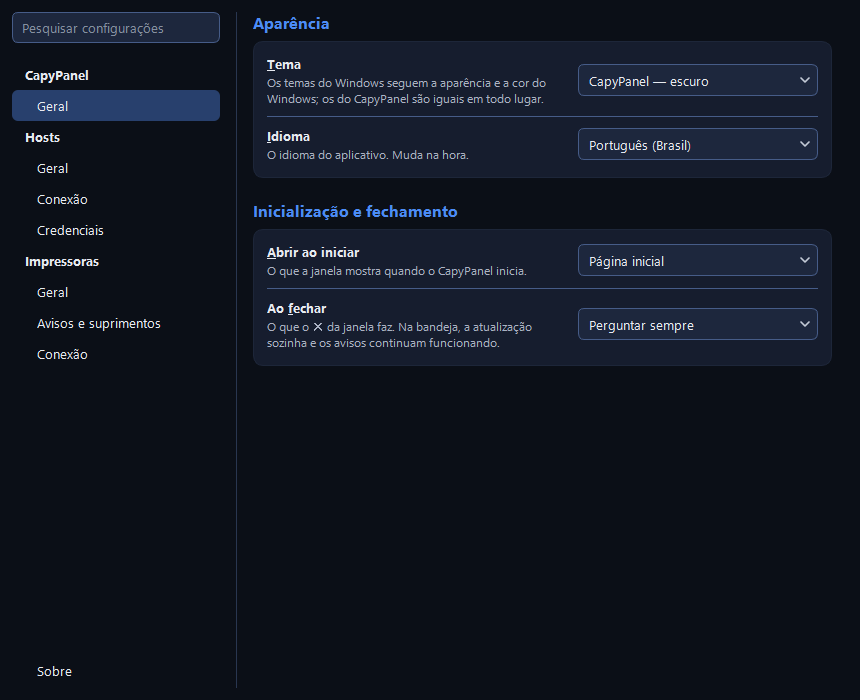
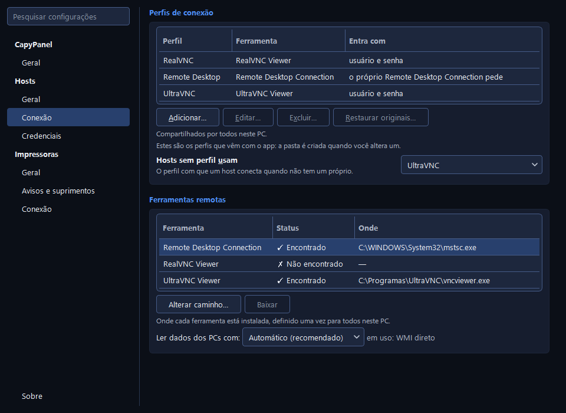
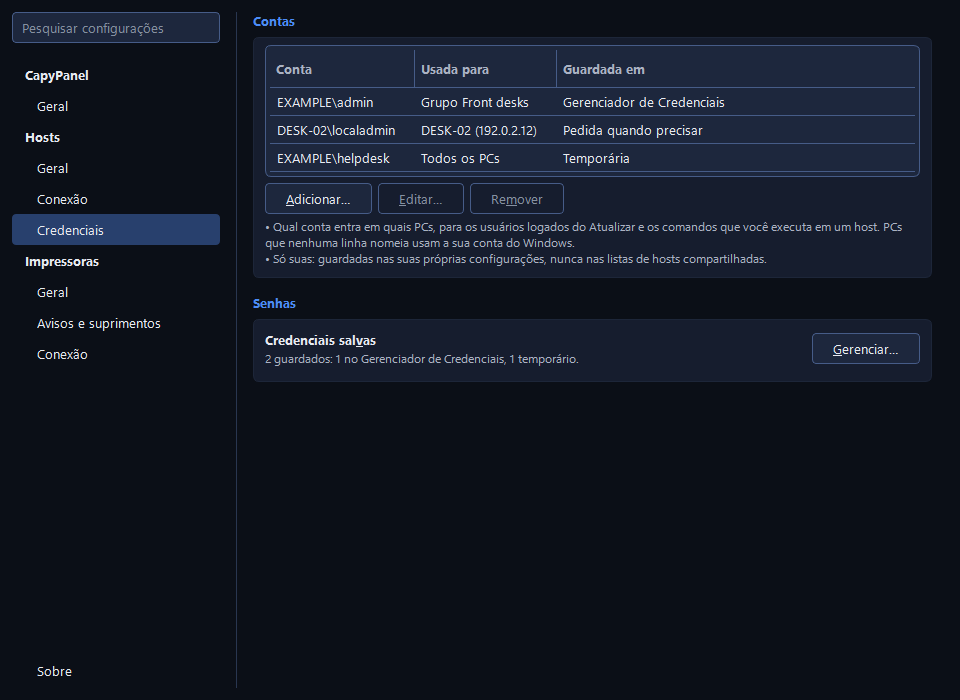

# Configurações e arquivos

As Configurações são a engrenagem embaixo na barra lateral, e **Arquivo > Configurações…**
(Ctrl+,). **Cada escolha vale assim que você a faz**: não há botão Salvar, e o **×** da janela ou o
**Esc** a fecham. Esta página lista cada configuração, página por página, e onde o CapyPanel guarda
os arquivos.

## Encontrar uma configuração

Digite três letras ou mais em **Pesquisar configurações**, no alto à esquerda. O lado direito
mostra todas as seções que as mencionam, de todas as páginas, com as palavras encontradas marcadas
em amarelo, e as configurações funcionam ali mesmo.

??? note "Mais sobre a janela"

    - As páginas são agrupadas: **CapyPanel** (Geral), **Hosts** (Geral, Conexão, Credenciais) e
      **Impressoras** (Geral, Avisos e suprimentos, Conexão). **Sobre** fica à parte, no fim da
      lista. As Configurações abrem em **CapyPanel > Geral**.
    - Cada página é feita de seções: um título com as configurações dele num cartão arredondado. Uma
      tabela é igual em todo lugar: uma linha fina embaixo de cada linha, divisores para arrastar e
      alargar uma coluna, as ações principais como botões embaixo, **todas as ações de uma linha no
      botão direito dela** e um clique duplo para a mais óbvia. O botão direito nos títulos das
      colunas oferece **Ajustar colunas ao conteúdo**.
    - A pesquisa procura as palavras pelo começo, e a lista de páginas fica só com as que têm alguma
      correspondência. Um menu cuja correspondência é uma das opções recebe a marca na setinha.
      Limpar a caixa põe tudo de volta.
    - A janela abre em 960 × 700 na primeira vez, ou menor numa tela pequena, como a de um notebook
      em escala de 125 %. Você pode deixá-la de qualquer tamanho: uma página maior que a janela
      rola, para baixo e para o lado. Ela abre de novo no tamanho e no lugar em que você a deixou.

??? note "Configurações para todos neste PC"

    A maioria das configurações é só sua. Algumas são as mesmas para todos que usam o CapyPanel
    neste PC, e as seções delas dizem **Todos neste PC**, com um pequeno computador, ao lado do
    título:

    - **CapyPanel > Geral > Novas versões**
    - **Hosts > Conexão**: **Perfis de conexão** (com **Hosts sem perfil usam**) e **Ferramentas
      remotas** (com **Ler dados dos PCs com**)

    Embaixo do título, uma linha diz "Uma mudança aqui vale para todos neste PC." Se o Windows não
    deixa a sua conta alterá-las, a linha diz "Somente leitura para você. Um administrador deste PC
    pode alterar." e os controles ficam apagados. Elas ficam na pasta compartilhada (veja [Onde o
    CapyPanel guarda os arquivos](#onde-o-capypanel-guarda-os-arquivos)), que só os
    administradores e quem a criou podem alterar.

    As listas de hosts e de impressoras compartilhadas também são de todos: as tabelas de listas
    dizem qual lista é **Compartilhada** e qual é **Pessoal**.

## CapyPanel > Geral

| Configuração | O que faz | De início |
|---|---|---|
| **Tema** | O visual: Windows (seguir o sistema, escuro, claro), CapyPanel (escuro, claro), Graphite ou Paper | Windows, seguir o tema do sistema |
| **Idioma** | English ou Português (Brasil). "O idioma do aplicativo. Muda na hora.", inclusive nas Configurações | O idioma em que o Windows aparece: Português (Brasil) para qualquer português, English para os outros |
| **Abrir ao iniciar** | O que a janela mostra ao iniciar: a **Página inicial**, **A última ferramenta usada** ou uma ferramenta pelo nome | Página inicial |
| **Ao fechar** | O que o **✕** da janela faz: **Perguntar sempre**, **Manter aberto na bandeja** ou **Sair** (veja [Primeiros passos](getting-started.pt-BR.md#fechar-o-capypanel-ou-deixa-lo-na-bandeja)) | Perguntar sempre |

??? note "Mais sobre os temas"

    "Os temas do Windows seguem a aparência e a cor do Windows; os do CapyPanel são iguais em todo
    lugar." Os temas mudam as cores. Cada um tem os seus tons das cores de aviso (âmbar, vermelho,
    verde e cinza), então os avisos e os pontos e as barras de suprimentos do Impressoras ficam
    legíveis também nos temas claros. A fonte e o tamanho dela são os mesmos em todos, e um tema
    nunca muda o que o app faz. Os temas do Windows seguem a sua cor de destaque (**Configurações >
    Personalização > Cores**), e tudo o que vem dela continua legível.

### Novas versões

**Todos neste PC**: "Uma mudança aqui vale para todos neste PC: uma nova versão substitui o
CapyPanel para todos eles."

| Configuração | O que faz | De início |
|---|---|---|
| **Procurar nova versão** | **A cada início**, **Uma vez por dia**, **Uma vez por semana** ou **Desligado**. "Pergunta ao GitHub (api.github.com) qual é a versão mais nova do CapyPanel. Nada é baixado até você escolher Instalar. Ajuda › Procurar nova versão funciona com qualquer opção." | A cada início |

## Hosts > Geral

| Configuração | O que faz | De início |
|---|---|---|
| **Listas de hosts** | A tabela de todas as listas, com **Nova…**, **Adicionar existente…** e **Remover** (veja [Trocar, criar e compartilhar listas](hosts/host-lists.pt-BR.md#trocar-criar-e-compartilhar-listas)) | A lista padrão e a pessoal |
| **Lista ao iniciar** | Qual lista de hosts abre com a ferramenta. "Se essa lista não abrir: a lista padrão, depois a sua lista pessoal." | A última lista usada |
| **Mostrar primeiro** | O que a lista aberta mostra quando abre: **Todos os hosts**, **Onde parei** ou **Um grupo escolhido ▸**. "Para a lista aberta agora; cada lista guarda a sua." | Todos os hosts |
| **Atualizar o status sozinho** | Verifica o status dos hosts exibidos **a cada minuto**, a cada **5**, **15** ou **30 minutos**, ou num intervalo **Personalizado…** de 1 a 120 (veja [Verificando hosts](hosts/checking.pt-BR.md#verificar-o-status-sozinho)) | Desligado |
| **Comandos rápidos > Escolher…** | "Os botões no topo do painel de detalhes de um host; os quatro primeiros também ficam no menu do botão direito. Seus, neste PC." (veja [Escolher os seus comandos rápidos](hosts/commands.pt-BR.md#escolher-os-seus-comandos-rapidos)) | Compartilhamento C$, Pasta do usuário, Gerenciamento do Computador, Enviar uma mensagem… |

## Hosts > Conexão

**Todos neste PC**: as duas seções, **Perfis de conexão** e **Ferramentas remotas**, têm a marca,
com "Uma mudança aqui vale para todos neste PC." embaixo do título.

| Configuração | O que faz | De início |
|---|---|---|
| **Perfis de conexão** | A tabela **Perfil \| Ferramenta \| Entra com**, com **Adicionar…**, **Editar…**, **Excluir…** e **Restaurar originais…** (veja [Configurar os perfis de conexão](hosts/connecting.pt-BR.md#configurar-os-perfis-de-conexao)) | UltraVNC, RealVNC, Remote Desktop |
| **Hosts sem perfil usam** | "O perfil com que um host conecta quando não tem um próprio." | UltraVNC |
| **Ferramentas remotas** | A tabela **Ferramenta \| Status \| Onde**, com **Alterar caminho…** e **Baixar**: onde cada ferramenta está instalada | Encontradas sozinhas |
| **Ler dados dos PCs com** | Como o CapyPanel lê os dados do PC, os programas, as unidades mapeadas e os perfis de usuário de outros PCs: **Automático (recomendado)**, **WMI direto** ou **WMI pelo PowerShell** (veja [Como o CapyPanel lê outros PCs](hosts/checking.pt-BR.md#ler-os-dados-de-um-pc)) | Automático |

??? note "Mais sobre perfis e ferramentas"

    - O botão direito numa linha acrescenta **Duplicar…**, e um clique duplo edita. A entrada da
      Área de Trabalho Remota lê "o próprio Remote Desktop Connection pede".
    - **Restaurar originais…** traz de volta os perfis que vêm com o CapyPanel, e fica apagado
      enquanto não falta nenhum. Ele pergunta antes, dizendo os nomes, e acrescenta "Os perfis que
      você alterou ou criou continuam como estão." Cancelar é o botão padrão.
    - As alterações são gravadas para todos no instante em que você as faz. Onde o Windows não deixa
      você alterá-las, a linha embaixo do título diz "Somente leitura para você. Um administrador
      deste PC pode alterar."
    - O CapyPanel enche a pasta de perfis no primeiro início, com um arquivo de configurações,
      `_profiles.json`, que registra o **Hosts sem perfil usam** e quais perfis de fábrica já foram
      adicionados. Onde a pasta não pôde ser criada, a página mostra os perfis de fábrica e avisa.
    - Uma ferramenta remota diz **✓ Encontrado** quando o CapyPanel a achou sozinho, **✓ Sua
      escolha** quando um caminho foi definido aqui, ou **✗ Não encontrado** ("Instale-o ou localize
      o .exe dele."). Depois do **Alterar caminho…**, o botão direito na linha oferece **Usar o
      caminho automático**. O **Baixar** abre o site da ferramenta, só para uma que não foi
      encontrada.
    - Embaixo das duas tabelas, uma linha diz quais arquivos o CapyPanel não está usando e por quê,
      como "2 arquivos ignorados: broken.json (não pode ser lido), clinicas.json (feito por outro
      usuário)"; passe o mouse para ver os caminhos inteiros.
    - Com o **Automático**, o "em uso:" ao lado diz o jeito que ele usa neste PC.

## Hosts > Credenciais

| Configuração | O que faz | De início |
|---|---|---|
| **Contas** | A tabela **Conta \| Usada para \| Guardada em**: qual conta entra em quais PCs, para os usuários logados e os comandos. "guardadas nas suas próprias configurações, nunca nas listas de hosts compartilhadas" (veja [Usar outra conta em alguns PCs](hosts/connecting.pt-BR.md#usar-outra-conta-em-alguns-pcs)) | Vazia: a sua conta do Windows em todo lugar |
| **Credenciais salvas** | Quantos logins o CapyPanel guarda e onde, como "2 guardados: 1 no Gerenciador de Credenciais, 1 temporário.", com **Gerenciar…** (veja [Esquecer uma senha salva](hosts/connecting.pt-BR.md#esquecer-uma-senha-salva)) | Nenhum guardado |

## Impressoras

| Página | Configuração | O que faz | De início |
|---|---|---|---|
| Geral | **Listas de impressoras**, **Lista ao iniciar**, **Mostrar primeiro** | Como no Hosts (veja [Manter impressoras em listas, grupos e tags](printers/printers.pt-BR.md#manter-impressoras-em-listas-grupos-e-tags)) | Como no Hosts |
| Avisos e suprimentos | **Atualizar sozinho** | Lê todas as impressoras da lista aberta a cada **5**, **15**, **30** ou **60 minutos** (veja [Verificando impressoras](printers/checking.pt-BR.md#atualizar-as-impressoras-sozinho)) | Desligado |
| Avisos e suprimentos | **Notificação do Windows** | **Desligado**, **Parada ou offline** ou **Também suprimento baixo** | Parada ou offline |
| Avisos e suprimentos | **Nível baixo de suprimento** | Quando um suprimento conta como baixo, de 1 a 50 % | 10 % |
| Avisos e suprimentos | **Marcas das barras** | Traços nas barras de suprimento, com **Alterar…** | O traço do nível baixo |
| Avisos e suprimentos | **Coluna Toner** | Texto ou uma barra | Texto |
| Conexão | **Versão do SNMP** e **Conta SNMP** | v2c ou v3, e a conta dela (veja [Definir a conta SNMP](printers/checking.pt-BR.md#definir-a-conta-snmp)) | v2c, "public" |
| Conexão | **Conta do Doc360 MPS** | O login do portal para as impressoras cujos contadores de páginas vêm dele (veja [Contar páginas pelo Doc360 MPS](printers/checking.pt-BR.md#contar-paginas-pelo-doc360-mps)) | Não definida |

A ferramenta Perfis de usuário não tem configurações próprias: ela usa as listas e as contas do
Hosts.

## Sobre

**Ajuda > Sobre o CapyPanel** abre esta página, no fim da lista. Ela tem quatro cartões:

| Cartão | O que tem |
|---|---|
| **CapyPanel** | A versão (clique nela para copiá-la com o commit), os direitos autorais e a licença, links para a documentação e o código-fonte, uma linha **Build**, e **Relatar um problema** ao lado de **Abrir pasta de logs** |
| **Créditos** | Quem fez o CapyPanel, o mascote dele e os ícones que ele usa |
| **Licenças** | Cada biblioteca que vem com o CapyPanel, com a licença dela; **Ler licença** abre o texto que vem com o app |
| **Pastas** | Onde o CapyPanel guarda tudo, com um botão **Abrir pasta** |

??? note "Os cartões Licenças e Pastas por inteiro"

    **Licenças** é a tabela **Software | Versão | Licença | Aviso**: CapyPanel (GPL-3.0), Qt e Qt
    for Python (LGPL-3.0), Python (PSF License), cryptography (BSD-3-Clause, e a licença do OpenSSL,
    Apache-2.0, no mesmo aviso, porque o build dela para Windows leva o OpenSSL), cffi (MIT-0) e
    pycparser (BSD-3-Clause), de que a cryptography precisa, pywin32 (BSD-3-Clause), pelo qual o
    CapyPanel lê outros PCs, e Tabler Icons (MIT). O **Ler licença** também funciona num clique
    duplo ou no botão direito da linha, e o **Abrir pasta** abre a pasta em que todas vêm. O
    "Software livre sob a GPL-3.0, sem garantia: veja Licenças." do cartão CapyPanel rola até elas.

    **Pastas** é a versão curta da seção abaixo:

    | Pasta | O que ela guarda |
    |---|---|
    | **Compartilhada** | "Para todos neste PC: perfis de conexão, ferramentas remotas e as listas compartilhadas em “lists”, uma pasta para cada tipo de lista." |
    | **Pessoal** | "Só para você e os administradores: suas configurações e suas listas em “lists”, uma pasta para cada tipo de lista." |
    | **Logs** | "Um por usuário, com o nome da conta." |

    No modo portátil ela acrescenta "Modo portátil: tudo fica na própria pasta do aplicativo."

## Onde o CapyPanel guarda os arquivos

Tudo de todos os usuários de um PC fica numa só pasta, `C:\ProgramData\CapyPanel`, com uma pasta
privada por usuário:

| O quê | Onde |
|---|---|
| Listas compartilhadas com todos no PC, uma pasta por tipo | `lists\hosts\`, `lists\printers\` |
| Perfis de conexão, seus arquivos de configurações, e qual deles os hosts usam sem um próprio | `profiles\` |
| Definições de visualizadores adicionadas pela sua empresa, onde cada visualizador está instalado, como os outros PCs são lidos, e de quanto em quanto tempo procurar nova versão | `tools\` |
| Suas configurações, entre elas as suas contas para outros PCs | `users\<você@DOMÍNIO>\` |
| Suas próprias listas, uma pasta por tipo | `users\<você@DOMÍNIO>\lists\hosts\`, `…\lists\printers\` |
| Logs, um arquivo por usuário | `logs\<você@DOMÍNIO>.log` |
| Todo perfil de usuário que você excluiu, ou tentou excluir | `logs\<você@DOMÍNIO>.user-profiles.log` |
| Definições de visualizadores embutidas e os perfis iniciais | Dentro do app |

??? note "Quem pode ler o quê"

    - **Sua pasta é privada:** só você, os administradores e o próprio Windows podem abri-la. O
      CapyPanel se recusa a usar uma pasta que outra pessoa criou antes em seu nome.
    - **Arquivos compartilhados precisam vir de alguém confiável.** Qualquer usuário pode criar
      arquivos no ProgramData, então o CapyPanel ignora um arquivo compartilhado (uma lista, um
      perfil, uma definição de visualizador da empresa) criado por outro usuário que não seja
      administrador, e registra isso no log.
    - **Os logs nunca contêm senhas.** Eles registram qual visualizador abriu para qual endereço, o
      resultado de cada verificação de login e, a cada início, o jeito como o CapyPanel lê outros
      PCs. O log de perfis de usuário guarda, para cada exclusão, quando, em qual PC, de quem era o
      perfil e como terminou.
    - O CapyPanel cria essas pastas no primeiro início. Listas de uma versão anterior são copiadas
      para dentro delas uma vez, sozinhas: os arquivos `hosts.json` de antes da 0.19 e as listas que
      a 0.19 guardava direto em `lists\`. Os arquivos antigos ficam onde estão, para uma versão mais
      antiga ainda rodar.

### Modo portátil

Um arquivo vazio chamado `capypanel.portable` ao lado do app guarda tudo (configurações, listas,
logs) numa pasta `userdata` ao lado dele, para rodar de um pendrive ou de uma pasta compartilhada.
Quando você roda pelo código-fonte, "ao lado do app" significa a pasta do repositório.

## Mensagens que você pode ver

| Mensagem | O que significa | O que fazer |
|---|---|---|
| "Somente leitura para você. Um administrador deste PC pode alterar." | As configurações dessa seção são as mesmas para todos neste PC, e o Windows não deixa a sua conta alterá-las | Peça a um administrador do PC para alterá-las |
| "2 arquivos ignorados: broken.json (não pode ser lido), clinicas.json (feito por outro usuário)" | Embaixo da tabela de perfis ou de ferramentas: arquivos na pasta compartilhada que o CapyPanel não está usando. Passe o mouse para ver os caminhos inteiros | Corrija ou remova um arquivo que não pode ser lido. Um arquivo feito por outro usuário que não é administrador é ignorado de propósito: peça a um administrador para colocá-lo lá |
