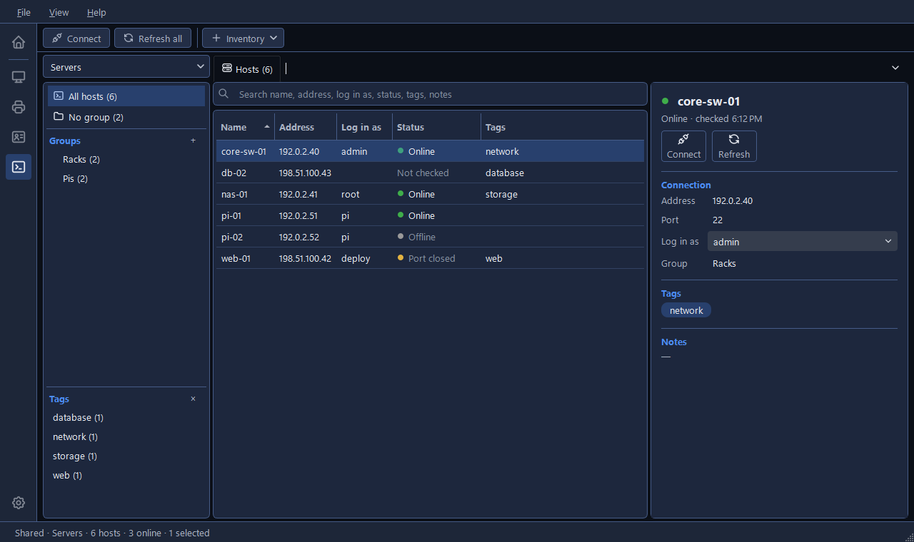
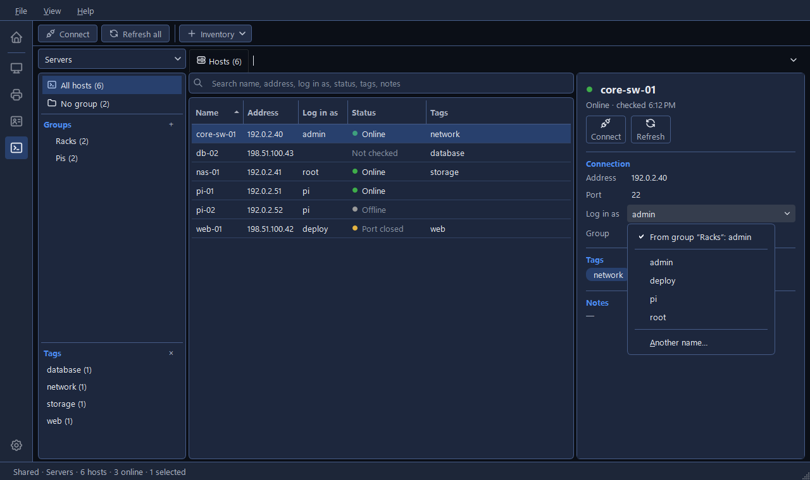
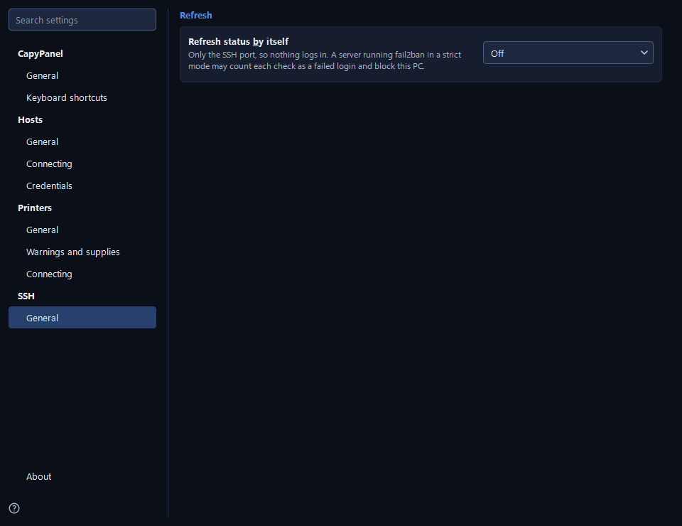
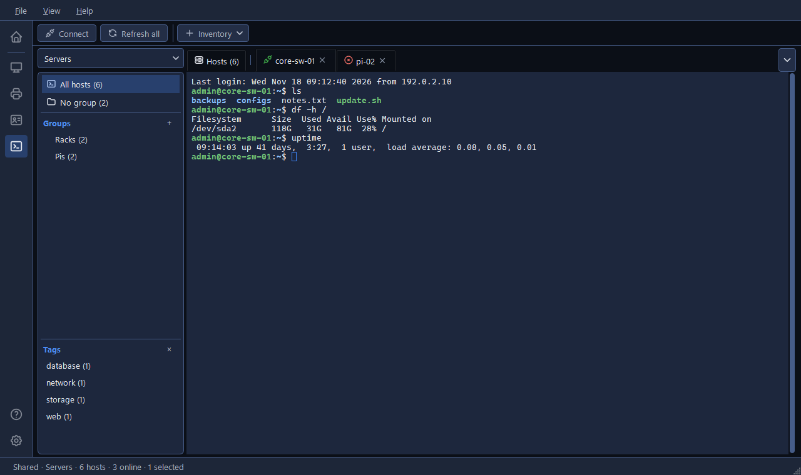
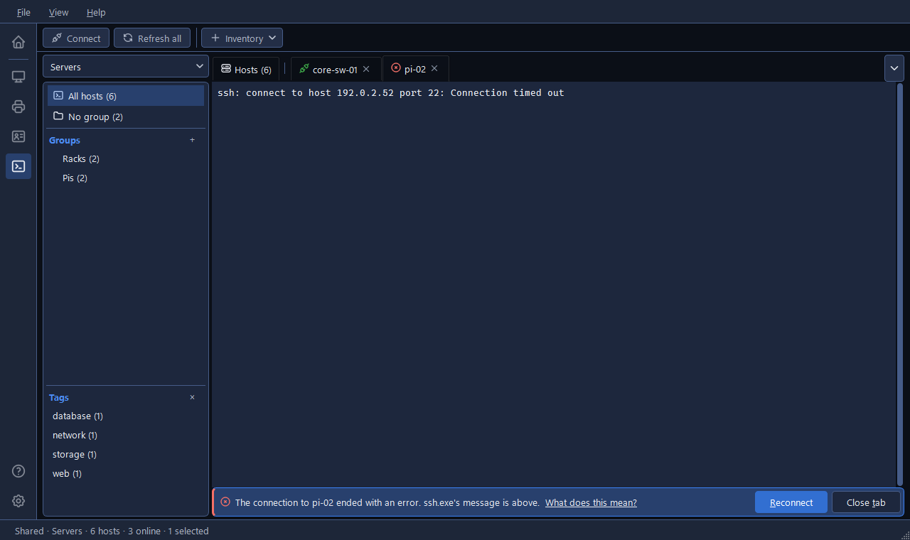

# The SSH tool

SSH keeps the servers, switches and other devices you reach over SSH, tells you which ones answer,
and opens a terminal on any of them in a tab beside the list. Open it from the **SSH** tile on
Home, the terminal icon on the sidebar, or **Ctrl+4**. The first time it opens, a guide shows its
parts on a sample host; **Help > Guide to this screen** shows it again.



Every connection runs Windows' own SSH client, ssh.exe. It asks for the password or uses your key,
and it checks each server's identity, so CapyPanel keeps no SSH password and no server key. In
CapyPanel's terminal each key you type passes through CapyPanel on its way to ssh.exe, and none is
kept.

SSH shows the host list that's open in Hosts, the same lists Profile cleanup shows. A host you add
here is in Hosts at once, and the other way round.

## Add a host <a id="ssh-add-a-host"></a>

1. **Inventory > Add host…** (Ctrl+N).
2. Type a **Name** and the **Address**, an IP address or a network name.
3. Fill in **Port** and **Log in as** if you need them. Without them, ssh.exe uses port 22 and its
   own settings.
4. Click **Add**.

Groups, tags, **Move to ▸**, **Tags ▸** and finding a host work as in Hosts: see
[Host lists](../hosts/host-lists.md). To bring in many hosts at once, use **Import hosts…** in the
Hosts tool; they show here too, on port 22.

??? note "More about adding hosts"

    - **Edit selected…** (F2) opens the same window for a host already in the list, with **Save**.
    - An address can't hold a space or start with "-", and can't hold a backquote or any of these:

        ```
        " $ & ' ( ) , ; < > \ { | }
        ```

      **Log in as** has the same rules, except that `$`, `,` and `\` are allowed. Windows' own
      ssh.exe refuses these characters, and an older one could pass them on to a program.
      `DOMAIN\user`, `user@domain` and a name ending in `$` work.
    - **Port** is a column of the table too, hidden until you show it from a right-click on the
      column titles. The Details panel always shows it.
    - A list that can't be written to can still be checked and connected to; only editing is off.

## Choose the name to log in as <a id="ssh-choose-the-name-to-log-in-as"></a>

**Log in as** is the account ssh.exe signs in to the server with. Empty, ssh.exe decides: your own
SSH config first, then your Windows user name.



1. Select a host. In the Details panel, click **Log in as**.
2. Pick a name the list already uses, or **Another name…** to type one.

A whole group can have a name too: right-click the group, then **Log in as**. "Hosts in “{group}”
without a name of their own log in with this one." A host's own name wins over its group's, and a
group with none takes the nearest group above it that has one.

??? note "More about Log in as"

    - The first choice follows the group, as in "From group “Racks”: admin", or "None: your SSH
      config, then your Windows user name" when no group gives a name. A pin beside the name means
      the host has one of its own.
    - With several hosts selected, their right-click menu has **Log in as ▸** too. When their
      groups give different names, its first choice reads "From their groups".
    - The table's **Log in as** column shows the name each host logs in with, its group's included.
    - The name is kept in the host list file, beside the host or the group.

## Check which hosts answer <a id="ssh-check-which-hosts-answer"></a>

Click **Refresh all** on the toolbar (F5). CapyPanel checks the SSH port of every host shown,
eight at a time, and logs in to nothing.

| Status | What it means |
|---|---|
| **Online** | The SSH port took the connection |
| **Port closed** | The host answered, but nothing listens on that port: ssh.exe would fail with "Connection refused" |
| **Offline** | Nothing answered |
| **Host not found** | The name or address doesn't exist |
| **Not checked** (grey) | Nobody has refreshed it yet |

Hover over a status for when it was checked and which address answered. To check fewer, right-click
a host for **Refresh host** (or **Refresh {n} hosts**), or a group for **Refresh group**, which
checks its subgroups too.

??? note "Settings › SSH › General"

    

    **Refresh status by itself** checks the hosts shown every **minute**, **5**, **15** or **30
    minutes**, or a **Custom…** interval. It's **Off** to begin with, and says why it might stay
    that way: "Only the SSH port, so nothing logs in. A server running fail2ban in a strict mode
    may count each check as a failed login and block this PC."

## Connect <a id="ssh-connect"></a>

1. Select a host, or several.
2. Click **Connect** on the toolbar, double-click the host, or press **Enter**.
3. A tab opens beside the list, named after the host, and ssh.exe connects in it. A second
   connection to the same host is "srv-01 (2)".
4. The first time you reach a server, ssh.exe asks, in English: "Are you sure you want to continue
   connecting (yes/no/[fingerprint])?" Type **yes**, then press **Enter**.
5. Type the password if it asks. Nothing shows while you type it.



To connect to a server that isn't in the list, type its name or address in the search box. While no
host of the list has it, the table offers **Connect to {host}**, which uses port 22 and ssh.exe's
own settings.

??? note "More about connecting"

    - At the host key question, only **yes** (in any case) or the server's fingerprint accepts it.
      "y" or "sim" makes ssh.exe ask again, and **Enter** alone answers no, which ends the
      connection with "Host key verification failed."
    - CapyPanel connects at most ten hosts at once: "Only the first 10 connect at once."
    - ssh.exe reads your own SSH config (`%USERPROFILE%\.ssh\config`) and your keys, so a key,
      a jump host or an older algorithm works as in any terminal (see
      [Old devices and your SSH config](#old-devices-and-your-ssh-config)).
    - CapyPanel connects over SSH only, not over Telnet or a serial cable.

## Work in the terminal <a id="ssh-work-in-the-terminal"></a>

Every key you type goes to the server, apart from these:

| Key | What it does |
|---|---|
| **Ctrl+C** | Copies the text you selected; with nothing selected, it goes to the server and stops the running program |
| **Ctrl+Shift+C** / **Ctrl+Shift+V** | Copy / paste |
| **Ctrl+=** / **Ctrl+-** | Bigger / smaller text |
| **Ctrl+Tab** / **Ctrl+Shift+Tab** | The next / previous tab, the Hosts tab included: the way out of a terminal |
| **Ctrl+Shift+W** | Close the tab |
| **Ctrl+0** to **Ctrl+4**, **Ctrl+,** | Home, the tools and Settings, with the keys **Keyboard shortcuts** gives them |

So F1, Esc, F5, Ctrl+F and Exit's Ctrl+Q go to the server while a terminal has the keyboard. On
the Hosts tab every key works as usual, and picking a group, a tag or a list on the left, or
**Ctrl+F**, brings that tab forward.

Select text with the mouse to copy it. A right-click opens **Copy**, **Paste**, **Select all** and
**Clear scrollback**; it never pastes by itself.

??? note "More about the terminal"

    - Pasting text with more than one line asks first, as in "Paste 4 lines into srv-01?" and
      "Each line may run as a command.", showing the first three lines. **Cancel** is the default.
      It doesn't ask when the program on the server asked for pasted text to wait for Enter, as
      recent versions of bash do.
    - The terminal takes the theme's colours. A program's colour pair that would be hard to read is
      swapped for one that reads. The text is Cascadia Mono, or Consolas where Cascadia Mono isn't
      installed; line, block and Powerline characters are drawn by CapyPanel, so boxes join with
      no gaps.
    - The text size is one for every tab, and it's kept for next time.
    - A line too long for the tab goes on to the next row, and copies as one line, so it pastes
      whole.
    - Each tab keeps the last 10,000 lines. Nothing you type, paste or see is logged or saved, and
      nothing of a connection outlives CapyPanel but the text size.

??? note "What the terminal doesn't do yet"

    - The mouse only selects text. Programs such as mc and htop don't get clicks: use their keys.
    - Links in the output can't be clicked. Select one and copy it.
    - There's no search in the scrollback. Right-click > **Select all**, copy, and search in a text
      editor. The scrollback can't be saved to a file either; copy it the same way.
    - The scrollback keeps the last 10,000 lines, and that isn't a setting.
    - Lines already printed don't rewrap when the tab changes width, so a narrower tab cuts off
      their ends at the right edge.
    - The bell makes no sound and shows nothing.
    - The cursor is always a block, even where a program asks for a bar, as vim does while you
      type.
    - The text size is changed with Ctrl+= and Ctrl+-, not in Settings.
    - Screen readers can't read the terminal, and Windows' contrast themes don't change it.

    For any of these, [Connect in a separate window](#connect-in-a-separate-window) opens the host
    in Windows' own terminal.

## When a connection ends <a id="ssh-when-a-connection-ends"></a>

The tab stays, with the last screen, so you can read how it ended. A strip at its foot says it and
offers **Reconnect** (the default: **Enter** does it too) and **Close tab**.



| The strip | When |
|---|---|
| "The connection to {host} ended." in grey | The server closed the connection, or you typed `exit`. A program's own exit code counts as a normal end |
| "The connection to {host} ended with an error. ssh.exe's message is above." in red, with a cross | ssh.exe couldn't connect, or lost the connection |
| "The connection to {host} ended with an error (exit code 0xC0000005)." | ssh.exe stopped with one of Windows' own error codes and printed nothing |

??? note "Closing tabs"

    - **Ctrl+Shift+W**, the tab's **×** or **Close tab** closes it. A tab that's still connected
      asks first, "Close the connection to {host}?", with "Anything still running in it on the
      server may stop."
    - Right-click a tab for **Reconnect**, **Close**, **Close the others** and **Close the ended
      ones**. Closing several open connections asks once.
    - Each tab's mark says how it stands: **Connection open**, **Ended with an error** or
      **Ended**.
    - Quitting CapyPanel with connections open asks once, as in "Quit CapyPanel with 2 connections
      open?" and "They all close, and anything still running in them on the servers may stop."

## Connect in a separate window <a id="ssh-connect-in-a-separate-window"></a>

Right-click a host and pick **Connect in a separate window**. It "Opens ssh.exe in a window of its
own, outside CapyPanel": there your keys never pass through CapyPanel, and the window does
everything Windows' console does.

If ssh.exe ends with an error, the window stays open so you can read why; press any key to close
it. Under ssh.exe's message it says "The connection to {host} ended with an error. ssh.exe's
message is above." and "Press any key to close this window." A key pressed in the first second
after those words is ignored, so a quick extra Enter doesn't close it unread. After a normal end it
closes by itself, and closing the window ends ssh.exe.

To install an update, close these windows first (see
[Update CapyPanel](../download.md#update-capypanel)).

## Old devices and your SSH config <a id="ssh-old-devices-and-your-ssh-config"></a>

ssh.exe reads your own SSH config, `%USERPROFILE%\.ssh\config`. That's the place for what a host
needs beyond a name and a port: a key file, a jump host, or an older algorithm that the newest
ssh.exe turns off. An old switch that ends with "Unable to negotiate with 192.0.2.60 port 22: no
matching host key type found. Their offer: ssh-rsa" connects with this:

```
Host 192.0.2.60
    HostKeyAlgorithms +ssh-rsa
    PubkeyAcceptedAlgorithms +ssh-rsa
```

The same message with "key exchange method", "cipher" or "MAC" needs `KexAlgorithms`, `Ciphers` or
`MACs` with `+` and the name from "Their offer". Keys go in `%USERPROFILE%\.ssh`, where ssh.exe
looks for them, or in Windows' OpenSSH agent.

## The window in detail <a id="ssh-the-window-in-detail"></a>

??? note "The window, part by part"

    | Part | What it shows |
    |---|---|
    | **Toolbar** | **Connect**, **Refresh all** and **Inventory** |
    | **Groups panel** (left) | The open host list's name on top, as a dropdown, then "All hosts", "No group", the groups and the tags |
    | **Tabs** (middle) | The **Hosts** tab, with the search box above the hosts in the group or tag you picked, then a tab for each connection |
    | **Details panel** (right) | The selected host, under its name and status with **Connect** and **Refresh**: **Connection** (address, port, Log in as, group), **Tags** and **Notes**. Click any value to copy it |
    | **Status bar** | The open list and its counts, as in Hosts |

    **Inventory** holds **Add host…** (Ctrl+N), **Add group…**, **Manage groups…** and **Sort
    groups A–Z**. The list's dropdown switches lists, makes one with **New list…**, and opens
    **Manage host lists…** in Settings, as in Hosts.

??? note "The table and its menus"

    - The columns are **Name**, **Address**, **Log in as**, **Status** and **Tags**, with **Port**
      hidden until you show it. The search covers the columns shown and the notes.
    - A host's right-click menu holds **Connect** in bold (what a double-click does), **Connect in
      a separate window**, **Refresh host**, **Log in as ▸**, **Copy ▸**, **Edit selected…** for
      one host, **Move to ▸**, **Tags ▸** and **Remove**. **Copy ▸ Address** keeps Ctrl+Shift+C.
    - A group's menu adds **Log in as ▸** and **Refresh group**.
    - **View > Customize the details panel…**, or a right-click on the panel, hides Connection
      "Address, port, Log in as, group", Tags or Notes. "Always shown: the host's name and its
      status."

## Messages you may see <a id="ssh-messages-you-may-see"></a>

CapyPanel's own messages:

| Message | What it means | What to do |
|---|---|---|
| <a id="ssh-not-installed"></a>"Windows' SSH client (ssh.exe) isn't installed on this PC. To add it, search Start for “Optional features” and add “OpenSSH Client”. Adding it needs an administrator." | Windows' SSH client is an optional part of Windows, and this PC doesn't have it | Add **OpenSSH Client** from **Optional features**, or ask whoever manages the PC |
| <a id="ssh-bad-address"></a>"Can't connect to “{host}”: its address or Log in as has a space, starts with “-”, or has a character such as ; & \| or quotes." | The list holds an address or name ssh.exe must not get | Fix it with **Edit selected…** |
| <a id="ssh-connect-limit"></a>"Only the first 10 connect at once." | More than ten hosts were selected | Connect the rest in a second go |
| <a id="ssh-no-address-skipped"></a>"2 hosts have no address and were skipped." | Those hosts have only a name | Add their address |
| <a id="ssh-port-closed"></a>**Port closed** | The host is on, but its SSH server is off or listens on another port | Check the port, or start the server's SSH service |

ssh.exe's messages come in English, as it prints them, since that's what you'd search for:

| Message | What it means | What to do |
|---|---|---|
| <a id="sshexe-unknown-host-key"></a>"The authenticity of host … can't be established." and "Are you sure you want to continue connecting (yes/no/[fingerprint])?" | The first connection to this server | Type **yes**, then press **Enter**. To be sure it's the right server, compare the fingerprint with the one its administrator gives you |
| <a id="sshexe-host-key-added"></a>"Warning: Permanently added … to the list of known hosts." | ssh.exe saved the server's key after your yes | Nothing: it's normal |
| <a id="sshexe-password-denied"></a>"Permission denied, please try again." | Wrong password | Type it again; ssh.exe gives three tries |
| <a id="sshexe-login-denied"></a>"Permission denied (publickey,password)." | The server turned down every way of logging in | Check **Log in as** and the password or key |
| <a id="sshexe-host-key-changed"></a>"WARNING: REMOTE HOST IDENTIFICATION HAS CHANGED!" then "Host key verification failed." | The server's key isn't the one ssh.exe saved: the server was reinstalled, or it isn't the same machine | Check with whoever runs the server first. If the change is expected, the line "Offending … key in …:3" names the file and line of the old key; remove it with `ssh-keygen -R` and the host's name or address, then connect again |
| <a id="sshexe-connection-refused"></a>"ssh: connect to host … port 22: Connection refused" | The host answered, but nothing listens on that port | As for **Port closed** above |
| <a id="sshexe-connection-timed-out"></a>"ssh: connect to host … port 22: Connection timed out" | Nothing answered | Check that the host is on and reachable |
| <a id="sshexe-hostname-unresolved"></a>"ssh: Could not resolve hostname …" | The name isn't known | Check the spelling, or use the IP address |
| <a id="sshexe-no-matching-host-key"></a>"Unable to negotiate with … no matching host key type found. Their offer: …" | An old device that only offers what the newest ssh.exe turns off | See [Old devices and your SSH config](#old-devices-and-your-ssh-config) |
| <a id="sshexe-connection-closed"></a>"Connection closed by …" or "Connection reset by …" | The server or the network ended the connection | **Reconnect** |
