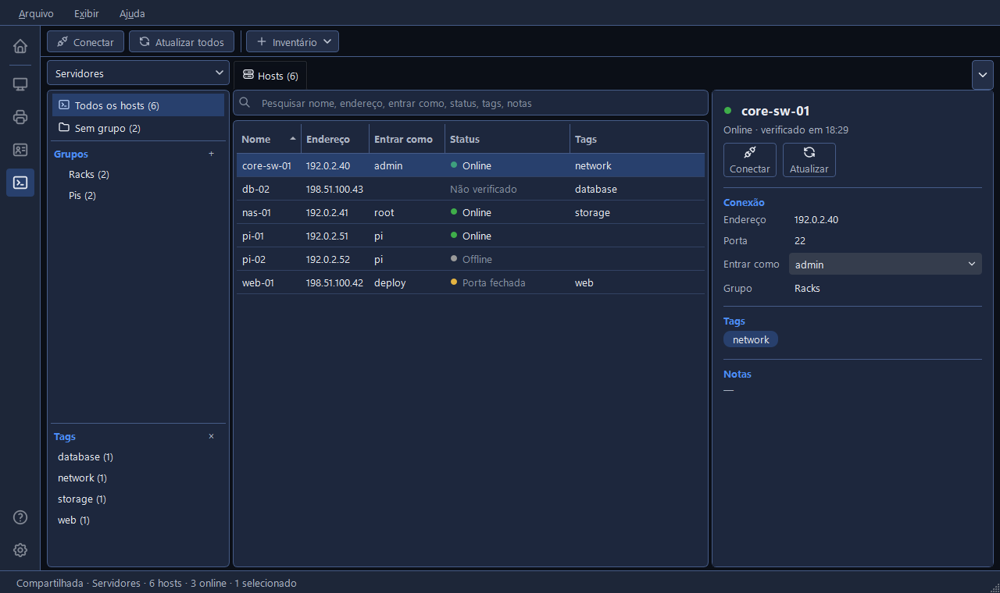
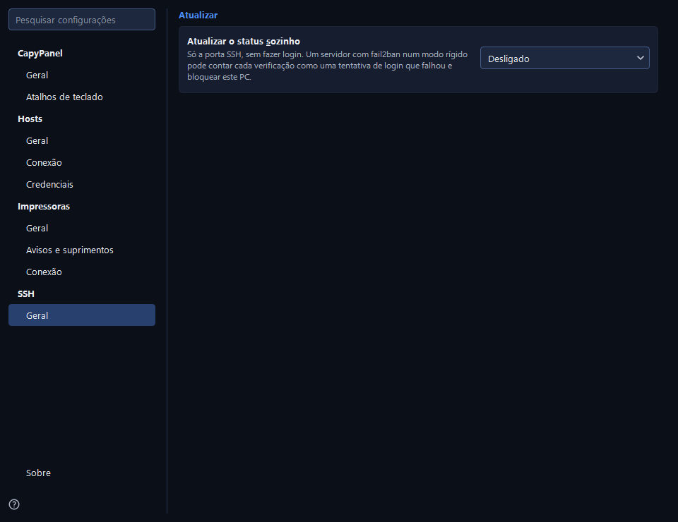
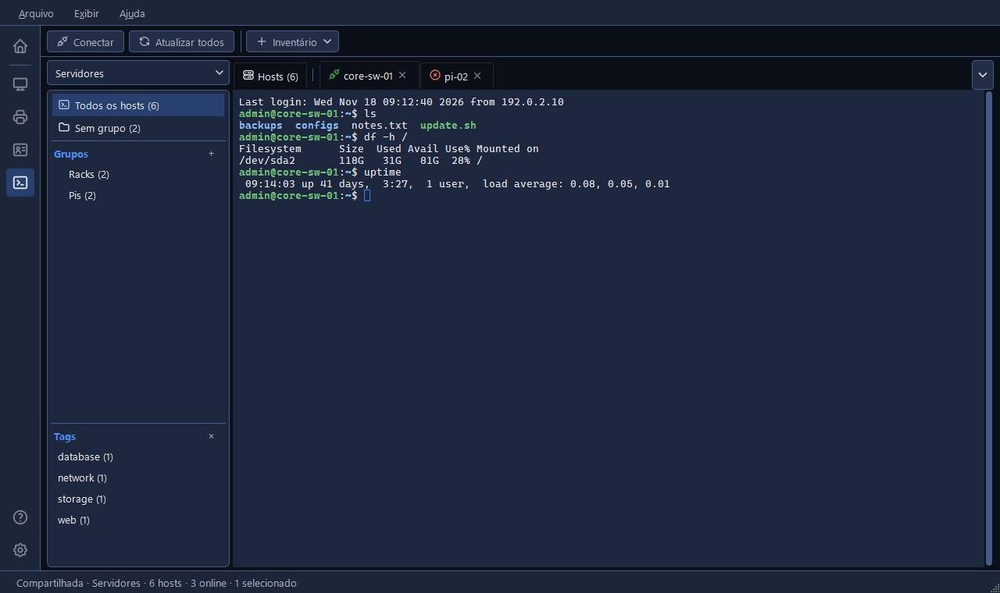
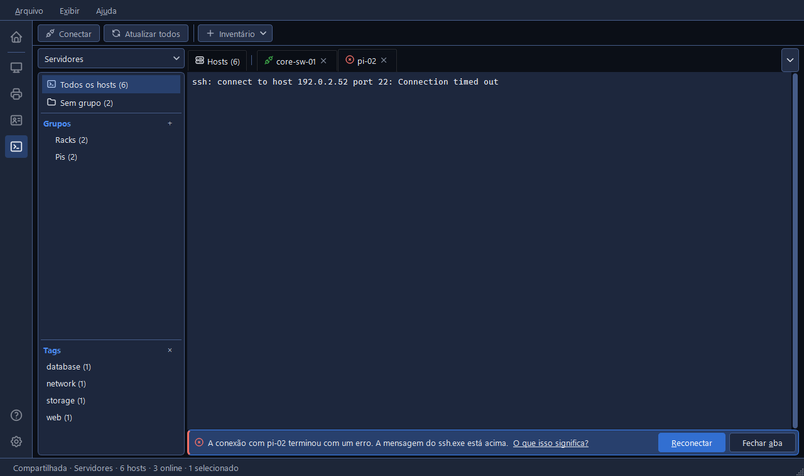

# A ferramenta SSH

O SSH guarda os servidores, switches e outros aparelhos que você acessa por SSH, mostra quais
respondem e abre um terminal em qualquer um deles, numa aba ao lado da lista. Abra-o pelo bloco
**SSH** da página inicial, pelo ícone de terminal na barra lateral ou com **Ctrl+4**. Na primeira
vez que ele abre, um guia mostra as partes dele num host de exemplo; o **Ajuda > Guia desta tela**
mostra o guia de novo.



Toda conexão usa o próprio cliente SSH do Windows, o ssh.exe. Ele pede a senha ou usa a sua chave,
e confere a identidade de cada servidor, então o CapyPanel não guarda nenhuma senha de SSH nem
chave de servidor. No terminal do CapyPanel, cada tecla que você digita passa pelo CapyPanel a
caminho do ssh.exe, e nenhuma fica guardada.

O SSH mostra a lista de hosts aberta no Hosts, as mesmas listas que a Limpeza de perfis mostra. Um
host que você adiciona aqui já aparece no Hosts, e vice-versa.

## Adicionar um host <a id="ssh-add-a-host"></a>

1. **Inventário > Adicionar host…** (Ctrl+N).
2. Digite um **Nome** e o **Endereço**, um endereço IP ou um nome na rede.
3. Preencha **Porta** e **Entrar como** se precisar. Sem eles, o ssh.exe usa a porta 22 e as
   configurações dele.
4. Clique em **Adicionar**.

Grupos, tags, **Mover para ▸**, **Tags ▸** e encontrar um host funcionam como no Hosts: veja
[Listas de hosts](../hosts/host-lists.pt-BR.md). Para trazer muitos hosts de uma vez, use o
**Importar hosts…** da ferramenta Hosts; eles aparecem aqui também, na porta 22.

??? note "Mais sobre adicionar hosts"

    - O **Editar selecionado…** (F2) abre a mesma janela para um host que já está na lista, com
      **Salvar**.
    - Um endereço não pode ter espaço nem começar com "-", e não pode ter crase nem nenhum destes:

        ```
        " $ & ' ( ) , ; < > \ { | }
        ```

      O **Entrar como** segue as mesmas regras, só que aceita `$`, `,` e `\`. O próprio ssh.exe do
      Windows recusa esses caracteres, e um mais antigo poderia repassá-los a um programa.
      `DOMINIO\usuario`, `usuario@dominio` e um nome que termina em `$` funcionam.
    - A **Porta** também é uma coluna da tabela, oculta até você mostrá-la com o botão direito nos
      títulos das colunas. O painel de detalhes sempre mostra a porta.
    - Uma lista em que não dá para gravar ainda pode ser verificada e usada para conectar; só a
      edição fica desligada.

## Escolher com que nome entrar <a id="ssh-choose-the-name-to-log-in-as"></a>

O **Entrar como** é a conta com que o ssh.exe entra no servidor. Vazio, quem decide é o ssh.exe:
primeiro a sua config do SSH, depois o seu usuário do Windows.


1. Selecione um host. No painel de detalhes, clique em **Entrar como**.
2. Escolha um nome que a lista já usa, ou **Outro nome…** para digitar um.

Um grupo inteiro também pode ter um nome: botão direito no grupo, depois **Entrar como**. "Os
hosts de “{group}” sem um nome próprio entram com este." O nome próprio de um host vale mais que o
do grupo, e um grupo sem nome usa o do grupo mais próximo acima dele que tenha um.

??? note "Mais sobre o Entrar como"

    - A primeira opção segue o grupo, como em "Do grupo “Racks”: admin", ou "Nenhum: config do SSH
      ou seu usuário do Windows" quando nenhum grupo dá um nome. Um alfinete ao lado do nome quer
      dizer que o host tem um nome próprio.
    - Com vários hosts selecionados, o menu do botão direito também tem **Entrar como ▸**. Quando
      os grupos deles dão nomes diferentes, a primeira opção diz "Do grupo de cada um".
    - A coluna **Entrar como** da tabela mostra o nome com que cada host entra, inclusive o que vem
      do grupo.
    - O nome fica no arquivo da lista de hosts, junto do host ou do grupo.

## Ver quais hosts respondem <a id="ssh-check-which-hosts-answer"></a>

Clique em **Atualizar todos** na barra de ferramentas (F5). O CapyPanel verifica a porta SSH de
todos os hosts exibidos, oito de cada vez, e não faz login em nada.

| Status | O que significa |
|---|---|
| **Online** | A porta SSH aceitou a conexão |
| **Porta fechada** | O host respondeu, mas nada escuta nessa porta: o ssh.exe falharia com "Connection refused" |
| **Offline** | Nada respondeu |
| **Host não encontrado** | O nome ou endereço não existe |
| **Não verificado** (cinza) | Ninguém atualizou ainda |

Pare o mouse sobre um status para ver quando foi verificado e qual endereço respondeu. Para
verificar menos hosts, clique com o botão direito num host para **Atualizar host** (ou **Atualizar
{n} hosts**), ou num grupo para **Atualizar grupo**, que verifica os subgrupos também.

??? note "Configurações › SSH › Geral"

    

    O **Atualizar o status sozinho** verifica os hosts exibidos **a cada minuto**, a cada **5**,
    **15** ou **30 minutos**, ou num intervalo **Personalizado…**. Começa **Desligado** e diz por
    que pode continuar assim: "Só a porta SSH, sem fazer login. Um servidor com fail2ban num modo
    rígido pode contar cada verificação como uma tentativa de login que falhou e bloquear este
    PC."

## Conectar <a id="ssh-connect"></a>

1. Selecione um host, ou vários.
2. Clique em **Conectar** na barra de ferramentas, dê dois cliques no host ou pressione **Enter**.
3. Uma aba abre ao lado da lista, com o nome do host, e o ssh.exe conecta nela. Uma segunda
   conexão ao mesmo host é "srv-01 (2)".
4. Na primeira vez que você acessa um servidor, o ssh.exe pergunta, em inglês: "Are you sure you
   want to continue connecting (yes/no/[fingerprint])?" Digite **yes**, em inglês, e pressione
   **Enter**.
5. Digite a senha se ele pedir. Nada aparece enquanto você digita.



Para conectar a um servidor que não está na lista, digite o nome ou endereço dele na caixa de
pesquisa. Enquanto nenhum host da lista for ele, a tabela oferece **Conectar a {host}**, que usa a
porta 22 e as configurações do próprio ssh.exe.

??? note "Mais sobre conectar"

    - Na pergunta da chave do host, só **yes** (em maiúsculas ou minúsculas) ou a impressão digital
      do servidor aceitam. "y" ou "sim" fazem o ssh.exe perguntar de novo, e **Enter** sozinho
      responde não, o que encerra a conexão com "Host key verification failed."
    - O CapyPanel conecta no máximo dez hosts de uma vez: "Só os 10 primeiros conectam de uma vez."
    - O ssh.exe lê a sua própria config do SSH (`%USERPROFILE%\.ssh\config`) e as suas chaves,
      então uma chave, um host de salto ou um algoritmo mais antigo funcionam como em qualquer
      terminal (veja
      [Aparelhos antigos e a sua config do SSH](#aparelhos-antigos-e-a-sua-config-do-ssh)).
    - O CapyPanel conecta só por SSH, não por Telnet nem por cabo serial.

## Trabalhar no terminal <a id="ssh-work-in-the-terminal"></a>

Toda tecla que você digita vai para o servidor, menos estas:

| Tecla | O que faz |
|---|---|
| **Ctrl+C** | Copia o texto que você selecionou; sem nada selecionado, vai para o servidor e para o programa em execução |
| **Ctrl+Shift+C** / **Ctrl+Shift+V** | Copiar / colar |
| **Ctrl+=** / **Ctrl+-** | Texto maior / menor |
| **Ctrl+Tab** / **Ctrl+Shift+Tab** | A próxima aba / a anterior, inclusive a aba Hosts: o jeito de sair de um terminal |
| **Ctrl+Shift+W** | Fechar a aba |
| **Ctrl+0** a **Ctrl+4**, **Ctrl+,** | A página inicial, as ferramentas e as Configurações, com as teclas que o **Atalhos de teclado** dá a eles |

Então F1, Esc, F5, Ctrl+F e o Ctrl+Q do Sair vão para o servidor enquanto um terminal tem o
teclado. Na aba Hosts toda tecla funciona como sempre, e escolher um grupo, uma tag ou uma lista à
esquerda, ou o **Ctrl+F**, traz essa aba para a frente.

Selecione texto com o mouse para copiá-lo. O botão direito abre **Copiar**, **Colar**,
**Selecionar tudo** e **Limpar histórico de rolagem**; ele nunca cola sozinho.

??? note "Mais sobre o terminal"

    - Colar um texto com mais de uma linha pergunta antes, como em "Colar 4 linhas em srv-01?" e
      "Cada linha pode ser executada como um comando.", mostrando as três primeiras linhas. O
      **Cancelar** é o padrão. Não pergunta quando o programa no servidor pediu que o texto colado
      espere o Enter, como fazem as versões recentes do bash.
    - O terminal usa as cores do tema. Um par de cores de um programa que ficaria difícil de ler é
      trocado por um que se lê. O texto é Cascadia Mono, ou Consolas onde o Cascadia Mono não
      estiver instalado; os caracteres de linha, de bloco e do Powerline são desenhados pelo
      CapyPanel, então as caixas se juntam sem falhas.
    - O tamanho do texto é um só para todas as abas, e fica guardado para a próxima vez.
    - Uma linha longa demais para a aba continua na fileira seguinte, e é copiada como uma linha
      só, então é colada inteira.
    - Cada aba guarda as últimas 10.000 linhas. Nada do que você digita, cola ou vê vai para o log
      ou é salvo, e nada de uma conexão sobrevive ao CapyPanel além do tamanho do texto.

??? note "O que o terminal ainda não faz"

    - O mouse só seleciona texto. Programas como o mc e o htop não recebem cliques: use as teclas
      deles.
    - Os links na saída não são clicáveis. Selecione um e copie.
    - Não há pesquisa no histórico de rolagem. Botão direito > **Selecionar tudo**, copie e
      pesquise num editor de texto. O histórico também não pode ser salvo num arquivo; copie do
      mesmo jeito.
    - O histórico de rolagem guarda as últimas 10.000 linhas, e isso não é uma configuração.
    - As linhas já exibidas não se reorganizam quando a aba muda de largura, então uma aba mais
      estreita corta o fim delas na borda direita.
    - O sinal sonoro não faz som nem mostra nada.
    - O cursor é sempre um bloco, mesmo quando um programa pede uma barra, como o vim enquanto você
      digita.
    - O tamanho do texto muda com Ctrl+= e Ctrl+-, não nas Configurações.
    - Leitores de tela não leem o terminal, e os temas de contraste do Windows não mudam a
      aparência dele.

    Para qualquer um desses, o [Conectar numa janela separada](#conectar-numa-janela-separada) abre
    o host no terminal do próprio Windows.

## Quando uma conexão termina <a id="ssh-when-a-connection-ends"></a>

A aba fica, com a última tela, para você ler como terminou. Uma faixa no pé dela diz isso e oferece
**Reconectar** (o padrão: o **Enter** também reconecta) e **Fechar aba**.



| A faixa | Quando |
|---|---|
| "A conexão com {host} terminou." em cinza | O servidor fechou a conexão, ou você digitou `exit`. O código de saída de um programa conta como um fim normal |
| "A conexão com {host} terminou com um erro. A mensagem do ssh.exe está acima." em vermelho, com um X | O ssh.exe não conseguiu conectar, ou perdeu a conexão |
| "A conexão com {host} terminou com um erro (código de saída 0xC0000005)." | O ssh.exe parou com um código de erro do próprio Windows e não escreveu nada |

??? note "Fechar abas"

    - O **Ctrl+Shift+W**, o **×** da aba ou o **Fechar aba** fecham a aba. Uma aba ainda conectada
      pergunta antes, "Fechar a conexão com {host}?", com "O que ainda estiver rodando nela no
      servidor pode parar."
    - Clique com o botão direito numa aba para **Reconectar**, **Fechar**, **Fechar as outras** e
      **Fechar as que terminaram**. Fechar várias conexões abertas pergunta uma vez só.
    - A marca de cada aba diz como ela está: **Conexão aberta**, **Terminou com um erro** ou
      **Terminou**.
    - Sair do CapyPanel com conexões abertas pergunta uma vez, como em "Sair do CapyPanel com 2
      conexões abertas?" e "Todas são fechadas, e o que ainda estiver rodando nelas nos servidores
      pode parar."

## Conectar numa janela separada <a id="ssh-connect-in-a-separate-window"></a>

Clique com o botão direito num host e escolha **Conectar numa janela separada**. Ele "Abre o
ssh.exe numa janela própria, fora do CapyPanel": ali as suas teclas nunca passam pelo CapyPanel, e
a janela faz tudo o que o console do Windows faz.

Se o ssh.exe terminar com um erro, a janela fica aberta para você ler o motivo; pressione qualquer
tecla para fechá-la. Embaixo da mensagem do ssh.exe ela diz "A conexão com {host} terminou com um
erro. A mensagem do ssh.exe está acima." e "Pressione qualquer tecla para fechar esta janela." Uma
tecla pressionada no primeiro segundo depois dessas palavras é ignorada, para que um Enter a mais
não feche a janela antes da leitura. Depois de um fim normal ela fecha sozinha, e fechar a janela
encerra o ssh.exe.

Para instalar uma atualização, feche essas janelas antes (veja
[Atualizar o CapyPanel](../download.pt-BR.md#atualizar-o-capypanel)).

## Aparelhos antigos e a sua config do SSH <a id="ssh-old-devices-and-your-ssh-config"></a>

O ssh.exe lê a sua própria config do SSH, `%USERPROFILE%\.ssh\config`. É ali que fica o que um host
precisa além de um nome e uma porta: um arquivo de chave, um host de salto ou um algoritmo mais
antigo que o ssh.exe mais novo desliga. Um switch antigo que termina com "Unable to negotiate with
192.0.2.60 port 22: no matching host key type found. Their offer: ssh-rsa" conecta com isto:

```
Host 192.0.2.60
    HostKeyAlgorithms +ssh-rsa
    PubkeyAcceptedAlgorithms +ssh-rsa
```

A mesma mensagem com "key exchange method", "cipher" ou "MAC" pede `KexAlgorithms`, `Ciphers` ou
`MACs` com `+` e o nome que vem em "Their offer". As chaves ficam em `%USERPROFILE%\.ssh`, onde o
ssh.exe procura, ou no agente OpenSSH do Windows.

## A janela em detalhe <a id="ssh-the-window-in-detail"></a>

??? note "A janela, parte por parte"

    | Parte | O que mostra |
    |---|---|
    | **Barra de ferramentas** | **Conectar**, **Atualizar todos** e **Inventário** |
    | **Painel de grupos** (esquerda) | O nome da lista de hosts aberta no topo, como uma lista suspensa, depois "Todos os hosts", "Sem grupo", os grupos e as tags |
    | **Abas** (meio) | A aba **Hosts**, com a caixa de pesquisa acima dos hosts do grupo ou da tag que você escolheu, depois uma aba para cada conexão |
    | **Painel de detalhes** (direita) | O host selecionado, abaixo do nome e do status, com **Conectar** e **Atualizar**: **Conexão** (endereço, porta, Entrar como, grupo), **Tags** e **Notas**. Clique em qualquer valor para copiá-lo |
    | **Barra de status** | A lista aberta e as contagens dela, como no Hosts |

    O **Inventário** traz **Adicionar host…** (Ctrl+N), **Adicionar grupo…**, **Gerenciar
    grupos…** e **Classificar grupos de A a Z**. A lista suspensa troca de lista, cria uma com
    **Nova lista…** e abre o **Gerenciar listas de hosts…** nas Configurações, como no Hosts.

??? note "A tabela e os menus dela"

    - As colunas são **Nome**, **Endereço**, **Entrar como**, **Status** e **Tags**, com a
      **Porta** oculta até você mostrá-la. A pesquisa cobre as colunas exibidas e as notas.
    - O menu do botão direito de um host traz **Conectar** em negrito (o que os dois cliques
      fazem), **Conectar numa janela separada**, **Atualizar host**, **Entrar como ▸**, **Copiar
      ▸**, **Editar selecionado…** para um host, **Mover para ▸**, **Tags ▸** e **Remover**. O
      **Copiar ▸ Endereço** fica com o Ctrl+Shift+C.
    - O menu de um grupo acrescenta **Entrar como ▸** e **Atualizar grupo**.
    - O **Exibir > Personalizar o painel de detalhes…**, ou o botão direito no painel, oculta
      Conexão "Endereço, porta, Entrar como, grupo", Tags ou Notas. "Sempre aparecem: o nome do
      host e o status."

## Mensagens que você pode ver <a id="ssh-messages-you-may-see"></a>

As mensagens do próprio CapyPanel:

| Mensagem | O que significa | O que fazer |
|---|---|---|
| <a id="ssh-not-installed"></a>"O cliente SSH do Windows (ssh.exe) não está instalado neste PC. Para adicioná-lo, pesquise “Recursos opcionais” no Iniciar e adicione “Cliente OpenSSH”. Adicionar exige um administrador." | O cliente SSH é uma parte opcional do Windows, e este PC não tem | Adicione o **Cliente OpenSSH** em **Recursos opcionais**, ou peça a quem administra o PC |
| <a id="ssh-bad-address"></a>"Não é possível conectar a “{host}”: o endereço ou o campo Entrar como tem um espaço, começa com “-” ou tem um caractere como ; & \| ou aspas." | A lista tem um endereço ou nome que o ssh.exe não pode receber | Corrija com o **Editar selecionado…** |
| <a id="ssh-connect-limit"></a>"Só os 10 primeiros conectam de uma vez." | Mais de dez hosts estavam selecionados | Conecte o resto numa segunda vez |
| <a id="ssh-no-address-skipped"></a>"2 hosts não têm endereço e foram ignorados." | Esses hosts só têm um nome | Acrescente o endereço deles |
| <a id="ssh-port-closed"></a>**Porta fechada** | O host está ligado, mas o servidor SSH dele está desligado ou escuta em outra porta | Confira a porta, ou ligue o serviço SSH do servidor |

As mensagens do ssh.exe vêm em inglês, como ele escreve, porque é isso que você pesquisaria:

| Mensagem | O que significa | O que fazer |
|---|---|---|
| <a id="sshexe-unknown-host-key"></a>"The authenticity of host … can't be established." e "Are you sure you want to continue connecting (yes/no/[fingerprint])?" | A primeira conexão a esse servidor | Digite **yes**, em inglês, e pressione **Enter**. Para ter certeza de que é o servidor certo, compare a impressão digital com a que o administrador dele passar |
| <a id="sshexe-host-key-added"></a>"Warning: Permanently added … to the list of known hosts." | O ssh.exe guardou a chave do servidor depois do seu yes | Nada: é normal |
| <a id="sshexe-password-denied"></a>"Permission denied, please try again." | Senha errada | Digite de novo; o ssh.exe dá três tentativas |
| <a id="sshexe-login-denied"></a>"Permission denied (publickey,password)." | O servidor recusou todas as formas de login | Confira o **Entrar como** e a senha ou a chave |
| <a id="sshexe-host-key-changed"></a>"WARNING: REMOTE HOST IDENTIFICATION HAS CHANGED!" e depois "Host key verification failed." | A chave do servidor não é a que o ssh.exe guardou: o servidor foi reinstalado, ou não é a mesma máquina | Confirme antes com quem cuida do servidor. Se a mudança era esperada, a linha "Offending … key in …:3" diz o arquivo e a linha da chave antiga; apague-a com `ssh-keygen -R` e o nome ou endereço do host, e conecte de novo |
| <a id="sshexe-connection-refused"></a>"ssh: connect to host … port 22: Connection refused" | O host respondeu, mas nada escuta nessa porta | Como em **Porta fechada**, acima |
| <a id="sshexe-connection-timed-out"></a>"ssh: connect to host … port 22: Connection timed out" | Nada respondeu | Confira se o host está ligado e acessível |
| <a id="sshexe-hostname-unresolved"></a>"ssh: Could not resolve hostname …" | O nome não é conhecido | Confira a grafia, ou use o endereço IP |
| <a id="sshexe-no-matching-host-key"></a>"Unable to negotiate with … no matching host key type found. Their offer: …" | Um aparelho antigo que só oferece o que o ssh.exe mais novo desliga | Veja [Aparelhos antigos e a sua config do SSH](#aparelhos-antigos-e-a-sua-config-do-ssh) |
| <a id="sshexe-connection-closed"></a>"Connection closed by …" ou "Connection reset by …" | O servidor ou a rede encerrou a conexão | **Reconectar** |
